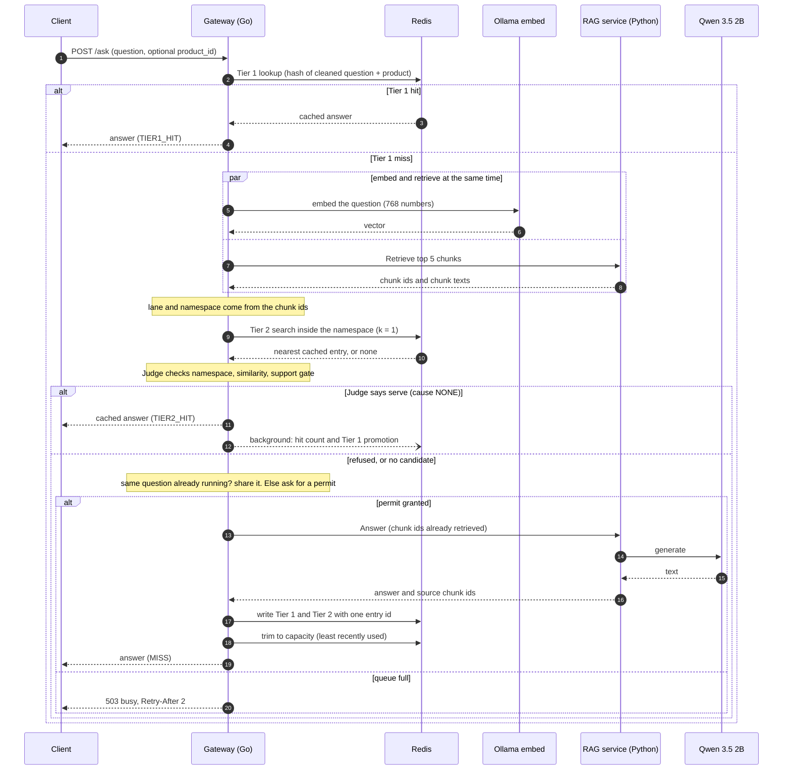
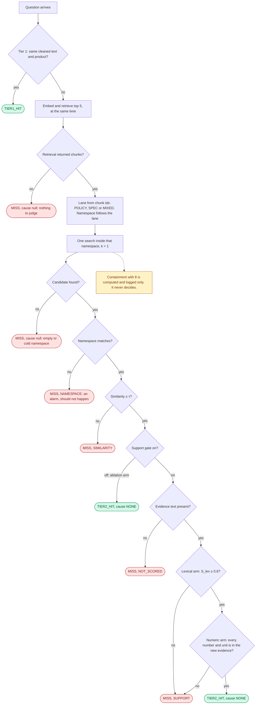
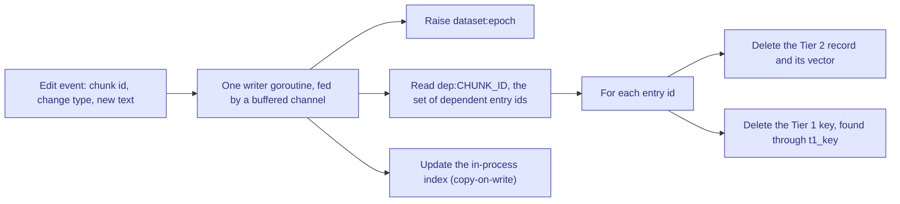
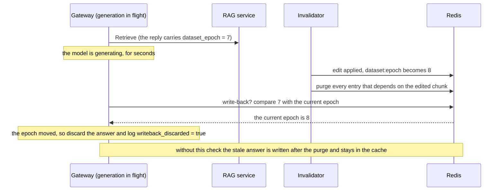
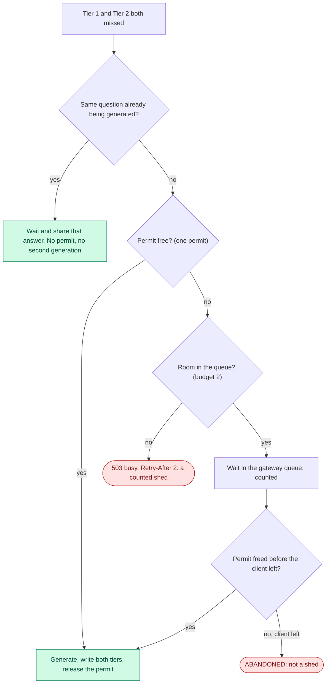

# Progress report — 16 Oct 2026

**Where we are.** Phase 1 and Phase 2 are done. Phase 3 (corpus and workload) starts now. Five phases of work are left (3 to 7), then the write-up (8). The thesis is due 13 Dec.

**What works today.** A Go gateway with two cache tiers, a reuse rule computed in Go, a support gate, admission control, and one log record per request. The Python RAG service and the local model (Qwen 3.5 2B, via Ollama) run behind it. Section 1.5 shows it running.

**What does not exist yet.** The real corpus, the workload, invalidation, the judge, configuration selection (only the full rule runs today), and every measured result.

> **Read every number in this file as "it works", not as "a result".** All runs so far use `dev-v0`, a small throwaway test corpus (44 documents). `dev-v0` can never be cited in the thesis. Latencies come from `make dev`, a functional run. Nothing here is a measurement.

Contents: 1. What is built · 2. The remaining phases · 3. The dataset and the corpus · 4. Admission control · 5. Why only Redis, with no database server · Questions for the supervisor

---

## 1. What is built: Tier 1 and Tier 2

### 1.1 Why two tiers

A cache hit is a memory lookup. A miss is a model generation, and it takes seconds. The cache turns the second into the first.

- **Tier 1** catches exact repeats. It is one hash lookup and needs no embedding.
- **Tier 2** catches paraphrases. It needs a vector search, and it needs a rule that says when reuse is safe.

The danger is a *false hit*: two questions that look alike but need different answers. "How long do I have to return it?" and "How long is the warranty?" are close in meaning space and have different answers. The rule exists to stop that.

### 1.2 The request sequence

Diagram A shows one request. It has three possible endings: a Tier-1 hit, a Tier-2 hit, or a miss that generates.



Three things to notice:

- **Embed and retrieve run in parallel.** A Tier-2 hit costs the slower of the two, not the sum.
- **The lane and the namespace are read from the retrieval, never from the query text.** A classifier on the query could be wrong, and that error would count as a reuse-rule error. So there is no classifier.
- **A miss writes both tiers with one `entry_id`.** The purge in Phase 4 needs this to find both copies.

### 1.3 The rule, as a workflow

Diagram B is the decision for one request. The order of the checks is fixed in code (`reuse/cause.go`). The first check that fails gives the refusal cause.



Words used in the diagram:

- **Lane.** The kind of question, read from the chunks that retrieval returned. If all chunks are `product-` documents, it is SPEC. If all are `policy-`, it is POLICY. A mix gives MIXED. The MIXED lane is switched off for now.
- **Namespace.** The cache partition. POLICY uses the top-ranked policy document. SPEC uses the product id. An entry can only be reused inside its own namespace.
- **τ (tau).** The similarity threshold. It is swept in Phase 6, never set by hand. The demo uses 0.85.

### 1.4 The rule in each tier

| | Tier 1 | Tier 2 |
| :--- | :--- | :--- |
| What it matches | The same text after cleaning, for the same product | A similar question, by vector search |
| Cost of a hit in the demo | One lookup, about 0.3 ms | About 50 ms (embed and retrieve in parallel, then one search) |
| Rule | None. Equal or not equal | Namespace equal ∧ similarity ≥ τ ∧ support gate |
| Why it is safe | A corpus check (G3): no two queries with different answers share a cleaned text | The rule itself, in Go. No model runs on the hit path |

Cleaning means: lowercase, collapse spaces, remove punctuation and symbols. The Tier-1 key is a hash of the cleaned text and the product id.

**What the code serves today.** Tier 2 serves on three conditions: namespace, similarity, support gate. Containment (the overlap between the chunks retrieved now and the chunks behind the cached entry, with a threshold θ) is computed and logged on every candidate. It is the baseline we compare against. It does not decide. The proposal lists containment as a condition, so the code and the proposal differ. This is an **open finding (F-K), not a decision**: no ADR records it and it has no owner yet. Section 1.4.1 shows why the namespace works where containment fails. Question 2 at the end asks which of the two should be the claim.

**The support gate** asks: is the cached answer supported by the evidence retrieved *now*? It has two arms:

- **Lexical arm.** The share of the answer's content words that appear in the new evidence. It must be at least `τ_s = 0.6`. This value is taken from prior work and is never swept. Stop-words and words under three letters are ignored.
- **Numeric arm.** Every number with its unit in the cached answer must appear in the new evidence. If a number cannot be read, the gate refuses (fail-closed).

The gate reads the cached answer and the new evidence. It never reads the question.

**Every Tier-2 decision logs one cause:**

| Cause | Meaning |
| :--- | :--- |
| `NONE` | Served |
| `NAMESPACE` | The namespace check refused. This is an alarm, because the search already filters by namespace |
| `SIMILARITY` | The nearest entry is below τ |
| `SUPPORT` | The support gate refused (lexical or numeric) |
| `NOT_SCORED` | The gate could not run (the RAG service sent chunk ids with no text). Refused, and the run is not valid |
| `null` | No candidate was judged (cold namespace, or no chunks) |

`CONTAINMENT` is in the list of allowed values but is never written, because θ does not decide.

**The gate can be switched off per run** (`SUPPORT_GATE=on|off`, default on). Every record names its arm. Reason: configuration 4 of the study is two arms, gate on and gate off, so the gate's own contribution can be measured. The switch is tested offline. The off arm was not run live for this report.

#### 1.4.1 Why the namespace exists: one measured example

On `dev-v0`, 2026-09-06, same product, same cached entry:

| Question | Similarity | Containment | Right answer |
| :--- | :--- | :--- | :--- |
| Paraphrase of the return question | 0.9382 | 0.80 | Reuse |
| The warranty question | 0.9208 | 0.80 | Do not reuse |

Both have the same containment, and both are above any sensible τ. No θ can separate them. The top-ranked policy *document* differs, so the namespace separates them. This is pinned in a test (`TestNoThetaSeparatesTheMeasuredPair`). Through the real `/ask` path, the warranty question never finds a candidate. The namespace search refuses it first, so it is a MISS with cause `null` (ADR-009).

#### 1.4.2 What the real-answer sample showed

On 14 Oct we checked the gate against answers the system really generated (`dev-v0`, 27 answers, temperature 1, memory pressure 1 to 2, **not citable**):

- 0 of 5 real paraphrases were refused. The upper 95 % bound is 43 % (n is small).
- 2 of 21 answers (9.5 %) scored below 0.6, although each was generated from the same evidence it was checked against.
- The numeric arm refused 0 of 21.
- The word "context" in an answer lowers the score (mean 0.60 with the word, 0.85 without).

Nothing was tuned. Whether to change the lexical score belongs to the pre-registration in item 6.1.

### 1.5 Demo: both tiers working now

The demo asks four fixed questions against a cold cache. It already exists in the repository.

```
make demo-reset     # stop the gateway first. Flushes both tiers, re-ingests dev-v0
make dev            # terminal 1: Redis check, RAG service, gateway on :8080
make demo           # terminal 2: the four steps, under a minute
```

What each step proves:

1. **Fresh question.** Nothing is cached, so the model generates. This is the cost every uncached system pays.
2. **Exact repeat.** Tier 1 answers from a hash lookup.
3. **Paraphrase.** Tier 2 finds the entry. The namespace matches, the similarity is high, and the gate checks the cached answer against the new evidence.
4. **The trap.** The same wording about a sofa instead of headphones. The similarity is high, but retrieval grounds it in other documents, so its namespace differs and nothing is reused.

**Conditions.** Run on 15 Oct 2026. `make dev`, `dev-v0`, gate on, evaluation log off. τ = 0.85 and θ = 0.60 are demo values. Memory pressure was level 1 at the start of run 1 and level 2 at the start of run 2 (models loaded). **Latencies are not citable.** The demo was run twice, from a cold cache each time, and both runs are shown.

| Step | Run 1 | Run 2 |
| :--- | :--- | :--- |
| 1. Fresh question | MISS, 9449 ms | MISS, 3001 ms |
| 2. Exact repeat | TIER1_HIT, 0 ms | TIER1_HIT, 0 ms |
| 3. Paraphrase | **MISS**, 3757 ms, cause `SUPPORT` | **TIER2_HIT**, 52 ms |
| 4. The trap | MISS, 3758 ms, no candidate | MISS, 3442 ms, no candidate |

Run 1's first request was slower, most likely because the model had to load (not checked).

**Step 3 differed between the two runs, and the reason is in the gateway log.** In both runs step 3 retrieved the same five chunks as the cached entry (overlap 1.00), and the similarity was 0.9750. The only difference is the cached answer, which the model writes differently each time:

```
run 1:  sim=0.9750  overlap=1.00  cause=SUPPORT  gate=on  lex=0.4394 (of 66 content words)  numeric_ok=true
run 2:  sim=0.9750  overlap=1.00  cause=NONE     gate=on  lex=0.8800 (of 25 content words)  numeric_ok=true
```

In run 1 the cached answer was long (66 content words) and only 44 % of them were in the evidence, so the gate refused a safe paraphrase. In run 2 the answer was short and 88 % were supported, so Tier 2 served it in 52 ms, about 60 times faster than a generation. This matches the sample in 1.4.2. Two runs are not a rate. They show that the gate is strict and that the verdict depends on how the cached answer happens to be worded.

Full output of run 2 (colour codes removed):

```
  cold cache verified (t1:0 t2:0)  ·  tau=0.85 theta=0.60 — DEMO values, swept later
  latencies here are NOT citable (dev-v0, make dev)

── Step 1 · fresh question — the cost every uncached system pays
    Q: Am I entitled to a full refund on my headphones 30 days after delivery?
    MISS  ·  3001 ms  ·  similarity —  ·  source_overlap —

── Step 2 · exact repeat — Tier 1
    Q: Am I entitled to a full refund on my headphones 30 days after delivery?
    TIER1_HIT  ·  0 ms  ·  similarity —  ·  source_overlap —

── Step 3 · paraphrase — Tier 2, different words, same evidence
    Q: Is a full refund possible for my headphones 30 days after delivery?
    TIER2_HIT  ·  52 ms  ·  similarity 0.9750  ·  source_overlap 1.00

── Step 4 · the trap — high similarity, different evidence
    Q: Am I entitled to a full refund on my sofa 30 days after delivery?
    MISS  ·  3442 ms  ·  similarity —  ·  source_overlap —

    The refusal is arithmetic, not a model score — check it by eye:

    cached entry grounded in (headphones):
      ✓ policy-returns-electronics#chunk-0
      ✓ policy-returns-furniture#chunk-0
        policy-warranty#chunk-0
        product-headphones-03#chunk-0
        product-headphones-04#chunk-0

    retrieved now (sofa):
      ✓ policy-returns-furniture#chunk-0
      ✓ policy-returns-electronics#chunk-0
        policy-shipping#chunk-0
        product-furniture-04#chunk-0
        product-furniture-08#chunk-0

    no cached entry in the namespace this question resolves to  →  MISS, generate instead

── Counters
    requests 4  ·  hits 2  ·  hit rate 50%  ·  generations avoided 2
```

How to read step 4: both return policies are in both lists, but the top-ranked policy differs (electronics for headphones, furniture for the sofa). The namespace is built from the top-ranked policy document, so the two questions get different namespaces.

**Before the meeting.** Make sure Ollama and Redis are running and heavy apps are closed (`make dev` refuses under 25 % free memory). Stop the gateway, run `make demo-reset`, then `make dev`, then `make demo`. A warm cache collapses the steps, so reset again if anything was asked since. If step 3 shows MISS, look in terminal 1 for the gateway log line with `cause=`. If it says `SUPPORT`, the gate did what it was built to do. It is the finding above.

**What the demo does not show:** invalidation (not built), shedding under load (needs a load run), and any capacity number.

**Known gap.** Since 9 Sep 2026 the Tier-1 key includes the product id (`cache/key.go`). The contract (`interfaces.md` §D) still says the key is a hash of the cleaned text alone, and the decision that reverses the old "rejected" entry has no ADR yet. It is owed.

### 1.6 Manual demo on the UI page: Tier 2, step by step

The scripted demo (1.5) asks four fixed questions. This one is done by hand in the browser. It shows
each thing Tier 2 does, one step at a time, with questions on one product page and on its neighbours.
Each step says what to type, what the page should show, and what the step proves.

**What was checked before writing this.** On 16 Oct I ran the retrieval and the embedding for every
question below, exactly as the gateway calls them, with the gateway stopped and without touching the
cache (exploratory, memory pressure 1, not citable). So the lane, the namespace and the similarity in
the tables are what the gateway will compute (the similarity may differ in the last digit). Two things
cannot be checked in advance:

- **The support gate's verdict.** The model writes a new answer each time, and the gate scores that
  answer. A step marked "TIER 2 HIT" can come out as MISS with cause `SUPPORT`, as in run 1 of 1.5.
- **Latencies.** A miss takes about 3 to 10 seconds, a Tier-2 hit about 50 ms.

#### Before you start

1. Close heavy apps. `sysctl kern.memorystatus_vm_pressure_level` should print `0` or `1`.
2. Stop the gateway if it runs, then `make demo-reset`. It empties both tiers and re-ingests `dev-v0`.
3. If `ui/dist/` is missing, run `make ui` once (Node is needed at build time only).
4. Terminal 1: `make dev`. Wait for the line `support_gate=on`. **Keep this terminal visible**: it
   shows the refusal cause, and the page does not.
5. Browser: open `http://localhost:8080`. Each product card opens a chat page, and every question on
   that page is sent with that product as `product_id`.

#### How to read the page and the terminal

- **Badge and time.** `TIER 1 HIT`, `TIER 2 HIT` or `MISS`, with the gateway's latency.
- **similarity.** The nearest stored question **inside this namespace**. `—` means the namespace had no
  entry, so nothing was judged.
- **source_overlap.** Containment, shown only when the similarity reached τ = 0.85. It is logged and never
  decides.
- **lane, namespace.** On a hit, the question's. On a MISS, those of the new entry just written (the same
  here). **rule** shows `namespace` on a Tier-2 hit and `—` otherwise.
- **grounded in N chunks.** The evidence behind the answer. A red "from another product" means a chunk of
  another product is in it.
- **Terminal 1.** For every judged candidate the gateway prints a `gateway: cascade lane=… ns=… sim=…`
  line, then `cause=… gate=on support=lex=… numeric_ok=…`. No `cascade` line means no candidate was
  found.

#### Part A — one product, the spec lane

Page: **EarBuds Pop 3** (`product-headphones-03`).

| # | Type this | Expect | What it proves |
| :--- | :--- | :--- | :--- |
| A1 | Which Bluetooth version do these earbuds use? | MISS. similarity `—`. lane SPEC, namespace `product-headphones-03` | Cold cache: the model runs. The entry is stored under this product |
| A2 | Which Bluetooth version do these earbuds use? | TIER 1 HIT, about 0 ms | An exact repeat is one hash lookup |
| A3 | which bluetooth version do these earbuds use | TIER 1 HIT | Tier 1 cleans the text first: capital letters and the question mark do not matter |
| A4 | What version of Bluetooth do these earbuds have? | TIER 2 HIT. similarity ≈ 0.9687, overlap 1.0000, rule `namespace` | A paraphrase: same meaning, same namespace, and the answer is supported by the new evidence |
| A5 | What version of Bluetooth do these earbuds have? | TIER 1 HIT | Promotion: the Tier-2 hit in A4 wrote a Tier-1 copy for these exact words |
| A6 | What is the battery life of these earbuds? | MISS. similarity ≈ 0.72, overlap `—`. Terminal: `cause=SIMILARITY` | Same product, different question: the nearest entry (A1) is below τ, so it is not reused |
| A7 | What battery life do these earbuds have? | TIER 2 HIT, similarity ≈ 0.9909 | A second paraphrase, reusing A6's entry |

**If A4 or A7 shows MISS.** Look at the page first: a similarity above 0.85 with an overlap shown means
the candidate passed the namespace and τ, so the support gate refused it. Terminal 1 then says
`cause=SUPPORT` and gives the lexical score. Short answers ("Bluetooth 5.3") pass. Chatty answers ("as
listed in the context …") can fail. That is the finding of 1.4.2, not a fault. For another try, use
"What is the weight of these earbuds?" and then "How much do these earbuds weigh?" (similarity 0.9656).

#### Part B — the same words on another product

Page: **EarBuds Pop 3 Pro** (`product-headphones-04`).

| # | Type this | Expect | What it proves |
| :--- | :--- | :--- | :--- |
| B1 | What is the battery life of these earbuds? | MISS. similarity `—`. namespace `product-headphones-04` | The text is the same as A6, so its similarity to A6 is 1.0000. A similarity-only cache would serve the Pop 3's "6 hours" for a product that has 8 hours. Tier 1 misses because its key includes the product. Tier 2 misses because the Pop 3's entry is in another namespace, so it is never even a candidate |

#### Part C — the policy lane

| # | Page | Type this | Expect | What it proves |
| :--- | :--- | :--- | :--- | :--- |
| C1 | EarBuds Pop 3 | Can I return these headphones after 30 days? | MISS. lane POLICY, namespace `policy-returns-electronics` | A policy question: its namespace is the top-ranked policy document, not the product |
| C2 | EarBuds Pop 3 | Can I still return these headphones 30 days after delivery? | TIER 2 HIT, similarity ≈ 0.95 | A policy paraphrase is reused |
| C3 | SoundMax ANC Pro (`product-headphones-01`) | Can I return these headphones after 30 days? | TIER 2 HIT, similarity 1.0000. The sources show "1 from another product" | One policy answer serves every product the policy covers. Tier 1 misses (other product), Tier 2 hits. The red mark is expected: the answer was written on the Pop 3 page, and it is grounded in the return policy |
| C4 | EarBuds Pop 3 | How long is the warranty on these headphones? | MISS. similarity `—`. namespace `policy-warranty` | Return or warranty (the pair of 1.4.1), live: the top policy differs, so the return answer is never a candidate |
| C5 | UltraBook Pro 14 (`product-laptops-01`) | How long is the warranty on this laptop? | MISS. similarity ≈ 0.82, overlap `—`. Terminal: `cause=SIMILARITY` | Same namespace as C4 (one warranty document covers every category), but below τ, so the headphones' 1-year answer is not given for a laptop (2 years) |
| C6 | EarBuds Pop 3 | How long is the warranty on these? | TIER 2 HIT, similarity ≈ 0.91 | A paraphrase in the warranty namespace. Its nearest entry is C4 (0.91), not the laptop entry of C5 (0.85) |
| C7 | Lounge Sofa 3-Seat Grey (`product-furniture-04`) | Can I return this sofa after 30 days? | MISS. similarity `—`. namespace `policy-returns-furniture` | The sofa trap: the electronics answer (30 days) is not reused for furniture (14 days and a 15 % fee) |

Keep the order: C5 must come before C6. The same "if it shows MISS" rule as in Part A applies to C2, C3
and C6.

**Counters at the end of Parts A to C**, if every expected hit happens: 15 requests, 3 Tier-1 hits,
5 Tier-2 hits, 7 misses, 7 model runs, 8 generations avoided, hit rate 53.3 %. Each gate refusal moves
one request from Tier 2 to miss.

#### Part D — two weak points (optional, after a new reset)

The 16 Oct check found cases where Tier 2 can serve a **wrong** answer from the UI (D2, D4), or where
only the gate stands in the way (D6). They are real limits, not demo faults. Show them only if you want to discuss limits. Stop the gateway,
`make demo-reset`, `make dev`, then:

| # | Page | Type this | What you may see | Why |
| :--- | :--- | :--- | :--- | :--- |
| D1 | EarBuds Pop 3 | How long is the warranty on these? | MISS, namespace `policy-warranty` | Stores the headphones' answer (1 year) |
| D2 | UltraBook Pro 14 | How long is the warranty on this? | Similarity ≈ 0.94, same namespace. **TIER 2 HIT** if the gate passes: the laptop is told 1 year, but its warranty is 2 years | **Same evidence, different condition.** The warranty policy is one document for every category, so both questions retrieve the same text, and that text contains "1-year". The gate checks the answer against the evidence and finds it supported. This is the residual the claim carries. Splitting each condition into its own document (G5) is the planned answer |
| D3 | EarBuds Pop 3 | Can I return these headphones after 30 days? | MISS, namespace `policy-returns-electronics` | Stores the electronics return answer |
| D4 | Lounge Sofa 3-Seat Grey | Can I return this after 30 days? | Namespace `policy-returns-electronics`, similarity ≈ 0.87. **TIER 2 HIT** if the gate passes: the sofa is told the electronics rule | **The policy namespace follows the question's words, not the product.** "this" does not say sofa, and "30 days" matches the electronics policy, so it ranks first. C7, which names the sofa, lands in the furniture namespace. The product's category is not used. The planned product-to-policy join in `v1` would close this |
| D5 | EarBuds Pop 3 | How long does the battery last? | MISS. lane **POLICY**, namespace `policy-warranty` | **A spec question read as a policy question.** The warranty policy mentions batteries and ranks first. On a product page the retriever keeps only two chunks here, so one policy chunk makes the lane POLICY |
| D6 | EarBuds Pop 3 Pro | How long does the battery last? | Same namespace, similarity 1.0000, so only the gate decides. Likely MISS with `cause=SUPPORT` if the cached answer says "24 hours" (the Pro has 32). It can pass if the answer gives only "6 hours", because "6" appears in the Pro's "6g each" | The product namespace no longer protects this question. The numeric arm is the last line, and its check (the number, plus the unit attached to *some* number in the same chunk) is loose |

#### Part E — the gate switched off (optional)

This shows how the gate's own effect is measured. Stop the gateway, `make demo-reset`, then start it
with `SUPPORT_GATE=off make dev`. Terminal 1 now prints `support_gate=off` and "the ABLATION ARM". Repeat a pair
that the gate refused earlier, for example A6 then A7, or D5 then D6. A pair the gate refused now comes
back as TIER 2 HIT, and the terminal shows `gate=off support=not run`. Afterwards, stop it, reset again
and start `make dev` normally: entries written with the gate off must not be served by a gate-on run.

#### What this demo cannot show

Some Tier-2 behaviours cannot be triggered from the page:

- the retrieval with zero chunks (no Tier-2 attempt),
- `NOT_SCORED` (it needs an old RAG server),
- the `NAMESPACE` alarm (it needs Redis and Go to disagree),
- the MIXED lane (switched off by default).

Invalidation (1.7) is not built. Before the scripted demo, run `make demo-reset` again: `make demo`
refuses a warm cache.

### 1.7 Invalidation: designed, not built (Phase 4)

`gateway/internal/deps/` is an empty stub today. The design is fixed in `interfaces.md` §E. It is blind: when a source chunk changes, **every** entry that depends on it is purged, from **both** tiers. This is guaranteed complete. We never trust an edit's own label ("cosmetic" or "substantive") to skip a purge. The label is only logged, so we can measure how much blind purging over-invalidates.

Diagram C is the purge. The order of the steps is decided in Phase 4, item 4.2.



Diagram D is the race that the epoch guard closes. A generation takes seconds. If the source is edited while it runs, the answer was built from text that is no longer true.



Three rules protect it, and each closes a failure that makes no error:

1. `dep:*` records are never evicted. An evicted record makes its entries unpurgeable.
2. Every Tier-2 record stores `t1_key`, because the Tier-1 key cannot be computed from the `entry_id`.
3. Write-back checks the epoch (Diagram D).

One known bug is carried into Phase 4 (item 4.3): a Tier-1 promotion creates a second Tier-1 key for the same entry, and nothing tracks it. It is harmless only while the cache is unbounded and invalidation does not exist. Both stop being true in Phases 3 and 4.

---

## 2. The remaining phases

Two names first. **Headline B** is the frontier: hit rate against false-hit rate, our rule against the best fixed similarity threshold. **Headline A** is capacity: how much load the machine absorbs with the cache against without it.

| Phase | What it is | It is finished when |
| :--- | :--- | :--- |
| **3. Corpus and workload** | Build the real corpus and the query workload from Amazon-PQA. Author the policy documents. Freeze and hash it. | The five corpus checks G1 to G5 pass and `make gate-corpus` prints the snapshot digest. `K` (distinct queries), the cache capacity and every corpus statistic are in `data-card.md`. The validation and test splits are frozen with the dataset |
| **4. Invalidation (C2)** | Build the dependency map, the purge of both tiers, the epoch-guarded write-back, and the update set of about 20 edits | Editing a policy purges exactly its dependents from both tiers. A generation in flight during an edit is discarded and logged. Completeness and precision come from one script |
| **5. Judging, δ, figures** | Build the judge (a different model from the generator), measure its error against about 100 human-checked pairs, fix the false-hit budget δ, and build the figure pipeline | Both agreement numbers are recorded. δ is set above the measured noise. `make figures` rebuilds every figure from the raw logs |
| **6. Headline B** | Run the five cache configurations. Configuration 4 runs as two arms, gate off and gate on. Sweep on validation, report on held-out test. Pre-register the sweep first | Headline B exists on the held-out split with both isolation controls. The residual (same evidence, opposite condition) has its own interval |
| **7. Headline A** | Sweep load against redundancy with the cache on and off. Measure how fast the model generates and how fast a cache hit is served. Find where the system saturates | Every contributing run was in green memory pressure. `h*` is computed from both measured rates. Every figure rebuilds from the raw logs. Every co-hosted number carries its interference reading |
| **8. Write-up** | Thesis and defence | Submission-ready and rehearsed |

**Not built yet:** invalidation (C2), the judge, the workload generator, the figure generators, and **configuration selection**. Today `CONFIG_ID` only labels the log, and the gateway always runs the full rule. Configuration 3 (the fixed-τ baseline that Headline B compares against) has no code path. It needs an owner before Phase 6 (finding F-K).

Phase 3 comes first because Phases 4 to 7 all need the frozen corpus and the splits.

Phase 7 is run on one machine, with the load generator on the same laptop. We cannot get a second machine. So every capacity number is a *bound*, not a ceiling, and each carries the generator's own CPU use (ADR-001).

---

## 3. The dataset and the corpus

### 3.1 The source

The source is **Amazon-PQA** (AWS Open Data), a set of real shopper questions and answers with the product content in the same record. We use six category files, grouped into four store departments (ADR-002):

| Department | PQA files |
| :--- | :--- |
| phones | unlocked cell phones |
| laptops | traditional laptops |
| electronics | LED and LCD TVs, over-ear headphones |
| furniture | chairs, home office desks |

Together the six files hold 1,212,029 questions over 71,794 products. The final corpus will use about 150 products, about 38 per department.

Why PQA: the question and the product content are in one record, so there is no join between two datasets to get wrong.

**Licence.** Academic use is granted. Redistribution is not. So the repository will hold a *download-and-build script plus a hash manifest*, never the raw data. The citation is Rozen, Carmel, Mejer, Mirkis and Ziser, NAACL-HLT 2021.

**Two traps found early:**

- The dataset's readme names fields the data does not use. A script written from the readme returns empty records with no error. We write the builder against the real bytes, and it must fail on a zero parse rate.
- PQA's answers are community answers. They can be wrong or contradict each other. We use PQA for *questions* only. The reference answer is made by our own pipeline.

### 3.2 How the corpus is built (Phase 3)

The old fetch script is for another dataset and will be replaced (item 3.1). The planned pipeline:

1. Download the six files with resume, and check each sha256.
2. Parse against the real field names. Skip the few empty questions. Stop if the parse rate is zero.
3. Filter products: drop price, stock and carrier questions. Keep products with 5 to 50 questions, at least 3 bullet points, no warranty term in their own text, and at least one near-duplicate question pair.
4. Select from the thick tail of the questions-per-product curve. A uniform draw returns mostly one-question products, and no paraphrase pair can be built from those.
5. Apply an answerability filter. Most real questions cannot be answered from the product record. Without this filter the reference answer is "not available" and reuse becomes trivially safe. This filter is **not designed yet**. 194 questions with human answerability labels will validate it.
6. Write each product as a `product-*` record with a `category`.
7. Chunk (size 256, overlap 40, top 5). Each chunk id is `doc_id#chunk-n`.
8. Run the corpus gate G1 to G5 (below), freeze, and hash.
9. Record `K` and set the cache capacity to `round(0.25 × K)`.

**The corpus gate.** The rule can only matter where queries are similar but ground differently. So the corpus is tested for that before it is frozen:

| Check | It requires |
| :--- | :--- |
| G1 | At least about 50 pairs with high similarity and low overlap |
| G2 | At least one such pair on the *same* product (a pair across products is solved by a one-line `product_id` key) |
| G3 | No two queries with different answers share a cleaned text (the Tier-1 safety check) |
| G4 | Every `doc_id` starts with `product-` or `policy-` (the lane reads it) |
| G5 | No two opposing conditions share a `doc_id` (for example "opened" and "unopened") |

G5 is not implemented yet (item 3.5). It cannot be fixed after the freeze, so it must be right before it.

### 3.3 Two meanings of "normalize"

- **Query normalization.** The Tier-1 cleaning function (lowercase, collapse spaces, remove punctuation). It is written once in Go. A Python copy runs in the corpus gate. Both are pinned to the same test cases in `contracts/normalize/cases.json`, because a looser copy would let the gate pass a corpus that collides in production.
- **Record normalization.** PQA's raw fields are mapped to one fixed product schema and one policy schema. The `doc_id` prefix (`product-` or `policy-`) carries the kind. The department is the `category` that product and policy records share, and it is the join key between them.

### 3.4 Data that PQA cannot give directly

| Piece | Why PQA cannot give it | How it is made, and its status |
| :--- | :--- | :--- |
| **Policy documents** (about 13) | PQA has no store policies | **Written by the author**, not generated. Per-department return and warranty windows, at least 3 chunks each, and opposing conditions in *separate* documents (G5). Warranty terms still need primary sources |
| **Policy questions** | PQA has no policy documents to ground them | The *wording* is sampled from PQA (for example 12,585 warranty questions in phones). The *grounding* is the authored documents |
| **Paraphrases for Tier 2** | Shoppers see earlier questions before they post, so PQA has little repetition (5 to 14 of 100 questions re-ask) | **Machine-generated** paraphrases of seed questions. Natural and generated pairs are reported apart. The method, model and prompt are **not decided** |
| **Self-contained queries** | Real questions are short and refer to the product page ("does this fit?") | Each query must name its product or category. The rewrite policy is **not decided** and is reported as a limitation |
| **Strata A, B-within, B-cross, C, D** | PQA has no labels for them | A and C are sampled from PQA near-duplicates. B-within is partly natural (same product, near-duplicate, different answer) and partly built by the author (opened against unopened, warranty against return). D needs the product-to-policy join |
| **Popularity** | Real traffic is not available | Zipf popularity over seed queries at three skew levels. This is a sampling procedure, not new text |
| **Reference answers** | PQA's answers are not ground truth | Generated at evaluation time by our own pipeline: the model's answer over the retrieved chunks |
| **Update set** (about 20 edits) | Needed for invalidation | Written by the author, half answer-changing and half answer-preserving |
| **Judged set** | Needed to score false hits | A judge model scores each cache hit. About 100 pairs are checked by a human (Phase 5) |

Two splits matter for validity. The validation and test sets are split **by seed-question cluster**, never by pair, because a pair split leaks paraphrases across the split. Tuning happens on validation only, and results are reported on test.

**Change since the proposal.** `Final_Proposal.md` §9.3 still says policy questions are authored. The data card now says their wording is sampled from PQA and only their grounding is authored. The data card is the newer text.

**Honest status.** Today we have the category choice, the schema, and a corpus gate script that implements G1 to G4. We do not have the builder, the policy documents, the workload generator, or any frozen data.

---

## 4. Admission control

The gateway is a resource governor. It decides how many generations may run at once, and it says "busy" to the rest instead of letting them queue out of sight.

**The fact that shapes it.** Ollama serves this model at **one** generation slot, whatever setting is requested. The old frozen value of 4 was never served (ADR-003). So the gateway grants one permit, and `make env-check` verifies the slot count against the live runner.

Diagram E shows what a miss goes through.



- **Where it sits.** Only on the miss path. A hit never takes a permit. Coalescing sits *outside* the permit, so ten identical questions at once cost one permit and one generation.
- **The mechanism.** A counting semaphore with a bounded wait queue (`admission/pool.go`). The default queue budget is twice the permits, so 2.
- **What it guarantees.** The queue stays inside the gateway, where it is counted and shed. Waiting time is bounded, and goodput does not collapse under overload. Overload shows up as counted `503` replies.
- **What it does not guarantee.** It does not bound memory. Memory is fixed when Ollama loads the model, and admitting requests adds none (ADR-003).
- **What is logged for each request.** Time waiting for a permit, queue depth, whether it was shed, and generation time.
- **The idea behind the capacity claim.** Generation is slow (about 0.19 requests per second, a planning figure) and a Tier-2 hit is fast (about 61 requests per second, an early co-hosted reading kept as a planning lower bound). The fraction of hits needed before the cache stops being the limit is `h* = μ_hit / (μ_gen + μ_hit)`. This is a bound, not a ceiling, because the load generator shares the machine (ADR-001).
- **Not done yet.** The queue budget is a parameter that must be fixed in writing before the saturation run (item 7.5). No shed rate is citable until then. A run counts only in green memory pressure.

---

## 5. Why only Redis, with no database server

**Decision (ADR-007, 10 Oct 2026).** There is no separate database server, and none will be added. Redis is not the system's database. It holds only *copies* of data that can be rebuilt.

**Where the real data lives.** In files: `data/<dataset_version>/*.json` plus the frozen chunking settings. For the real corpus (`v1`), the store of record is the build script plus the hash manifest (Section 3.1).

**What Redis holds, and how to get it back:**

- The corpus chunks and their vectors (`corpus::{chunk_id}`). `make ingest` rebuilds them.
- The cache and its bookkeeping (`t1:*`, `t2:*`, `dep:*`, `lru:entries`). If they are lost, we lose hit rate and nothing else.

**Why Redis, and not Postgres with pgvector:**

1. **A second store would sit on the measured path.** It adds latency to every retrieval. It also uses memory, and memory is already the tight limit: this machine uses about 9–10 GB before any Ollama test. And it helps neither contribution. C1 is set intersection over chunk ids, computed in Go. C2 is a reverse index. So we would pay in measurement noise and gain nothing for the claim.
2. **An editable database is bad for reproducibility.** A run is repeatable because of the `dataset_version` tag and the hash manifest. A database that can be changed from outside is the opposite.
3. **A database server would not add availability.** If Redis is down, every request fails, because the corpus index and the cache live in the same process. A Postgres server would be a second thing that can fail on the retrieval path. Real availability needs replicas and failover. That is scale-out, and it is out of scope.

Redis also gives us vector search for Tier 2 directly (Redis Stack, FLAT exact index, frozen for the whole study), so no extra service is needed.

**Other options we looked at, and rejected:**

- **Postgres with pgvector as the store of record.** Right for a real deployment, wrong for this measurement.
- **Fast in-memory vector search plus an outside document store.** One paper (Category-Aware Semantic Caching, arXiv 2510.26835) reports that this cuts the cost of a miss from 30 ms to 2 ms. We cite it in the write-up and do not use it, for the same reason as above.
- **Make Redis the store of record and harden it** (AOF, replica). AOF fixes a durability problem we do not have, and it slows writes. A replica is scale-out.

**Costs we accept:**

- **Redis durability is weak on purpose.** It runs with `appendonly no` and the cask's default snapshots. After an unclean stop, Redis can roll back by up to 1 hour, 5 minutes or 60 seconds of writes, depending on write volume. That rollback can **silently undo an invalidation** that already ran. We demonstrated this (trail `docs/work/2026-10-10-redis-as-sole-store/`).
- **Redis down means an outage, not a slower service.**
- The Redis config file path is tied to the cask version, and `brew upgrade` can replace it without notice.

**Two rules that follow:**

- **A Redis restart during a run voids that run.** The rollback cannot be seen from inside Redis. So the run manifest must record `redis_version` and `rdb_last_save_time`. The manifest does not exist yet (item P1). This is a research requirement, not a quality target, because breaking it voids a result silently.
- **The dataset epoch cannot live in Redis** (ADR-008). It would roll back together with the data it guards, and the guard would not see it. In Phase 4 it must come from the corpus files or the manifest hash. Today it is a constant, 0.

**What we do not claim.** We do not claim that this design scales. Postgres with pgvector is a reasonable choice for a real deployment. This thesis is about one machine and one measurement, and multi-node scope is out. This belongs in the limitations chapter.

---

## Questions for the supervisor

1. **The lexical score.** About 1 answer in 10 is refused although it came from its own evidence, and the demo showed it. Should I keep `S_lex` fixed and report this as a limitation, or let the pre-registration (item 6.1) revisit it?
2. **What is the claim: the namespace rule or containment?** The code serves on namespace, similarity and the support gate. Containment (θ) is only logged. So a θ sweep in Phase 6 would not change any served decision. Should the thesis claim the namespace rule (and I write the ADR), or should θ go back into the served decision? The first fits the one measured pair (`dev-v0`, 2026-09-06), which is a small sample. Also: the namespace stops the warranty case before the gate runs, so the gate never sees it. Is that enough for Phase 2's first exit clause?
3. **Paraphrases and answerability.** How should the machine paraphrases be made (the frozen Qwen, or another model)? Is a lexical answerability filter enough?
