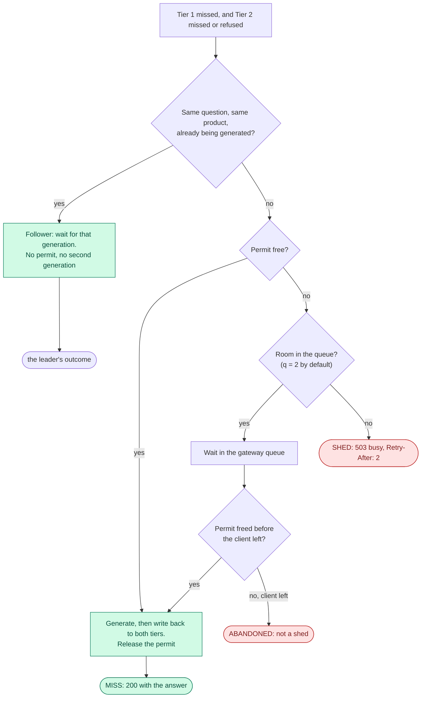

# Admission control — what the gateway does when more questions arrive than the model can answer

**For:** a reader who is new to this project · **Describes:** the code at commit `29b24a6` (30 Oct 2026),
checked on 30 Oct 2026. The admission, coalescing and handler code last changed in `ff1c6ff`. The decision
that shapes this mechanism is ADR-003.
**About the numbers:**
- **No admission number is citable yet.** Citable numbers come from item 7.5, in Phase 7.
- μ_gen ≈ 0.19 req/s (the model's rate) and the Tier-2 μ_hit ≈ 61 req/s are **planning figures**
  (ADR-003, ADR-001).
- The shed rates in §9 come from a textbook queueing model. They are an illustration, not a measurement.

**Contents.** Part 1, the idea (§1–3) · Part 2, the mechanism (§4–8) · Part 3, measuring (§9–12) ·
Part 4, related work, limits and code map (§13–15)

---

# Part 1 — The idea

## 1. The problem: one model slot, many questions

The model (Qwen 3.5 2B on Ollama) writes **one answer at a time**. Ollama serves it at one slot, so a second
request waits until the first one is finished. One answer takes seconds.

The cache answers repeated questions in milliseconds, but every **miss** needs the model. When misses arrive
faster than the model can answer them, they must wait somewhere. There are only two places:

- **Inside Ollama.** The gateway passes every miss on, and Ollama queues them out of sight. Nobody counts
  them, nothing limits the queue, and the waiting time grows without limit.
- **Inside the gateway.** The gateway lets one miss reach the model, lets a few wait, and answers the rest at
  once with `503 busy, retry`. The queue is short, counted and logged.

**Admission control is the second choice.** The gateway decides how many generations run at once (one), how
many requests may wait (the queue budget), and refuses the rest.

**Words used in this doc:**
- **Permit:** the right to use the model slot. There is one.
- **Queue budget (`q`):** how many requests may wait for the permit. The default is 2.
- **Shed:** a request refused with `503` because the permit and the queue were both taken.
- **Goodput:** answered requests per second. A shed never counts as goodput.

## 2. What it protects, and what it does not

**It protects two things** (ADR-003):
- **Waiting time.** An admitted request waits behind at most `q` others, so its latency stays at most
  (1 + q) · S, where S is the time of one generation.
- **Goodput past saturation.** When the load is higher than the model can serve, the extra load is shed and
  counted. Answered requests still flow at the model's rate, so goodput does not collapse.

**It does not do three things:**
- **It does not raise capacity.** Capacity is set by the model's rate and the hit rate: the capacity model in
  `docs/super-plan.md`, "The spine". Admission control keeps that capacity usable under overload. It adds none.
- **It does not bound memory.** Ollama's memory is fixed when it loads the model (about 3.0–3.1 GB, ADR-017),
  and admitting more requests adds none. Older text said the pool "bounds in-flight generation to what memory
  can hold". ADR-003 withdrew that sentence everywhere.
- **It does not govern the hit path.** Only the generation call is admitted. The embedding and the retrieval
  that run for every Tier-1 miss happen before admission, and nothing bounds them (§14).

## 3. Why exactly one permit (ADR-003)

**The project once froze four generation slots.** `OLLAMA_NUM_PARALLEL` was set to 4, and the pool had four
permits.

**Ollama never served four.** Ollama 0.33.2 refuses parallel requests for Qwen 3.5's architecture, a hybrid
with Gated DeltaNet in three of every four layers. It starts its runner with `-np 1` whatever is requested.
Its log said so in 26 of 26 loads of the model. This was finding F1, confirmed on 4 Oct 2026.

**A surplus permit moves the queue into Ollama.** With four permits and one slot, three admitted requests
wait inside Ollama, where the gateway can neither see nor shed them. Every shed rate would then describe the
test harness, not the gateway. One permit is the only value where the gateway's count equals what the server
really serves.

**It is checked, not assumed.** `make env-check` reads the live runner: its command line (`-np`) and its own
`/props` (`total_slots`). It fails when the slot count is not 1. The gateway also prints a warning at start
when it is given more than one permit.

**The consequence was written down in advance.** The W5 spike (15 Aug 2026) pre-registered this branch: if
the pool admits one generation at a time, it "degenerates to a mutex" (a lock that lets one caller in at a
time), and the design must be framed around queueing and shedding instead. That branch fired.

---

# Part 2 — The mechanism

## 4. Where it sits in a request

- **Only the miss path is admitted.** A Tier-1 or Tier-2 hit never asks for a permit (`Tier 2.md` §5 shows
  what comes before this point).
- **Coalescing sits outside the permit** (§6). Ten identical questions in flight cost one permit and one
  generation.
- **The permit covers more than the model call.** It is held through the `Answer` call **and** the write-back
  to both tiers, and released after both. So a generation rate measured at the gateway is a little lower than
  Ollama's own (item 7.5).
- **There is one call site**, in `Ask` (`gateway/internal/httpapi/handler.go`), inside the coalescing closure.
  The package comment requires that it stays the only place a permit is taken, and that no miss path skips it.

## 5. The pool, step by step

The pool is a **counting semaphore with a bounded queue** (`gateway/internal/admission/pool.go`, 120 lines). A
counting semaphore is a counter of free permits: a caller takes one to enter and gives it back to leave.

**`Acquire`**, called once per miss:
1. **Fast path.** If the permit is free, take it at once. The request never touches the queue, and its wait
   is zero.
2. **Join the queue.** If the permit is taken, try to take a place in the queue. If the queue is full, return
   `ErrShed` at once. The request does not wait.
3. **Wait.** In the queue, wait for whichever comes first: the permit becomes free, or the client leaves. A
   client that leaves gets its own context error, **never** `ErrShed`. Leaving is not a shed.

**`Release`** gives the permit back, once. A second call does nothing. A double release would silently add a
permit and let two generations run at once, with no error anywhere.

**Settings**, read once at start in `gateway/cmd/gateway/main.go`:

| Variable | Default | Meaning |
| :--- | :--- | :--- |
| `OLLAMA_NUM_PARALLEL` | 1 | The number of permits. Frozen at 1 (ADR-003). Any other value prints a warning |
| `GEN_QUEUE_BUDGET` | 2 × permits = 2 | The queue budget `q`. 0 means: shed as soon as the permit is taken |

A permit count of 0 or less **turns admission control off**: every request is admitted, and the gateway says
so at start. A run without admission control is a valid thing to measure, but never by accident.

## 6. Coalescing: why it sits outside the permit

**Coalescing** makes identical questions in flight share one generation (`gateway/internal/coalesce/coalesce.go`).
The key is the Tier-1 key: the normalised question plus the `product_id`. Two questions with the same words
about **different** products never share an answer.

The first request with a key is the **leader**. It takes the permit and generates. A request with the same key
that arrives while the leader is still running is a **follower**. It takes no permit and waits for the
leader's result.

**Why outside, never inside.** If admission sat outside coalescing, ten identical questions would take ten
permits, or ten queue places, or ten sheds, to produce one answer. That wastes the scarcest resource in the
system. It would also spoil the measurement: the no-cache baseline's generation count would depend on the
load generator's concurrency, not on how often the workload repeats itself.

**A follower shares the leader's fate**, because the shared work runs under the **leader's** request:
- if the leader is shed, every follower is shed too, with the same `503`;
- if the leader's client leaves during generation, the shared call is cancelled, and a follower whose own
  client is still connected fails as well. What that follower should get is **finding F-D**, still open;
- if the leader's code panics, the followers get an error, never an empty "success".

**What is not shared:** each request keeps its own record, its own client and its own outcome. Whether a
request was ABANDONED is read from **its own** connection, never the leader's.

## 7. The four outcomes of a miss

| Outcome | When | The client gets | Counted as |
| :--- | :--- | :--- | :--- |
| `MISS` | the request held the permit, or followed a leader that did, and `Answer` succeeded | `200` with the answer | goodput |
| `SHED` | the permit and the queue were both taken | `503`, `Retry-After: 2`, and `{"error": "busy", "reason": "generation_pool_saturated", "request_id": …}` | graceful degradation: never an error, never goodput |
| `ABANDONED` | the client left before its answer was ready, in the queue or during generation | nothing, because the connection is gone | a failed request, with a latency at least as long as the client's timeout. Never excluded |
| `GENERATION_FAILED` | `Answer` failed and the client is still there | `502` | an error |

The `503` header and body are a contract (`docs/contracts/interfaces.md` §A). A load generator counts sheds by
matching on them.

**The order is fixed** (finding F-A, fixed on 5 Oct 2026): SHED first; then "this request's client left",
which gives ABANDONED; then GENERATION_FAILED. A completed generation is always a MISS, even when the
write-back to the cache fails afterwards.

## 8. What it leaves in the log

Every request writes one record (`interfaces.md` §H). Five fields belong to admission and coalescing:

| Field | What the code writes today |
| :--- | :--- |
| `shed` | `true` only on a SHED record |
| `t_permit_wait_ms` | How long the request waited in the queue for the permit. **Null** on the fast path, on a request that left while queued, when admission is off, and on every record that never asked for a permit |
| `permit_queue_depth` | On a request that queued and was served: the queue length when it joined, itself included. On a SHED: the queue length at the moment of the shed. 0 on every other record |
| `t_generate_ms` | How long the request's own `Answer` call took (ADR-006). Null on SHED and on every follower. On ABANDONED it is **censored**: at most the true generation time (F-L, §11) |
| `coalesced` | `true` on a follower that was served. A gateway extension, not in §H, and absent on leaders (finding F-O) |

**Read `t_permit_wait_ms` with care (finding F-N, not fixed).** §H says it is "null unless a permit was
requested", but the fast path writes null too, because a zero wait is stored as null. So a non-null value
means "queued, then served", and a mean over the non-null values is biased high. Fixing it changes what the
log means, so it needs a contract note first.

---

# Part 3 — Measuring

## 9. The queue budget, and why it is fixed before the run

**At one slot, `q` sets the shed rate almost by itself.** A textbook model shows how strongly. The M/M/1/K
queue has random arrivals, random service times, one server, and room for K requests in all (one being
served, `q` waiting, so K = q + 1). The share of arrivals it refuses is

`P_shed = (1 − u) · u^K / (1 − u^(K+1))`

where `u` is the arrival rate divided by the service rate. (ADR-003 calls it ρ. It is not the workload
redundancy ρ of the capacity model.) At u = 0.8, this gives about **17 % shed at q = 2** and about
**3 % at q = 8**, the figures ADR-003 records.

**It is an illustration, not a prediction.** Generation times are not random in the way the model assumes,
so a real run will differ. But it shows the point: **a shed rate means nothing without its `q`**. A larger
`q` sheds less, and lets admitted requests wait longer, up to (1 + q) · S.

**So `q` is pre-registered.** It is a parameter of item 7.5, written down before the first saturation run
and recorded with every run. No shed rate is read at an unregistered default (ADR-003).

## 10. The planned experiment: governed against ungoverned (item 7.5)

This is the comparison that Headline A names. Both arms run the same workload past saturation, on the same
axes: goodput, p99 latency, shed rate and queue depth.
- **Governed:** one permit, and `q` as pre-registered.
- **Ungoverned:** more permits than the one served slot. The extra requests queue inside Ollama, where nothing
  counts them. The gateway prints its warning, by design.

**The hypothesis, not a result.** Admission control should not raise peak goodput. Past saturation, the
governed arm should keep goodput and p99 bounded and shed the excess, while the ungoverned arm's latency
should keep growing.

**Rules for the run:**
- **Green memory pressure only** (`CLAUDE.md`, ADR-014).
- **The load generator shares the machine** (ADR-001). So goodput is a **lower bound** and the shed rate an
  **upper bound**. Latency percentiles are **not a bound of either kind**: they are reported only with the
  load generator's own CPU use from the same run.
- **State which μ_gen is reported.** The gateway's figure, with the permit held through write-back, is at most
  Ollama's own.

## 11. What must be closed before Phase 7

- **F-L: an abandoned generation keeps running.** When a client leaves during generation, the gateway releases
  its permit. But `rag.server` does not check for the cancel, and keeps waiting on Ollama for up to 120 s.
  Ollama's one slot is still busy, so the next admitted request **queues inside Ollama**, which is what
  admission exists to prevent, and the bound (1 + q) · S breaks. It gates items 7.1 and 7.5. It can be closed
  by a fix (check `context.is_active()` before generating, and close a streaming `httpx` response on cancel),
  or by measuring that clients almost never leave during `Answer`.
- **F-N:** the null `t_permit_wait_ms` on the fast path (§8). A contract note, then a small fix.
- **F-F: the evaluation log closes while shutdown is still draining.** Requests in flight at SIGTERM vanish from
  `requests.jsonl`. Stopping the load before SIGTERM avoids it; the fix is cheap and due before Phase 7.
- **F-D:** what a live follower of a departed leader should get (§6).

## 12. What has been seen so far (nothing citable)

- **A mechanism check, before ADR-003.** With four permits on `dev-v0`, a burst of 8 distinct questions split
  4 × 200 and 4 × 503. It was never citable, and it ran at a permit count that was never served.
  `experiments/scripts/verify_admission.sh` repeats this check by hand. With one permit and
  `GEN_QUEUE_BUDGET=0`, the script expects 1 × 200 and 7 × 503. Since 30 Oct 2026 it uses `v1` products, two
  per department.
- **The same check on `v1`, 30 Oct 2026**, functional, in **yellow** pressure, not citable. With one permit and
  `GEN_QUEUE_BUDGET=0`: 8 distinct questions gave **1 × 200 and 7 × 503**, and the gateway logged 7 `SHED`
  lines at `in_flight=1 queued=0`. 5 identical questions all came back `MISS` with the same answer hash and
  the same latency (2,139 ms), in 2.18 s of wall time: one generation, shared.
- **The load-generator footprint runs** (item 1.6, ADR-001), on the development data and exploratory. Tier-1
  hits, Tier-2 hits, misses and sheds appeared together, with 63–93 sheds per row in the mixed runs. They show
  the mechanism working under load. They measure nothing about it.

**The tests that pin the mechanism** are Go unit tests against fakes, so they need no Ollama and no Python:

| Test | What it guarantees |
| :--- | :--- |
| `TestNeverAdmitsMoreThanPermits` | never more generations at once than permits |
| `TestShedsWhenPermitsAndQueueAreBothFull` | a shed happens exactly when the permit and the queue are both taken |
| `TestCancelledWaiterIsNotAShed` | a client that leaves while queued is not counted as a shed |
| `TestDoubleReleaseDoesNotRaiseCapacity` | a second `Release` adds no permit |
| `TestDisabledPoolAdmitsEverything` | a permit count of 0 or less turns admission off |
| `TestWaitedIsRecordedOnlyWhenTheCallerActuallyQueued` | the wait is recorded only for a request that queued |
| `TestCoalescingWrapsAdmission` (httpapi) | identical misses in flight take one permit and one generation |
| `TestCoalescingNeverCrossesProducts` (httpapi) | the same words about another product are not shared |
| `TestShedWhenPermitAndQueueAreBothFull`, `TestAbandonedWhileQueuedIsNotAShed` (httpapi) | the `503` reply and the record, end to end |

---

# Part 4 — Related work, limits and code map

## 13. Related work

**Admission control is classical, and it is not claimed.** The thesis uses it; it does not invent it.
- **SEDA** (Welsh and Culler): a server past saturation should refuse extra work, rather than serve everyone
  badly.
- **DAGOR** (Zhou et al., WeChat): at production scale, overload must be handled **at the point of
  admission**, because degradation further down spreads.
- **SLO scheduling with relegation** (Goel et al.): LLM serving that degrades some requests instead of
  refusing them. This thesis refuses instead.

**What changed since the Pre-Thesis.** Its §2.5 said the controller bounds **concurrent memory residency**, and
argued against relegation because a relegated generation still holds memory. ADR-003 withdrew the memory
framing, so the comparison must be restated around **queueing at one slot**. A possible restatement, still to
check in the literature review (Ch. 2 §2.6): at one slot, a relegated generation still holds the only slot for
as long as it runs.

**Candidates the literature review plans to add, not yet verified:** Breakwater (Cho et al., OSDI 2020),
credit-based overload control at the server; and *The Tail at Scale* (Dean and Barroso, CACM 2013), on why the
p99 and not the mean is the latency to report.

## 14. Limits

- **One generation stream.** Gains are measured against a backend that serves one stream, not a batched one
  (ADR-003). A batching engine would change S and every shed rate; it is future work.
- **First come, first served.** No priorities, no fairness between clients, and `q` is fixed, not adaptive.
- **No authentication, no per-client rate limit, no filter for meaningless questions** (decided 27 Oct 2026,
  item 8.2). A per-client limit would throttle the single-client load generator.
- **The embedding runner is not governed.** `nomic-embed-text` also runs at one slot. Every Tier-1 miss calls
  it, and those calls queue inside Ollama, out of the gateway's sight. This may be what bounds the Tier-2
  μ_hit (item 7.2).
- **The request size is not capped yet** (item 5.5, optional). One very large `/ask` body could take a lot of
  gateway memory.

## 15. Code map and further reading

| What | Where |
| :--- | :--- |
| The pool | `gateway/internal/admission/pool.go` |
| Coalescing | `gateway/internal/coalesce/coalesce.go` |
| The call site and the four outcomes | `Ask` in `gateway/internal/httpapi/handler.go` |
| The settings | `gateway/cmd/gateway/main.go` |
| The live slot check | `experiments/scripts/env_check.py` (`make env-check`) |
| The check by hand | `experiments/scripts/verify_admission.sh` (`make verify-admission`, after `GEN_QUEUE_BUDGET=0 make dev`) |
| Code-level docs (not written yet) | `Codebase/gateway/admission.md`, `Codebase/gateway/coalesce.md` |

**Further reading:** in `docs/decisions.md`, ADR-003 (one slot), ADR-001 (measuring on one machine) and
ADR-006 (`t_generate_ms`); `docs/contracts/interfaces.md` §A (the `503` contract) and §H (the log);
`docs/super-plan.md` item 7.5 and findings F-A, F-D, F-F, F-L, F-N and F-O; `Tier 2.md` §5 for what happens
before a request reaches admission.
