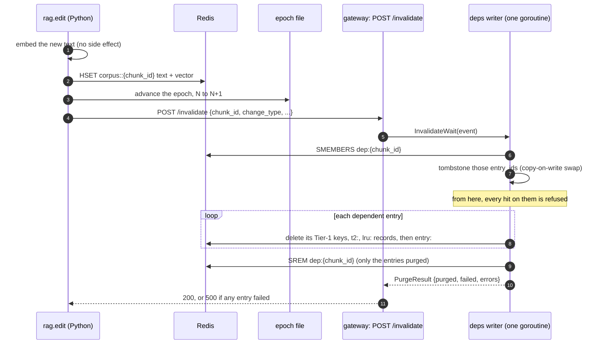
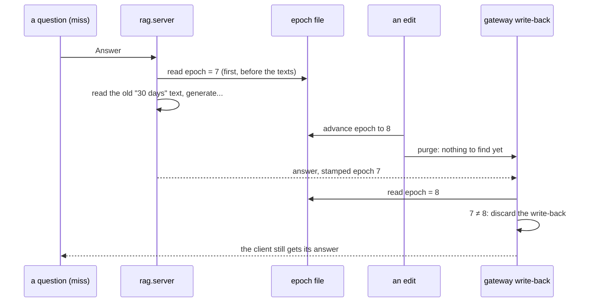

# Invalidation — how a source edit removes every answer built on it

**For:** a reader who is new to this project · **Describes:** the code at commit `29b24a6` (30 Oct 2026),
checked on 30 Oct 2026. The invalidation code last changed in `68d732e` (item 4.4). The decision that shapes
it most is ADR-008.
**About the numbers:**
- **The Phase 4 numbers (§11) come from functional runs on `v1`**, the frozen corpus, at memory pressure 1–2.
  They show that the mechanism works. They are **not citable**.
- **The thesis results for invalidation (RQ3) are measured in item 6.5**, in Phase 6.

**This doc links, it does not copy.** The Redis records (`dep:`, `entry:`), the purge steps and the three
invariants are in `Redis-Data Structure.md` §8. The exact rules are in `docs/contracts/interfaces.md` §E. The
20 edits and how they are scored are in [`Update set.md`](Update%20set.md).

**Contents.** Part 1, the idea (§1–3) · Part 2, the mechanism (§4–10) · Part 3, measuring (§11–12) ·
Part 4, limits, tests and code map (§13–15)

---

# Part 1 — The idea

## 1. The problem: a cached answer outlives its source

The cache stores answers. Each answer was written from a few source chunks: parts of a product page or a
store policy. When one of those chunks changes, every answer built on it may now be wrong, but the cache
still holds it and would still serve it.

**An example (our own policy text).** The policy `policy-return-electronics` says "30 days". The cache holds
answers to "Can I return my headphones?", "What is the return window?" and others, all built on that chunk.
The store changes the text to "14 days". From that moment, every one of those answers is stale.

This is **invalidation**: when a source changes, remove the cached answers that depend on it.

## 2. Three ways to keep a cache fresh, and the one chosen

- **Time to live (TTL).** Every entry expires after a fixed time. Simple, but it is wrong in both directions:
  a stale answer is served until its time runs out, and a correct answer is thrown away when it does.
- **A predictor that decides which edits matter.** It would purge only the answers an edit really changes.
  This was **removed from scope**: it needed the learned predictor that the scope reduction dropped. It is
  future work.
- **Blind dependency purge (chosen).** The cache records which chunks each answer used. When a chunk changes,
  it removes **every** answer that used it, without judging whether the answer changed.

**Why blind.** It is **complete**: no answer built on a changed chunk survives. Its cost is
**over-invalidation**: a small rewording of a chunk also removes answers that were still correct. The update
set measures that cost instead of assuming it ([`Update set.md`](Update%20set.md)). Each edit carries a
`change_type` (`substantive` or `cosmetic`), but it is **only measured, never used to decide**. Trusting the
label would make completeness depend on whoever wrote the edit.

## 3. What it guarantees, and what it does not

**It guarantees** that after an edit's purge has finished, no answer built on the old chunk is served,
**including** one whose generation was still running during the edit (the epoch guard, §9). Completeness is a
property of the purge **and** the write path together.

**It does not guarantee three things:**
- **That it survives a crash in the middle.** If a Redis call fails during a purge, the entry is refused by
  this gateway process (its tombstone stays, §6), but a restarted process would serve the leftover copy. The
  entry stays listed for a retry (§7).
- **That only the edited chunk's answers are affected.** The epoch is global, so any edit discards **every**
  write-back in flight, even one over a chunk the edit did not touch (§9). These discards are expected and
  counted.
- **That only changed answers are removed.** That is the over-invalidation of §2, by design.

---

# Part 2 — The mechanism

## 4. The whole path, in one picture

Three parts work together:
- **Registration** (§5) records, after each new answer, which chunks it used.
- **The writer and its snapshot** (§6–7) purge the dependents and refuse them on the hit path.
- **The epoch** (§9) catches the one answer that the purge cannot see: one still being generated.

## 5. Recording what each answer used

After a miss writes its answer back to both tiers, the gateway calls `Register(entry_id, source_chunk_ids,
t1_key, dataset_epoch)`. The writer then adds the `entry_id` to `dep:{chunk_id}` for each source chunk, and
writes `entry:{entry_id}`, in one transaction. `Redis-Data Structure.md` §8 shows both records.

**`Register` takes no context, on purpose.** The write-back runs inside the shared (coalesced) generation, and
a client that leaves cancels its context. A registration that gave up on a cancelled context would leave an
answer in the cache with **no dependency record**, so no purge could ever reach it. Completeness would fall
below 1 with no error. So `Register` waits on the writer's queue instead. A registration refused after
shutdown, or one whose Redis write fails, is counted (`Dropped`, `RegisterErrors`) and logged, never lost
without a trace.

## 6. One writer, and a snapshot the hit path reads without a lock

**One goroutine writes all `dep:*` and `entry:*` records.** Registrations and invalidations reach it through
one channel and run in arrival order. So a registration can never race a purge on the same key.

**The hit path asks one question: "has this entry been invalidated?"** It must answer in nanoseconds,
because every Tier-1 and Tier-2 hit asks it. The writer keeps a set of invalidated `entry_id`s (the
**tombstones**) as a **copy-on-write snapshot**: to add IDs, it copies the set, adds them, and swaps a pointer
in one atomic step. A reader does one atomic load and one map lookup: no lock, no Redis call, and it never
waits for the writer.

**The order makes it safe.** The writer swaps in the tombstones **before** it deletes anything in Redis, and
the hit path reads Redis **first** and the snapshot **second**. So a hit that can still see a purged entry
in Redis also sees its tombstone. What happens then:
- **On Tier 1**, the request goes on to Tier 2.
- **On Tier 2**, the candidate is dropped before it is judged, and the record names it
  (`invalidated_entry_id`, `interfaces.md` §H).

**Why copy-on-write and not a read-write lock.** With a lock, a reader can wait behind a writer during a
purge. With copy-on-write, a reader never waits. The microbenchmark that would have compared the two is
**dropped** (item 6.5, proposal §12). The thesis argues it analytically, and item 7.4 measures the hit path's
p99 while purges fire under load.

## 7. The purge

`Invalidate` (or `InvalidateWait`) sends the event to the writer, which:
1. reads `dep:{chunk_id}`: every entry built on the chunk;
2. tombstones them all (§6). `Invalidate` returns here;
3. purges each entry from both tiers, then deletes its `entry:` record;
4. removes **only the purged entries** from `dep:{chunk_id}`. `InvalidateWait` returns here, with the list of
   what was purged and what failed.

`Redis-Data Structure.md` §8 and `interfaces.md` §E give each step's Redis commands. Two details matter:
- **A Tier-1 key is deleted only if it still names this entry.** A newer answer to the same question may
  have taken the same Tier-1 key. One Lua script checks and deletes in one step, so the newer answer
  survives.
- **A failed entry stays in `dep:{chunk_id}`.** If any of its Redis steps fails, it is reported as failed and
  left in the set, so a second call, or a restarted gateway, finds it again (item 4.4).

## 8. The edit path: `rag.edit`, then `POST /invalidate`

An edit is one call: `python -m rag.edit --update-set FILE --edit-id ID --gateway URL`. The order of its four
steps is fixed in one function, and a test pins it:

1. **Embed** the new text, the way ingest embeds it. No side effect yet.
2. **Write** the new `text` **and** `vector` of the chunk in Redis, in one command.
3. **Advance** the dataset epoch, N to N+1.
4. **Post** the event to the gateway's `POST /invalidate`, which replies only after the purge has finished.

**Every other order fails with no error** (`interfaces.md` §E, order rule 2):
- **Advance before write:** a retrieval between the two reads the **old** text under the **new** epoch, and
  the guard lets it through.
- **Post before advance:** a generation that starts after the purge still carries the old epoch, and
  writes back.
- **Write the text but not the vector:** answers are built on the new text but found by the old meaning.

**`POST /invalidate` accepts loopback callers only**, because an open purge endpoint is a way to empty the
cache. It answers 200 when every dependent was purged, 500 when any failed, and 400, 403, 405 or 503 for a bad
call (`interfaces.md` §E). A failed call makes `rag.edit` exit non-zero, and running the same edit again is
safe. An edit changes Redis only: the files in `data/v1/` are never written, and `make ingest` puts the
corpus back.

## 9. The epoch: catching the answer the purge cannot see

**The race.** A question arrives, its chunks are read, and the model starts writing (a few seconds). During
those seconds, an edit lands and its purge runs. The purge finds nothing to remove, because the answer is not
in the cache yet. Then the generation ends and writes the old answer back, **after** the purge. Without a
guard, that stale answer stays in the cache, with no trace.

**The guard** (item 4.2). The dataset epoch is one integer that every edit advances. `rag.server` reads it
**first** in every call, before it reads any chunk text, and stamps it on the answer (order rule 1). At
write-back, the gateway reads the epoch again. **Any difference discards the write-back**, and so does a
failed read: it fails closed. The record then says `writeback_discarded: true`. The client still gets its
answer; only the cache copy is refused.

**The late rule.** The guard can pass, and an edit can still land **between** the write-back and the
registration. The edit's purge then cannot see the entry. So the writer reads the epoch once more when it
handles a registration. On a mismatch it tombstones and purges the entry instead of registering it, and counts
it in `LateDiscards`. A hit could be served in the gap of about a millisecond; this is accepted and counted
(`interfaces.md` §E).

**Why the epoch is a file, not a Redis key (ADR-008).** If Redis restarts from an old snapshot, the purged
entries come back, **and** a Redis epoch counter goes back with them. The guard then compares old with old,
agrees, and serves stale data. This was shown on a test Redis: an RDB restore brought back a purged entry and
reset the counter from 8 to 7, the value stamped on that entry. A file outside Redis does not roll back with
it, so the mismatch is seen.

**There is no epoch check on the hit path.** The epoch is global, so checking it on a hit would refuse every
entry after any edit. The purge and the tombstones own the hit path.

## 10. The three correctness invariants

Each one closes a failure that would give **no error**. `Redis-Data Structure.md` §8 explains them; the
report's §3.9 lists the tests that pin them.
1. **`dep:*` and `entry:*` are never evicted.** An evicted record would make its answers unpurgeable.
2. **Every Tier-2 record carries `t1_key`**, and every Tier-1 key is listed in `lru:t1keys:{entry_id}`, so a
   purge always reaches Tier 1.
3. **Write-back is guarded by the epoch** (§9).

---

# Part 3 — Measuring

## 11. What Phase 4 showed (functional, not citable)

Phase 4 closed on 29 Oct 2026. Its exit line was run on `docs/work/2026-10-29-update-set/evidence/live3/`
(`v1`, `MUTATION=on`, unbounded cache, pressure 1–2):
- **A policy edit purges exactly its dependents from both tiers.** Each of the 10 policy edits had 4–11
  dependents, and every one was gone from Tier 1 and Tier 2. Nothing else was removed.
- **An edit during a generation is discarded.** The 30 → 14 day edit landed mid-generation, and the record
  says `writeback_discarded: true`, with no key written.
- **One script reproduces the numbers.** `make update-set-score` printed byte-identical output twice.

Across three runs: completeness **1.0** (57 of 57, 57 of 57, 59 of 59 dependents), **no** entry removed
without an edited source, and precision **0.684, 0.702 and 0.695**. [`Update set.md`](Update%20set.md)
explains each number.

## 12. The RQ3 plan (item 6.5)

RQ3 runs the Phase 6 harness, with judged labels, at `mutation: on`, on the held-out split. It reports four
things:
- **(a) Staleness:** how often a conventional cache serves a stale answer under source change, configuration
  `(3, on)`, against the full system, `(5, on)`.
- **(b) Completeness and precision** on `(5, on)`, split into `substantive` and `cosmetic` edits. These replace
  Phase 4's functional numbers.
- **(c) False hits by cause**, so a stale answer is never charged to the reuse rule.
- **(d) A swept TTL baseline:** the staleness and hit-rate curve that TTL can reach, with blind purge as one
  point against it, never one hand-picked TTL. The TTL values are written down before the first `on` run.

**Two rules for these runs:**
- **Completeness below 1 is a defect, not a number.** It means the dependency map or the epoch guard is
  broken, and it stops the item.
- **The support gate can hide a missed purge** (ADR-009). With the gate on, its numeric arm refuses a stale
  "30 days" answer whose purge was missed, so the miss never shows. Completeness is therefore checked on the
  gate-off arm, or read from the cache state directly.

Item 7.4 adds the hit path's p99 latency while purges fire under load (Phase 7).

---

# Part 4 — Limits, tests and code map

## 13. Limits

- **The epoch is global.** Under `mutation: on`, any edit discards every write-back in flight, not only those
  over the edited chunk. This lowers the hit rate a little during edits; the discards are counted.
- **Tombstones live in one process.** After a failed purge and a gateway restart, a leftover Redis copy can be
  served again until a second purge removes it.
- **The tombstone set only grows** while the gateway runs, and each purge copies it. This is cheap at this
  scale (59 dependents in a run of 20 edits), but it is not bounded.
- **The late-rule gap.** For about a millisecond after a late write-back, a hit could serve the stale entry.
  Accepted and counted in `LateDiscards`.
- **Precision is judged per edit, not per entry** ([`Update set.md`](Update%20set.md) §5).
- **Predictor-gated purging is future work** (proposal §14).

## 14. Tests that pin it

The `deps` tests run against a throwaway Redis on port 6390 (`make test-go`), never the live one.

| Test | What it guarantees |
| :--- | :--- |
| `TestRegisterWritesDepAndEntry`, `TestRegisterWithoutTier2Entry` | registration writes both records, even for a Tier-1-only answer |
| `TestInvalidatePurgesExactlyDependents` | a purge removes every dependent and nothing else |
| `TestInvalidatedVisibleBeforePurge` | the tombstone is visible before anything is deleted |
| `TestConcurrentRegisterInvalidateRead` | registrations, purges and hit-path reads race safely |
| `TestRegisterWaitsWhenQueueFull`, `TestRegisterAfterCloseIsCounted` | a registration is never dropped without a count |
| `TestInvalidateWaitKeepsFailedEntriesInDep`, `TestInvalidateWaitRetryPurgesAgain` | a failed entry can be found and purged again |
| `TestLateRegistrationIsPurged`, `TestLateRegistrationReadErrorPurges` | the late rule purges, and fails closed |
| `TestEpochGuardDiscardsAdvancedEpoch`, `TestEpochGuardDiscardsOlderEpoch` (httpapi) | the write-back guard discards on any mismatch |
| `TestEvictionLeavesDependencyRecordsAlone` (cache) | the LRU trim never deletes `dep:*` or `entry:*` |
| `rag/tests/test_edit_order.py` | the edit's four steps run in the fixed order |

Two live checks load the models and are not measurements: `make epoch-race-check` (the race of §9, with an
epoch advance standing in for the edit) and `make update-set-check` ([`Update set.md`](Update%20set.md) §3).

## 15. Code map and further reading

| What | Where |
| :--- | :--- |
| The writer, registration, purge, tombstones | `gateway/internal/deps/deps.go` |
| The epoch reader | `gateway/internal/deps/epoch.go` |
| `POST /invalidate` | `gateway/internal/httpapi/invalidate.go` |
| The write-back guard and the call to `Register` | `Ask` in `gateway/internal/httpapi/handler.go` |
| The Tier-1 compare-and-delete script | `gateway/internal/cache/purge.go` and `capacity.go` |
| The edit | `rag/src/rag/edit.py` |
| The epoch file and its advance | `rag/src/rag/epoch.py` (`make epoch-advance`) |
| Code-level doc (not written yet) | `Codebase/gateway/deps.md`, `Codebase/rag/edit-and-epoch.md` |

**Further reading:** `interfaces.md` §E (every rule, as the contract); `Redis-Data Structure.md` §8 (the
records); ADR-008 (the epoch outside Redis) and ADR-009 (the gate hiding a missed purge) in
`docs/decisions.md`; `docs/super-plan.md` Phase 4 and item 6.5; the trails `docs/work/2026-10-27-dependency-map/`,
`2026-10-28-epoch-guard/` and `2026-10-29-update-set/`.
