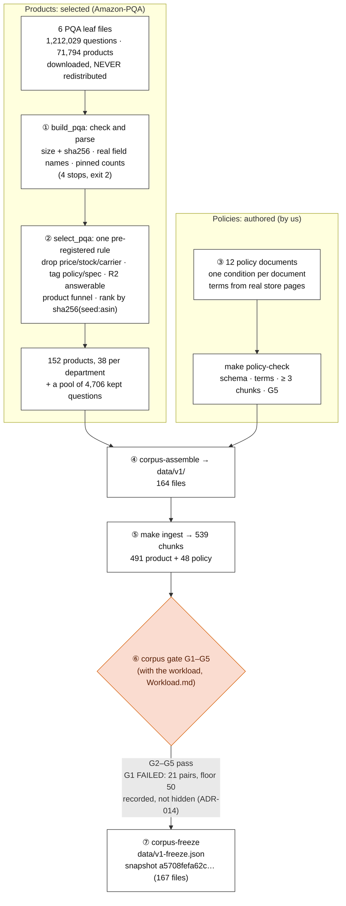

# The corpus pipeline — from raw Amazon-PQA files to the frozen `v1`

**For:** the author, as a blueprint for the top half of D9 (Ch. 4) and for the supervisor. **Describes:** the frozen
`v1` corpus (23 Oct 2026, ADR-015) and the scripts at commit `29b24a6`. **About the numbers:** all counts are facts
about the frozen data, taken from `docs/data-card.md` §1, §2 and §7. They describe the corpus, not a result.

**The message, in one sentence:** *products are selected from Amazon-PQA by one rule fixed in advance, policies are
written by us to rules fixed in advance, and both are checked and frozen with one failure recorded, not hidden.*

---

## 1. The pipeline (the blueprint for D9, top half)

## 2. Step by step

**① Check and parse the six leaf files** (`make pqa-fetch`, then `make pqa-build`; `build_pqa.py`). Six Amazon-PQA
category files, about 1.9 GB, chosen to give **four store departments** (ADR-002):

| Department | PQA leaf file(s) |
| :--- | :--- |
| phones | unlocked cell phones |
| laptops | traditional laptops |
| electronics | LED & LCD TVs + over-ear headphones |
| furniture | chairs + home office desks |

The dataset's readme names fields **the data does not use**, so a builder written from the readme returns empty
records with no error. The builder therefore stops (exit 2, nothing written) on a wrong size or SHA-256, on zero
parsed records, on a missing or unknown field, or on counts that differ from numbers pinned by an earlier probe.

**② Select 152 products** (`make pqa-select`; `select_pqa.py`; ADR-011), by one rule written before the draw:
- **Questions:** price, stock and carrier questions are dropped; return and warranty questions are tagged `policy`
  (our documents answer them); the rest are `spec`, and a spec question is **answerable** (rule **R2**) when at least
  half of its content words appear in the product's own record, after removing words common to the leaf's titles.
  Most real questions are **not** answerable from their product's record (about 20–23 %), which is why the filter
  exists.
- **Products** pass a funnel: a title, at least 3 bullets, no warranty term in their own text, records that agree,
  5–50 kept questions, at least 5 answerable spec questions, and at least one near-duplicate question pair.
- **The draw:** inside each leaf, eligible products are ranked by `sha256("v1-item-3.2:" + asin)` and the first ones
  are taken. **38 per department**, split over its leaves.

| Leaf | Eligible / in | Taken |
| :--- | ---: | ---: |
| phones | 205 / 15,298 | 38 |
| laptops | 77 / 19,742 | 38 |
| TVs | 13 / 3,970 | 13 (short leaf: the pre-registered fallback) |
| headphones | 52 / 6,605 | 25 |
| chairs | 65 / 19,193 | 19 |
| desks | 40 / 6,986 | 19 |
| **total** | | **152** |

The selected products keep **4,706** questions (1,180 answerable spec, 3,399 not answerable, 127 policy). That pool
feeds the workload ([`Workload.md`](Workload.md)).

**③ Write 12 policy documents** (`data/policies-v1/`; ADR-012). PQA has questions about returns and warranty, but no
store policy to answer them, so we write it. **One condition per document**: returns for opened and unopened phones
are two files, and so are new and renewed laptops, opened and unopened furniture, and domestic and international
phone warranty. This is the corpus's only defence against "same evidence, opposite condition" traps. The terms are
taken from real store and maker pages (Best Buy, Amazon, Target, IKEA, Samsung, HP, Sony). `make policy-check` checks
the schema, that the only numbers are the declared terms, that each document gives at least 3 chunks (it gives 4),
and gate G5.

**④ Assemble** `data/v1/` (`make corpus-assemble`): 152 product files + 12 policy files = **164 files**, copied byte
for byte.

**⑤ Ingest** (`make ingest`, [`RAG.md`](RAG.md) §1): **539 chunks**, 491 from products (about 3.2 each) and 48 from
policies (4 each).

**⑥ The corpus gate** (`make gate-corpus`, with the workload):

| | Criterion | Result |
| :-- | :--- | :--- |
| **G1** | at least about 50 pairs with high similarity (cosine ≥ 0.85) and low evidence overlap (Jaccard ≤ 0.2), inside a split | **FAILED: 21** (validation 13, test 8) |
| **G2** | at least one `B-within` trap (same product, different evidence) | pass |
| **G3** | zero Tier-1 collisions in the workload | pass |
| **G4** | every `doc_id` starts with `product-` or `policy-` | pass |
| **G5** | no policy document names a condition it does not declare | pass |

**⑦ Freeze** (`make corpus-freeze`; ADR-014, ADR-015). The author chose to freeze `v1` **with G1 recorded as
failed**, not to change the gate: it is a **finding that limits C1** (less power to show it on same-product traps).
`data/v1-freeze.json` holds the snapshot digest `a5708fefa62c…` over **167 files** (164 corpus + 3 workload), the
chunk digest, `K` per run file, and statistics. **No names, ASINs or paths**, because the repository is public.

## 3. Licensing (put it on the figure)

- **Amazon-PQA:** academic use granted, **redistribution not granted**. Every PQA-derived file (`data/raw/`,
  `data/v1-draft/`, `data/v1/`) is gitignored. The repository ships the **build scripts and hash manifests**, never the
  text. Citation: Rozen et al., NAACL-HLT 2021.
- **The 12 policies:** written by the author, free to release.

## 4. Drawing notes

- **Two sources, two colours or two columns:** products are **selected**, policies are **authored**. That difference
  is the first thing a reader should see.
- **Write the count on every box** (6 files → 152 products → 164 files → 539 chunks).
- **Write G1's failure on the arrow** to the freeze, in red-orange `#D55E00`. It must not be hidden.
- **Must show:** "never redistributed" on the PQA box.
- **Combine with [`Workload.md`](Workload.md)** for the full D9: the workload joins at the gate.
- **File:** `d09-corpus-build`.

## 5. Sources

`docs/data-card.md` §1, §2, §7; ADR-002, ADR-011, ADR-012, ADR-014, ADR-015; `experiments/scripts/build_pqa.py`,
`select_pqa.py`, `check_policies.py`, `corpus_gate.py`, `freeze_corpus.py`;
[`data-build.md`](../Codebase/experiments/data-build.md), [`gate-and-freeze.md`](../Codebase/experiments/gate-and-freeze.md).
