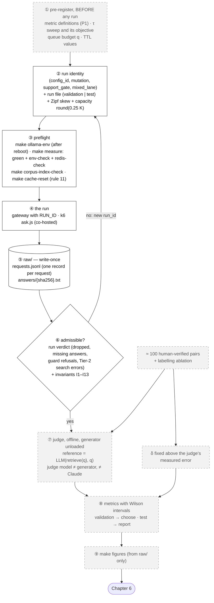
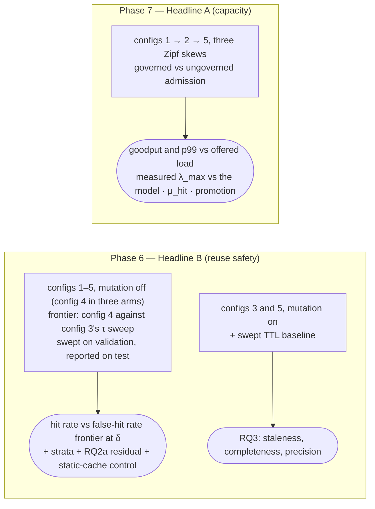

# The evaluation pipeline — how a run becomes a number and a figure

**For:** the author, as a blueprint for D10 (Ch. 5) and for the supervisor. **Describes:** the state on 30 Oct 2026
(commit `29b24a6`, Phase 5 open). **About the numbers:** none here; this doc is about the **path** every number takes.
**Half of this pipeline is not built yet** — §3 says exactly which half.

**The message, in one sentence:** *every number in Chapter 6 comes from write-once raw logs through one path; choices
are made on the validation split and results are reported on the test split, judged offline.*

---

## 1. The pipeline (the blueprint for D10)

Solid boxes exist today; dashed boxes are Phase 5–7 work.

## 2. Step by step

**① Pre-register.** Before the first run that can be cited, these are written down and dated: the **metric
definitions and counting rules** (P1, item 5.1), the **τ sweep** range and the rule that picks "the best fixed
threshold" (item 6.1), the **queue budget `q`** (item 7.5) and the **TTL values** (item 6.5). Writing the method
before the data is what stops a threshold being tuned to make a headline work.

**② The run identity.** A run is named by **`(config_id, mutation)`** and its arms (`support_gate`, `mixed_lane`), all
written into every record. It also fixes the **run file** (validation or test), the **Zipf skew**, and the **cache
capacity**, `round(0.25 × K)` of that file.

| Config | What is served | Arms |
| :---: | :--- | :--- |
| 1 | no cache: every request generates | — |
| 2 | Tier 1 only | — |
| 3 | similarity alone: nearest entry overall, k = 1, and τ (GPTCache's rule; ADR-019) | — |
| 4 | the served rule: similarity ∧ namespace ∧ support | gate off / MIXED off · gate on / MIXED off · gate on / MIXED on (ADR-016) |
| 5 | the full tiered system | gate on, MIXED on (invariants I8, I11) |

Each is run at `mutation: off` and, for RQ3, at `mutation: on` (the update set applied during the run).
⚠️ **Today `CONFIG_ID` only labels the record**; item 6.0 builds the switch that makes each configuration run its own
path.

**③ Preflight.** `make ollama-env` after every reboot; `make measure` refuses unless memory pressure is **green** and
`env-check` and `redis-check` pass; `make corpus-index-check` confirms Redis holds `v1`; `make cache-reset` empties
`t1:`, `t2:`, `lru:`, `dep:` and `entry:`, so a run starts on a cache it writes itself (rule 11).

**④ The run.** The gateway starts with a fresh `RUN_ID`; k6 (`ask.js`) sends the Zipf stream from the run file. The
load generator shares the machine (ADR-001), so goodput is a **lower bound** and the shed rate an **upper bound**.

**⑤ `raw/`, write-once.** One JSON line per request (`interfaces.md` §H: outcome, similarity, cause, support values,
timings, permit wait, epoch, `answer_sha256`, …) and the text of every served answer, written **before** the line that
names it. A reused `RUN_ID` makes the gateway refuse to start. `raw/` is gitignored (it holds PQA text) and archived.

**⑥ Admissible?** At shutdown the gateway closes the log and then checks its counters: dropped records, failed line
writes, missing answer files, guard refusals, Tier-2 search errors. Any of them prints **`THIS RUN IS INCOMPLETE`**.
The 13 invariants of §H (for example "cause `NONE` ⇔ `TIER2_HIT`", "`mutation: off` ⇒ no discarded write-back") are
checks on a finished log. **A wrong run is never edited: it gets a new `run_id`.**

**⑦ Judge, offline.** For each served Tier-2 answer, the question is: *is it correct for this question?* A wrong one
is a **false hit**. The **reference** answer is `LLM(retrieve(q), q)`, generated fresh by the same pipeline. The
**judge** is a different model from the generator, and **not Claude** (Claude wrote the workload). It runs after the
generator is unloaded, reads the answer from `raw/answers/`, and its verdicts are deduplicated by `answer_sha256`.
About **100 pairs are checked by a human**, to measure the judge's own error. A **labelling ablation** compares two
ways of judging (with and without the reference answer), reported by overlap bucket.

**δ, the false-hit budget,** is provisionally 5 % and is fixed **above the judge's measured error**. Otherwise the
study could not tell a cache error from a judge error.

**⑧ Metrics.** Every rate carries a **Wilson interval**. **Validation** is used to choose (τ, the operating point);
**test** is used only to report. A pre-registered null is a result, not a failure.

**⑨ Figures.** `make figures` regenerates every figure **from `raw/`** on a clean checkout plus the raw archive. A
figure is never drawn by hand.

## 3. What exists today, and what is built later

| Step | State on 30 Oct 2026 | Owner |
| :--- | :--- | :--- |
| run labels in every record (`config_id`, `mutation`, arms) | ✅ built | — |
| configuration selection (`CONFIG_ID` changes the path) | ⬜ labels only | item 6.0 |
| preflight targets (`measure`, `env-check`, `cache-reset`, `corpus-index-check`) | ✅ built | — |
| k6 scenario and μ_hit probe | ✅ built, not yet run for a result | items 7.1, 7.2 |
| `raw/` log and answer store, write-once, run verdict | ✅ built | — |
| invariant checker over a finished log | ⬜ defined in §H, no script | Phase 5 (P1) |
| run manifest | ⬜ `ask.js` prints values to paste into `manifest.yaml` by hand; no schema yet | item 5.1 (P1) |
| metric definitions and counting rules (P1) | ⬜ | item 5.1, **first** |
| judge harness, references, dedup | ⬜ | item 5.1 |
| human-verified pairs, labelling ablation | ⬜ | item 5.2 |
| δ finalised | ⬜ (5 % provisional) | item 5.3 |
| figure generators (`make figures`) | ⬜ the target calls a script that does not exist | item 5.4 |

## 4. Which runs feed which result

## 5. Rules that bind every step

- **Never tune to make a headline work.** Thresholds are swept on validation and reported on test; the result is a
  frontier, not a tuned point.
- **`dev-v0` is never cited.** Functional runs on `v1` (Phases 1–4) are not cited either.
- **Green pressure only** for a citable run; a yellow or red run is discarded and repeated.
- **`raw/` and the manifest are write-once**; figures regenerate from `raw/`, never the reverse.

## 6. Drawing notes

- **D10 is a vertical flow** with three bands: *before the run* (①–③), *the run* (④–⑥), *after the run* (⑦–⑨). Put the
  band names on the left.
- **Show the judge offline**: a dotted line between the run and the judge, labelled "generator unloaded".
- **Show the human pairs feeding both the judge check and δ.**
- **Mark what is not built** with a dashed grey border (`figures.md` §0.2), and redraw it solid when Phase 5 closes.
- **The second figure (§4)** is optional; it is the one to show the supervisor when the question is "which run answers
  which RQ?".
- **File:** `d10-evaluation-pipeline`.

## 7. Sources

`docs/contracts/interfaces.md` §H (the record, rules 1–12, invariants I1–I13); `docs/super-plan.md` Phases 5–7;
ADR-001, ADR-005, ADR-010, ADR-013, ADR-016, ADR-019; `gateway/cmd/gateway/main.go` (the run verdict);
`experiments/k6/ask.js`; `docs/data-card.md` §3 (the reference answer); [`telemetry.md`](../Codebase/gateway/telemetry.md),
[`cmd-gateway.md`](../Codebase/gateway/cmd-gateway.md).
