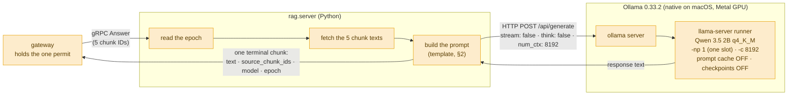
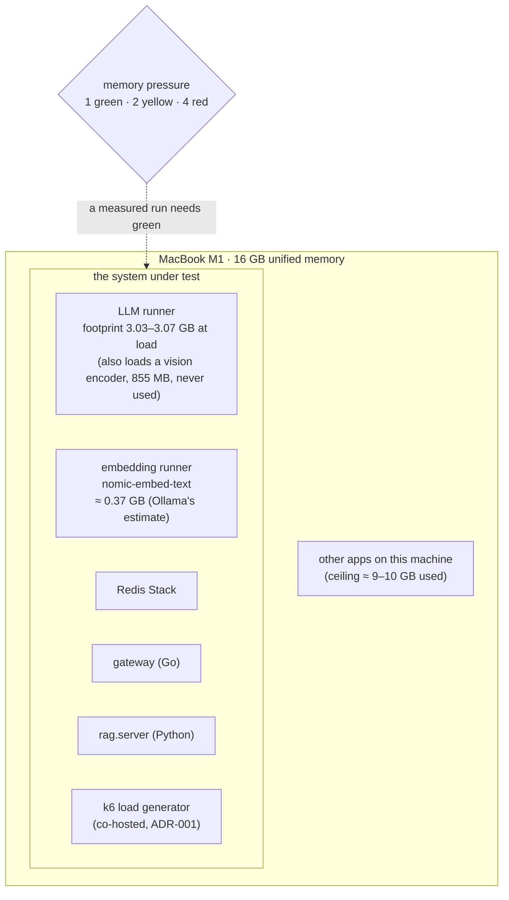
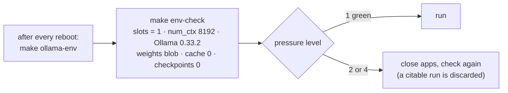

# The LLM pipeline — one model, one slot, one fixed envelope

**For:** the author, as a blueprint for a generation figure and an envelope figure, and for the supervisor.
**Describes:** the code at commit `29b24a6` (30 Oct 2026). The decisions are ADR-003 (one slot) and ADR-017 (no
prompt cache). **About the numbers:** speeds and memory are from functional runs on `v1` at pressure 1–2. **None is
citable**; μ_gen is re-measured in Phase 7.

**The message, in one sentence:** *every miss waits for the same single generation stream, on a model whose memory is
fixed when it loads.*

---

## 1. The generation call (a blueprint for Ch. 3)



**Step by step:**
1. The gateway already holds the **one permit** ([`whole Request.md`](whole%20Request.md) ⑦). It calls `Answer` with
   the 5 chunk IDs it retrieved.
2. `rag.server` reads the **epoch first**, fetches the 5 chunk texts by ID, and builds the prompt.
3. It posts to Ollama's `/api/generate` with the frozen settings: model `qwen3.5:2b-q4_K_M`, **`think: false`**,
   **`num_ctx: 8192`**, `stream: false`, 120 s timeout. No call can override them.
4. Ollama hands the prompt to its **runner**, a `llama-server` process started with **one slot** (`-np 1`). A second
   request waits until the first one is finished.
5. The text comes back as **one** gRPC message, with the source chunk IDs and the epoch, which the write-back uses.

## 2. The prompt

```
Answer the question using ONLY the context below. If the answer is not contained in the context, say you don't know.

Context:
<chunk 1 text>

<chunk 2 text>
...

Question: <question>
Answer:
```

The chunks keep their **rank order**. There is no system prompt, no example, and no chat history: each answer depends
only on the question and its five chunks, which is what makes a cached answer reusable at all.

## 3. Why one slot, and what it means

- **Ollama 0.33.2 refuses parallel requests for Qwen 3.5's architecture** (a hybrid with Gated DeltaNet in three of
  every four layers) and starts the runner at one slot whatever `OLLAMA_NUM_PARALLEL` asks. The old frozen value of 4
  **was never served** (finding F1, ADR-003).
- So the gateway grants **one permit**, and `make env-check` checks the live runner's slot count.
- **Consequence:** capacity is set by this one stream and the hit rate (`λ_max = min(μ_gen/(1 − h), μ_hit/h)`). The
  cache is the only way to serve more questions on this machine.

## 4. The memory envelope (a blueprint for an envelope figure)



**The four facts to put on this figure:**
- **Memory is fixed when the runner loads**: about **3.03–3.07 GB** (read with macOS `footprint`, never RSS or
  Ollama's own `/api/ps`, which said 1.6 GB). Admitting requests adds none, **because the prompt cache is off**.
- **The prompt cache was a hidden leak** (ADR-017). Ollama starts `llama-server` with its prompt cache on, up to 8 GB.
  50 distinct prompts grew the footprint from 3,066 to 7,088 MB, and none of the saved entries was ever reused. RSS
  hid it, because macOS compresses those pages. Now `LLAMA_ARG_CACHE_RAM=0` and `LLAMA_ARG_CTX_CHECKPOINTS=0`; over 300
  distinct prompts the footprint rose 1 MB.
- **The context checkpoints are off too.** Left on, they gave a repeated prompt free prefill (0.05 s instead of 1.29 s),
  which would hand the no-cache baseline a hidden second cache under Zipf.
- **A run counts only in green pressure.** The machine also runs other projects, so the real ceiling is about 9–10 GB
  used before any Ollama test.

## 5. Before any run: the checklist (a small figure, optional)



`make ollama-env` sets the two variables in Ollama.app's environment and restarts it. `make env-check` reads the
**live runner** (its command line and its own `/props`), never the requested values, and fails closed. The Ollama app
itself is not used during a run, and its auto-update stays off.

## 6. Key numbers

| Quantity | Value | Status |
| :--- | :--- | :--- |
| model | Qwen 3.5 2B, 4-bit `q4_K_M`, weights blob pinned | frozen |
| `num_ctx` · slots · `think` | 8192 · 1 · false | frozen |
| footprint at load | 3.03–3.07 GB | measured, `v1`, not citable |
| KV memory | 12 KiB per token (6 of 24 layers keep KV); 96 MiB at 8192 | measured (ADR-003) |
| prefill speed (median) | about 480–510 tokens/s | 50 prompts, ADR-017, not citable |
| decode speed (median) | about 36–37 tokens/s | 50 prompts, ADR-017, not citable |
| one answer | about 1.3 s reading the prompt + 2.0 s generating | `v1` update-set run, not citable |
| μ_gen | 28.2 tok/s ≈ 0.19 req/s | **planning figure** until Phase 7 (ADR-003) |

## 7. Why this model

The study first froze **Gemma 4 E4B**, which put the machine into yellow pressure even at its lightest setting; Gemma 4
E2B used 7.7 GB at one slot. **Qwen 3.5 2B** fits: its hybrid layers keep KV in only 6 of 24 layers, so its context
memory is small. The price is that Ollama serves it at one slot. Changing the model or the serving stack now would void
every comparison (frozen).

## 8. Open points

- **The runner's batch size is not fixed** (ADR-017 §F3): Ollama gives it `-b 512` or `-b 1024` for a reason not yet
  known, and `env-check` neither pins nor records it. It changes prefill speed. Decide before Phase 7.
- **A cancelled request keeps generating** (finding F-L): `rag.server` does not stop the Ollama call when the gateway
  cancels, so the slot stays busy. It gates Phase 7.

## 9. Drawing notes

- **The generation figure:** three boxes left to right (gateway, `rag.server`, Ollama), with the frozen settings
  written **on the arrow** to Ollama. The one-slot runner is the point: draw it as a single lane.
- **The envelope figure:** one big box (16 GB) with the system's processes inside and the runner as the biggest block,
  labelled with its footprint. Put the pressure check outside, as a gate.
- Colours: the generation path in the miss orange `#E69F00`.
- Do **not** write "bounds memory" anywhere near admission control: ADR-003 withdrew it.

## 10. Sources

`rag/src/rag/generate.py`, `server.py`, `config.py`; `experiments/scripts/env_check.py`; ADR-003, ADR-017;
`docs/work/2026-10-29-ollama-prompt-cache/`; [`envelope-and-load.md`](../Codebase/experiments/envelope-and-load.md).
