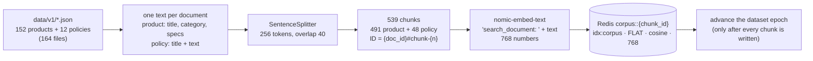
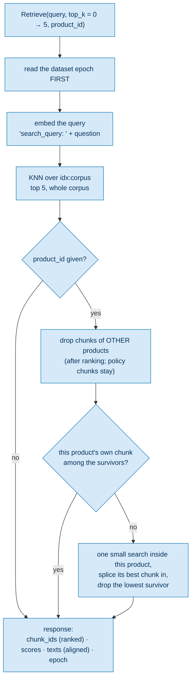
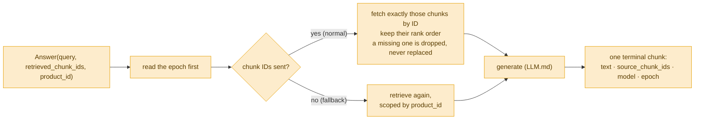

# The RAG pipeline — from documents to five ranked chunks

**For:** the author, as a blueprint for the ingestion figure (D5) and a new retrieval figure, and for the supervisor.
**Describes:** the code at commit `29b24a6` (30 Oct 2026). **About the numbers:** corpus counts are from the frozen
`v1` (ADR-015). The routing measurements in §5 are from the `v1` validation split and are **not citable**.

**The message, in one sentence:** *the corpus is chunked and embedded once, offline; online, retrieval returns five
ranked chunks scoped to the product, and those chunk IDs decide both the cache partition and the evidence the cached
answer is checked against.*

RAG here has two halves that never run at the same time: **offline** (build the index) and **online** (answer a
retrieval call).

---

## 1. Offline: ingestion (the blueprint for D5)

**Step by step** (`make ingest`, `rag/src/rag/ingest.py`):
1. **Load** every JSON file in `data/v1/`. Each file's `doc_id` must equal its name and start with `product-` or
   `policy-`; anything else stops the ingest, because the reuse rule reads the kind from that prefix.
2. **Make one text per document.** A product becomes `Product: … / Category: … / Specs: - key: value` lines; a policy
   becomes its title and its text.
3. **Split** with LlamaIndex's `SentenceSplitter` at **256 tokens with 40 overlapping** (frozen). Products are short and
   give about 3.2 chunks each on average; each policy gives 4.
4. **Name each chunk** `{doc_id}#chunk-{n}`, numbered from 0 inside its document. This ID is used everywhere after:
   in the reuse rule, the dependency map and every log record. Metadata (`doc_id`, `kind`, `category`, ...) is stored
   but **kept out of the embedded text**.
5. **Embed** each chunk with `nomic-embed-text` (served by Ollama), with the **`search_document:` prefix**.
6. **Write** to Redis as `corpus::{chunk_id}` hashes, indexed by `idx:corpus`: a **FLAT** index (exact search, frozen;
   never HNSW), cosine distance, 768 float32. The store waits until the index is complete before anything searches it.
7. **Advance the dataset epoch**, last. A generation in flight during a rebuild then carries the old epoch, and its
   write-back is discarded.

## 2. Online: one `Retrieve` call (a new figure, suggested for Ch. 3 §3.4)

**Step by step** (`rag/src/rag/server.py` and `retrieve.py`):
1. **Read the epoch first**, before any chunk text (order rule 1, `interfaces.md` §E). Read after, a retrieval that
   overlapped an edit would carry the new epoch over the old text.
2. **Embed the query** with the `search_query:` prefix. The two prefixes differ on purpose; omitting one makes every
   similarity worse with no error.
3. **Search** the whole corpus for the top 5 chunks.
4. **Scope to the product**, when a `product_id` is given:
   - **drop chunks of other products, after ranking.** Policy chunks stay only because they ranked. An earlier version
     filtered **before** ranking to "this product or any policy"; in a small corpus that filled the five places with
     policy chunks, pushed plain spec questions into the POLICY lane, and served one product's answer for another
     (a real false hit, 10 Sep 2026);
   - **make sure the product's own chunk is there.** If it did not rank, one small search inside the product finds
     its best chunk, which replaces the lowest survivor. This can only lower the policy share, never raise it.
5. **Return** the ranked `chunk_ids`, their `scores`, their `texts` (built from the same list, so `texts[i]` belongs to
   `chunk_ids[i]`), and the epoch.

**What the gateway does with it** ([`whole Request.md`](whole%20Request.md) ④–⑥): the chunk IDs give the **lane and
namespace**, and the texts are the **evidence** the support gate checks the cached answer against.

## 3. Online: the `Answer` call reuses the same chunks

The gateway already retrieved for this question, so it sends the chunk IDs and Python **does not search again**. This
saves the second query embedding. **Rank order is kept**: generation reads the chunks in order, and the namespace
comes from the rank-1 document of each kind. A chunk that no longer exists is dropped rather than replaced, because an
invented chunk would put text into the answer that no provenance record accounts for.

## 4. Key numbers

| Quantity | Value | Source |
| :--- | :--- | :--- |
| documents | 164 (152 products, 12 policies) | ADR-015 |
| chunks | 539 (491 product, 48 policy) | ADR-015, `data-card.md` |
| chunk size / overlap | 256 / 40 tokens | frozen, `rag/src/rag/config.py` |
| top_k | 5 | frozen |
| embedding | `nomic-embed-text`, 768 dimensions, FLAT, cosine | frozen |
| chunks per product | about 3.2 on average | ADR-019 |
| retrieval time | about 18 ms | `handler.go` comment, `dev-v0`, not citable |

## 5. What retrieval cannot do (measured limits)

These matter because the namespace and the support gate inherit every retrieval error.
- **Overlap is about 1 inside a product.** A product has about 3.2 chunks and retrieval returns 5, so two questions
  about one product retrieve nearly the same chunks, whatever they ask. That is why containment (θ) is logged but not
  served (ADR-019).
- **Condition routing** (which of two sibling policy documents ranks first), on the workload's own questions: **98 of
  121 right (81 %)** with the condition word in the question, 9 of 13 (69 %) without it. When wrong, retrieval often
  picks **the opposite condition**.
- **Conditions said in other words:** only **24 of 43** synonym rewrites are routed right (56 %). "Still sealed" goes
  to the *opened* document; "used" goes to the *unopened* one.
- **An unknown `product_id` is not rejected.** A scoped search for it returns nothing, or policy chunks only.

All four are from the `v1` validation split and not citable (`Tier 2.md` §12a; trail
`docs/work/2026-10-30-condition-routing-probe/`).

## 6. Drawing notes

- **D5 (offline)** is a left-to-right line of six boxes. Must show: the chunk-ID scheme, FLAT, the
  `search_document:` prefix, and the epoch advancing **last**.
- **The online figure** is new. Its message: *the product scoping filters after ranking and adds only the product's
  own chunk.* Draw the two scoping steps as the centre of the figure; the rest is context.
- Keep both **separate from D2**: D2 shows retrieval as one box.
- Colours: online retrieval in the Tier-2 blue (it serves the Tier-2 decision); `Answer` in the miss orange.

## 7. Sources

`rag/src/rag/ingest.py`, `retrieve.py`, `server.py`, `store.py`, `embedding.py`; `interfaces.md` §B, §C and §E;
`Redis-Data Structure.md` §3; [`ingestion.md`](../Codebase/rag/ingestion.md), [`serving.md`](../Codebase/rag/serving.md);
`Tier 2.md` §8 and §12a.
