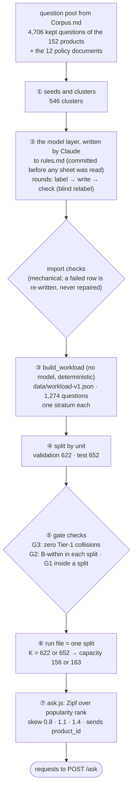
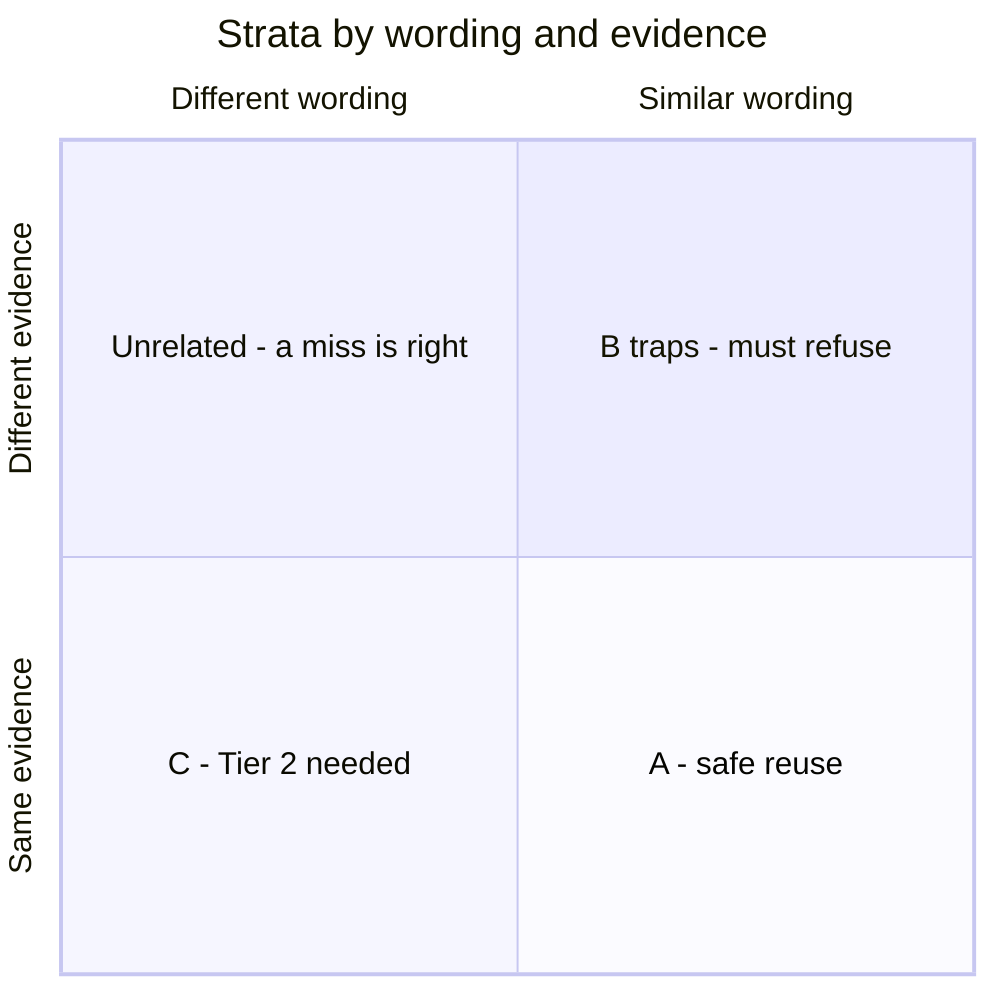

# The workload pipeline — from real questions to a run's request stream

**For:** the author, as a blueprint for the bottom half of D9 (Ch. 4), a strata figure, and the supervisor.
**Describes:** the frozen `v1` workload (23 Oct 2026, ADR-013 and ADR-015) and `ask.js` at commit `29b24a6`. **About
the numbers:** all counts are facts about the frozen data (`docs/data-card.md` §3, §4, §7).

**The message, in one sentence:** *1,274 questions were written to rules fixed before the text, each tagged with the
one stratum it tests, and split so that no question and its paraphrase sit on both sides.*

---

## 1. The pipeline (the blueprint for D9, bottom half)

## 2. Step by step

**① Seeds and clusters.** The starting point is the pool of kept PQA questions of the 152 products
([`Corpus.md`](Corpus.md) §2) and the 12 policy documents. Questions that ask the same thing about the same evidence
form a **cluster** (546 in all). One question of a cluster is its **seed**.

**② The model layer.** PQA itself repeats little: shoppers see the Q&A board before they post, so within one product
only 5–14 of 100 questions re-ask something. Real redundancy has to be **modelled**, and the traps the study needs
have to be **written**. So Claude wrote, task by task, from sheets a script prepared:
- **label:** which spec questions the product text answers, one short name per product, which policy each policy
  question belongs to;
- **write:** rewrites of the seeds (questions must name their product, because real PQA questions are asked on a
  product page), paraphrases (close and far), lookalike traps, name swaps, questions about a product **and** a
  policy, and policy wordings;
- **check:** every written spec question labelled again **without its seed**; a disagreement drops it.

The rules and every constant were **committed before the first sheet was read**, and the import refuses to run while
they are changed. A row that fails a check is written again, never repaired by a script.

**③ Build.** `make workload-build` turns the model layer into the workload, with no model and no randomness: two builds
gave the same manifest (`7ee717a846a2…`). Each question gets **exactly one stratum** (§3).

**④ Split by unit.** Whole units go to one side: a **pair of products** for spec questions, a **(shape, department)**
group for policy questions, and the two sides of each minimal pair into **opposite** splits. So a seed and its
paraphrases are never split, which would leak answers from validation into test. **Validation (622)** is for choices
(τ, the operating point); **test (652)** is for the reported results.

**⑤ Gate checks** ([`Corpus.md`](Corpus.md) §2 ⑥). For the workload, three matter most:
- **G3, zero Tier-1 collisions:** no two questions with different grounding normalise to the same Tier-1 key (§5);
- **G2 inside each split:** both splits contain same-product traps;
- **G1 inside a split:** 21 pairs, against a floor of 50, recorded as failed (ADR-014).

**⑥ Run file and `K`.** A run draws from **one split file**. `K` is that file's number of distinct questions, and the
cache capacity is **`round(0.25 × K)`**: 156 for validation, 163 for test. A cache smaller than the question set makes
eviction real.

**⑦ The request stream.** `k6/ask.js` picks questions by a **Zipf** distribution over each record's popularity rank,
with a skew swept over **0.8, 1.1 and 1.4** (default 1.1). Redundancy is the independent variable: uniform would make
the cache look useless, a fixed cycle would make it look perfect. Each request sends the record's `product_id`.

## 3. The strata (a blueprint for a strata figure or table T8)

| Stratum | Wording | Evidence | What it tests | Count |
| :---: | :--- | :--- | :--- | ---: |
| **A** | similar | same | safe reuse: what a semantic cache **should** serve | 761 |
| **C** | different | same | why exact match is not enough: Tier 2's reason to exist | 150 |
| **B-within** | similar | different, **same product** | the trap **only the evidence check** can catch | 272 |
| **B-cross** | similar | different, other product | a trap a `product_id` key also catches | 22 |
| **D** | any | a product **and** a policy | grounding on two kinds of document (the MIXED lane) | 69 |
| | | | **total** | **1,274** |

- **Traps:** 284 (272 B-within + 12 B-cross name swaps; the 10 "same name" swaps are not traps). Only **182 of
  284** have a partner close enough (cosine ≥ 0.85) to reach the τ check at all (figure F2). Trap fraction 0.2229.
- **Why B is split in two.** If every trap were across products, putting `product_id` in the cache key would catch
  them all for free, and C1 would be redundant by construction. B-within is the case that needs the evidence check.
- **94 questions** are not answerable from their product's record; they ride in the run files marked
  `answerable: false`.

*(Mermaid's quadrant chart is a sketch. In draw.io, draw a 2 × 2 grid with these four labels and put D as a separate
box beside it: it is defined by its grounding, not by these two axes.)*

## 4. Key numbers

| Quantity | Value |
| :--- | :--- |
| questions | 1,274 (validation 622, test 652) |
| clusters / paraphrase records / lookalike traps | 546 / 555 / 99 |
| strata | A 761 · B-within 272 · C 150 · D 69 · B-cross 22 |
| traps that can reach τ | 182 of 284 |
| `K` → capacity | 622 → 156 (validation) · 652 → 163 (test) |
| Zipf skews | 0.8 · 1.1 · 1.4 |

## 5. What G3 guarantees for Tier 1, and what it does not

Tier 1 is a bare hash of the normalised question and runs **no** reuse rule. If two questions with different
answers normalised to the same text (for example "-10 °C" and "10 °C", or "Model A-1" and "Model A1"), Tier 1
would serve one answer for the other, forever. **G3 guarantees there is no such pair in the frozen workload**, so
on the test split Tier 1 cannot be wrong. It guarantees **nothing about real traffic**: that is a limitation to
report (`Tier 2.md` §12a, row 2).

## 6. Limitations to state with this figure

- **Written by a model (Claude)**, to rules fixed in advance; the Phase 5 judge must therefore **not** be Claude.
- **Mostly literal.** Conditions are rarely said in other words, so synonym errors (`RAG.md` §5) are understated.
- **G1 failed** (21 of about 50 pairs): less power to show C1 on same-product traps.

## 7. Drawing notes

- **Two figures, not one:** the pipeline (this doc §1, joined to [`Corpus.md`](Corpus.md) at the gate for D9), and the
  strata (§3, as a 2 × 2 grid plus D, or as table T8).
- **Must show:** "written to rules fixed before the text"; the split **before** the gate; `K` → capacity on the run
  file; Zipf with its three skews.
- **Name the writer honestly:** "Claude", with "blind relabel" on the check step.
- **File:** `d09-corpus-build` (shared with `Corpus.md`).

## 8. Sources

`docs/data-card.md` §3, §4, §7; ADR-013, ADR-014, ADR-015; `experiments/scripts/build_workload.py`, `corpus_gate.py`;
`experiments/k6/ask.js`; [`data-build.md`](../Codebase/experiments/data-build.md).
