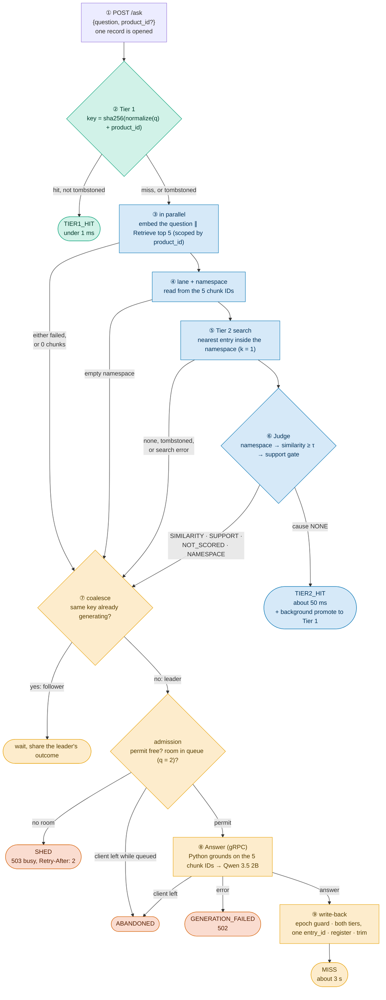
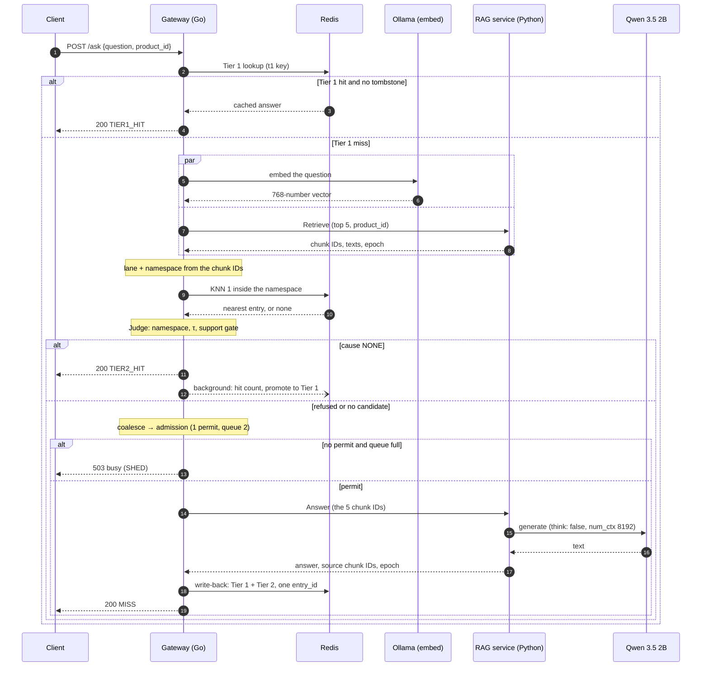

# The whole request — one question, from the client to the answer

**For:** the author, as a blueprint for the report's main pipeline figure (D2 in
`docs/0-Thesis-Report/plan/figures.md`) and for the supervisor. **Describes:** the code at commit `29b24a6`
(30 Oct 2026). **About the numbers:** every time in this doc comes from demo or functional runs. **None is
citable**; Phase 7 measures them.

**The message of the figure, in one sentence:** *a request stops at the cheapest tier that can answer it
safely; only a miss reaches the model, and only through the permit.*

---

## 1. The pipeline, as a flowchart (the blueprint for D2)

## 2. Step by step

**① The request.** `POST /ask` with a `question` and an optional `product_id`. The gateway computes the **Tier-1
key once** and reuses it for the Tier-1 lookup, the coalescing key and Tier 2's `t1_key`. It opens **one evaluation
record**, and one deferred call writes it on every exit, so each request leaves exactly one record.

**② Tier 1, exact match.** The question is normalised (lower case, white space collapsed, punctuation and symbols
dropped) and hashed **together with the `product_id`** (ADR-018). One Redis lookup. A hit is served **unless its
entry has a tombstone** (it was invalidated by an edit); then the request goes on as a miss. Tier 1 runs **no reuse
rule**: it is a bare hash match. It cannot be wrong on the frozen workload, because gate G3 removed every collision
there ([`Workload.md`](Workload.md) §5).

**③ Embed and retrieve, at the same time.** Two calls run in parallel, so a Tier-2 hit costs the slower of the two,
not their sum:
- **embed**: Ollama turns the question into 768 numbers (`search_query:` prefix);
- **Retrieve**: the Python service returns the **top 5 chunks**, their scores, their **texts**, and the dataset
  epoch, scoped to the `product_id` ([`RAG.md`](RAG.md) §3).

If either fails, or retrieval returns no chunk, the request goes **straight to the miss path**. A Tier-2 outage
costs hit rate, never availability.

**④ Lane and namespace.** Pure Go, no I/O. The share of policy chunks among the five gives the **lane** (SPEC,
POLICY, or MIXED when that arm is on). The lane and the ranked chunk IDs give the **namespace**: the product, the
rank-1 policy document, or the pair. It is **read from what retrieval returned, never predicted from the question**.
`Tier 2.md` §6 explains why.

**⑤ Tier 2 search.** One vector search, **inside the namespace only**, for the single nearest cached question. No
candidate, a tombstoned candidate, or a search error (which makes the run inadmissible, rule 12) all lead to the miss
path.

**⑥ Judge.** One reason per candidate, in a fixed order: **NAMESPACE** (an alarm, should never happen) →
**SIMILARITY** (below τ) → the **support gate** (does the fresh evidence still support the cached answer?) →
**NONE**, which means serve. With the gate off, the third check is skipped. Containment (θ) is computed and logged,
never used (ADR-019). A served hit is **TIER2_HIT**; two background writes follow (a hit counter, and a copy of
the entry into Tier 1 under this question's key, so the next identical question is a Tier-1 hit).

**⑦ Coalesce, then admission.** If the same key is already being generated, this request becomes a **follower**:
it takes no permit and shares the leader's result, whatever it is. Otherwise it is the **leader** and asks the
**admission pool** for the one permit. If the permit is taken and the queue (q = 2) is full: **SHED**, `503`. If the
client leaves while queued: **ABANDONED**, which is not a shed.
[`Admission Control.md`](../Admission%20Control/Admission%20Control.md) has the detail.

**⑧ Generate.** The leader calls `Answer` and sends the 5 chunk IDs it already has, so Python does **not** retrieve
again. Python reads the epoch, fetches the 5 texts, builds the prompt and calls Qwen 3.5 2B
([`LLM.md`](LLM.md)). The permit is held for the whole call and the write-back.

**⑨ Write-back.** If the epoch moved during generation, the answer is **served but not cached**. Otherwise it is
written to **both tiers under one new `entry_id`**, its sources are registered in the dependency map, and the cache
is trimmed to its capacity. Any failure here still serves the answer. [`write-back.md`](write-back.md) has the
detail. Outcome: **MISS**.

## 3. The six outcomes

| Outcome | Where it ends | HTTP | Counted as |
| :--- | :--- | :---: | :--- |
| `TIER1_HIT` | ② | 200 | goodput, a hit |
| `TIER2_HIT` | ⑥ | 200 | goodput, a hit |
| `MISS` | ⑨ (a follower shares it) | 200 | goodput, a generation |
| `SHED` | ⑦ (a follower of a shed leader too) | 503 | graceful degradation, never goodput |
| `ABANDONED` | ⑦ or ⑧ | none | a failed request, never excluded |
| `GENERATION_FAILED` | ⑧ | 502 | an error |

## 4. The same request as a sequence diagram (optional second figure)

Use this when the audience needs to see **who talks to whom**. Paste it into draw.io as Mermaid; a sequence
diagram usually comes in usable as it is.

## 5. Time per step (indicative, not citable)

| Step | Time | Source |
| :--- | :--- | :--- |
| ② Tier 1 | under 1 ms (shown as 0 ms) | `dev-v0` demo, `Tier 2.md` §9 |
| ③ embed ∥ retrieve | about 15 ms ∥ about 18 ms | code comment in `handler.go`, `dev-v0` |
| ③–⑥ a whole Tier-2 hit | about 50 ms (52 ms in the demo) | `dev-v0` demo |
| ⑧ prompt reading + generation | about 1.3 s + 2.0 s (medians per Qwen request) | `v1`, update-set run `live3`, Ollama log |
| a whole miss | about 3 s (3,001 ms in the demo) | `dev-v0` demo |
| throughput ceilings | Tier 1 ≈ 8,000 req/s · Tier 2 ≈ 61 req/s · generation ≈ 0.19 req/s | planning figures (ADR-001, ADR-003) |

The ratio is the whole point: a Tier-2 hit is about **60 times** cheaper than a generation, and a Tier-1 hit far more.

## 6. Failure paths

| What fails | What happens | Why |
| :--- | :--- | :--- |
| Tier-1 Redis read | 500 | the cache store is down |
| embedding or retrieval | miss path | Tier 2 costs hit rate, never availability |
| retrieval returns 0 chunks | miss path, no cause | no evidence, no hit |
| Tier-2 search error | miss path, `tier2_search_failed` | the run is inadmissible (rule 12) |
| a tombstoned entry | refused, named in `invalidated_entry_id` | it was invalidated by an edit |
| no permit, queue full | 503 | overload is shed and counted |
| client leaves | ABANDONED | a censored latency, never excluded |
| `Answer` fails | 502 | |
| write-back fails | still 200 MISS | the generation already happened |
| epoch moved during generation | still 200 MISS, not cached | a stale answer must not enter the cache |

## 7. Drawing notes

- **Colours** (`figures.md` §0.2): Tier 1 green `#009E73`, Tier 2 blue `#0072B2`, miss and generation orange
  `#E69F00`, shed and refusals red-orange `#D55E00`. The Mermaid above already uses them.
- **Must show:** the six outcomes; embed and retrieve **in parallel**; coalescing **before** admission (a follower
  never takes a permit); that the namespace comes from the retrieval.
- **Optional small notes:** "one record per request"; the times of §5 next to the three hit/miss endings.
- **Leave out** (they have their own figures): the Redis commands (`Redis-Data Structure.md` §7), the inside of the
  Judge (D3), lane and namespace rules (D4), the inside of the write-back ([`write-back.md`](write-back.md)).
- **Names** exactly as in the code: Tier 1, Tier 2, namespace, permit, `TIER1_HIT`, `TIER2_HIT`, `MISS`, `SHED`.
- **File:** `d02-request-pipeline` (`.drawio` in `figures/diagrams/`, `.pdf` in `latex/images/`).

## 8. Sources

`docs/architecture.md` §3; `docs/contracts/interfaces.md` §A and §H; `gateway/internal/httpapi/handler.go` and
`cascade.go`; [`httpapi.md`](../Codebase/gateway/httpapi.md); `Redis-Data Structure.md` §7; `Tier 2.md` §5–§9.
