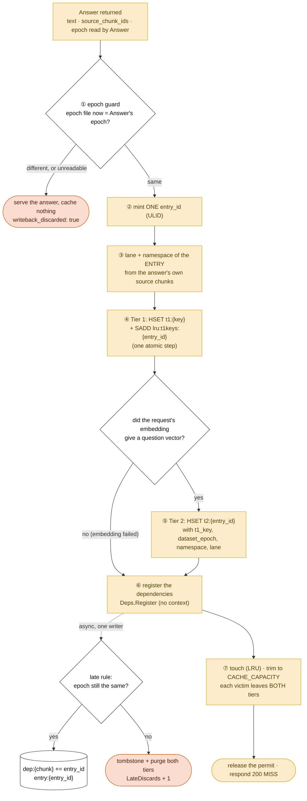
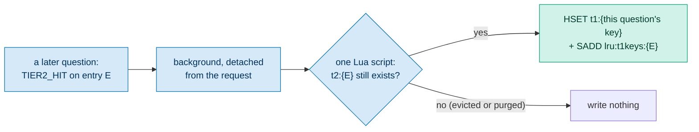

# The write-back — what a miss leaves behind

**For:** the author, as a blueprint for the tail of D2 and a figure in Ch. 3 §3.3 or §3.6, and for the supervisor.
**Describes:** the code at commit `29b24a6` (30 Oct 2026). **Every Redis key and field** named here is described in
`Redis-Data Structure.md` §5–§8; this doc shows the **order** and the **reasons**, and links rather than repeats.

**The message, in one sentence:** *a new answer is written to both tiers under one `entry_id`, only if the dataset
epoch has not moved, and nothing that fails after generation stops the answer from being served.*

---

## 1. The pipeline

## 2. Step by step

**① The epoch guard.** `Answer` read the epoch **before** it read the chunk texts, and returned it. The gateway now
reads the epoch file again. **Any difference, or a failed read, discards the write-back**: the client still gets the
answer, but nothing is cached, registered or trimmed, and the record says `writeback_discarded: true`. This closes the
race in which an edit lands while the model is writing ([`Invalidation.md`](../Cache_Invalidation/Invalidation.md) §9).
Under `mutation: on`, any edit discards **every** write-back in flight, because the epoch is global; under
`mutation: off` a discard is a bug (invariant I13).

*In the code, steps ② and ③ are computed just before the guard. They write nothing, so the figure can show the guard
first: the point is that **nothing reaches Redis before it**.*

**② One `entry_id`.** A ULID, minted once and used for **both** tiers. The purge finds Tier 2 by this ID and Tier 1
through it; two IDs would make the purge miss one copy.

**③ The entry's own partition.** The lane and namespace are computed from the chunks **the answer was generated
from**, not from the incoming question's retrieval. Usually they are the same chunks; when Python had to retrieve
again, they are not, and the entry must be filed under what it really used.

**④ Tier 1.** `HSET t1:{key}` with the answer, sources, model, time and `entry_id`, and **in the same atomic step**
the key is added to `lru:t1keys:{entry_id}`. A key written without that record would survive eviction and purge.

**⑤ Tier 2**, only when the request has a question vector. `HSET t2:{entry_id}` with the vector, the question, the
answer, the sources, **`t1_key`** (correctness invariant 2), the `dataset_epoch`, the namespace and the lane. If the
embedding failed, the entry is Tier-1-only; `entry:{entry_id}` (step ⑥) still lets the purge find it.

**⑥ Register.** `Deps.Register(entry_id, sources, t1_key, epoch)` queues the registration for the one writer
goroutine and returns. It takes **no context**: a client that has left must not cancel it, or the entry would have
no dependency record and no purge could reach it. The writer then applies the **late rule**: if the epoch moved
between ① and now, it tombstones and purges the entry instead of registering it (`LateDiscards`). Otherwise it writes
`dep:{chunk}` for each source and `entry:{entry_id}` in one transaction.

**⑦ Touch and trim.** The entry's last-use time is updated in `lru:entries`, and the cache is trimmed to
`CACHE_CAPACITY` (`round(0.25 × K)` for a measured run; unbounded when unset). **Each victim leaves both tiers
together**: a Tier-1 copy left behind would keep serving an answer the experiment thinks is gone. The trim never
touches `dep:*` or `entry:*` (correctness invariant 1).

Then the closure ends, the **permit is released**, and the response is `200 MISS`. Coalesced followers get the same
answer.

## 3. Later: promotion on a Tier-2 hit

A Tier-2 hit copies the entry into Tier 1 under the **new** question's key, so the next identical question costs a
hash lookup. The check and the write are **one script**: with two calls, a purge could run in between and leave a
Tier-1 pointer to a purged answer. Item 7.3 measures what promotion does to the tier mix.

## 4. Which failures are allowed

| Failure | Effect | Why it is allowed |
| :--- | :--- | :--- |
| Tier-1 write fails | logged; answer served | the generation is the most expensive thing in the system |
| Tier-2 write fails | logged; answer served; still registered | a Tier-1 copy may exist, so it must stay purgeable |
| registration fails | counted (`RegisterErrors`), logged | reported at shutdown as an incomplete map |
| registration after shutdown | counted (`Dropped`), logged | never lost without a trace |
| trim fails | logged; answer served | costs capacity accuracy, not correctness of this answer |
| epoch guard fires | answer served, not cached | a stale answer must not enter the cache |

**Never allowed:** a write-back that fails the request. That would turn a successful generation into an error, an
outcome the evaluation has no category for.

## 5. Drawing notes

- **Message box first:** "one `entry_id`, two tiers, guarded by the epoch".
- **Must show:** the guard **before** any write; the one `entry_id` feeding both tiers; registration **after** the
  writes and **without** a context; the trim removing both tiers.
- **Show the discard path in red-orange** `#D55E00`, the writes in the miss orange `#E69F00`.
- **Leave out** the Redis field lists (point to `Redis-Data Structure.md`) and the purge itself (D8a).
- In D2 this whole doc is the single box ⑨; draw this as its own figure only if Ch. 3 needs it.

## 6. Sources

`gateway/internal/httpapi/handler.go` (the coalescing closure); `gateway/internal/cache/store.go`, `tier2.go`,
`capacity.go`; `gateway/internal/deps/deps.go`; `interfaces.md` §D and §E; ADR-008; `Redis-Data Structure.md` §5–§8;
[`httpapi.md`](../Codebase/gateway/httpapi.md), [`cache.md`](../Codebase/gateway/cache.md), [`deps.md`](../Codebase/gateway/deps.md).
