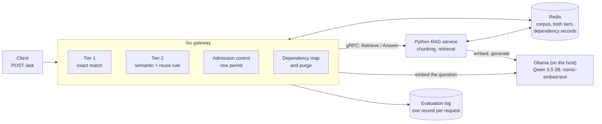

# System docs — how the platform works

**For:** a reader who is new to the project: the supervisor, an examiner, or a later work session.
**What this folder is:** one file per part of the system, written to be read, not to define anything.
- The **contracts** that the code must follow are in `docs/contracts/interfaces.md`.
- The **decisions** and why they were made are in `docs/decisions.md`. An `ADR-NNN` here means an entry
  there.
- The **folder structure and module boundaries** are in `docs/architecture.md`.

**Two kinds of file live here:**
- **System docs** (§1–§4) explain the platform **by flow**: what happens to a question, where the data comes
  from, and how the safety mechanisms work.
- **Codebase docs** (§5) explain the code **by folder**: what each package or module is for, and the logic
  of its files and functions.

**Status (30 Oct 2026):** five system docs are written (`Tier 2.md`, `Redis-Data Structure.md`,
`Admission Control/Admission Control.md`, `Cache_Invalidation/Invalidation.md`, `Cache_Invalidation/Update set.md`),
all 21 codebase docs (§5), and the seven `Pipelines/` docs (30 Oct 2026), which double as drawing blueprints for
the report's figures (each has Mermaid diagrams and drawing notes keyed to `docs/0-Thesis-Report/plan/figures.md`). The tables in §3 and §5 say what each file should
cover and where its facts come from.

---

## 1. The system in one picture



- **The gateway** owns both cache tiers, the reuse decision, admission control and invalidation.
- **The RAG service** owns the corpus, retrieval and the call to the model.
- **Ollama** serves one generation at a time on a 16 GB laptop.
- **Redis** holds only copies: the corpus of record is the JSON files in `data/v1/`.

---

## 2. Reading order

1. `Pipelines/whole Request.md`: what happens to one question, from the client to the answer.
2. `Pipelines/Corpus.md`, then `Pipelines/Workload.md`: where the data comes from, and how the questions are
   built.
3. `Pipelines/RAG.md` and `Pipelines/LLM.md`: retrieval and generation.
4. `Tier 2.md`: the semantic cache and every known trap.
5. `Pipelines/write-back.md` and `Redis-Data Structure.md`: what a miss leaves behind, and how it is stored.
6. `Admission Control/` and `Cache_Invalidation/`: the two mechanisms that keep the system safe under load
   and under change.
7. `Pipelines/Evaluation.md`: how a run becomes a number and a figure.
8. `Codebase/`: when you need the code itself, open the doc of the package you are reading (§5).

---

## 3. The files

| File | Status | What it covers | Write it from |
| :--- | :--- | :--- | :--- |
| [`Tier 2.md`](Tier%202.md) | **written** | The semantic cache: lanes, namespaces, the support gate, worked examples, and every known false-hit and false-miss trap (§12a) | — |
| [`Redis-Data Structure.md`](Redis-Data%20Structure.md) | **written** | Every Redis key, field by field: corpus, both tiers, LRU, dependency records | — |
| [`Pipelines/whole Request.md`](Pipelines/whole%20Request.md) | **written** | One request end to end, as a sequence diagram: Tier 1 → embedding and retrieval **in parallel** → lane and namespace → Tier 2 → hit, or miss → admission → coalescing → generation → write-back → the response and one log record. Time per step. Failure paths: a Tier-2 failure degrades to a miss, and overload answers `503` | `docs/architecture.md` §3; `docs/0. progress 16-10.md` §1.2; `Redis-Data Structure.md` §7; `gateway/internal/httpapi/` |
| [`Pipelines/Corpus.md`](Pipelines/Corpus.md) | **written** | Raw Amazon-PQA files (sha256 checks, parsing) → the pre-registered product draw (152) → the R2 filter → JSON documents → 12 authored policies, one condition per document → the corpus gate G1–G5 → the freeze. A count at each step. The licensing rule | `docs/data-card.md` §1, §2, §7; ADR-002, ADR-011, ADR-012, ADR-014, ADR-015; `experiments/scripts/build_pqa.py`, `select_pqa.py` |
| [`Pipelines/Workload.md`](Pipelines/Workload.md) | **written** | Seed clusters → paraphrases and traps by stratum (A, B-within, B-cross, C, D) → the split by cluster (validation 622, test 652) → run files, Zipf, `K` per file. What G3 guarantees for Tier 1 | `docs/data-card.md` §3 and the strata table; ADR-013; `experiments/scripts/build_workload.py` |
| [`Pipelines/RAG.md`](Pipelines/RAG.md) | **written** | **Offline:** JSON → chunks (256 tokens, overlap 40) → `search_document:` embedding → `idx:corpus`. **Online:** `search_query:` → top 5 → product scoping (drop other products, add this product's own chunk) → `texts` aligned with `chunk_ids`. Measured limits: condition routing, overlap ≈ 1 inside a product | `Redis-Data Structure.md` §3; `interfaces.md` §B–§C; `rag/src/rag/`; `Tier 2.md` §8 and §12a |
| [`Pipelines/LLM.md`](Pipelines/LLM.md) | **written** | Qwen 3.5 2B (`q4_K_M`, `think: false`, `num_ctx` 8192) on Ollama, natively, at **one slot**. The prompt template. The memory envelope: about 3.0–3.1 GB, a vision encoder of 855 MB, the prompt cache off, `make ollama-env` after a reboot, `make env-check`. Why this model. The open batch-size finding | ADR-003, ADR-017; `rag/src/rag/generate.py`; `experiments/scripts/env_check.py`; trail `docs/work/2026-10-29-ollama-prompt-cache/` |
| [`Pipelines/write-back.md`](Pipelines/write-back.md) | **written** | After a generation: the epoch guard → Tier 1 and Tier 2 written under one `entry_id` → the LRU trim → dependency registration → promotion on a later Tier-2 hit. Which failures are allowed: a failed write never fails the request | `Redis-Data Structure.md` §5–§8 (link to it, do not copy it); ADR-008; `gateway/internal/httpapi/handler.go` |
| [`Pipelines/Evaluation.md`](Pipelines/Evaluation.md) | **written** | How a run becomes a number. The run identity `(config_id, mutation, support_gate, mixed_lane)` → the evaluation log (§H) → write-once `raw/` → the judge → metrics with Wilson intervals → `make figures`. The five configurations, Headlines A and B, RQ3; validation for choices, test for results. Say clearly what exists now and what Phase 5 builds | `interfaces.md` §H; `docs/Final_Proposal.md` §9; `docs/super-plan.md` Phases 5–7; ADR-005, ADR-010, ADR-016, ADR-019 |
| [`Admission Control/Admission Control.md`](Admission%20Control/Admission%20Control.md) | **written** | Why one permit (ADR-003); the queue budget; `503 busy, retry`; how it works with coalescing; what it protects (queueing delay and goodput) and what it does not (it does not raise capacity, and it does not bound memory). The telemetry fields. The planned with/without comparison (item 7.5). Related work | ADR-003; `docs/0. progress 16-10.md` §4; `gateway/internal/admission/`; pre-thesis report §2.5 |
| [`Cache_Invalidation/Invalidation.md`](Cache_Invalidation/Invalidation.md) | **written** | The dependency map (`dep:`, `entry:`), blind purge, the copy-on-write tombstone set, the epoch guard, the edit path (`rag.edit` → `POST /invalidate`), the three correctness invariants. Phase 4's functional results. The RQ3 plan (item 6.5) and the TTL baseline | `Redis-Data Structure.md` §8; ADR-008; `gateway/internal/deps/`; `docs/learning/04-concurrency-and-invalidation.md`; trail `docs/work/2026-10-29-update-set/` |
| [`Cache_Invalidation/Update set.md`](Cache_Invalidation/Update%20set.md) | **written** | The 20 edits (10 substantive, 10 cosmetic; half policy, half product); how completeness and precision are computed; the limit that precision is judged per edit, not per entry | `docs/data-card.md` §5; trail `docs/work/2026-10-29-update-set/`; `experiments/scripts/score_update_set.py` |

---

## 4. Rules for writing these files

- **Plain English**, short sentences, one idea per paragraph (`CLAUDE.md`, "How to write").
- **Link, do not copy.** If `Tier 2.md`, `Redis-Data Structure.md` or `interfaces.md` already explains
  something, point to the section. Two copies of one fact drift apart: these two files had to be corrected
  in five places on 30 Oct.
- **Check against the code before writing**, and name the commit in the file's header.
- **Every number names its corpus, and whether it is citable.** `dev-v0` is never citable. Numbers from the
  `v1` validation split, functional runs and probes are not citable either. Only Phase 6 and Phase 7 runs
  on the test split are.
- **Never quote Amazon-PQA text**: questions or product descriptions. Its redistribution is not granted.
  Write examples of your own and say so.
- **Diagrams in mermaid**, so they render in the editor and on GitHub.
- **Terms** are defined once, in `Redis-Data Structure.md` §10.

---

## 5. Codebase docs

One doc per **Go package**, and one per **group of Python modules or scripts** with one job. Inside each
doc, **one section per source file**, and in it a short explanation of the logic of each important type
and function. They are meant to be read beside the code, not instead of it.

```
Codebase/
├── gateway/        one doc per package in gateway/cmd and gateway/internal
├── rag/            the Python RAG service, rag/src/rag/, in three groups
├── experiments/    experiments/scripts/ and experiments/k6/, in four groups
├── contracts.md    contracts/: the gRPC schema and the shared normalisation cases
└── ui.md           ui/: the demo page
```

### 5.1 `gateway/` — the Go gateway (`gateway/cmd/`, `gateway/internal/`)

| Doc | Source files | Explain especially |
| :--- | :--- | :--- |
| [`cmd-gateway.md`](Codebase/gateway/cmd-gateway.md) | `cmd/gateway/main.go` | How the parts are wired. Every environment variable, its default and its refusal rule (`REUSE_TAU`, `REUSE_THETA`, `SUPPORT_GATE`, `LANE_SIGMA`/`LANE_SIGMA_HI`, `CACHE_CAPACITY`, `CONFIG_ID`, `MUTATION`, `OLLAMA_NUM_PARALLEL`, `DATASET_EPOCH_FILE`). The wait for `idx:cache`. Shutdown order |
| [`httpapi.md`](Codebase/gateway/httpapi.md) | `handler.go`, `cascade.go`, `invalidate.go`, `browse.go`, `types.go` | `Ask` step by step, with **every exit path**. The cascade is Tier 2's plumbing, while `reuse/` makes the decision. Write-back and the epoch check. `POST /invalidate`. The demo endpoints. The request and response types |
| [`reuse.md`](Codebase/gateway/reuse.md) | `lane.go`, `rule.go`, `gate.go`, `support.go`, `support_numeric.go`, `cause.go` | The decision itself: the lane and the namespace, `DecideNamespace`, the logged containment (`Decide`, ADR-019), `Judge` and the order of causes, the lexical and numeric arms. Why the package has no I/O |
| [`cache.md`](Codebase/gateway/cache.md) | `key.go`, `normalize.go`, `store.go`, `tier2.go`, `capacity.go`, `purge.go`, `entry.go`, `entry_id.go` | The Tier-1 key and `Normalize`, including the collision note. Reads and writes of both tiers. The namespace-scoped KNN. The LRU trim and the purge scripts. Entry IDs. It never decides reuse |
| [`deps.md`](Codebase/gateway/deps.md) | `deps.go`, `epoch.go` | The one writer goroutine. Registration. The copy-on-write tombstone set. `Invalidate` and `InvalidateWait`, and the purge steps. The epoch reader and the late check |
| [`admission.md`](Codebase/gateway/admission.md) | `pool.go` | The permit pool and its bounded queue. When it sheds. What its numbers mean (ADR-003) |
| [`coalesce.md`](Codebase/gateway/coalesce.md) | `coalesce.go` | How identical questions in flight share one generation, and what is not shared |
| [`embed.md`](Codebase/gateway/embed.md) | `client.go` | The query embedding over `/api/embed`, and the `search_query:` prefix |
| [`ragclient.md`](Codebase/gateway/ragclient.md) | `client.go`, `retrieve.go`, `answer.go`; the generated `ragpb/` | The gRPC client. `Retrieve` and `Answer`. `texts` aligned with `chunk_ids`. The two live tests (`make seam-check`, `make support-check`) |
| [`telemetry.md`](Codebase/gateway/telemetry.md) | `evallog.go` | The evaluation record, field by field (`interfaces.md` §H). Why no field uses `omitempty`. How it is written |
| [`catalog.md`](Codebase/gateway/catalog.md) | `catalog.go` | A read-only product list for the demo page. Never on a measured path |
| [`testredis.md`](Codebase/gateway/testredis.md) | `testredis.go` | The throwaway Redis that Go tests use (port 6390), and why the live server is never touched |

### 5.2 `rag/` — the Python RAG service (`rag/src/rag/`)

| Doc | Source files | Explain especially |
| :--- | :--- | :--- |
| [`ingestion.md`](Codebase/rag/ingestion.md) | `config.py`, `chunkid.py`, `embedding.py`, `store.py`, `ingest.py` | JSON → chunks → vectors → `idx:corpus`. The chunk-ID scheme. The index schema. The `search_document:` prefix. The wait until the index is complete |
| [`serving.md`](Codebase/rag/serving.md) | `server.py`, `retrieve.py`, `generate.py`, `cli.py` | The gRPC server. `retrieve()` with product scoping (`_drop_other_products`, `_ensure_own_chunk`). `fetch_by_ids`. `Answer` and the prompt template. The `rag ask` CLI |
| [`edit-and-epoch.md`](Codebase/rag/edit-and-epoch.md) | `edit.py`, `epoch.py` | The order of an edit: embed, write, advance the epoch, post. The epoch file and its lock (ADR-008) |

### 5.3 `experiments/` — scripts that build data and check the system

| Doc | Source files | Explain especially |
| :--- | :--- | :--- |
| [`data-build.md`](Codebase/experiments/data-build.md) | `build_pqa.py`, `select_pqa.py`, `answerability_check.py`, `check_policies.py`, `build_workload.py` | From raw PQA to the frozen JSON corpus and workload; what each script checks; which `make` target runs it |
| [`gate-and-freeze.md`](Codebase/experiments/gate-and-freeze.md) | `corpus_gate.py`, `freeze_corpus.py` | G1–G5, one by one. How the freeze records hashes and refuses a mismatch |
| [`envelope-and-load.md`](Codebase/experiments/envelope-and-load.md) | `env_check.py`, `loadgen_footprint.py`, `load_burst.py`, `verify_admission.sh`, `k6/ask.js`, `k6/mu_hit.js` | How `env-check` reads the live runner (argv, `/props`, its environment). The load generator and its own footprint. The μ_hit probe |
| [`invalidation-tools.md`](Codebase/experiments/invalidation-tools.md) | `update_set.py`, `update_set_check.py`, `score_update_set.py`, `epoch_race_check.py`, `cache_reset.py` | The update set, the live check, the completeness and precision score, the epoch race check, and the measured-run reset |

### 5.4 Shared files and the demo page

| Doc | Source files | Explain especially |
| :--- | :--- | :--- |
| [`contracts.md`](Codebase/contracts.md) | `contracts/rag/v1/rag.proto`, `contracts/normalize/cases.json` | The gRPC messages (§B). The normalisation cases that a Go test and the corpus gate (G3) both read, so both languages normalise alike |
| [`ui.md`](Codebase/ui.md) | `ui/src/` (`main.jsx`, `api.js`, `Counters.jsx`, `pages/`) | The demo page: which endpoints it calls (`/products`, `/stats`, `/ask`), and what it shows |

### 5.5 A template for every codebase doc

1. **Purpose.** What the package is for, and which part of the thesis it serves (C1, C2, S1/S2, or none).
2. **Boundaries.** What it may import and what it must not do (`docs/architecture.md` §2).
3. **Files.** One section per source file. For each important type or function:
   - what it does, with its inputs and outputs;
   - its logic, step by step;
   - what happens on an edge case or an error;
   - why it is written that way, with the ADR or trail that decided it.
4. **Callers and callees.** Who calls it, and what it calls.
5. **Tests that pin it.** The test names, and what each one guarantees.
6. **Silent failures to watch.** What could go wrong with no error. This project's typical bug is a
   plausible wrong number.
7. **The commit** the doc describes.

Do not repeat a system doc. If `Tier 2.md` already explains why a check exists, the codebase doc explains
the code that does it and links to the reason.
