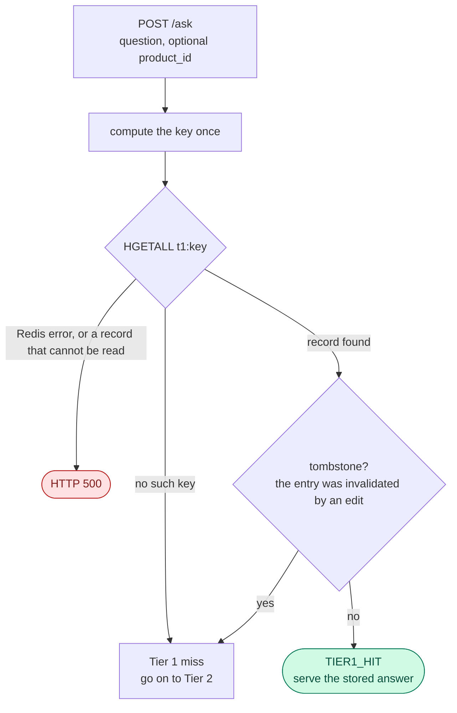

# Tier 1 — the exact-match cache, from the idea to the mechanism

**For:** a reader who is new to this project · **Describes:** the code at commit `2eb64af` (30 Oct 2026),
checked on 30 Oct 2026. The only uncommitted changes in `cache/` and `httpapi/` are edits to comments. The
decisions behind it go up to ADR-019.
**About the numbers:**
- **The examples use questions written for this document.** The three-step demo in §8 follows the
  `dev-v0` demo of `Tier 2.md` §9. `dev-v0` was retired on 29 Oct 2026, so those parts show how the
  mechanism behaves, and they are **not** results of the thesis.
- **The key values are computed.** They come from a Python copy of `Normalize` and `Key`. The copy gives
  exactly the key that `Redis-Data Structure.md` §4.1 lists, and the Go tests for both functions pass.
- **The corpus counts come from `v1`** (the gate G3 and ADR-018). The speed figures (§1) come from
  `dev-v0`. Neither is citable.
- **The thesis results are measured in Phases 6 and 7**, on the held-out test split.

**Contents.** Part 1, the idea (§1–2) · Part 2, the mechanism (§3–6) · Part 3, four worked examples (§7–10) ·
Part 4, safety, measuring and limits (§11–12) · Code map and further reading (§13)

---

# Part 1 — The idea

## 1. What Tier 1 does

Tier 1 answers a question that was **already asked in the same words**, about the same product. It is one
Redis hash lookup. It does not embed the question, it does not retrieve chunks, and it runs no reuse rule.

It sits first in every request (`Tier 2.md` §5). If it hits, the request ends there.

| | Tier 1 | Tier 2 | Generation |
| :--- | :--- | :--- | :--- |
| Matches | the same words (after normalising) and the same product | the same meaning | — |
| Work | one hash read | embed + retrieve + one vector search + the reuse rule | the model writes the answer |
| Time | under 1 ms (the demo showed 0 ms) | about 50 ms | 3 to 9 s |
| Throughput (planning figure) | about 8,000 req/s | about 61 req/s | about 0.19 req/s |

These are planning figures. The two hit figures are earlier probes on `dev-v0`. The Tier-1 one was taken on
6 Sep 2026 under *urgent* memory pressure, so it is a ceiling and not a safe bound (ADR-001). The 0.19 is a
projection that Phase 7 measures again.

**Where Tier-1 hits come from.** There are two sources:
- **A repeat.** Someone asks the same question again. The frozen workload draws its questions with a
  Zipf distribution, so a few questions repeat very often.
- **A promotion.** When Tier 2 serves a hit, the gateway also writes a Tier-1 copy under the new
  question's own words (§5). The next identical question then stops at Tier 1.

**Why it matters for the thesis.** A Tier-1 hit is the cheapest kind of load conversion: a generation of
seconds becomes a lookup of microseconds. Item 7.2 reports μ_hit for the two tiers separately, as lower
bounds, because the mix between them changes the capacity of the machine. Configuration 2 of the evaluation, "Tier 1 only", is
this tier alone.

## 2. Why Tier 1 is kept simple

The research question is about Tier 2: when is it safe to reuse an answer for a question with different
words? Tier 1 has no such question. Its rule is equality, and equality is not a judgement.

So `cache/` keeps Tier 1 as plain as possible. The `cache` package **never makes a reuse decision**
(`docs/architecture.md` §2). That is why `Normalize` does so little (§3).

This has a price. Tier 1 has no safety check at all, so its safety must come from somewhere else. It comes
from the corpus: no two workload questions with different correct answers may normalise to the same text
(§11).

---

# Part 2 — The mechanism

## 3. The key

```
question  "Does the EarBuds Pop 3 have ANC?"          product_id  "product-headphones-03"
      │                                                     │
      │ Normalize()                                         │
      ▼                                                     │
"does the earbuds pop 3 have anc"                           │
      │                                                     │
      └──────────────► join with one zero byte ◄────────────┘
                                  │
                                  │ sha256, as 64 hex characters
                                  ▼
      t1:1f8fa611c1ed1e4df9715196eb6655811dc94a774927dded7a5c00767b76350b
```

The handler computes this key **once**, at the start of `Ask`. It uses that one value for the evaluation
record (`t1_key`), the coalescing key, Tier 2's `t1_key` field and the dependency registration, so those
four can never drift apart. `Store.Get` and `Store.Put` build the same key again inside the store, with the
same two functions, `Normalize` and `Key`.

### What `Normalize` does

| Step | Result |
| :--- | :--- |
| Lower-case | `Can I Return` → `can i return` |
| Collapse white space | tabs, new lines and runs of spaces become one space; the ends are trimmed |
| Remove punctuation and symbols | every Unicode punctuation and symbol character is **removed, not replaced by a space** |
| Nothing else | no stemming, no stop words, no synonyms, no spelling fixes |

Two details:
- Removing is not the same as replacing. `laptop, headphones` becomes `laptop headphones` because there was
  a space after the comma. But `what's` becomes `whats`, `return/refund` becomes `returnrefund` and `$500`
  becomes `500`.
- Letters with accents and all digits stay. `Café` becomes `café`.

**Why so little?** Stemming, stop-word removal and synonyms would each merge two different questions at the
hash. That is a reuse decision, made in a place where no threshold governs it and nothing measures it.
`TestNormalizeDoesNotStemOrDropStopwords` pins this.

The same function runs when reading and when writing. If it did not, a question could be stored under one
key and looked up under another, and the hit rate would be too low with no error.

### What the key does and does not catch

| These two questions | Same key? | Why |
| :--- | :---: | :--- |
| `How long is the warranty?` and `HOW LONG IS THE WARRANTY` | yes | case and punctuation |
| `how long is the warranty` and `  how   long is the warranty  ` | yes | white space |
| `... after 30 days` and `... after 30-day` | **no** | `30-day` becomes `30day` |
| `return` and `returns` | **no** | no stemming |
| `the warranty` and `warranty` | **no** | no stop-word removal |
| `can i return this` and `can i refund this` | **no** | no synonyms |

Every "no" is a question that Tier 2 can still catch. It is a lost Tier-1 hit and not an error.

### The product is part of the key

`product_id` goes into the hash (ADR-018, `interfaces.md` v0.23). The same words about two products give two
keys. For the question "Is it waterproof?":

| `product_id` | Key (start) |
| :--- | :--- |
| `product-headphones-03` | `t1:66c1459b…` |
| `product-headphones-04` | `t1:db5773db…` |
| none | `t1:98dfede8…` |

- **A request with no `product_id` is its own partition.** It never reads or writes a product's key. It is
  not a wildcard.
- **The zero byte matters.** Without it, `"ab"` + `"c"` and `"a"` + `"bc"` would hash the same
  (`TestKeySeparatorIsUnambiguous`).
- **The cost:** a policy question asked on many product pages gets one Tier-1 entry per page. On `v1` this
  cost is zero (§11).

## 4. A request through Tier 1



**The lookup.** `Store.Get` reads the hash with one `HGETALL`. An empty hash is a miss. A found hash is
turned into an `Entry`: the answer, the source chunk IDs (stored as a JSON string), the model, the time and
the `entry_id`.

**The tombstone check.** After the read, the handler asks the dependency map whether this `entry_id` was
invalidated. If it was, the answer is **not served**. The request goes on as a miss, and the evaluation
record names the entry it refused (`invalidated_entry_id`). The check comes after the Redis read on purpose:
the map stores its tombstones before it deletes anything, so a read that could still see a purged entry also
sees its tombstone (`Invalidation.md`).

**A hit.** The handler then:
- records the hit in the log and returns `cache: TIER1_HIT`, with `similarity: null` and
  `source_overlap: null`: nothing was compared;
- returns the stored `sources` and `model_used`;
- touches the entry in the LRU order (only when `CACHE_CAPACITY` is set; one `ZADD`, and an error is
  logged and ignored). A question that is asked often stays in the cache.

A Tier-1 hit never reaches the embedding or the retrieval, so their times in the log are `null`.

**A failure is an error here.** If Redis fails, or the stored record cannot be read (a bad JSON string or
a bad time), `Get` returns an error and the request ends with **HTTP 500**. Tier 2 behaves differently: a
Tier-2 problem becomes a normal miss. Only something other than the gateway could write an unreadable
Tier-1 record, so it is not expected in a normal run. `TestTier1LookupErrorStillEmitsOneRecord` checks that
even this path leaves exactly one log record.

## 5. How a Tier-1 record is written

Tier 1 is never written by the question that hits it. Three paths write it:

| Path | When | What is written |
| :--- | :--- | :--- |
| **Miss write-back** | after the model has written an answer | Tier 1 and Tier 2 together, under **one** new `entry_id` |
| **Promotion** | after a Tier-2 hit, in the background | a Tier-1 copy of the cached answer, under the **new** question's key |
| **Tier-1 only** | the miss write-back when the embedding failed | Tier 1 alone: there is no vector, so no `t2:` record |

**Every Tier-1 write does two things in one atomic step:** it writes the hash, and it adds the key to the set
`lru:t1keys:{entry_id}`. This is a `MULTI`. A key without its set member would be an orphan: after an
eviction it would keep serving an entry the cache no longer holds (`TestNoOrphan`). `Redis-Data Structure.md`
§4.2 and §6 give the fields.

**The miss write-back** runs inside the coalesced generation, so a group of identical questions writes it
once. It does not run at all if the dataset epoch moved while the model was writing (the epoch guard,
invariant 3): then neither tier is written and the client still gets the answer. A failed Tier-1 write is
logged and never fails the request, because the generation is the most expensive thing in the system.

**The promotion** is the delicate one. It runs in the background, so a trim or a purge of the same entry can
run just before it. A plain write would then put a Tier-1 key in front of an entry that is already gone. So
the promotion is one Lua script (`promoteScript`): *if `t2:{entry_id}` exists, write the hash and the set
member; otherwise write nothing.* Redis runs a script as one step, so either the removal runs first (the
promotion finds nothing and stops) or the promotion runs first (the removal finds the key in the set and
deletes it). A promotion that finds no `t2:` record is not an error. `TestPromotionNeedsTier2` and
`TestTier2HitPromotesConditionally` pin both sides.

## 6. How a Tier-1 record leaves

Two things remove entries: the **LRU bound** (the cache holds at most `0.25 × K` entries) and the **purge**
after a source edit. Both run the same Lua script, `dropEntryScript`, so they can never disagree about what
an entry owns.

- **The bound counts entries, not keys.** `lru:entries` is a sorted set of `entry_id`s scored by last
  access. One entry can own several Tier-1 keys: the key from its miss and one for every promotion.
- **The script collects the entry's Tier-1 keys** from three places: the members of `lru:t1keys:{entry_id}`,
  the `t1_key` field of its `t2:` record, and a key the caller knows of (used by the purge for a Tier-1-only
  entry). It deletes each key, then `t2:`, the set and the `lru:entries` member.
- **Both tiers die together.** If only `t2:` were deleted, Tier 1 would keep serving the answer from a bare
  hash lookup. The entry would be gone from the cache the experiment believes it is measuring, and the
  capacity sweep would measure nothing.
- **Each key is deleted only if its `entry_id` field still names this entry.** Tier 1 is keyed by the
  question, so a newer entry for the same question reuses the same key. A blind delete would remove the new
  entry's copy (Example D, §10).

The script never touches `dep:*` or `entry:*`. Those belong to `deps/` (invariant 1). `Invalidation.md`
covers how an edit reaches the purge.

---

# Part 3 — Worked examples

## 7. Example A — the key, in five lines

Take the question "Does the EarBuds Pop 3 have ANC?" asked on the page of `product-headphones-03`.

1. `Normalize` gives `does the earbuds pop 3 have anc`: lower-case, no `?`.
2. Add a zero byte and the `product_id`.
3. sha256 gives `1f8fa611c1ed1e4df9715196eb6655811dc94a774927dded7a5c00767b76350b`.
4. The key is `t1:` plus those 64 characters.
5. `HGETALL` on that key returns the five fields of §5, or nothing.

If the same words are sent from the page of `product-headphones-04`, step 2 changes, and so does every
character after it.

## 8. Example B — the life of one entry

**Setting.** Follows the `dev-v0` demo of `Tier 2.md` §9: cold cache, gate on, no `product_id`. The results
and times of steps 1 to 3 are from the recorded demo (run 2). The keys and the contents of Redis are
computed from the code. Steps 4 to 6 follow from the code and the tests, and are not recorded runs.

Two questions are involved:
- **Q1:** "Am I entitled to a full refund on my headphones 30 days after delivery?" Its key starts
  `t1:b3c7a285`.
- **Q3:** "Is a full refund possible for my headphones 30 days after delivery?" Its key starts `t1:d6a1ef47`.

| Step | Request | Result | What Redis holds for the entry `E` |
| :---: | :--- | :--- | :--- |
| 1 | Q1 | Tier 1 miss, Tier 2 miss, the model answers (3.0 s) | `t1:b3c7…` (entry_id `E`) · `t2:E` · `lru:t1keys:E` = {`b3c7…`} |
| 2 | Q1 again | **Tier-1 hit**, shown as 0 ms | no change |
| 3 | Q3 | Tier 1 miss (other words), **Tier-2 hit** in 52 ms. In the background: promotion | adds `t1:d6a1…` (entry_id `E`) · `lru:t1keys:E` = {`b3c7…`, `d6a1…`} |
| 4 | Q3 again | **Tier-1 hit**: no embedding, no search | no change |
| 5 | Q3 without the `?` | **Tier-1 hit**: the same key | no change |
| 6 | `E` is the least recently used and the cache is full | trimmed | `t1:b3c7…`, `t1:d6a1…`, `t2:E`, `lru:t1keys:E` and its `lru:entries` member are all deleted |

Step 3 is where one entry gets a second key. Step 6 shows why the set exists: the Tier-2 record knows only
`t1:b3c7…`. Without the set, the trim would leave `t1:d6a1…` behind, still serving the answer.

## 9. Example C — one question, three pages

The question "Is it waterproof?" is asked on `product-headphones-03`, on `product-headphones-04` and with no
`product_id`. The three keys in §3 are different, so the first request on each page is a miss, and each
page gets its own answer, from its own product's chunks.

Without `product_id` in the key, the first answer would be served to all three pages. For the pages of two
different products that is a false hit. No rule would see it, because Tier 1 runs none. This is why the
author kept the product in the key (ADR-018).

On the frozen `v1` workload this changes no hit: no normalised question is shared between two products
(0 of 622 validation queries and 0 of 652 test queries). The queries name their product.

## 10. Example D — an edit while a Tier-1 key is still there

This is the race that the "only if it still names this entry" check was built for
(`TestPurgeDropsLeaveAReusedKey`, `TestTrimDropsLeaveAReusedKey`).

1. Entry `E1` lives under key `K`. Its answer says the return window is 30 days.
2. A source edit changes the window to 14 days. The dependency map **first** marks `E1` as invalidated, and
   only then starts to delete.
3. Before the delete reaches `K`, the same question arrives. Tier 1 reads `K` and finds `E1`. The tombstone
   says it is invalid, so it is not served. The Tier-2 candidate `E1` is dropped too. The model answers
   again (14 days) and the write-back creates `E2`. It writes `K` again, now with `entry_id` = `E2`.
4. The purge of `E1` now reaches `K`. The script reads `K`'s `entry_id`: it says `E2`, not `E1`. It leaves
   `K` alone.

A blind delete would remove `E2`'s fresh answer. The cache would lose a correct entry, and the precision
metric of item 6.5 would count it as over-invalidation caused by the purge.

---

# Part 4 — Safety, measuring and limits

## 11. Why Tier 1 is safe, and when it is not

**Tier 1 runs no rule. Its safety is a fact about the corpus.** The invariant is: *no two workload queries
with different grounding or different reference answers share a normalised form.* Gate **G3** checks it on
the corpus files before the freeze, with a second implementation of `Normalize` in Python
(`corpus_gate.py`). A Go test and a Python test both check the same 27 golden cases in
`contracts/normalize/cases.json`, so neither implementation can drift from the other without a test failing.

**The result on `v1`** (freeze of 23 Oct 2026): G3 passes, with 0 colliding groups and 0 benign duplicate
groups. On the test split Tier 1 therefore cannot give a wrong answer. This says nothing about real traffic.

**Traps.** Every way a Tier-1 hit can be wrong, or a Tier-1 hit can be lost:

| # | Trap | What stops it | It still gets through when |
| :---: | :--- | :--- | :--- |
| 1 | **Normalisation collision.** `1.5 m` and `15 m`; `-10 °C` and `10 °C`; `15%` and `$15`; `Model A-1` and `Model A1` all become one key | **nothing**: Tier 1 runs no rule. G3 keeps them out of the workload | always, in real traffic |
| 2 | **Same words, another product** | `product_id` in the key | the request carries no `product_id`: all such requests share one partition |
| 3 | **A stale answer after an edit** | purge, tombstone, epoch guard | a purge misses an entry (completeness below 1) |
| 4 | **A Tier-2 decision repeated by Tier 1** (see below) | nothing | a Tier-2 false hit is promoted |
| 5 | **A foreign entry from an earlier run** | run rule 11: `make cache-reset` before each measured run | the reset is skipped |
| 6 | **Only punctuation.** `???` and `!!!` both normalise to the empty string, so they share one key. The handler rejects only an empty *raw* question | — | always, for such input. Not checked against the workload, but a full-sentence question cannot normalise to empty. Harmless in practice: such a request asks nothing |

**False misses** (the model runs although a Tier-1 answer could exist):
- the wording differs by more than case, white space and punctuation (§3). Tier 2 may still catch it;
- the same question is asked with a different `product_id`: one entry per page (zero cost on `v1`);
- the entry was evicted by the LRU bound, or purged, or refused by a tombstone;
- the Tier-1 record was never written, because the epoch moved or the write failed.

### Open point: a promoted key repeats a Tier-2 decision

A promoted key stores the answer that the Tier-2 judge accepted for that question. After that, every
identical request is served by Tier 1, which checks nothing. If the Tier-2 decision was a false hit, Tier 1
**repeats it on every later request** until the entry is evicted or purged.

Those later hits are logged as `TIER1_HIT`, not `TIER2_HIT`. The workload repeats questions (Zipf), so this
will happen. `interfaces.md` §D already warns that a Tier-1 false hit has no bucket in the two-cause split
of the evaluation, because no rule ran. No ADR or contract section yet says how a repeated promoted hit is
counted. This is a reading of the code, not a measurement. It is worth settling before Phase 6, and item
7.3 (the tier mix with promotion on and off) is the natural place to measure it.

## 12. What Tier 1 leaves in the log, and how it is measured

A Tier-1 hit writes one evaluation record (`interfaces.md` §H) with:

| Field | Value on a Tier-1 hit |
| :--- | :--- |
| `cache` | `TIER1_HIT` |
| `t_tier1_ms` | the time of the lookup |
| `entry_id`, `t1_key` | the entry and the key; `t1_key` lets a collision be found again from the run output |
| `query_raw`, `query_normalized` | what was asked, and what the key was built from |
| `answer_sha256` | the hash of the served text (ADR-005); the text is in `raw/answers/` |
| `refusal_cause` | `null`: nothing was judged |
| `t_embed_ms`, `t_search_ms`, `t_overlap_ms` | `null`: those stages did not run |
| `invalidated_entry_id` | set only when a tombstone refused a Tier-1 entry (the request is then a MISS) |

**In the evaluation:**
- **Configuration 2, "Tier 1 only"**, measures exact repeats within a product (ADR-018). **It cannot be
  selected yet:** `CONFIG_ID` only labels the record until item 6.0 builds configuration selection.
- **Item 7.1** runs the load sweep as a ladder: no cache, Tier 1 only, the full system.
- **Item 7.2** measures μ_hit in both modes, as a lower bound, and per sweep point.
- **Item 7.3** measures the promotion effect on the tier mix.
- **Every measured run starts with an empty cache** (`make cache-reset`, run rule 11), or a Tier-1 entry
  written by an earlier process would be served with no rule and counted as this run's hit.

---

## 13. Code map and further reading

| File | What it does |
| :--- | :--- |
| `gateway/internal/cache/normalize.go` | `Normalize`: the four steps of §3 |
| `gateway/internal/cache/key.go` | `Key`: `t1:` + sha256 of the normalised text, a zero byte and the `product_id` |
| `gateway/internal/cache/entry.go` | `Entry`, the Tier-1 record, and the `Promotion` flag |
| `gateway/internal/cache/store.go` | `Get`, `Put`, and `promoteScript` |
| `gateway/internal/cache/capacity.go` | `Touch`, `TrimToCapacity`, `dropEntryScript` and `lru:t1keys:` |
| `gateway/internal/cache/purge.go` | `PurgeEntry`, which runs the same script for `deps/` |
| `gateway/internal/httpapi/handler.go` | The lookup, the tombstone check, the serve, the promotion and the miss write-back |
| `contracts/normalize/cases.json` | The 27 golden cases that a Go test and a Python test both check |
| `experiments/scripts/corpus_gate.py` | Gate G3, the Python copy of `Normalize` |

`Codebase/gateway/cache.md` explains these files one by one. This document explains the idea behind them.

**Tests that pin the examples:**

| Test | What it guarantees |
| :--- | :--- |
| `TestNormalize`, `TestNormalizeIsIdempotent`, `TestNormalizeMatchesCrossLanguageContract` | the four steps of §3, and that Go and Python agree |
| `TestNormalizeCollapsesHyphenatedModelNames` | the documented collision (trap 1) |
| `TestNormalizeDoesNotStemOrDropStopwords` | `Normalize` makes no reuse decision |
| `TestKeyIsStableAcrossTrivialSpellingVariants`, `TestKeyIsScopedByProductID`, `TestKeySeparatorIsUnambiguous` | Examples A and C |
| `TestTier1HitServesTheStoredAnswer`, `TestTier1LookupErrorStillEmitsOneRecord` | §4: a hit, and the 500 path |
| `TestInvalidatedTier1HitIsNotServed` | the tombstone check: the request goes on to Tier 2 and names the entry |
| `TestPutRecordsTier1Key`, `TestNoOrphan` | every Tier-1 write is recorded in the set |
| `TestPromotionNeedsTier2`, `TestPromotionWithoutEntryIDFails`, `TestTier2HitPromotesConditionally` | §5: the conditional promotion |
| `TestEvictionRemovesBothTiers`, `TestTrimDropsEveryTier1Key`, `TestPurgeDropsEveryTier1Key` | §6 and Example B, step 6 |
| `TestTrimDropsLeaveAReusedKey`, `TestPurgeDropsLeaveAReusedKey` | Example D |

The cache tests use a throwaway Redis on port 6390: `make test-go`. The normalisation and key tests need no
Redis: `cd gateway && go test ./internal/cache/ -run 'TestNormalize|TestKey'`.

**Decisions and contracts behind the rules:**
- `docs/decisions.md`:
  - **ADR-005**: the served text is stored by hash in `raw/answers/`;
  - **ADR-008**: the dataset epoch and the epoch guard;
  - **ADR-018**: `product_id` is part of the Tier-1 key.
- `docs/contracts/interfaces.md`: §A (the HTTP response), §D (the cache records and `lru:t1keys:`),
  §E (invalidation), §H (the evaluation log, run rule 11).
- `docs/data-card.md` §7: gate G3.
- `docs/1-System Docs/Redis-Data Structure.md` §4: the Tier-1 key and hash, field by field.
- `docs/1-System Docs/Tier 2.md`: the semantic cache, and §12a for every trap of both tiers.
- `docs/1-System Docs/Pipelines/write-back.md` and `Cache_Invalidation/Invalidation.md`: what a miss leaves
  behind, and how an edit removes it.
