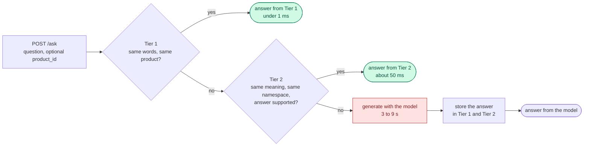
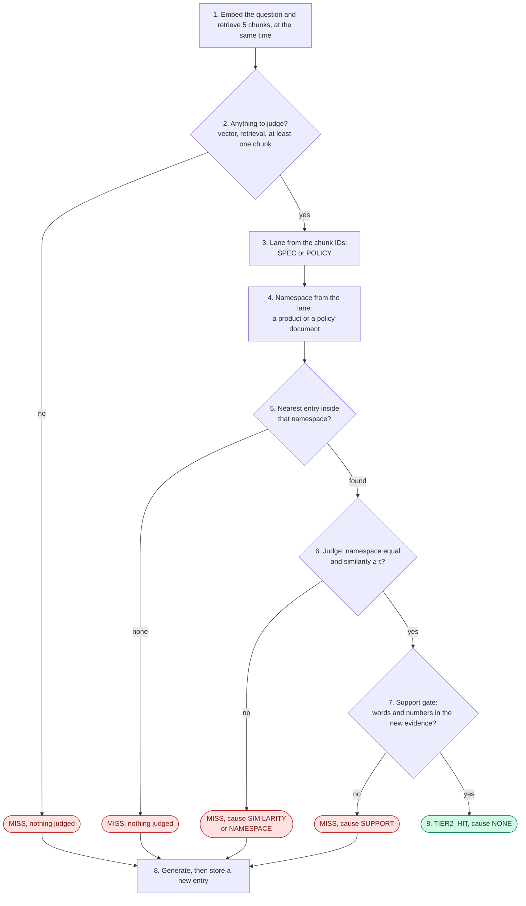

# Tier 2 — the semantic cache, from the idea to the mechanism

**For:** a reader who is new to this project · **Describes:** the code at commit `ff1c6ff` (29 Oct 2026),
checked on 30 Oct 2026. The decisions behind it go up to ADR-019.
**About the numbers:**
- **The worked examples (§9–11) use `dev-v0`**, the small development corpus (44 documents: 4 store
  policies and 40 products). It was retired on 29 Oct 2026. They show how the mechanism behaves, and they
  are **not** results of the thesis.
- **Some numbers come from `v1`**, the final corpus (frozen on 23 Oct 2026): the lane counts in Step 3
  (ADR-015 and ADR-016), the overlap measurement in §8 (ADR-019) and the trap measurements in §12a. They come
  from the validation split, and they are **not citable** either.
- **The thesis results are measured in Phase 6**, on the held-out test split.

**Contents.** Part 1, the idea (§1–4) · Part 2, the mechanism (§5–8) · Part 3, four worked
examples (§9–11a) · Part 4, measuring, traps and limits (§12–13) · Code map and further reading (§14)

---

# Part 1 — The idea

## 1. The problem Tier 2 solves

This project is a question-answering assistant for an online shop. It answers questions about
**product specifications** ("How much does the SoundMax ANC Pro weigh?") and **store policies**
("Can I return headphones after 30 days?").

It runs on **one laptop**: a MacBook M1 with 16 GB of memory. The answers come from a small language
model (Qwen 3.5 2B) that runs locally and writes **one answer at a time**. Writing one answer takes
seconds (3 to 9 seconds in the demo runs of §9). Reading a stored answer from a cache takes
milliseconds.

So every question the cache answers **safely** is a question the model does not have to answer. This
is how the system serves more users on the same machine: it turns slow generation work into fast
memory lookups.

The cache has two tiers:

- **Tier 1 — same words.** It matches a question that was already asked with the same text (after
  lower-casing and removing punctuation), about the same product. One hash lookup, under a millisecond.
- **Tier 2 — same meaning.** It matches a question that was asked before **in other words**.
  "Am I entitled to a full refund on my headphones 30 days after delivery?" and "Is a full refund
  possible for my headphones 30 days after delivery?" use different words and need the same answer.

Tier 1 is simple, and its safety is checked on the corpus before any run. Tier 2 is where the hard
part is. This document is about Tier 2.

## 2. What a semantic cache is

A semantic cache compares **meanings**, not strings. To do that it uses an **embedding**: a model
turns a sentence into a list of numbers, here 768 numbers from the model `nomic-embed-text`.
Sentences with similar meanings get lists of numbers that point in a similar direction.

How close two such lists are is measured by **cosine similarity**. It is a number up to 1.0, and 1.0
means "the same direction". In the examples below, paraphrases of a question score between 0.93 and
0.98.

A basic semantic cache works in three steps:

1. When it answers a question, it stores the question's vector together with the answer.
2. For a new question, it finds the stored question with the highest similarity.
3. If that similarity is at least a threshold **τ** ("tau"), it serves the stored answer.

```
new question ──embed──►  [0.012, -0.044, …, 0.031]      (768 numbers)
                                  │
                                  │  find the nearest stored vector
                                  ▼
stored: "Am I entitled to a full refund on my headphones …"
        similarity 0.9750  ≥  τ = 0.85   →   serve the stored answer?
```

## 3. Why similarity alone is not safe

The danger is a **false hit**: the cache serves a stored answer to a question that needs a different
answer. The user gets a wrong answer, quickly, and nothing in the system notices.

Similarity measures how two questions are **worded**. It does not measure what **evidence** each
question needs. Two examples from this project show the gap:

- **Return or warranty.** On 6 Sep 2026 a cached answer about returning the EarBuds Pop 3 was compared
  with two new questions about the same product. A paraphrase of the return question scored
  **0.9382**. A question about the warranty scored **0.9208**. Both are above τ = 0.85. The first may
  reuse the answer. The second must not: headphones can be returned within 30 days, but their
  warranty is 1 year.
- **Headphones or sofa.** "Am I entitled to a full refund on my headphones 30 days after delivery?"
  and the same sentence with "sofa" differ in one word, so a cache that compares wording sees two
  near-identical questions. The answers differ: electronics may be returned within 30 days,
  furniture within 14 days and with a 15 % restocking fee.

Moving τ does not fix this. A lower τ catches more paraphrases and lets in more false hits. A higher τ
does the reverse. On 17 labelled test questions in this corpus, the most similar **wrong** match
scored 0.9685, and only one of the seven **right** matches scored higher (0.9899). A τ high enough to
refuse every wrong match would also refuse six of the seven right ones.

## 4. This project's idea: ask the retriever first

The assistant is a **RAG** system (retrieval-augmented generation). Before the model writes an
answer, a **retriever** searches the shop's documents and returns the five most relevant pieces,
called **chunks**. The model then writes its answer from those chunks.

Every chunk has a stable ID that names its document, for example
`policy-returns-electronics#chunk-0` or `product-headphones-03#chunk-0`. Every document ID starts
with `policy-` or `product-`, so the ID alone says what kind of document a chunk comes from.

**The retrieval tells us which evidence a question needs, whatever its wording.** The return question
retrieves the return policy. The warranty question retrieves the warranty policy. Tier 2 uses the
retrieval of the new question twice:

1. **To choose where to look.** The cache is split into groups called **namespaces**. A question may
   only reuse an answer from its own namespace. For a policy question, the namespace is built from
   what retrieval returned: the warranty question looks among warranty answers, so it never sees the
   return answer. For a product question that carries a `product_id`, the namespace is that product,
   taken from the request and not from retrieval (Step 4, Example D).
2. **To check the old answer.** Before an answer is served, a **support gate** checks that the cached
   answer's words and numbers appear in the evidence retrieved **now**, for the new question.

Both checks are plain rules written in Go: string comparisons, set counts and a word count. **No
model runs to make the decision**, so the decision is the same every time, and it takes about 30
microseconds in a benchmark.

**What is new here, and what is borrowed.**
- **Borrowed.** Using retrieval evidence to decide reuse is not new: two systems published in 2026,
  GroundedCache and FinCacheServe, also do it. The support gate is taken from GroundedCache, with its
  published threshold of 0.6.
- **Measured and set aside.** GroundedCache also compares the two chunk lists directly. This project
  measured that check on `v1` and does not use it, because inside one product it cannot tell a safe
  paraphrase from a trap (§8, ADR-019).
- **What it adds.** The **namespace** split, and a way of measuring. The thesis asks a narrow question: does
  this design allow more safe reuse than the best similarity-only threshold, at a fixed budget of false hits
  (provisionally at most 5 %)?

**The served rule, in one line:** similarity ≥ τ **and** the same namespace **and** the support gate
passes.

---

# Part 2 — The mechanism

## 5. Where Tier 2 sits in a request

The system has three parts. The **gateway**, written in Go, receives every question and runs both
cache tiers. The **RAG service**, written in Python, does the retrieval and calls the model. **Redis**
stores both tiers and the vector index. The gateway and the RAG service talk over gRPC.



The times are from the demo of §9: a Tier-1 hit showed as 0 ms, a Tier-2 hit took 52 ms, and a
generation took 3.0 to 9.4 seconds. (If the model is busy and too many questions are waiting, the
gateway answers `503 busy, retry` instead of queueing without limit. That is a separate part of the
system and is not covered here.)

## 6. Tier 2 step by step

This is what happens after Tier 1 misses. The steps are numbered as in the text below.



### Step 1 — Embed and retrieve, at the same time

The gateway needs two things about the new question: its **vector**, for the similarity, and its
**retrieval**, for the namespace and the gate. Neither depends on the other, so the gateway asks for
both at once:

- **The vector**, from the embedding model. The text is sent as `search_query: <question>`. The model
  was trained with this prefix (the documents were stored with `search_document: `), and without it
  every similarity would be quietly worse.
- **The top five chunks**, from the RAG service, each with its ID and its text. If the request names
  the product the user is looking at (`product_id`), the retriever drops chunks of **other** products
  and makes sure this product's own chunk is included, so it may return fewer than five.

This step costs the **slower** of the two calls, not their sum. If either call fails, Tier 2 is skipped
and the request continues as a normal miss. A Tier-2 problem costs speed. It never becomes an error
for the user.

### Step 2 — Stop when there is nothing to judge

Three cases end Tier 2 at once, as a plain MISS with no candidate judged:

- the embedding failed (no vector),
- the retrieval failed,
- the retrieval returned **zero chunks**.

The third case matters most. An answer may only be reused when there is evidence behind the
decision. With zero chunks there is none, so nothing is reused.

### Step 3 — Read the lane from the chunk IDs

A **lane** is the kind of question: about a product (SPEC) or about a policy (POLICY). The lane is
read from one number, the **policy fraction**: the share of retrieved chunks whose ID starts with
`policy-`.

The rule is: a fraction of 0 is SPEC, a fraction of at least 0.20 is POLICY. With at most five chunks,
that means **no policy chunk → SPEC, at least one policy chunk → POLICY**. In a check on the
development corpus (6 Sep 2026) this separated the two kinds completely: ten spec questions all had
fraction 0.00, and ten policy questions all had 0.40 to 0.80. That corpus had 4 policy chunks; `v1` has 48.
The same count on the `v1` validation split (ADR-015) reads 428 of 431 product-only questions as SPEC,
so the split holds for them. It does not hold for mixed questions (stratum D): of 33, 27 are read as
POLICY, 6 as SPEC and none as MIXED, because the band is closed.

**Why read it from the retrieval, and not from the question?** A classifier that reads the question
can be wrong, and its mistakes would look like mistakes of the reuse rule. Counting the prefixes of
what retrieval actually returned cannot be wrong about what was retrieved.

There is also a third lane, **MIXED**, for questions that need both a product and a policy ("How long
is the warranty on the EarBuds Pop 3, and what is its battery life?").
- **ADR-016 (27 Oct 2026)** pins it as **one band, [0.20, 0.60)**, run as an **on/off arm** and never
  swept. Any other band stops the gateway at start.
- **Off is the default:** `LANE_SIGMA` = `LANE_SIGMA_HI` = 0.20, an empty band. The counts above are the
  off arm.
- **On** (`LANE_SIGMA_HI=0.60`), the `v1` validation split reads 12 of its 33 stratum-D questions as MIXED.

Every log record names the arm in the field `mixed_lane`. `v1` has 69 stratum-D questions in all.

### Step 4 — Build the namespace

The namespace is the group of the cache that this question may reuse from. It depends on the lane:

| Lane | When | Namespace | Example from the corpus |
| :--- | :--- | :--- | :--- |
| SPEC | no policy chunk retrieved | the product the user is looking at (`product_id`); if none, the document of the **top-ranked** product chunk | "How much RAM does the UltraBook Pro 14 have?" → `product-laptops-01` |
| POLICY | at least one policy chunk | the document of the **top-ranked** policy chunk | "How long do I have to return a laptop for a full refund?" → `policy-returns-electronics` |
| MIXED (off) | both kinds, inside a set band | the pair `{product}\|{policy}`; both halves are required | `product-headphones-03\|policy-warranty` |

Four details make this work:

- **A namespace is a document, not a chunk.** `policy-returns-electronics#chunk-2` belongs to
  `policy-returns-electronics`.
- **The top rank decides, not the list of documents.** The headphones and the sofa refund questions
  both retrieve **both** return policies. But the retriever ranks the electronics policy first for
  headphones and the furniture policy first for the sofa. The rank separates them. The list alone
  would not.
- **The product the user is viewing beats the top-ranked product.** Asked with no `product_id`, "what
  is the battery life of the EarBuds Pop 3" retrieved `product-headphones-04` first. That is the
  EarBuds Pop 3 **Pro**, a different product. Paraphrases can rank near-identical products in a
  different order. The page the user is on does not change.
- **An empty namespace matches nothing.** It is never treated as "match everything".

**Why are policy answers not split by product?** A policy answer is the same for every product the
policy covers. One entry per policy uses less cache space than one entry per product.

### Step 5 — Search inside the namespace only

The gateway sends **one** query to Redis: "the nearest stored question whose namespace is this one".
It asks for one result only (`k = 1`), because inside one namespace the most similar entry is the best
candidate.

```
FT.SEARCH idx:cache "(@namespace:{policy\-returns\-electronics})=>[KNN 1 @embedding $vec AS dist]"
```

- The vector index is **exact** (`FLAT`), not approximate. An approximate index could return a
  different neighbour from one run to the next, and that noise would mix with the effect being
  measured. The choice is frozen for the whole study.
- Redis returns the cosine **distance**. The gateway converts it: similarity = 1 − distance.
- If the namespace holds no entry yet, Tier 2 ends as a MISS with nothing judged. This is the normal
  case on a cold cache.

**Why not search the whole cache and filter afterwards?** The nearest few entries overall can all
belong to other namespaces. A good entry in the right namespace would then sit just below the cut and
never be seen, and this gets worse as the cache fills. Searching inside the namespace has no such
limit.

### Step 6 — Judge, in a fixed order, and give one reason

The candidate goes through the checks in a fixed order. The first check that fails gives the
**refusal cause**, and every judged candidate gets exactly one cause in the log:

| Order | Check | Cause if it fails |
| :---: | :--- | :--- |
| 1 | The candidate's namespace equals the question's (for MIXED, the candidate must be MIXED too) | `NAMESPACE` |
| 2 | Similarity ≥ τ (0.85, a demo value) | `SIMILARITY` |
| 3 | The RAG service sent the chunk texts, so the gate can run | `NOT_SCORED` |
| 4 | The support gate passes (Step 7) | `SUPPORT` |
| — | Every check passed: the answer is served | `NONE` |

- **With the gate switched off** (§12), checks 3 and 4 are skipped: a candidate that passes checks 1
  and 2 is served.
- **`NAMESPACE` should never happen**, because the search already filtered by namespace. The check is
  repeated in Go on purpose. If Redis and Go ever disagreed, Go refuses, and the cause shows it.
- **`NOT_SCORED`** means an old version of the RAG service sent chunk IDs without their text. The gate
  cannot check anything, so the answer is not served, and a measured run with any such record is
  invalid.
- **One rule decides serving: the cause is `NONE`.** A request where nothing was judged (Steps 2
  and 5) has no cause at all, which is different from a refusal.
- **τ is not set by hand for results.** It is swept over a range, chosen on a validation set and
  reported on a separate test set. 0.85 is the value the demo uses.

### Step 7 — The support gate

The gate asks one question: **is the cached answer supported by the evidence retrieved for this new
question?** It reads the cached answer and the new chunks. It **never reads either question**. It has
two arms, and both must pass.

**The lexical arm** counts words:

```
S_lex  =  (content words of the cached answer that also appear in the new evidence)
          ─────────────────────────────────────────────────────────────────────────
                          (content words of the cached answer)
```

- **Content words:** lower-case, split on anything that is not a letter or a digit, remove 33 common
  words ("the", "of", "with", …, the standard Lucene list), remove words shorter than three
  characters, and count each word once. There is no stemming, so "return" and "returns" are different
  words.
- **Evidence:** every word of the retrieved chunks.
- **Pass when `S_lex ≥ τ_s = 0.6`.** This value is GroundedCache's published threshold. It is fixed
  and never tuned.

**The numeric arm** checks numbers:

- Every number in the cached answer, with its unit, must appear in **one** retrieved chunk. The number
  and its unit must be in the same chunk, never one in each.
- It reads common forms: "30-day", "30 days" and "thirty days" all become *30 day*; "250g" becomes
  *250 g*; "$49.99" becomes *49.99 $*; "IPX4" is read as a code.
- A number with no unit is checked by its value only.
- A number it cannot read ("½", "1,5 days", "5.3.1") **blocks reuse**. When unsure, it refuses.

**Why two arms?** Words catch the wrong **topic**. Numbers catch the wrong **fact**. An answer that
says "40 hours" where the evidence says "30 hours" shares almost all its words with the evidence
(Example C, §11).

The gate costs about 30 microseconds for both arms in a benchmark on the M1. That is an estimated
0.2 % of a Tier-2 hit.

### Step 8 — Serve, or fall through to generation

**When the cause is `NONE`,** the stored answer is returned with `cache: TIER2_HIT`. Two small writes
then run in the background, so they never slow the answer: the entry's hit counter goes up by one, and
a **Tier-1 copy** is written for the exact words of this question. The next identical question then
stops at Tier 1 and skips the embedding and the search. The copy is written **only while the Tier-2 entry
still exists**, and its key is recorded with the entry (item 4.3). So a later eviction or purge removes
it too.

**Otherwise** the request continues as a normal miss. The model writes a new answer **from the chunks
already retrieved in Step 1**, so the system never retrieves twice. The new answer is stored in both
tiers under one entry ID. Its lane and namespace are computed from **the chunks its own answer was
built from**. A refused candidate is not deleted. The new entry is stored beside it.

## 7. What one Tier-2 entry holds

Each entry is one Redis hash. This is the entry that the first question of Example A (§9) creates.
`<entry_id>` and `<sha256>` stand for long generated IDs.

```
t2:<entry_id>                                     a Redis hash, indexed by idx:cache
├── embedding          768 × float32              the vector of the question that caused the miss
├── query_text         "Am I entitled to a full refund on my headphones 30 days after delivery?"
├── answer             "…"                        the answer the model wrote
├── source_chunk_ids   policy-returns-electronics#chunk-0
│                      policy-returns-furniture#chunk-0
│                      policy-warranty#chunk-0
│                      product-headphones-03#chunk-0
│                      product-headphones-04#chunk-0    (the evidence behind the answer)
├── lane               POLICY                     3 of 5 chunks are policy chunks
├── namespace          policy-returns-electronics the top-ranked policy document
├── t1_key             t1:<sha256>                the Tier-1 copy written by the same miss
├── dataset_epoch      1                          corpus version: the epoch file's value, ≥ 1 (item 4.2)
└── hit_count, created_at, source_overlap
```

In the index, `namespace` and `lane` are **tags**: they are compared for exact equality and never
split into words. `embedding` is the vector field (exact `FLAT` index, cosine, 768 dimensions).

The link to the Tier-1 copy (`t1_key`) exists because the Tier-1 key is a hash of the question text and
the `product_id` (ADR-018), and it cannot be computed back from the entry. Without the link, removing an entry would leave its
Tier-1 copy still serving the old answer.

## 8. The overlap score: computed, but it does not decide

The project's proposal planned a third check that compares the chunk lists directly. It is called
**containment**:

```
containment  =  |chunks retrieved now  ∩  chunks behind the cached answer|
                ─────────────────────────────────────────────────────────
                           |chunks behind the cached answer|
```

The rule would reuse when containment ≥ θ ("theta"; the demo value is 0.60).

The code **computes containment for every candidate that clears τ and logs it**, as `source_overlap` in
the evaluation log. It does **not** use it to decide, and θ is **not swept**. ADR-019 (30 Oct 2026)
records this decision. It settles what the plan called finding F-K.

**The reason.** When a request carries a `product_id`, retrieval is limited to that product. A product
has about 3.2 chunks in `v1` (491 product chunks over 152 products), and the retriever returns up to
five. So two questions about the same product mostly retrieve the same chunks, and their containment is
close to 1 whatever they ask. (A long product, like the one in Example D with eight chunks, is an
exception.)

**The measurement** (`v1` validation split, 416 pairs, not citable;
`docs/work/2026-10-30-adr-019-theta-overlap/`). Each question was retrieved with its own `product_id`,
and the containment was computed as `rule.go` computes it:

| Pairs | n | mean containment | = 1.0 | ≥ 0.6 |
| :--- | ---: | ---: | ---: | ---: |
| a paraphrase and its seed question (**should** reuse) | 281 | 0.876 | 75 % | 86 % |
| a B-within trap and its pair, same product (should **not** reuse) | 124 | 0.784 | 47 % | 85 % |
| a B-cross trap and its pair, different product (should **not** reuse) | 11 | 0.000 | 0 % | 0 % |

**No θ separates the first two rows.** At θ = 0.6, containment would reuse 86 % of the paraphrases and
85 % of the same-product traps. At θ = 1.0, it would reuse 75 % and 47 %. The third row is already
separated by the namespace, because the two questions are about different products. Example B (§10)
shows the same thing on `dev-v0`: two questions that need opposite verdicts get exactly the same
containment. With five chunks, the score can also only take six values (0, 0.2, …, 1.0).

**What this means for the thesis.** On traps across products, the namespace does the work. On traps
inside one product, only the support gate can refuse. The claim is restated around this served rule
(ADR-019). Logging the containment on every candidate still matters: it is the evidence for the
decision, and the write-up reports its distribution.

---

# Part 3 — Worked examples

## 9. Example A — the live demo, end to end

**Setting.** 15 Oct 2026, development corpus, cold cache, gate on, τ = 0.85, θ = 0.60. No `product_id`
was sent. The demo was run twice, each time from an empty cache. The latencies are not measurements.

**Question 1:** "Am I entitled to a full refund on my headphones 30 days after delivery?"

1. Tier 1 misses: nothing is stored yet.
2. Retrieval returns five chunks, ranked: `policy-returns-electronics`, `policy-returns-furniture`,
   `policy-warranty`, `product-headphones-03`, `product-headphones-04` (each `#chunk-0`).
3. Three of five are policy chunks, so the lane is **POLICY**.
4. The top-ranked policy document is `policy-returns-electronics`. That is the namespace.
5. The namespace is empty, so nothing is judged: **MISS**.
6. The model writes an answer (3,001 ms in run 2), and a new entry is stored in
   `policy-returns-electronics`, with the five chunks above as its sources (§7).

**Question 2:** the same words again. **Tier 1 hit**, shown as 0 ms. Tier 2 does not run.

**Question 3:** "Is a full refund possible for my headphones 30 days after delivery?"

1. Tier 1 misses: the words are different.
2. Retrieval returns **the same five chunks** as Question 1.
3. Lane POLICY, namespace `policy-returns-electronics`, the same as the entry.
4. The search finds Question 1's entry, at similarity **0.9750**.
5. Namespace equal, and 0.9750 ≥ 0.85. The gate runs. (Containment is 5/5 = 1.00, logged only.)

Here the two runs differ, and only because of the stored answer. The model words its answer
differently each time:

| | Run 1 | Run 2 |
| :--- | :--- | :--- |
| Content words in the cached answer | 66 | 25 |
| … of them found in the new evidence | 29 | 22 |
| `S_lex` | 29/66 = **0.4394**, below 0.6 | 22/25 = **0.88** |
| Numeric arm | pass | pass |
| Result | **MISS**, cause `SUPPORT`, the model answers again (3,757 ms) | **TIER2_HIT** in **52 ms** |

**What this shows.** The same question, with the same evidence, got opposite verdicts. In run 1 the
cached answer was long, and many of its words were the model's own phrasing, not the policy's. The
gate refused a paraphrase that was safe to reuse. That refusal is safe, but it costs a generation.
In run 2 the answer was short and close to the policy text, and Tier 2 served it about 60 times
faster than a generation.

**Question 4:** "Am I entitled to a full refund on my sofa 30 days after delivery?"

```
cached entry (Question 1, headphones)       retrieved now (Question 4, sofa)
  1. policy-returns-electronics   ◄── top     1. policy-returns-furniture     ◄── top
  2. policy-returns-furniture                 2. policy-returns-electronics
  3. policy-warranty                          3. policy-shipping
  4. product-headphones-03                    4. product-furniture-04
  5. product-headphones-04                    5. product-furniture-08
```

Both lists contain both return policies. But the top-ranked policy differs, so Question 4's namespace
is `policy-returns-furniture`. That namespace is empty, so the headphones answer is **never even a
candidate**. Result: MISS, nothing judged, and the model writes a new answer from the furniture
evidence.

## 10. Example B — return or warranty: why the namespace, and not the overlap score

**What is real and what is not.** The chunk IDs and the two similarities were measured on 6 Sep 2026.
No answer text was recorded at that time, so the tests use an **authored** cached answer, built only
from facts in the real documents. The numbers in this section are what the tests check.

**The three chunk lists** (all `#chunk-0`, in rank order):

```
cached entry:          product-headphones-04  product-headphones-03  policy-returns-electronics  product-headphones-09  product-headphones-01
paraphrase  (0.9382):  product-headphones-04  product-headphones-03  policy-returns-electronics  product-headphones-09  product-headphones-02
warranty    (0.9208):  product-headphones-04  product-headphones-03  product-headphones-09       policy-warranty        product-headphones-01
```

**(a) The overlap score cannot separate them.** The paraphrase retrieves 4 of the entry's 5 chunks
(it lacks `product-headphones-01`): 0.80. The warranty question also retrieves 4 of 5 (it lacks
`policy-returns-electronics`): 0.80. The same score, and opposite correct answers. No θ can reuse the
first and refuse the second.

**(b) Similarity cannot separate them at τ = 0.85.** 0.9382 and 0.9208 are both above it.

**(c) The namespace separates them.** Each list has one policy chunk out of five, so all three are
POLICY. The entry and the paraphrase both have `policy-returns-electronics` as their only policy
document. The warranty question has `policy-warranty`. So the warranty question searches a different
namespace and **never sees the return answer**. With the MIXED lane switched on, the namespaces are
pairs (`product-headphones-03|policy-returns-electronics` against
`product-headphones-03|policy-warranty`), and they still differ.

**(d) The gate, as a second line of defence.** The namespace already stops the warranty question in the
real request path. The tests still check what the gate would do if the warranty question had reached
the entry. The authored cached answer is:

> "The EarBuds Pop 3 has 6 hours of battery life, 24 hours with the case. Return it within the
> 30-day return window for a full refund if unused and in original packaging."

Its **16 content words** are: *earbuds, pop, has, hours, battery, life, case, return, within, day,
window, full, refund, unused, original, packaging.* The removed words are the common words (*the, of,
with, it, for, if, and, in*) and the short ones (*3, 6, 24, 30*).

- **Against the paraphrase's evidence** (four product chunks and the electronics return policy), only
  *has* and *life* are missing: 14/16 = **0.875**. Pass.
- **Against the warranty question's evidence** (four product chunks and the warranty policy), only
  *earbuds, pop, hours, battery, case* are found, and all five also appear in the product chunks:
  5/16 = **0.3125**. Refuse.

The numeric arm reads four items in the answer: *3* (no unit, from "Pop 3"), *6 hours*, *24 hours*
and *30 days*. With the paraphrase's evidence all four are supported: the EarBuds Pop 3 chunk has 3, 6
and 24 together with hours, and the return policy has 30 days. With the warranty evidence, **no
chunk contains 30**, so the arm refuses. (One looseness, kept on purpose and documented: the unit must
appear with *some* number in the same chunk, not necessarily with this one. The chunk says "6 hours
(24 with case)", and that is enough for *24 hours*.)

## 11. Example C — the gate on answers the model really wrote

**Setting.** On 14 Oct 2026, 27 answers that the model really generated were collected, and the gate
was run on pairs of (cached answer, evidence). The gate was called **directly**, not through the full
request path, so these pairs test the gate on its own.

**It catches a wrong number that the words miss.** The cached answer: *"The battery life of the
SoundMax ANC Pro is 40 hours."* The evidence: the chunk of a **different** product, the SoundMax ANC
Lite, whose battery is 30 hours.

- Lexical arm: 6 content words (*battery, life, soundmax, anc, pro, hours*), 4 found (*soundmax, anc,
  battery, hours*): 4/6 = **0.667**. **Pass.**
- Numeric arm: *40 hours* is not in the chunk, which says 30 hours. **Refuse.**

In the full request path the namespace would already separate these two products. This pair shows why
the numeric arm exists.

**It refuses a correct answer.** The question: "what is the battery life of the EarBuds Pop 3". The
answer: *"The battery life of the EarBuds Pop 3 is 6 hours, with an additional 24 hours when using the
case."* The evidence: that product's own chunk, the evidence the answer was written from.

- 9 content words (*battery, life, earbuds, pop, hours, additional, when, using, case*), 5 found:
  5/9 = **0.556**. **Refuse.**

The answer is right. The gate refuses it because the model used words the spec sheet does not use
(*life, additional, when, using*).

**What the whole sample showed:**

- **0 of 5** real paraphrases were refused. With so few, the 95 % upper bound is still 43 %.
- **2 of 21** answers (9.5 %) scored below 0.6 against the very evidence they were written from.
- Answers that mention "the context" ("as listed in the context") score lower: mean 0.60 with that
  word, 0.85 without.

Nothing was tuned after the sample. A strict gate costs hit rate, not safety, and whether to change the
lexical score is a decision for the final study, made before its data is seen.

## 11a. Example D — a product question that carries a `product_id`

**Setting.** Corpus `v1`, cold cache, gate on, τ = 0.85. The product is a laptop whose record is cut
into 8 chunks (checked on 26 Oct 2026 by running the ingest splitter on its file). The product texts
and questions of `v1` come from Amazon-PQA, which this repository may not redistribute, so the two
questions below are written for this example. **This example follows the code. It is not a recorded
run:** Redis held `dev-v0` when it was written, so it shows no similarity and no `S_lex` value.

Both requests carry the same `product_id`, written here as `product-laptops-X`.

**Question 1:** "Which graphics card does this laptop have?"

1. Tier 1 misses: nothing is stored yet.
2. Retrieval takes the top five chunks over the whole corpus, then drops every chunk of another
   product (§6, Step 1). What is left is chunks of this laptop, and a policy chunk only if it ranked in
   the top five.
3. If no policy chunk is left, the policy fraction is 0 and the lane is **SPEC**.
4. The namespace is `product-laptops-X`. It comes from the `product_id` in the request, **not** from
   the retrieved chunks.
5. The namespace is empty, so nothing is judged: **MISS**. The model answers from the retrieved chunks,
   and the new entry is stored with lane SPEC and namespace `product-laptops-X`.

**Question 2:** "What GPU is in this laptop?"

1. Tier 1 misses: the words are different.
2. The lane and the namespace are the same as for Question 1.
3. The search inside the namespace finds Question 1's entry.
4. The judge runs the checks of Step 6: similarity ≥ τ, then the support gate. If the cached answer
   holds a number with a unit (a memory size, for example), the same number and unit must appear in one
   of the new chunks.
5. If every check passes, the result is **TIER2_HIT**. If one fails, it is a **MISS** with cause
   `SIMILARITY` or `SUPPORT`, and the model answers again.

**What this shows.**

- The namespace is the product named in the request. A different laptop with almost the same wording
  can never be a candidate, whatever retrieval returns.
- Containment (§8) would add nothing here. Both questions are limited to the same product, so they
  mostly retrieve the same chunks. This laptop has eight chunks, so the top five of two questions can
  differ. That is the exception, not the usual case.
- For a product question with a `product_id`, the namespace comes from the request, not from the
  evidence. Retrieval still decides the lane and the support gate. Without a `product_id`, the
  namespace falls back to the top-ranked product chunk, as in Step 4.

---

# Part 4 — Measuring and limits

## 12. What each decision leaves in the log

Every request writes **one JSON line** to an evaluation log. These fields describe the Tier-2
decision:

| Field | Meaning |
| :--- | :--- |
| `cache` | `TIER1_HIT`, `TIER2_HIT`, `MISS`, … |
| `similarity` | the candidate's similarity, or `null` when no candidate was found |
| `entered_band` | the candidate cleared τ |
| `source_overlap` | the containment score of §8, logged only |
| `refusal_cause` | `NONE`, `SIMILARITY`, `NAMESPACE`, `SUPPORT`, `NOT_SCORED`, or `null` when nothing was judged |
| `support_lex`, `support_numeric_ok` | the two arms' results, or `null` when the gate did not run |
| `retrieved_chunk_ids`, `candidate_entry_id`, `candidate_sources` | the evidence of this request, and the entry that was judged |
| `support_gate` | `on` or `off`: which version of the rule this process ran |
| `mixed_lane` | `on` or `off`: which MIXED arm this process ran (ADR-016) |

For example, the refusal in run 1 of Example A would be written like this. (The evaluation log was
switched off during the demo, so this record is built from the gateway's log line for that request,
and only the Tier-2 fields are shown.)

```json
{
  "cache": "MISS",
  "support_gate": "on",
  "similarity": 0.975,
  "entered_band": true,
  "source_overlap": 1.0,
  "refusal_cause": "SUPPORT",
  "support_lex": 0.4394,
  "support_numeric_ok": true,
  "retrieved_chunk_ids": ["policy-returns-electronics#chunk-0", "policy-returns-furniture#chunk-0",
                          "policy-warranty#chunk-0", "product-headphones-03#chunk-0",
                          "product-headphones-04#chunk-0"],
  "candidate_entry_id": "<Question 1's entry>",
  "candidate_sources": ["…the same five chunks…"]
}
```

The HTTP response to the user shows the similarity and the overlap, but it has **no field for the
reason**. The reason is only in the log.

**The gate can be switched off, to measure it.** `SUPPORT_GATE=on` (the default) or `off` is set for
each run. With the gate off, Tier 2 serves on namespace and similarity alone, and both support fields
are `null`. Every record names the setting, so a run with the gate and a run without it can be
compared, and the gate's own effect, in false hits prevented and in hits lost, can be measured.

## 12a. Traps: every way a reuse decision can go wrong

A cache can be wrong in two directions:
- A **false hit** serves a stored answer that is wrong for the new question. It costs **correctness**.
- A **false miss** calls the model although a right answer was already stored. It costs **capacity**: the
  hit rate falls, and the machine serves fewer questions.

The frontier of Phase 6 measures the trade between the two. Here is every trap known so far, sorted by the
part of the system it gets past.

**False hits — a wrong answer is served.** The numbers in the last column are queries in the `v1`
validation and test splits.

| # | Trap | Example | What stops it | It still gets through when | In the `v1` workload? |
| :---: | :--- | :--- | :--- | :--- | :--- |
| 1 | Same words, **different product** (Tier 1) | "Is it waterproof?" asked on two product pages | `product_id` is in the Tier-1 key (ADR-018) | the request carries no `product_id` | no: the corpus gate (G3) excludes it |
| 2 | **Normalisation collision** (Tier 1) | "1.5 m" and "15 m"; "-10 °C" and "10 °C"; "15 %" and "$15" | **nothing**: Tier 1 runs no rule | always | no: G3 excludes it |
| 3 | **B-cross**: similar words, another product | "full refund on my headphones…" against "…on my sofa…" | the namespace | there is no `product_id` and the top-ranked document is wrong | yes: 11 + 11 |
| 4 | **B-within, spec attribute**: same product, another attribute | "Does it work with Windows 10?" against "…Windows 7?" | only the support gate; its numeric arm when the answer holds a number | the product's chunks contain both facts, so the answer is "supported" | yes: 52 + 47 |
| 5 | **B-within, policy condition** | opened against unopened; new against renewed | separate documents give separate namespaces | retrieval ranks the wrong condition first (see below) | yes: 40 + 80 |
| 6 | **B-within, policy region** | domestic against international warranty | as row 5 | as row 5 | yes: 6 + 12 |
| 7 | **B-within, policy kind** | return against warranty, same product | the namespace, and the numeric arm (30 days against 1 year) | retrieval ranks the wrong document first | yes: 6 + 3 |
| 8 | **B-within, condition by department** | opened phone against opened chair | the namespace | as row 7 | yes: 16 (validation) |
| 9 | **The condition said in other words** | "still sealed" for unopened, "used" for opened | only retrieval | retrieval is right only 56 % of the time (see below) | almost none: 13 of 134 |
| 10 | **Same evidence, opposite condition or negation** | "Is the battery removable?" against "…**not** removable?" | **no check can see it** | always | yes; reported as RQ2a (item 6.4) |
| 11 | **Product and policy in one question** (stratum D) | "If this laptop is new, how many days do I have to return it, and how much does it weigh?" | the MIXED lane, on its on arm (ADR-016) | the arm is off: the product half is ignored | yes: 33 + 36 |
| 12 | **A stale answer after a source edit** | a return window changed from 30 to 14 days | dependency purge and the epoch guard (Phase 4) | a purge misses an entry (completeness below 1) | in `mutation: on` runs (item 6.5) |

When retrieval picks the wrong document, the answer is wrong **even with no cache**: the model writes
from the wrong evidence. The cache inherits that error, and so does the reference answer the judge
compares against. Item 5.2's labelling ablation exists to measure this.

**False misses — the model runs although a right answer was stored.**

| # | Cause | Example | Where it shows |
| :---: | :--- | :--- | :--- |
| 1 | **Similarity below τ** (stratum C, very different words) | "How do I send back X?" against "What is the return process for X?" | refusal cause `SIMILARITY` |
| 2 | **The namespace differs on a safe reuse** | one paraphrase is routed to the other condition's document; no `product_id` | `NAMESPACE`, or the search finds no candidate at all |
| 3 | **The MIXED arm moves a question to another namespace** | 9 policy and 3 product-only questions lose their reuse (ADR-016) | per arm, `mixed_lane` |
| 4 | **The support gate refuses a right answer** | the model used its own words, not the evidence's (Example A run 1: `S_lex` 0.4394; Example C: 0.556) | `SUPPORT`; GroundedCache reports that this gate cut its speed-up from 1.48× to 1.04× |
| 5 | **Only the nearest entry is judged** (k = 1) | the nearest entry is wrong, and a right one sits second | ADR-009: the same `candidate_entry_id` refused again and again |
| 6 | **Same question, another `product_id`** | one policy question asked on many product pages gets one entry per page | ADR-018; zero on `v1`, where no question is shared across products |
| 7 | **Evicted by the LRU limit** | the cache holds only 0.25 × K entries | tier mix, item 7.1 |
| 8 | **Purged by a cosmetic edit** | blind purge removes answers the edit did not change | precision, item 6.5 (0.695 in item 4.4, not citable) |
| 9 | **Nothing was written** | the epoch moved during generation; `NOT_SCORED`; the embedding failed | `writeback_discarded`, `NOT_SCORED` |
| 10 | **Paraphrases in flight at the same time** | coalescing joins only identical questions | item 7.1 |

**Two measurements behind rows 5 and 9** (`v1` validation split, not citable;
`docs/work/2026-10-30-condition-routing-probe/`). The question is whether retrieval ranks the **right
condition document** first. That document is the POLICY namespace, so it is what keeps an "opened" answer
away from an "unopened" question.

- **The workload's own questions:**
  - with the condition word in the question, 98 of 121 are right (81 %);
  - without it ("the US version" for domestic), 9 of 13 are right (69 %);
  - when wrong, retrieval often picks **the opposite condition**: new → renewed, unopened → opened,
    domestic → international.
- **Synonyms**, 43 rewrites written for the probe: only **24 of 43** are right (56 %), and the errors
  point one way:
  - "still sealed", "never opened" and "brand-new in its sealed box" (all meaning unopened) go to the
    **opened** document;
  - "used", "unboxed" and "already taken out of the box" (meaning opened) go to the **unopened** document;
  - "brand-new" and "factory-sealed" (meaning new) go to the **renewed** document.

  The embedding follows the **letters** ("never opened" contains "opened"), not the condition they
  describe.

**What follows from this.**
- **These are retrieval limits, not cache-rule limits.** They are reported, not fixed: the corpus, the
  workload and the retriever are frozen.
- **Phase 6 will understate the risk of rows 2 and 9.** The workload almost always uses the literal
  condition word (121 of 134), and G3 keeps normalisation collisions out of it.
- **Possible fixes, all for future work:**
  - a normaliser that keeps signs and decimal points next to digits;
  - hybrid retrieval, with keyword search beside the embedding, for condition words;
  - a query-side condition check. That last one is ruled out in this thesis: the reuse decision may
    never read the question text as a signal.

## 13. Limits and open points

**Decided since the first version of this document:**

- **The overlap score is logged but does not decide** (§8). ADR-019 records this, and the thesis claim is
  restated around the served rule. The proposal and `CLAUDE.md` still describe four checks; those files
  are the author's to update.
- **The MIXED lane** is one pinned band, run as an on/off arm (ADR-016; Step 3).
- **Removing answers when a source changes is built** (Phase 4): dependency purge, the epoch guard, and
  tracking of every Tier-1 key.

**Open in the design:**

- **Traps the frozen workload hardly contains** (§12a): conditions said in other words (rows 5 and 9), and
  Tier-1 normalisation collisions (row 2). They are limits to report.
- **Same evidence, opposite condition.** Two questions can retrieve the same chunks and ask about
  opposite conditions, for example an opened and an unopened item. The namespace and the gate both look
  at the evidence, and the evidence is the same, so neither can tell them apart. The planned defence is
  in the corpus: opposite conditions are written into **separate documents**, so they get separate
  namespaces. The thesis reports this residual as part of its claim.
- **Only the nearest entry is judged** (`k = 1`). A refused entry is not removed, so it can stay the
  nearest one and be refused again for each new paraphrase.

**Weak points of the gate, measured:**

- **It is strict.** About one correct answer in ten is refused against its own evidence, mostly because
  of the model's wording (§11).
- **It can be fooled by wording.** An answer that mostly repeats product specs passes even against the
  wrong policy, because spec words appear in every product chunk. A test keeps this case visible.
- **The evidence is small.** The gate's numbers in §11 are from the 44-document development corpus, not
  from `v1`. The thesis measures it on `v1` in Phase 6.

## 14. Code map and further reading

| File | What it does |
| :--- | :--- |
| `gateway/internal/httpapi/handler.go` | One request: Tier 1, embedding and retrieval in parallel, serving, the miss and the write-back |
| `gateway/internal/httpapi/cascade.go` | Tier 2 itself: Steps 2 to 6, in order |
| `gateway/internal/reuse/lane.go` | Lanes, namespaces and the namespace rule |
| `gateway/internal/reuse/cause.go` | The fixed order of checks and the refusal cause (`Thresholds.Judge`) |
| `gateway/internal/reuse/support.go`, `support_numeric.go` | The lexical and the numeric arm of the gate |
| `gateway/internal/reuse/gate.go` | The gate's on/off switch |
| `gateway/internal/reuse/rule.go` | Containment, computed and logged only (ADR-019) |
| `gateway/internal/cache/tier2.go` | The Tier-2 record, the index and the namespace-scoped search |
| `gateway/internal/cache/key.go`, `normalize.go` | The Tier-1 key: the normalised question and the `product_id` (ADR-018) |
| `gateway/internal/deps/` | The dependency map, the blind purge and the epoch check (Phase 4) |
| `gateway/internal/embed/client.go` | The query embedding, with its prefix |
| `gateway/cmd/gateway/main.go` | The defaults: `REUSE_TAU=0.85`, `REUSE_THETA=0.60` (sets the logged containment verdict only), `LANE_SIGMA` = `LANE_SIGMA_HI` = 0.20 (MIXED off), `SUPPORT_GATE=on` |

The `reuse/` package uses only Go's standard library and does no input or output. That is deliberate:
the reuse decision can be tested on its own, with no Redis, no network and no model.

**Tests that pin the examples** (all in `gateway/internal/reuse/`):

- `TestNoThetaSeparatesTheMeasuredPair` (`lane_test.go`) — Example B, (a) to (c).
- `TestSupportLexicalSeparatesTheMeasuredPair` (`support_test.go`) — Example B, the 14/16 and 5/16.
- `TestNumericMeasuredPair` (`support_numeric_test.go`) — Example B, the numeric arm.
- `TestJudgeAgreesWithDecideLane` (`cause_test.go`) — the order of checks agrees with the namespace
  rule on every input.

Run them with `cd gateway && go test ./internal/reuse/`. **Example A cannot be replayed now.** It needs
`dev-v0` in Redis, and `make demo-reset` refuses to run while Redis holds `v1` (a guard added on
29 Oct 2026, because it would wipe `v1`). `make demo` moves to `v1` in Phase 8.

**Decisions and contracts behind the rules:**

- `docs/decisions.md`:
  - **ADR-004**: one search, inside the namespace;
  - **ADR-009**: the gate is served, and every judged candidate gets one cause;
  - **ADR-010**: the gate's on/off switch;
  - **ADR-016**: the MIXED band and its arm;
  - **ADR-018**: `product_id` in the Tier-1 key;
  - **ADR-019**: the served rule, and containment as a logged counterfactual.
- `docs/contracts/interfaces.md`: §A (the HTTP response), §D (the cache records), §H (the evaluation
  log).
- `docs/work/2026-10-14-real-answer-sample/`: the full data behind Example C.
- `docs/work/2026-10-30-adr-019-theta-overlap/` and `docs/work/2026-10-30-condition-routing-probe/`: the
  `v1` measurements in §8 and §12a.
- `docs/0. progress 16-10.md` §1.5: the full demo output behind Example A.
- `docs/1-System Docs/Redis-Data Structure.md` §5: the Tier-2 record field by field.
