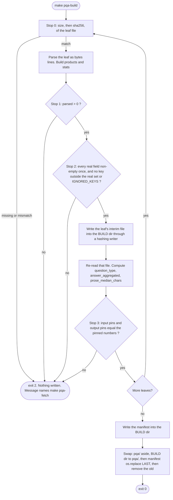

# Design — pqa-build-script (item 3.1)

**Scope:** L · **Status:** revised after impact and design review, waiting for the author's `/approve design`
Read `spec.md` first. Names and numbers below are exact; the shape of the code is a proposal.

## 1. The shape

One new script, `experiments/scripts/build_pqa.py`, **standard library only and no network code**. One new
test file, `experiments/tests/test_build_pqa.py`. Three Make targets: `pqa-fetch` (curl, resume),
`pqa-build`, `pqa-verify`. Pure functions where possible, so tests need no network and no PQA text: they use
tiny fixtures written by the author, with their own pins.



The BUILD directory is `data/v1-draft/.pqa-build-<pid>/`, a sibling of the final `data/v1-draft/pqa/`.
It is inside `data/v1-draft/`, which is gitignored (a temp directory directly under `data/` would not
be). Same filesystem, so `os.replace` is a rename. On any failure the BUILD directory is removed.

`make pqa-verify` runs `build_pqa.py --verify`: no parsing. It hashes the six raw files and the six
interim files on disk against `data/pqa-manifest.json` and exits 2 on any difference.

## 2. Decisions, each with its reason

| # | Decision | Why |
| :-: | :--- | :--- |
| D1 | **Four stops**: source hash, parse rate above zero, every real field non-empty once and no unlisted key, and pinned counts on both input and output. After the code review, Stop 3 has a third part: **3c, a field-by-field comparison of the written file with the parse** | The Done-when asks for one. The readme trap has a quiet second form that Stop 1 passes. A field the builder forgets to list passes Stop 2(a), so Stop 2(b) stops on unlisted keys, and Stop 3's output pins check what is written |
| D2 | **Pins live in the code**, next to the sha256: per leaf `parsed`, `products`, `skipped_total`, `question_type`, `answer_aggregated`, `prose_median_chars` | The bytes are fixed by sha256, so these are fixed too. Source: the probe in the 2026-10-03 trail, written separately. They are not settings. A11 checks them against `probe_results.json` and `data-card.md` |
| D3 | **A key census** per leaf. A key outside `REAL_FIELDS ∪ IGNORED_KEYS` stops the run | If a file uses a readme name, the message can say "saw `asin_id` 499,535 times, expected `asin`". `IGNORED_KEYS` starts empty; each entry needs a written reason |
| D4 | **Output is deterministic** (rules in §6) | A tracked manifest must be reproducible by someone who downloads and builds |
| D5 | **The manifest records `builder_sha256`**, not a git SHA | A git SHA inside a file committed on top of it never matches. A script hash can be checked by anyone. A change in it shows as a one-line `git diff`; it is read, not a failure |
| D6 | **No rebuild-and-compare mode.** Build, then `git diff --exit-code data/pqa-manifest.json` | Same guarantee, no code. `--verify` replaces it for the on-disk files |
| D7 | **Every failure exits non-zero**, including any exception. No blind `except` | The old script printed `FAILED` and exited 0. Finding F-M is the same fault in the gateway |
| D8 | **Always re-hash**, never trust size + mtime | A stale shortcut is a silent failure. 1.9 GB hashes in well under a minute |
| D9 | **Lone surrogates are replaced with U+FFFD and counted** | Item 1.4's note: redis-py's strict encoder rejects them. Dropping the record would change the question count without a trace. `ensure_ascii=False` stays, so a field the replacement missed raises at write instead of moving the failure to `make ingest` |
| D10 | **The interim keeps `answers` as a list of strings** | The first design dropped them. The review showed no licence gain and a likely later use (3.2's answerability filter) |
| D11 | **Each question carries `line_no`** | `question_id` can repeat. `(leaf, line_no)` is unique and fixed by the pinned bytes |
| D12 | **Non-string values are counted, not coerced.** A non-string bullet or description is treated as empty and counted in `bad_type[field]` | `str(["a"])` would put `"['a']"` into prose with no error |
| D13 | **No network code in the script; `make pqa-fetch` uses `curl -C -`** | The download cannot corrupt data silently (the hash gates it) and the files are already on disk. Python Range code plus a fake server costs the most and is worth the least |
| D14 | **The only sanctioned reader is `iter_interim`** | Both a crash between renames and a `git checkout` of an older manifest can leave the gitignored files out of step with the manifest. Hashing before reading is the real catcher |

## 3. Function contracts

```
LEAVES: tuple[LeafSpec, ...]    # leaf, department, file, bytes, sha256, parsed, products, skipped_total,
                                # question_type{}, answer_aggregated{}, prose_median_chars   (pinned)
REAL_FIELDS: tuple[str, ...]    # asin question_id question_text question_type answers answer_aggregated
                                # brand_name item_name product_description bullet_point1..5
IGNORED_KEYS: dict[str, str]    # key -> reason. Empty at the start

verify_source(path, spec) -> None
    raises SourceMismatch(size | sha256) ; streams 1 MiB blocks ; message names `make pqa-fetch`

parse_leaf(lines: Iterable[bytes], spec) -> LeafResult
    pure: no file, no network, no clock ; the test seam
    skips, each counted by reason: bad_json (includes UnicodeDecodeError) | not_object | missing_asin
                                    | bad_question_text | blank_line
    invariant: lines_read == parsed + sum(skipped.values())       (asserted, and tested)
    product fields come from the FIRST PARSED record of an asin (not the first line)

check_leaf(stats, spec) -> list[str]          # empty list = pass. Stops 1, 2a, 2b, then Stop 3 input pins
write_interim(products, spec, build_dir) -> InterimInfo(path, bytes, sha256)   # line by line, hashing writer
summarise_interim(path) -> Summary            # re-reads the file as written: output pins
build_manifest(...) -> dict
iter_interim(manifest_path, interim_dir) -> Iterator[tuple[str, dict]]
    walks the manifest's file list ; hashes each file BEFORE yielding its first line ; never globs
main(argv) -> int                             # 0 ok · 2 stop or mismatch · exceptions propagate (non-zero)
```

`parse_leaf` takes bytes lines, so tests pass a list and the real run passes the open file. It holds one
leaf at a time. All paths are parameters (`--raw-dir`, `--interim-dir`, `--manifest`); tests use `tmp_path`.

## 4. The interim record and the manifest

Interim line, `data/v1-draft/pqa/<leaf>.jsonl`:

```
{"asin", "leaf", "department", "item_name", "brand_name", "bullets": [5 strings, "" if absent],
 "product_description", "questions": [{"line_no", "question_id", "question_text", "question_type",
 "answer_aggregated", "answers": [strings]}, ...]}
```

A later record of the same asin with different prose is counted in `prose_conflicts`: not an error, not hidden.

Manifest, `data/pqa-manifest.json`:

- `manifest_version`, `stage` = `"3.1-interim"`, a `note` saying it is not the `v1` snapshot digest, `builder_sha256`.
- `sources[]`: leaf, department, file, url, bytes, sha256.
- `leaves{}`: lines read, parsed, `skipped{reason: n}`, products, questions, `field_nonempty{}`,
  `unknown_keys{}`, `question_type{}`, `answer_aggregated{}`, `bad_type{}`, `answers_bad`,
  `prose_conflicts`, `duplicate_question_ids`, `surrogate_replacements`, `prose_median_chars`, interim file,
  interim bytes, interim sha256.
- `cross_leaf{}`: the number of asins shared by each pair of leaves. **Counts only, never lists.**
- `totals{}`: `questions`; `products_sum_of_leaf_distinct` (71,794) and `products_distinct_across_leaves`.
  They differ when an asin sits in two leaves; the manifest keeps the two meanings apart.

Every string value is a name, a hex digest, a URL or one of the fixed reasons. No question text.

## 5. Failure modes

Silent ones first. Each says what catches it.

| Failure | Looks like | Caught by |
| :--- | :--- | :--- |
| Readme field names used | Zero records, or a normal-looking empty corpus | Stop 1; D3 names the key it saw instead |
| Some fields misnamed (bullets) | Products with empty prose, no error | Stop 2(a) |
| A field never listed in `REAL_FIELDS` | Every product loses a field, no error | Stop 2(b), and Stop 3 output pins |
| Writer drops or swaps a field | A plausible wrong corpus | Stop 3 output pins, from a re-read of the file |
| Parser changed and reads fewer or more records | Counts shift, nothing fails | Stop 3 input pins |
| Pin typed wrongly | Stop 3 fails on good data, or passes bad | A11 against `probe_results.json` and `data-card.md` |
| Wrong department map | A whole leaf in the wrong namespace | A11 against the `data-card.md` §1 department table |
| Wrong or cut-short source file | Fewer products than expected | Stop 0 |
| Crash between renames, or older manifest restored by git | Interim files and manifest disagree | Manifest renamed last; `--verify`; `iter_interim` hashes before reading |
| Output differs run to run or machine to machine | A manifest nobody can reproduce | D4, §6, test A6 (two subprocesses, two hash seeds) |
| Lone surrogate | `UnicodeEncodeError` at write, or later in `make ingest` | D9, test A5 (escape and raw bytes) |
| `str()` on a list or number | `"['a']"` in the prose | D12 |
| Exit 0 on failure | A wrapper accepts an empty run | D7 |
| Interim text in a tracked path | Licensed text in the public repo | Path under `data/v1-draft/` (ignored); A8 |
| `make demo-reset` reverts the manifest | Interim files and manifest disagree | Open question 7; `--verify` |
| 175 stale files reach `v1` | Wrong-dataset products, no error | Open question 4: a fresh `products/` directory and a guard in 3.2 |

## 6. Reproducibility rules

Iterate leaves in `LEAVES` order, never in glob order. Read the source in **binary** and iterate bytes
lines — never `str.splitlines()`, which splits a valid JSON line holding U+2028 into two silent `bad_json`
skips. Write bytes with `b"\n"`. No NFC / NFKC and no `casefold` (they depend on Python's Unicode tables).
No floats in anything hashed. `json.dumps(..., sort_keys=True, ensure_ascii=False)`. **Sort every set before
it reaches output.** No timestamp. `python_version` and `ru_maxrss` go to stderr, not the manifest.

## 7. Unknowns that still need verifying

1. **The real bytes were not re-read in this session** (Bash was denied on `data/`). First implementation
   step: print the key census and field types of a few real lines per leaf. Record the census in the trail,
   never the text.
2. **Does the data hold keys outside the data-card list**, or a field that is empty in a whole leaf? Either
   trips Stop 2 on the first real run. The fix is a named entry with a reason, decided by the author.
3. **Does the S3 key `amazon_pqa_led_&_lcd_tvs.json` need `%26`?** One HEAD request settles it. Quote the name in any recipe: unquoted, the shell backgrounds the command.
4. **How many asins have prose that differs between records?** If many, "first parsed record wins" needs a second look.
5. **Do the same asins appear in two leaves of one department?** If so 3.2 must dedupe. This design only counts them.
6. **Duplicate `question_id`s.** Counted. `line_no` keeps them apart.
7. **Are the 4 skipped records all `bad_question_text`?** The probe lumped the reasons. The first real run shows it; then the reason is pinned.
8. **Peak memory** on the 821 MB leaf. Measured ≈ 230 MB on synthetic data; not measured on the real file.
9. **The ruff rule set floats with the ruff version** (no config in `experiments/`). A new ruff may flag the script later.
10. **`data/README.md` and any nested `data/.gitignore`** were not read. A8's `git check-ignore` closes the second.
11. **Who owns `product-*.json`** (spec open question 4). This design does not write them.

## 8. What this invalidates

Nothing. No run exists on `v1`; `experiments/results/` holds only `.gitkeep`. `dev-v0` is untouched. No
frozen value changes: ADR-002 is used as written, and the pins are facts about pinned bytes.
**Indirect, and it binds at the freeze:** the skip rules, "first parsed record wins", and surrogate
replacement shape the question pool that `K` and `cache_capacity = round(0.25 × K)` come from. After 3.6
a change to any of them needs a new `dataset_version`. They go in `data-card.md` at 3.6.

## 9. As built — where the code differs from the text above

The design stands. These are the differences, all small, all found while building:

- `parse_leaf(lines)` takes no `spec`: the parser needs none. Pins are checked in `check_leaf` and `check_output`.
- `build()` is the function behind `main()`, and takes the leaves, directories and ignored keys as parameters,
  which is how the tests run it on fixtures. `publish()` does the swap and its rollback.
- `--list` prints `file url bytes` per source. `make pqa-fetch` reads it, so the pinned file list exists only in
  `build_pqa.py`, and the target skips a file whose size already matches.
- **The build prints its manifest's sha256**, and `--verify` prints it too. Added during the live run because
  `git diff` on a new, untracked manifest cannot compare two builds. 3.2 records this hash.
- **The build prints a second table**: prose conflicts, duplicate question ids, surrogate replacements, bad types,
  bad `answers` entries, skip reasons, shared asins, totals. These are the counts a human should look at on
  every build; they never fail it.
- `unknown_keys` in the manifest is therefore always `{}` today (`IGNORED_KEYS` is empty and any other key stops
  the run).
- The skip *reasons* are not pinned, only the skipped total. The real run showed all 4 are `bad_question_text`;
  the reasons are in the manifest and the printed report.
- The unit tests need no network and write nothing under `data/`: after `make test`, `git status --porcelain
  data/` is identical to before.
- **Stop 3c (added after `/ai-review`).** `write_interim` takes a digest of each product *before* `product_line` runs;
  `check_round_trip` re-reads the file and compares every line with that digest. The aggregate pins of 3b cannot
  see a writer that swaps `item_name` and `brand_name`, blanks a field, keeps one of two answers or shifts a
  `line_no`. Comparing with the in-memory product was the first version and failed its own test: an in-place edit in
  the writer changes both sides. 3c compares the writer with the parser, not with the probe, so it cannot see a parser
  that reads a field consistently into the wrong slot; a hand-written test pins each field's slot.
- **Stop 0 now runs for all six files before the first parse**, as §1's flowchart implied but the first code did not.
- **A warning on every build** if `data/v1-draft/product-*.json` exist. On the real disk it found none.
- Peak memory with 3c: about 586 MiB (the design estimated 250 – 500 MB).
