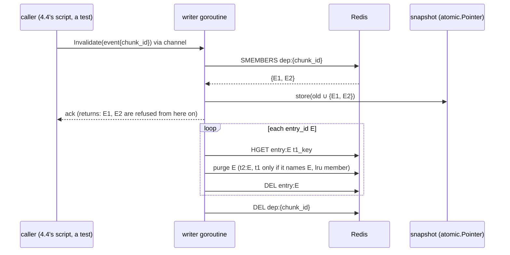
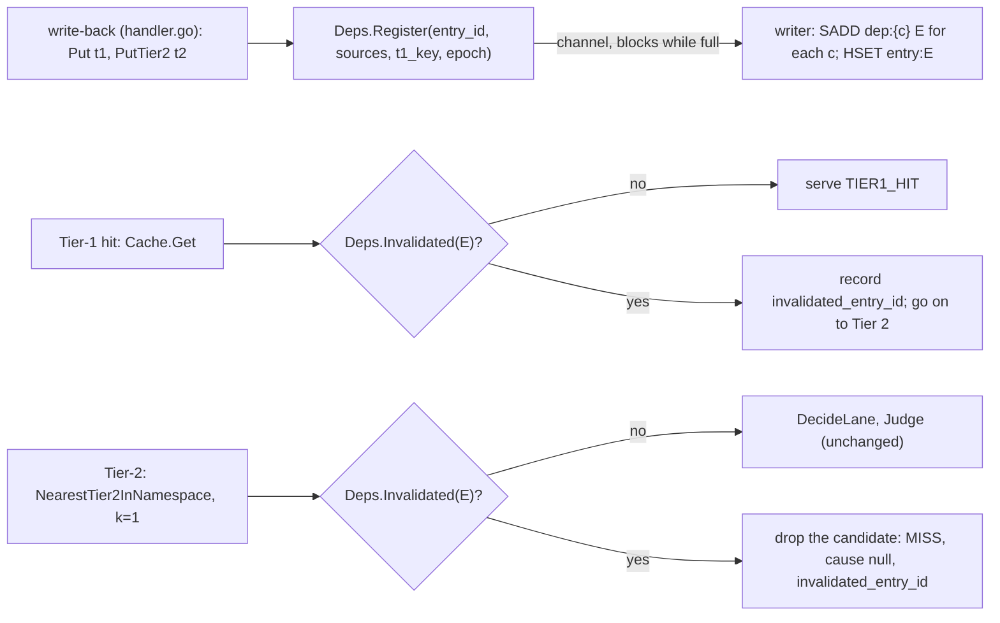
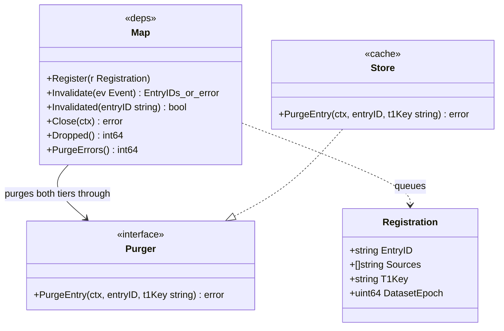

# Dependency map and blind purge (C2)

Status: opened 2026-10-27 · spec approved 2026-10-28 · design approved 2026-10-28 · plan approved 2026-10-28
§1/§2 changed at design: DC 5 split into deps/ and httpapi/ halves and states k=1; DC 7 also counts failed purges;
DC 12 added (main wires the map); §2's new import edge removed (deps reaches the tiers through an interface).
§1/§3 changed at plan: DC 7 and §3 add `RegisterErrors` (a failed SADD leaves the same hole as a dropped registration).
Super-plan item: 4.1 — Dependency map

## 1. Spec

**The change.** Build `gateway/internal/deps/`. Every write-back registers its entry under each of its source
chunks. An invalidation event for a chunk purges every dependent entry from both tiers and touches nothing
else. All writes to the dependency records go through one writer goroutine. A hit checks an in-process
copy-on-write snapshot, so an entry is not served once its invalidation has been accepted, even before
Redis has finished the purge.

**What the records hold** (`interfaces.md` §E, made concrete here):

- `dep:{chunk_id}` — SET of `entry_id`, as §E has it today.
- `entry:{entry_id}` — HASH with the entry's `t1_key` and `source_chunk_ids`. The name is reserved today and
  nothing writes it. It is needed because the purge reads `t1_key` from `t2:{entry_id}`, and a write-back
  with no vector (embedding failed) writes Tier 1 only, so its Tier-1 copy is unpurgeable today. Item 4.3
  will add promoted Tier-1 keys to this record.

**Done conditions.** Every test that needs Redis runs against `redis-stack-server` on `localhost:6379`. Its
`-v` output must show `--- PASS`, never `--- SKIP`.

1. **Register.** A new test in `deps/` shows that after a write-back of entry `E` with sources `S`, every
   `dep:{c}` for `c ∈ S` contains `E`, and `entry:E` holds `E`'s `t1_key` and `S`. The same holds for a write-back
   with no Tier-2 record.
2. **Purge is complete and exact.** A new test seeds `E1` (sources `{A, B}`), `E2` (`{B, C}`) and `E3` (`{C}`), each
   with `t1:`, `t2:`, `lru:entries` and `entry:` state, and invalidates `B`. Afterwards `E1` and `E2` have no
   `t1:`, `t2:`, `entry:` record and no `lru:entries` member, and `dep:B` is gone. `E3`'s four records are
   unchanged, and `dep:C` still contains `E3`.
3. **Tier-1-only entries are purged.** In the same package, an entry written with no `t2:` record loses its
   `t1:` record when one of its chunks is invalidated.
4. **A reused Tier-1 key is left alone.** If `t1:k` now names a newer entry `E'`, purging an older entry `E` whose
   `entry:E` still records `t1:k` does not delete `t1:k`.
5. **The hit path does not serve an invalidated entry.**
   (a) A new `deps/` test holds the Redis purge back: right after `Invalidate` for a chunk of `E` returns,
   `Invalidated(E)` is true while `t2:E` still exists, and it is false for an entry with no invalidated chunk.
   (b) A new `httpapi` test with a fake map that reports `E` invalidated: a Tier-1 hit on `E` is not served and
   the request goes on to Tier 2; a Tier-2 candidate `E` is dropped before it is judged, so the request is a
   MISS with `refusal_cause` null (the search returns one candidate, k=1). Each record carries
   `invalidated_entry_id: E`. A hit on any other entry is served as before.
6. **One writer.** `go test -race -count=1 ./internal/deps/` passes a new test that runs registrations,
   invalidations and snapshot reads concurrently. `grep -rn '"dep:\|"entry:' gateway --include='*.go'` lists
   non-test files under `internal/deps/` only.
7. **No registration is lost silently.** A new test fills the writer's queue and shows a further `Register`
   either waits and lands, or is counted on an exported counter that the gateway logs at shutdown. It is never
   dropped with no trace. A registration whose Redis write fails, and a purge whose Redis call fails, are
   counted and logged the same way.
8. **Eviction still leaves the dependency region alone.** The existing
   `TestEvictionLeavesDependencyRecordsAlone` passes unchanged.
9. `docs/contracts/interfaces.md` is at v0.17. §E names `dep:*` and `entry:*` with their fields, the purge
   steps, the hit-path check, and ADR-008's rule that the epoch is not a Redis key. §H names
   `invalidated_entry_id`. `docs/architecture.md`'s `deps/` row and `docs/Redis-Data Structure.md` §8 describe
   what is built.
10. `make verify` passes with Redis up. Any SKIPPED target is listed by name.
11. No existing test is edited: in `git status --porcelain -- '*_test.go'` every line starts with `??` or `A `.
12. **The gateway always has a map.** A new `cmd/gateway` test reading `main.go` (comment lines dropped) shows
   `deps.New(` is called, its result is assigned to `handler.Deps`, and its `Close` is called after
   `srv.Shutdown` and before `finishRun`.

**Out of scope.**

- **The epoch guard** on write-back and the epoch's source (item 4.2, ADR-008). The registration carries the
  entry's `dataset_epoch`, so 4.2 can close the gap between a write-back and its registration in the writer.
- **Promoted Tier-1 keys** (item 4.3). They stay untracked in Redis after a purge. The hit-path check
  (DC 5) refuses them within the same gateway process, because a promoted key's record names the same `entry_id`.
- **How an edit reaches the gateway.** 4.1 offers a Go call, `Invalidate(event)`. An HTTP endpoint or other
  transport, the corpus change itself, and the update set belong with item 4.4.
- **The reset for run rule 11.** Once `dep:` and `entry:` keys exist, `flush-cache` refuses to run, by design.
  Phase 4 must define the reset, and no item owns it yet.
- `change_type` as a gate (cut scope), the COW-against-`RWMutex` microbenchmark (RQ3), and invalidation under
  load (item 7.4).

## 2. Impact

**Files.** No new edge between leaf packages. `deps/` imports no internal package: it reaches the two tiers
through a small interface that `*cache.Store` satisfies, wired in `cmd/gateway`. `httpapi` and `cmd/gateway`
import `deps`, which `architecture.md` allows (`httpapi` is the package that imports its siblings).

- `gateway/internal/deps/` (new code): the writer goroutine, the snapshot, `Register`, `Invalidate`, the
  `dep:*` and `entry:*` records.
- `gateway/internal/cache/`: one method that deletes an entry's `t2:`, its `t1:` (only if that record still
  names the entry) and its `lru:entries` member. `cache/` keeps owning the key layout of both tiers.
- `gateway/internal/httpapi/handler.go` and `cascade.go`: register after write-back; check the snapshot on a
  Tier-1 and a Tier-2 hit.
- `gateway/internal/telemetry/evallog.go`: the `invalidated_entry_id` field.
- `gateway/cmd/gateway/main.go`: start the writer and drain it at shutdown.
- New test files in `deps/`, `cache/`, `httpapi/` and `cmd/gateway/`.
- Docs: `interfaces.md`, `architecture.md`, `Redis-Data Structure.md`.

**Frozen values touched.** None. Redis still evicts nothing, the capacity ratio and the trim are unchanged, and
the purge is blind, as §E fixes it. **Invalidates:** none — no runs yet (`experiments/results/` holds only
`.gitkeep`).

**Contract change.** Yes, `interfaces.md` v0.16 → v0.17, gateway side only.
- §E gains the `entry:*` record and the purge steps.
- §H gains the extension key `invalidated_entry_id`.
- §A, §B and the `.proto` do not change. The Python service is not touched: the epoch is item 4.2.
- `source_chunk_ids`, `t1_key` and `dataset_epoch` keep their meaning. The registration reads the first
  two and carries the third.

**Measurement change.**
- Under `mutation: off`, nothing changes. No event fires, so no hit is refused.
- Under `mutation: on`, a hit on an entry whose chunk was invalidated becomes a miss and is named in the
  record. This lowers the staleness rate (RQ3) compared with a purge-only design, and the record says when it
  happened.
- Every hit pays one atomic load and one map lookup. That is too small to move μ_hit at the probe's
  resolution, but it is a change on the hot path, and item 7.2 measures μ_hit after it.

**New dependency.** None (standard library only). Resident memory: the snapshot holds invalidated `entry_id`s,
at most a few hundred bytes per purged entry for one process.

**Cut scope reinstated.** No. The purge is blind; `change_type` is recorded, never used as a gate.

**Existing tests.** `capacity_test.go:TestEvictionLeavesDependencyRecordsAlone` requires that the trim never
deletes `dep:*` or `entry:*`. The design keeps that: only the purge deletes them, so a stale `entry_id`
of an evicted entry can stay in `dep:*` sets, and a later purge of it is a no-op.

## 3. Design

**Approach.** One writer goroutine owns `dep:*` and `entry:*`. It takes two kinds of message from one
buffered channel, a registration and an invalidation, and handles them in arrival order. The in-process
copy-on-write snapshot holds the set of **invalidated `entry_id`s**. The writer builds a new set and swaps it in
with one `atomic.Pointer` store, **before** it deletes anything in Redis. A hit reads Redis first and checks
the snapshot second. So any hit that could still see a purged entry also sees its tombstone. Redis `dep:*` stays
the authority for "who depends on this chunk", so entries written by an earlier gateway process are purged too.

*Beaten:* an in-process mirror of the whole `chunk → entries` map, read on the hit path. It duplicates Redis,
is empty after a restart (so it would miss earlier entries), and the hit path never needs the forward
question. It only needs to know whether this entry has been invalidated.

### Diagrams

**Invalidation.** `Invalidate` returns once the tombstones are visible. The Redis purge runs after that, off
the caller's path.



**Registration and the hit-path check.**



**Types.**



### Files

**`gateway/internal/deps/deps.go`** (new). Imports `github.com/redis/go-redis/v9` and the standard library only.

```go
type Registration struct { EntryID string; Sources []string; T1Key string; DatasetEpoch uint64 }
type Event struct { ChunkID, DocID, ChangeType, NewText, DatasetVersion string; TS time.Time } // interfaces.md §E
type Purger interface { PurgeEntry(ctx context.Context, entryID, t1Key string) error }

func New(rdb *redis.Client, p Purger, queue int) *Map // starts the writer
func (m *Map) Register(r Registration)                  // blocks until queued; after Close: counted, not queued
func (m *Map) Invalidate(ev Event) ([]string, error)    // returns the entry IDs tombstoned, after the swap
func (m *Map) Invalidated(entryID string) bool          // one atomic load and a map lookup; no lock, no Redis
func (m *Map) Close(ctx context.Context) error          // stops intake, drains the queue, waits for the writer
func (m *Map) Dropped() int64                            // registrations refused after Close
func (m *Map) RegisterErrors() int64                     // registrations whose Redis write failed
func (m *Map) PurgeErrors() int64                        // Redis calls that failed during a purge
```

- **The register step** is one `TxPipeline`: `SADD dep:{c} E` for each source, then `HSET entry:E t1_key <k>
  source_chunk_ids <json>`. A registration with no sources writes `entry:E` only. It depends on no chunk, so no
  event can purge it, which is correct.
- **`Register` ignores the request's context, on purpose.** The write-back runs in the coalesced generation,
  and a client that left cancels its context. A registration that gave up on a cancelled context would leave
  the entry in Redis with no dependency record, and so it could never be purged (failure mode 1). It waits on
  the channel instead. The writer only stops at `Close`.
- **The invalidate step** is SMEMBERS, swap, ack, purge each entry, `DEL dep:{chunk_id}`, as in the diagram.
  `t1_key` comes from `entry:E`, and falls back to `t2:E`'s field for an entry registered by no writer. A Redis
  error on one entry increments `PurgeErrors`, is logged, and the loop goes on. The tombstone stays, so this
  process still refuses the entry.
- **The snapshot** is `atomic.Pointer[map[string]struct{}]`. The writer copies the map, adds the new IDs, and
  stores the copy. It is never mutated after the store. Tombstones live for the process: entry IDs are ULIDs
  and never reused, and dropping a tombstone after the purge would reopen the window for a hit that read Redis
  just before the `DEL`.

**`gateway/internal/cache/purge.go`** (new). `func (s *Store) PurgeEntry(ctx, entryID, t1Key string) error`
runs one Lua script with keys `t2:E`, `t1:k` and `lru:entries`: delete `t2:E`, delete `t1:k` **only if** its
`entry_id` field equals `E` (compare-and-delete, so a newer entry that reuses the key survives, DC 4), and
`ZREM lru:entries E`. One script, so the compare and the delete are atomic. If `t1Key` is empty, it reads
`t2:E`'s `t1_key` first.

**`gateway/internal/httpapi/`.**
- `handler.go`: a `Deps` field of type `dependencyMap interface { Register(deps.Registration); Invalidated(string) bool }`.
  A nil `Deps` disables both, so a `Handler` built as a struct literal (every existing test) behaves as today.
- Tier-1: after `Cache.Get` hits, if `Deps.Invalidated(entry.EntryID)`, set `rec.InvalidatedEntryID` and fall
  through to Tier 2 as a lookup miss.
- Write-back: after `Put` and `PutTier2` (whatever their errors), call `Deps.Register` with `entryID`,
  `result.SourceChunkIDs`, `t1Key` and `result.DatasetEpoch`.
- `cascade.go`: in `tryTier2`, right after `c := scoped[0]` and before `DecideLane`, if `Deps.Invalidated`, set
  `out.InvalidatedEntryID` and return with `Found` false. `handler.go` copies it to the record **only if the
  Tier-1 step did not set one**, so the field names the first invalidated entry the request met.

**`gateway/internal/telemetry/evallog.go`:** `InvalidatedEntryID string` with tag
`json:"invalidated_entry_id,omitempty"`. It is an extension key, present only when set, as §H's other extensions.

**`gateway/cmd/gateway/main.go`:** `depMap := deps.New(rdb, store, 1024)` after the store is built;
`handler.Deps = depMap`. At shutdown, after `srv.Shutdown`: `depMap.Close(ctx)`, then log `Dropped()`,
`RegisterErrors()` and `PurgeErrors()` when non-zero, then `finishRun`.

**Docs.** `interfaces.md` v0.17: §E gets the `entry:*` record, the register and purge steps, the hit-path
check, and a line that the epoch follows ADR-008, not the `dataset:epoch` key §E still names. §H gets the
`invalidated_entry_id` row. Plus the version row. `architecture.md`: the `deps/` row and the Invalidation row
of the path table say what is built. `Redis-Data Structure.md` §8: drop "not built yet" and match the steps.

### New tests (new files only)

| File | Covers | Needs Redis |
| :--- | :--- | :--- |
| `deps/deps_test.go` | DC 1, 2, 3, 5a, 7, using Redis **DB 14** (the cache tests use DB 15, and packages run in parallel) and a `Purger` that can block or fail | yes |
| `deps/race_test.go` | DC 6: registrations, invalidations and `Invalidated` reads at once, under `-race` | yes |
| `cache/purge_test.go` | DC 4 and the plain purge of both tiers, with `testStore` (DB 15) | yes |
| `httpapi/invalidation_test.go` | DC 5b, with `newHarness` and a fake `dependencyMap` | no |
| `cmd/gateway/deps_wiring_test.go` | DC 12, a source-order check on `main.go` | no |

### Failure modes, silent ones first

1. **A registration is lost.** The entry sits in Redis with no `dep:*` record and survives every purge.
   Completeness drops below 1 with no error. *Closed by:* `Register` waits and ignores the request context;
   after `Close`, or when its Redis write fails, it is counted. *Caught by* DC 1 and DC 7.
2. **A Tier-1-only entry is unpurgeable,** because the purge read `t1_key` from a `t2:` record that was never
   written. *Closed by* `entry:E`. *Caught by* DC 3.
3. **The purge deletes a Tier-1 key that a newer entry now owns.** Over-invalidation that the precision metric
   would charge to blind purge. *Closed by* compare-and-delete in Lua. *Caught by* DC 4.
4. **A hit serves an entry between the event and the `DEL`.** *Closed by* swapping before deleting, and
   checking after reading. *Caught by* DC 5a and 5b.
5. **Two writers race on `dep:*`.** A request goroutine's `SADD` lands after the writer's `DEL dep:C`, or a
   purge reads a half-written set. *Closed by* one goroutine. *Caught by* DC 6 (grep and `-race`).
6. **Eviction deletes the dependency region.** *Caught by* DC 8 (existing test).
7. **A purge fails half-way.** The Redis copy stays. This process refuses it through the tombstone; a restarted
   process would serve it. *Counted* in `PurgeErrors` and logged at shutdown (DC 7). It does not yet make a run
   INCOMPLETE under §H rule 6: that would be a contract change, and 4.4's completeness script reads Redis
   state directly, so a leftover entry is found there.
8. **The gateway runs without a map.** A nil `Deps` registers nothing, silently. *Caught by* DC 12.

**Not closed here, owned by item 4.2:** a generation that retrieved before an edit can write back and register
**after** the writer has purged its chunk. Its entry is then stale and registered. 4.1 orders registration and
purge in one queue, and the registration carries `DatasetEpoch`, so 4.2 can refuse a stale registration in the
writer. Until 4.2, completeness under concurrent edits is not claimed.

### Edge cases

- An event for a chunk with no dependants: SMEMBERS is empty; nothing is swapped or deleted except `dep:` (absent).
- The same event twice: the second finds `dep:C` gone and does nothing.
- An evicted entry still listed in `dep:C`: its `t2:` is gone, `entry:E` is still there (eviction leaves it), and
  the compare-and-delete leaves any reused `t1:` key alone. The purge removes `entry:E`.
- A request that meets an invalidated Tier-1 entry and a different invalidated Tier-2 candidate: the field names
  the Tier-1 one. Rare: both copies of one answer share an `entry_id`.
- `Invalidate` after `Close`: returns an error; nothing is purged.

### Unknowns

- That `redis-stack-server` on this machine runs `EVAL` (it ships Lua). `cache/purge_test.go` settles it.
- That a 1,024-slot queue never fills in a real run. Writes come from generations, one at a time (ADR-003), so
  it should hold. DC 7 proves only that a full queue waits instead of dropping; item 7.4 measures the queue under load.

### Verification

| DC | How |
| :--- | :--- |
| 1, 2, 3, 5a, 7 | `go test -count=1 -v ./internal/deps/`: each named test `--- PASS`, none `--- SKIP` |
| 4 | `go test -count=1 -v -run TestPurgeEntry ./internal/cache/` |
| 5b | `go test -count=1 -v -run TestInvalidated ./internal/httpapi/` |
| 6 | `go test -race -count=1 ./internal/deps/`, and the `grep` in §1 |
| 8 | `go test -count=1 -v -run TestEvictionLeavesDependencyRecordsAlone ./internal/cache/` |
| 9 | `grep` on the three docs |
| 10 | `make verify` with `redis-cli PING` answering `PONG` first |
| 11 | `git status --porcelain -- '*_test.go'` |
| 12 | `go test -count=1 -v -run TestMainWiresDeps ./cmd/gateway/` |

## 4. Findings

**2026-10-28 — a `FLUSHDB` on any Redis DB drops every search index.** In the main session's re-check, the
first `make verify` failed: `rag/tests/test_retrieve_scoping.py::test_retrieve_unscoped_behaviour_is_unchanged_when_product_id_absent`
got two different top chunks from two identical retrievals (`evidence/verify-1-parallel-fail.out`).
- **Cause.** I ran the Go done-condition tests in parallel with `make verify`. Their helpers `FLUSHDB` DB 14
  and DB 15. On this server (search module 2.10.20), that drops **every** index, in every DB: a `FLUSHDB` on
  an empty DB 13 removed a throwaway index in DB 0. `idx:corpus` was gone, and the RAG service rebuilt it
  on the next query, so `pytest` read a half-built index.
- **Not this task's code.** The existing `cache` tests already flush DB 15. This task adds `deps` tests
  that flush DB 14, which is the same hazard again, not a new one. No existing test was changed.
- **Re-check.** `make verify` run alone, with the Go test cache cleared, exits 0
  (`evidence/verify-3-uncached-pass.out`). That was the one quick fix: run the check alone.
- **What it means beyond this task.** §3's "DB 14 for deps, DB 15 for cache" isolates keys, not indexes.
  Running any Go Redis test while a gateway or the RAG service is up drops `idx:cache` and `idx:corpus`.
  A run in progress would lose Tier 2 with no error from the test. No item owns a guard for this yet.
