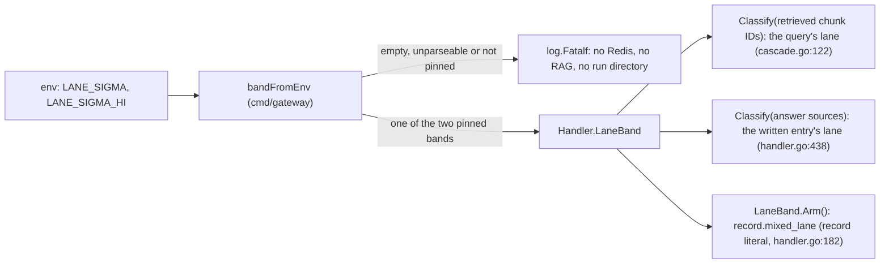
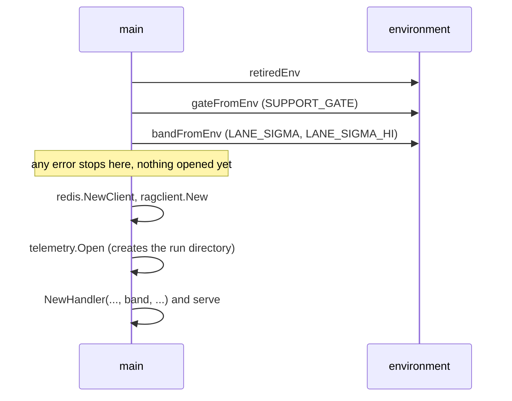
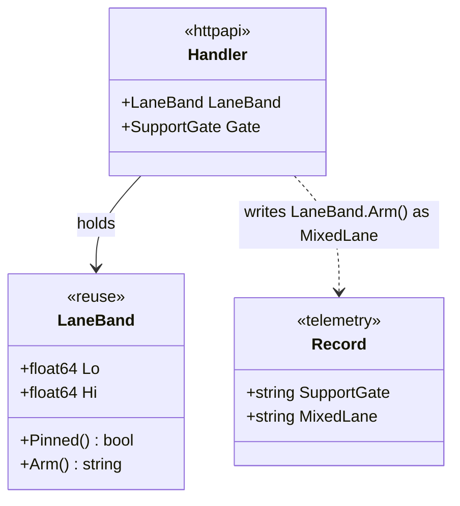

# Name the MIXED arm in every record

Status: opened 2026-10-27 · spec approved 2026-10-27 · design approved 2026-10-27 · plan approved 2026-10-27
§1/§2 changed at design: DC 4 adds the empty value and `0.6`; DC 6 adds `handler.go`; DC 9 added; §2 names the `reuse/` helper.
§1 changed at plan: DC 8 uses `git status --porcelain`, because `git diff` does not list new untracked files.
Super-plan item: 4.5 — Name the MIXED arm in every record

## 1. Spec

**The change.** Every evaluation record gets a required key, `mixed_lane` (`"on"` or `"off"`), that names the
lane band the gateway ran with, and the gateway refuses to start with any band that is not one of ADR-016's two
pinned bands.

The second half is what makes the key true. Today `getenvFloat` turns an unparseable value into the default
without a word, and any other band runs with nothing in the record to say so. ADR-010 closed the same gap for
`SUPPORT_GATE`: one field decides the behaviour and writes the label, and any other value stops the process.

The two pinned bands (ADR-016). `LANE_SIGMA_HI` defaults to `LANE_SIGMA`, as it does today:

| Arm | `LANE_SIGMA` | `LANE_SIGMA_HI` | Band |
| :--- | :--- | :--- | :--- |
| off (the default) | unset or `0.20` | unset or `0.20` | [0.20, 0.20), closed |
| on | unset or `0.20` | `0.60` | [0.20, 0.60) |

**Done conditions.**

1. `cd gateway && go test ./internal/telemetry/` passes, and a new test shows `mixed_lane` is written on every
   record, never null, with no `omitempty`: a zero `Record` writes `"mixed_lane":""`, and `"on"` and `"off"` are
   written as given.
2. `cd gateway && go test ./internal/httpapi/` passes, and a new test drives `Ask` through a Tier-1 hit, a Tier-2
   hit, a miss and a shed, once with the closed band and once with [0.20, 0.60). Every record carries `"off"` and
   `"on"` respectively.
3. **Label and behaviour agree.** In the same package, a new test sends one request whose grounding is mixed
   (policy fraction in [0.20, 0.60)). With the band [0.20, 0.60) its record has `mixed_lane: "on"` and
   `reuse_rule: "composite"`; with the closed band it has `mixed_lane: "off"` and `reuse_rule: "namespace"`.
4. `cd gateway && go test ./cmd/gateway/` passes, and a new test shows the start-up check. It accepts unset,
   `0.20` / `0.20`, `0.20` / `0.60` and `LANE_SIGMA_HI=0.6`, and maps them to off, off, on and on. It refuses
   `LANE_SIGMA_HI=0.70`, `LANE_SIGMA=0.30`, `LANE_SIGMA_HI=abc` and a set-but-empty `LANE_SIGMA_HI=` with an
   error. A test reading `main.go` shows the call comes before `redis.NewClient`, `ragclient.New` and
   `telemetry.Open`, as `gateFromEnv` does.
5. `docs/contracts/interfaces.md` reads `Current version: v0.16`, and §H names `mixed_lane` in the example record,
   the field table, the invariants and the version table. The invariants say:
   `mixed_lane ∈ {"on", "off"}` on every record and constant across a run; `mixed_lane == "off"` ⇒ no record has
   `reuse_rule == "composite"`; `config_id == 5` ⇒ `mixed_lane == "on"`; and `config_id == 4 ∧ support_gate ==
   "off"` ⇒ `mixed_lane == "off"` (ADR-016's three arms). The old-log rule says a log without the key reads as off
   (ADR-016), and any `composite` record in it disproves that.
6. The stale text is gone. Each of these prints nothing:
   `grep -n "Both bounds are swept" gateway/internal/reuse/lane.go`,
   `grep -n "operating point belongs to the sweep" gateway/cmd/gateway/main.go`,
   `grep -n "Item 4.0 chooses" README.md`,
   `grep -n "swept, never hand-set for anything reported" gateway/internal/httpapi/handler.go`. The start-up log
   line no longer calls the band a DEMO value that is swept later.
7. `make verify` passes. Any SKIPPED target is listed by name.
8. No existing test is edited: in `git status --porcelain -- '*_test.go'` every line starts with `??` or `A `
   (new files), and none with `M` or `D`.
9. `cd gateway && go test ./internal/reuse/` passes, and a new test shows `Pinned()` is true for the two bands
   only, `Arm()` names them, and for each pinned band `Classify` on a grounding with one policy chunk in three
   gives MIXED under the on band and POLICY under the off band.

**Out of scope.**

- How lanes are chosen or keyed. `Classify`, `Namespace` and `DecideLane` do not change.
- A new switch name such as `MIXED_LANE=on|off`. The on arm stays `LANE_SIGMA_HI=0.60`, as ADR-016 says.
- Checking `config_id` against the arms at start. `CONFIG_ID` selects no behaviour yet (F-K), so the two
  `config_id` invariants are checks on a finished log, like I8.
- The run manifest (P1), configuration 3's code path (F-K), and item 5.5's request size cap.
- `Final_Proposal.md` §9.2 and §9.4. They are the author's to edit.

## 2. Impact

**Files.** No new import edge, so the graph in `docs/architecture.md` holds.

- `gateway/internal/telemetry/evallog.go`: one field on `Record`. The value is a plain string, so the package
  still imports nothing from the repository.
- `gateway/internal/httpapi/handler.go`: writes the arm where it writes `support_gate` (`handler.go:187`), so
  every exit path carries it. It is taken from `h.LaneBand`, the same field that `Classify` reads.
- `gateway/cmd/gateway/main.go`: the start-up check beside `gateFromEnv`, the start-up log line, and the stale
  comment. Wiring and config only, as `architecture.md` asks.
- `gateway/internal/reuse/lane.go`: the stale comment at lines 93–102, the two pinned values, and two pure methods
  on `LaneBand` (§3). No Redis, gRPC or HTTP, so `reuse/` stays falsifiable in isolation.
- New test files in `reuse/`, `telemetry/`, `httpapi/` and `cmd/gateway/`.
- Docs: `docs/contracts/interfaces.md` (§H and the version), `README.md` (the "MIXED lane is off" bullet),
  `docs/architecture.md` (the line on what `cmd/gateway` reads at start).

**Frozen values touched.** None. ADR-016 froze the two bands today; this task enforces them and changes no
default. The closed band (`LANE_SIGMA` = `LANE_SIGMA_HI` = 0.20) stays the default and is the off arm.
**Invalidates:** none — no runs yet (`experiments/results/` holds only `.gitkeep`).

**Contract change.** Yes: `interfaces.md` §H, v0.15 → v0.16. The writer is the gateway (`telemetry`). No reader
is built yet; the judge harness (5.1) and the figure generators (5.4) will read the key. §A, §B, §D and the
`.proto` do not change. `source_chunk_ids`, `t1_key` and `dataset_epoch` are not touched.

**Measurement change.** No metric changes what it means or how it is counted. A configuration-4 run is now
identified by `(config_id, mutation, support_gate, mixed_lane)`, and hit rate, tier mix, band share and false
hits by cause are reported per MIXED arm (ADR-016). One behaviour changes: a band outside the two pinned ones now
stops the gateway at start, where today it runs. A demo that sets another band will stop.

**New dependency.** None.

**Cut scope reinstated.** No.

**Existing tests.** None pins the record's full key set or the band parsing (checked with grep in `telemetry/`,
`httpapi/` and `cmd/gateway/`), so no existing test needs to change.

## 3. Design

**Approach.** Follow ADR-010's pattern. One field decides the behaviour and writes the label, and any value
outside the pinned set stops the process at start. The field is `Handler.LaneBand`: `Classify` already reads it
(`cascade.go:122` for the query, `handler.go:438` for the write-back), and the record's `mixed_lane` will be
derived from it too, so the label cannot come from a second source.

*Beaten:* a numeric key `lane_band: [lo, hi]` that accepts any band. It is truthful for any band, but it lets an
unpinned band run, and every reader must re-derive the arm. ADR-016 pins two bands, so a two-value key with a
refusal at start is both simpler and stricter.

### Diagrams

**One field, three readers.** The band is parsed once at start. A band that is not pinned stops the process
before any side effect. After that, `Handler.LaneBand` is the only source for both lane decisions and for the
label, which is what failure mode 1 depends on.



**Start-up order.** `bandFromEnv` joins the two existing checks, ahead of the first side effect.



**Types that change.** `telemetry.Record` holds a plain string, so `telemetry/` still imports nothing from the
repository; the handler converts.



### Files

**`gateway/internal/reuse/lane.go`** (C1 package, pure):

```go
const (
	PinnedLo   = 0.20 // ADR-016: σ_lo, both arms; σ_hi of the off arm
	PinnedHiOn = 0.60 // ADR-016: σ_hi of the on arm
)

// Pinned reports whether b is one of ADR-016's two bands, compared exactly.
func (b LaneBand) Pinned() bool // b == {PinnedLo, PinnedLo} || b == {PinnedLo, PinnedHiOn}

// Arm is the record's mixed_lane value: "on" when the band is open (Hi > Lo), else "off".
func (b LaneBand) Arm() string
```

`Arm` does not check `Pinned`. Start-up does that once. A zero `LaneBand{}` (what `NewHandler`'s test passes)
is closed, so it reads `"off"`, which matches what `Classify` does with it. The comment block at lines 93–102
("Both bounds are swept, never hand-set") is rewritten to say ADR-016 pins two bands as an on/off arm.

Exact float comparison is safe here. `strconv.ParseFloat("0.20")`, `ParseFloat("0.2")` and the literal `0.20`
are the same `float64`, because each is the nearest double to the same decimal. A value such as `0.2000001`
differs and is refused, which is the point.

**`gateway/internal/telemetry/evallog.go`:** one field after `SupportGate`:
`` MixedLane string `json:"mixed_lane"` ``, with no `omitempty`, for the reason `SupportGate` gives: the old-log
reading rule keys on presence.

**`gateway/internal/httpapi/handler.go`:** in the record literal at line 182, beside `SupportGate`:
`MixedLane: h.LaneBand.Arm()`. Set in the literal, so every exit path (Tier-1 lookup error, TIER1_HIT, SHED,
ABANDONED, GENERATION_FAILED, the hits and the miss) carries it. The `LaneBand` field comment (lines 107–110,
"DEMO values ... swept, never hand-set") is rewritten.

**`gateway/cmd/gateway/main.go`:**

```go
// bandFromEnv reads LANE_SIGMA and LANE_SIGMA_HI in os.LookupEnv's shape, as gateFromEnv does.
// Unset LANE_SIGMA is PinnedLo; unset LANE_SIGMA_HI equals LANE_SIGMA. Set-but-empty, unparseable
// and unpinned values are errors that name both values and ADR-016.
func bandFromEnv(lookup func(string) (string, bool)) (reuse.LaneBand, error)
```

`main` calls it right after `gateFromEnv` and stops on error, before `redis.NewClient` (line 179). It replaces
the two `getenvFloat` lines; `getenvFloat` itself stays for τ and θ. The start-up line prints τ and θ as DEMO
values, as today, and the band separately as `lane_band=[0.20,0.60) mixed_lane=on (ADR-016)`. The comment block at
lines 205–224 is rewritten: it keeps the dev-v0 measurement that chose [0.20, 0.60) and drops "the operating
point belongs to the sweep".

**Docs.** `interfaces.md` to v0.16: the header's version and date, the example record (`"mixed_lane": "off"`
after `support_gate`), a field-table row, invariants **I10** (the arm: values, constant per run, `off` ⇒ no
`composite`), **I11** (`config_id == 5` ⇒ `on`) and **I12** (`config_id == 4 ∧ support_gate == "off"` ⇒ `off`),
the reading rule for old logs, *Joins name their arm* and the run identity extended to the MIXED arm, and a
version-table row. `README.md`: the "MIXED lane is off" bullet says it is an on/off arm (ADR-016) named in every
record. `architecture.md`: line 48 names `bandFromEnv` beside `gateFromEnv`.

### New tests (new files only)

| File | Covers |
| :--- | :--- |
| `reuse/lane_band_test.go` | DC 9: `Pinned`, `Arm`, and `Classify` on `[product#0, policy#0, product#1]` (fraction 1/3) |
| `telemetry/mixed_lane_field_test.go` | DC 1, with `logOne` from `cause_fields_test.go` |
| `httpapi/mixed_lane_test.go` | DC 2 with `newHarness`, setting `hs.h.LaneBand` before the first `Ask`; DC 3 below |
| `cmd/gateway/lane_env_test.go` | DC 4: a table over `bandFromEnv`, and a source-order check on `main.go` |

DC 3 needs a mixed grounding, and the harness's `fakeRAG` returns product chunks only. Editing it would edit an
existing test file, so `mixed_lane_test.go` brings its own small gRPC fake whose `Retrieve` returns
`[product-kettle-01#chunk-0, policy-returns-01#chunk-0, product-kettle-01#chunk-1]` with aligned texts, and builds
the `Handler` from `newFakeStore`, `fakeEmbedder` and `telemetry.Open`. It seeds two Tier-2 entries: one MIXED
entry in namespace `product-kettle-01|policy-returns-01`, and one POLICY entry in `policy-returns-01`, both close
to the query's vector. On the on band the search goes to the composite namespace and the record says
`reuse_rule: "composite"`; on the off band it goes to the policy namespace and says `"namespace"`. Each run
reads `mixed_lane` from the same record.

### Failure modes, silent ones first

1. **The label comes from a different source than the behaviour.** A record says `off` while MIXED ran. Symptom:
   plausible per-arm numbers that pool both arms. Closed by deriving the label from `h.LaneBand`; caught by DC 3.
2. **The key is set late,** after an early return. Tier-1 and SHED records carry `""` and read as an unknown arm.
   Caught by DC 2 (four exit paths) and DC 1 (no `omitempty`).
3. **A typo falls back to the default,** as `getenvFloat` does today. `LANE_SIGMA_HI=0,60` runs the off arm
   under a run id meant for the on arm. The label is true, but the run is wasted and easy to file wrongly.
   Caught by DC 4 (`abc` and the empty value are refused).
4. **An unpinned band runs and is labelled `on`.** `Hi > Lo` is all `Arm` checks, so `0.70` would pool with the
   pinned on arm. Caught by DC 4 (`0.70`, `0.30`) and DC 9 (`Pinned`).
5. **A mislabelled configuration.** Configuration 5 with MIXED off, or configuration 4's gate-off arm with MIXED
   on. Not checked at start, because `CONFIG_ID` selects nothing yet (F-K). I11 and I12 catch it on a finished
   log, as I8 does for the gate. A known gap, recorded in §H.

### Edge cases

- `LANE_SIGMA=0.20` with `LANE_SIGMA_HI` unset: off. `LANE_SIGMA_HI=0.20` with `LANE_SIGMA` unset: off.
- `LANE_SIGMA=0.60` with `LANE_SIGMA_HI` unset: band [0.60, 0.60), not pinned, refused.
- `LANE_SIGMA_HI` below `LANE_SIGMA`, or with spaces (`" 0.60"`): refused.
- A log from before this task has no key. It reads as off (ADR-016); a `composite` record disproves that.

### Unknowns

- No script or Makefile target sets `LANE_SIGMA*` (grep over `Makefile`, `experiments/` and `gateway/`), so the
  new refusal stops nothing that runs today. `make verify` re-checks this from the build side.
- That `fakeStore`'s namespace filter and `DecideLane`'s lane check together route the two seeded entries as
  described. DC 3 settles it; if they do not, the test fails and the design is wrong, not the test.

### Verification

| DC | How |
| :--- | :--- |
| 1, 2, 3, 9 | `go test` on the package, new tests named in the plan |
| 4 | `go test ./cmd/gateway/`: the table test and the source-order test |
| 5, 6 | `grep` on the files named in §1 |
| 7 | `make verify` |
| 8 | `git status --porcelain -- '*_test.go'` |
