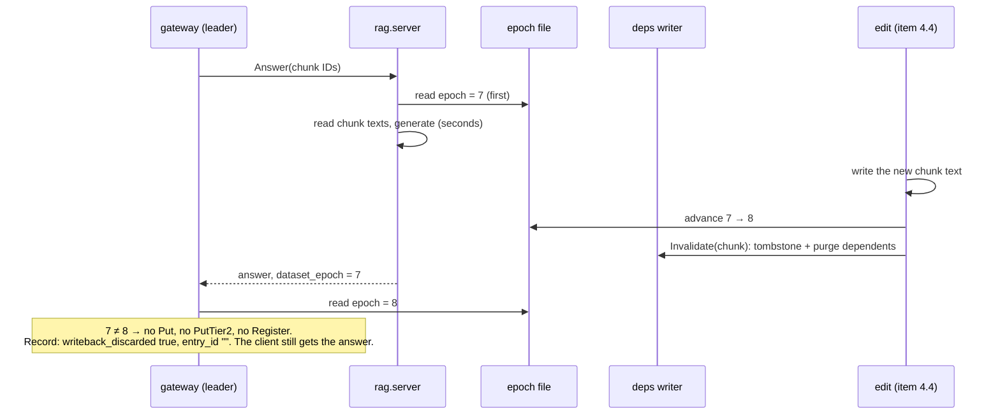
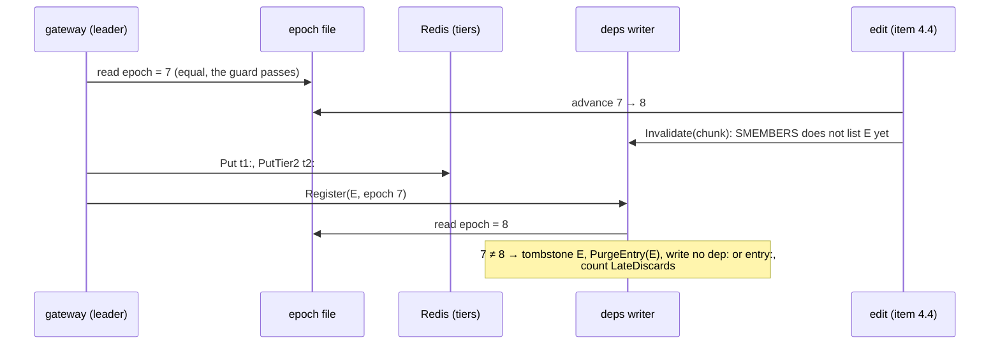

# Epoch-guarded write-back

Status: opened 2026-10-28 · spec approved 2026-10-28 · design approved 2026-10-28 · plan approved 2026-10-28
§1/§2 changed at design: DC 1 adds concurrent advances and the Go reader's re-read; DC 8 also refuses a relative
path and a value below 1; DC 9 also checks the writer's source; §2 adds the live-check script, and `config.py`
only loses the stub. §1 changed at plan: DC 3 adds `entry_sources` null; DC 11 hands failure mode 10 to
item 4.4; DC 13 adds a hash check, because 4.1's tests are not committed and git cannot see an edit to them.
Super-plan item: 4.2 — Epoch-guarded write-back, and make it set `writeback_discarded`

## 1. Spec

**The change.** The dataset epoch becomes real. It is one integer in a file outside Redis (ADR-008). The
RAG service stamps it on every retrieval, and an edit advances it. A write-back whose stamped epoch differs
from the current one is discarded: nothing reaches either tier or the dependency map, and the record says
`writeback_discarded: true`.

**The race this closes.** A generation in flight during an edit finishes *after* the purge and writes the old
answer back, with no trace (§E). DC 7 also closes 4.1's narrower gap: an edit between write-back and registration.

**Order rules** (written into §E, because a wrong order makes the guard pass on stale text):
- Python reads the epoch **before** it reads the chunk texts.
- An edit writes the new text **first**, then advances the epoch, then calls `Invalidate`. Item 4.4 builds
  the edit, and 4.2 provides the advance step.

**Done conditions.** Tests that need Redis must print `--- PASS` (Go) or `passed` (pytest), never a skip.

1. **The epoch lives in a file, never in Redis.** A new Python module reads and advances one integer file
   named by `DATASET_EPOCH_FILE`. A new test shows:
   - `advance()` on a missing file writes 1, and on N writes N+1, through a temp file and a rename;
   - eight threads advancing at once lose no advance;
   - `read()` returns the value, and a read that fails returns 0, which is never a real epoch.

   A new Go test shows the reader re-reads the file on every call. `grep -rn "DATASET_EPOCH_STUB\|dataset:epoch"
   rag/src gateway --include='*.py' --include='*.go'` is empty.
2. **Python stamps the epoch it read first.** New tests on `RagServicer` show `Retrieve`, and `Answer` with
   and without `retrieved_chunk_ids`, return the file's epoch. A fake that records call order shows the
   epoch read comes before the chunk-text read on all three paths. Ingest advances the epoch after it has
   written every chunk, shown on the function ingest calls, with no model loaded.
3. **A stale write-back is discarded.** In a new `httpapi` test, `Answer` reports epoch `e` and a fake epoch
   source reports `e+1` at write-back. No `Put`, `PutTier2` or `Register` call is made. The client still
   gets the answer. The record has `cache: MISS`, `writeback_discarded: true`, `entry_id: ""` and
   `entry_sources` null. A source reporting `e−1` gives the same result: any mismatch discards.
4. **No false discard.** In the same test with the source equal to `e`, the write-back and the registration
   happen, with `writeback_discarded: false`. With no source (nil), the guard is off. Every existing
   `httpapi` test passes unchanged; they use `testEpoch` 7 on both sides.
5. **A read error fails closed.** If the source returns an error at write-back, the write-back is
   discarded, `writeback_discarded` is true, and the error is logged.
6. **One discard, one flag.** A leader and a coalesced follower share a discarded generation. Only the
   leader's record carries `writeback_discarded: true`. Both records have `entry_id: ""`, and both clients
   get the answer.
7. **The late race is closed.** A new test on Redis DB 14: an entry is written to both tiers, the epoch
   advances, and only then is the entry's registration handled. Once the writer has drained, the entry has
   no `t1:`, `t2:`, `lru:entries`, `dep:` or `entry:` record, and `Invalidated` reports it. The case is
   counted on an exported counter that the gateway logs at shutdown. A registration stamped with the
   current epoch is registered as before.
8. **No epoch, no start.** A new `cmd/gateway` test on a pure function (the `bandFromEnv` pattern) and a
   new Python test on the server's start-up check. `DATASET_EPOCH_FILE` unset, empty or relative, naming a
   missing file, or holding a non-integer or a value below 1 each stops the process before it opens Redis,
   the log or the port. The start-up line names the path and the value.
9. **The gateway always has a source.** A new `cmd/gateway` test reads `main.go` (comment lines dropped)
   and shows the epoch source is built, assigned to the handler and given to the dependency map's writer.
10. **The live race** (loads the LLM, `citable: no`, memory check first). The gateway and `rag.server` run
    against one epoch file. One question is sent, and the epoch is advanced while its generation runs.
    The record has `writeback_discarded: true`, the client got an answer, and Redis holds no `t1:`, `t2:`
    or `entry:` record for it. A second question with no edit is written back, with
    `writeback_discarded: false`. Raw output goes to `evidence/`.
11. **The docs.**
    - `interfaces.md` is at v0.18. §E names the file and `DATASET_EPOCH_FILE` in place of the
      `dataset:epoch` key, and states the guard (any mismatch discards; a read error discards), the two
      order rules and the late-race rule.
    - §H defines `writeback_discarded` (leader only; `entry_id ""`) and adds an invariant: under
      `mutation: off` it is never true.
    - `architecture.md` and `Redis-Data Structure.md` §8 no longer say the guard is not built.
    - Super-plan row 4.4 says its design must test the edit order (§3 failure mode 10).
12. `make verify` passes with Redis up. Any SKIPPED target is listed by name.
13. No existing test is edited: in `git status --porcelain -- '*_test.go' 'rag/tests/*'` every line starts
    with `??` or `A `, and every test file that existed before Phase 1 has the same sha256 as then.

**Out of scope.**
- **The edit itself** (item 4.4): the update set, writing new chunk text, re-embedding it, and how an edit
  reaches the gateway. 4.2 provides `advance()` and the order rule only.
- **Promoted Tier-1 keys** (item 4.3).
- **An epoch check on the hit path.** The epoch is global (§E), so such a check would refuse every entry
  after any edit. The purge and the tombstone own the hit path (4.1). One epoch per chunk is also out.
- **Detecting an RDB rollback some other way** (ADR-008 rejected this). Also out: the reset for run rule
  11, and 4.1's follow-up that a failed purge still deletes `dep:{chunk}`.

## 2. Impact

**Files.** Each side of the seam changes. No new package, and no new edge between leaf packages.

- **Python** (`rag/src/rag/`): `epoch.py` (new: read, advance, the start-up check); `server.py` (stamp the
  epoch read first; check at `serve()`); `retrieve.py` (read the epoch first, same return shape);
  `ingest.py` (advance after indexing); `config.py` (the stub goes; the path is read at call time).
- **Go:**
  - `deps/`: the file reader, using the standard library only. C2 owns the guard, and the writer needs the
    reader for DC 7.
  - `httpapi/handler.go`: the guard in the write-back closure, an epoch-source interface field (nil means
    off), the record flag and `entry_id ""`.
  - `cmd/gateway/main.go`: read `DATASET_EPOCH_FILE`, refuse to start, wire the source, log it.
  - `telemetry/evallog.go`: the comment on `WritebackDisc` only.
- **Makefile:** one exported `DATASET_EPOCH_FILE` for every target (so `seam-check`'s `rag.server` gets it),
  an advance target, and a target for DC 10. **`.gitignore`:** the epoch file and its lock.
- **New:** `experiments/scripts/epoch_race_check.py` (DC 10), and tests in `rag/tests/`, `deps/`,
  `httpapi/` and `cmd/gateway/`. **Docs:** `interfaces.md`, `architecture.md`, `Redis-Data Structure.md`.

**Frozen values touched.** None. ADR-008 is carried out, not changed: the epoch comes from a file it allows,
and never from Redis. The corpus freeze is untouched. The file lives outside `data/v1/`, and
`make corpus-verify` checks files, chunks, the model and the retrieval config, not `config.py`'s epoch line.
**Invalidates:** none — no runs yet (`experiments/results/` holds only `.gitkeep`).

**Contract change.** Yes: `interfaces.md` v0.17 → v0.18. The wire and the `.proto` do not change.
- §E: the `dataset:epoch` Redis key is replaced by the file. The guard, the two order rules and the
  late-race rule are added.
- §H: `writeback_discarded` gets its rules, and the new invariant.
- `dataset_epoch` (§B) keeps its meaning, "the corpus version these chunks came from". It is now a real
  value instead of 0. That is why both sides change: Python stamps it, and Go compares it.

**Measurement change.**
- **`dataset_epoch_at_retrieval` carries information for the first time.** It is the file's value (≥ 1),
  not 0. Under `mutation: off` it stays the same for a whole run.
- **Under `mutation: off`, nothing else changes.** The epoch never advances, so `writeback_discarded` is
  never true, and a true value is a bug (the new §H invariant).
- **Under `mutation: on`, any edit discards every write-back in flight.** The epoch is global, so a
  generation over chunks the edit did not touch is discarded too. The extra discards are expected and
  counted, and fewer entries are written, so the hit rate there falls a little. A discarded request is
  still a MISS served to its client, over text read before the edit; item 4.4's staleness metric must
  decide how to count it.
- **Cost:** one small file read per write-back in Go and per RPC in Python. Neither is on the hit path.

**New dependency.** None. Python and Go use their standard libraries.

**Cut scope reinstated.** No. The guard is a comparison of two integers, not a predictor, and `change_type`
is still never a gate.

**Existing tests.** They limit the design, and none is edited.
- `httpapi/harness_test.go` sets `testEpoch = 7` for both `Retrieve` and `Answer`: "the Phase 4 epoch
  guard must not discard these write-backs". Equal epochs never discard, and a nil source turns it off.
- `ask_test.go:TestRecordCarriesTheRetrievalEpoch` gives `Answer` epoch 8 and `Retrieve` 7, and asserts
  neither the write-back nor the stored epoch. It runs with no source, so nothing changes for it.
- `rag/tests/test_retrieve_texts.py` calls `RagServicer().Retrieve` with no epoch file, and
  `test_retrieve_scoping.py` calls the real `retrieve()`. So `retrieve()` keeps its return shape, a
  missing file must not raise at call time (DC 1 returns 0), and the loud failure is at start-up (DC 8).
- 4.1's `TestMainWiresDeps` requires `depMap := deps.New(`, so `deps.New` keeps its signature.
- `make seam-check` (a target, not a test) starts `rag.server`, so it now needs the epoch file.

## 3. Design

**Approach.** One file holds the epoch as a decimal integer ≥ 1. Python reads it as the first step of each
RPC and stamps that value. Go reads it again at write-back and discards on any difference. The dependency
map's writer reads it once more when it handles a registration, which closes the gap between the write-back
check and the registration. Every read goes to the file; nothing caches it.

*The alternative it beat:* send the whole write-back through the deps writer, so the check, both cache
writes and the registration are one serialized step. That closes the late gap with no second check, but it
rewrites 4.1's registration contract: `Register` would wait for Redis, and `deps/` would need the cache's
write methods. All that for a window of about a millisecond per edit.

**The race, and how the guard ends it.**



**The late gap, and how the writer ends it.** The guard passed, but the edit landed before the registration.



**Files — Python (`rag/src/rag/`).**

- `epoch.py` (new, standard library only):
  - `ENV = "DATASET_EPOCH_FILE"`, `NOT_READ = 0`, `class EpochError(Exception)`.
  - `read() -> int` never raises. It returns the value, or `NOT_READ` when the variable is unset or empty,
    or the file is missing, unreadable, not an integer, or below 1.
  - `check() -> tuple[Path, int]` is the start-up check. It raises `EpochError` naming the reason: unset,
    empty, relative, missing, not an integer, below 1.
  - `require_path() -> Path` requires the variable set, non-empty and absolute; the file may not exist yet.
    Used by `advance()` and ingest.
  - `advance() -> int` takes an exclusive `fcntl.flock` on `<file>.lock`, then reads the value (missing →
    0; present but not a valid integer → `EpochError`, never a silent reset). It writes N+1 to a temp file
    in the same directory, calls `fsync`, then `os.replace`, and returns N+1.
  - `python -m rag.epoch advance | show` prints the path and the value.
- `server.py`: `ep = epoch.read()` is the **first statement** of `Retrieve` and of `Answer`. The response
  carries `ep`, never the epoch that `retrieve.*` returns. `serve()` calls `epoch.check()` before
  `build_server`, and prints the path and value with its listen line.
- `retrieve.py`: `retrieve()` and `fetch_by_ids()` read `epoch.read()` first and return it in place of the
  stub. The shape stays `(chunks, epoch)`. Only direct callers (`rag ask`) use that value.
- `config.py`: the stub block goes, with a one-line pointer to `epoch.py`. The path is read at call time,
  not at import, so a test can set it.
- `ingest.py`: `main()` calls `epoch.require_path()` first, before the records load, so a long ingest
  cannot fail at the end. Then `_write_index(nodes)` (the current `VectorStoreIndex` block, moved as is),
  then `epoch.advance()`, and it prints the new value.

**Files — Go.**

- `deps/epoch.go` (new):

  ```go
  type EpochSource interface{ Current() (uint64, error) }
  type EpochFile struct{ path string }
  func OpenEpochFile(path string) (*EpochFile, uint64, error) // absolute, exists, integer ≥ 1
  func (f *EpochFile) Current() (uint64, error)                // re-reads the file on every call
  func (f *EpochFile) Path() string
  ```

- `deps/deps.go`:
  - `func (m *Map) SetEpochSource(src EpochSource)` stores the source atomically. While none is set, the
    check is off, which is what 4.1's tests get.
  - `func (m *Map) LateDiscards() int64`, backed by `lateDiscards atomic.Int64`.
  - `applyRegistration` checks first. If a source is set and its read fails or differs from
    `r.DatasetEpoch`, the writer adds `r.EntryID` to the snapshot, calls `PurgeEntry(ctx, r.EntryID,
    r.T1Key)` (a failure also counts in `PurgeErrors`), counts `lateDiscards`, logs it, and returns. It
    writes no `dep:` or `entry:` record.
  - The snapshot swap moves into one helper, used by this path and by `applyInvalidation`.
  - `New` keeps its signature.
- `httpapi/handler.go`:
  - `type epochSource interface{ Current() (uint64, error) }`, `var _ epochSource = (*deps.EpochFile)(nil)`,
    and a field `Epoch epochSource`. Nil turns the guard off; `cmd/gateway` always sets it (DC 9).
  - `generation` gains `Discarded bool`.
  - In the closure, after `writeNS` and before `h.Cache.Put`:

    ```go
    if h.Epoch != nil {
        now, err := h.Epoch.Current()
        if err != nil || now != result.DatasetEpoch {
            rec.WritebackDisc = true // the leader's own record: the closure never runs for a follower
            log.Printf(...)          // request_id, both epochs or the error
            return &generation{Text: result.Text, SourceChunkIDs: result.SourceChunkIDs,
                ModelUsed: result.ModelUsed, Lane: writeLane, Namespace: writeNS, Discarded: true}, nil
        }
    }
    ```

    That path makes no `Put`, `PutTier2`, `Register`, `touch` or `TrimToCapacity` call.
  - After `Do`, if `gen.Discarded`: `rec.EntryID, rec.EntrySources = "", nil`. That is §H's "no entry was
    written" form, for the leader and every follower. The client's response does not change: it still
    lists the answer's sources.
- `cmd/gateway/main.go`:
  - `func epochFromEnv(lookup func(string) (string, bool)) (*deps.EpochFile, uint64, error)`: unset or empty
    is an error; otherwise `deps.OpenEpochFile`. It is called right after `bandFromEnv`, before
    `redis.NewClient(`, `ragclient.New(` and `telemetry.Open(`. Log line: `gateway: dataset_epoch_file=<path>
    epoch=<n> (ADR-008)`.
  - After `depMap := deps.New(…)`: `depMap.SetEpochSource(epochFile)`. After the handler is built:
    `handler.Epoch = epochFile`.
  - At shutdown, beside the dependency-map counters: log `LateDiscards()` when non-zero. These are discarded
    write-backs, not incompleteness.
- `telemetry/evallog.go`: the `WritebackDisc` comment states the rule (leader only; §H v0.18).

**Files — Makefile, `.gitignore`, the live check.**

- Makefile, near the top: `DATASET_EPOCH_FILE ?= $(CURDIR)/data/dataset-epoch` and `export DATASET_EPOCH_FILE`.
  It is absolute because the gateway and `rag.server` run from different directories. Every recipe inherits
  it, including `seam-check`'s `rag.server`. New targets:
  - `epoch-advance` runs `cd $(RAG) && $(PY) -m rag.epoch advance`.
  - `epoch-race-check` runs the script below. It prints the memory pressure level first, as `seam-check` does.
- `.gitignore`: `data/dataset-epoch` and `data/dataset-epoch.lock`.
- `experiments/scripts/epoch_race_check.py` (new; DC 10). The script is the check, and it never passes by
  accident, because only a mismatch sets the flag.
  1. Make a temp directory with its own epoch file (value 1), a results directory and a run ID. Build the
     gateway binary into it.
  2. Start `rag.server` on `127.0.0.1:50053` and the gateway on `127.0.0.1:18080`. Both get the temp
     `DATASET_EPOCH_FILE`. The gateway gets `MUTATION=on`, because an edit happens in this run and the new
     invariant forbids a discard under `off`. Wait until both listen.
  3. Pick two `product-` doc IDs from the `corpus:*` keys in Redis, so neither question can be a Tier-2 hit on
     the other.
  4. Question A, no edit. Wait for the answer; this also loads both models.
  5. Question B: send it in a thread, wait 1.5 s, then run `advance()` on the temp file.
  6. Read `requests.jsonl` and check:
     - A: `writeback_discarded: false`, a non-empty `entry_id`, and its `t1:`, `t2:` and `entry:` keys exist.
     - B: `cache: MISS`, `writeback_discarded: true`, `entry_id: ""`, a non-empty answer.
     - No `t1:`, `t2:` or `entry:` key appeared between A's end and B's end (`SCAN` before and after).
     - If B says `false`, fail with "race not forced" and print `t_generate_ms`.
  7. Stop both processes with SIGINT. Then delete exactly A's keys: its `t1_key`, `t2:{A}`, `entry:{A}`,
     `SREM dep:{c} A` for each source (DEL when empty), and `ZREM lru:entries A`. **Never `FLUSHDB`**
     (4.1 §4: it drops every search index).
  8. Write both records, the key diff, both process logs and the pressure level to `--evidence-dir`.

**Failure modes, silent ones first.**

1. **Python reads the epoch after the texts.** A write-back over pre-edit text then carries the new epoch,
   passes, and is cached with no trace. → DC 2, the order test on all three paths.
2. **The real gateway has no source** (`handler.Epoch` nil). The guard never fires, and
   `writeback_discarded` stays false, which looks like "no race happened". → DC 9.
3. **The writer has no source.** The late gap stays open and nothing shows it. → DC 9.
4. **Go caches the epoch.** It then misses an advance, and a stale write-back passes. → DC 1, the re-read
   test.
5. **Two advances interleave and one is lost.** A later stale write-back then carries an equal epoch.
   → DC 1, the concurrency test.
6. **The two services read different files.** After the first advance every write-back is discarded. That
   is loud, not silent, because any mismatch discards (DC 3's `e−1` case). Absolute paths, and both
   start-up lines naming the path (DC 8), make the cause findable.
7. **A follower's record is flagged too**, so discards are counted twice. → DC 6.
8. **A discarded record names an entry** that never existed in Redis, and offline joins (I9) look broken.
   → DC 3 (`entry_id ""`, and `entry_sources` null).
9. **Python cannot read the file at call time.** It stamps 0, and every write-back is discarded: loud.
   → DC 1 (0 is never a real epoch). Under `mutation: off` the new §H invariant flags it.
10. **The edit runs in the wrong order** (advance before the text write). A retrieval between the two reads
    old text with the new epoch and passes, with no trace. 4.2 cannot test this, because no edit exists
    yet. §E states the order (DC 11), and 4.4's design must check it. This is recorded as a 4.4 follow-up.
11. **Ingest does not advance.** A write-back in flight during a rebuild then passes. → DC 2.
12. **The late window.** Between the stale entry's `Put` and the writer's purge (about a millisecond), a
    hit on it could be served. This is accepted. The window is shorter than the purge's own window (edit to
    tombstone), and `LateDiscards` counts each case, so it is measured, not hidden.

**Edge cases.**

- **First start after this task.** There is no epoch file, so both services refuse to start.
  `make epoch-advance` creates it with 1. The corpus in Redis now was ingested before the file existed.
- **The file's text.** A trailing newline or spaces are allowed; anything else is not an integer.
- **A corrupt file.** `advance` raises and never resets to 1, because a reset would make a stale stamp equal
  again.
- **Answer's epoch differs from Retrieve's** (`TestRecordCarriesTheRetrievalEpoch`). The guard compares
  Answer's, because Answer read the texts the answer was made from. `dataset_epoch_at_retrieval` stays
  Retrieve's.
- **Answer with no chunk IDs** (the gateway's retrieval failed). Python retrieves for itself, under the same
  read-first rule.
- **A Tier-2 write failure** is unrelated: the guard passed, and the write fails as it does today (F-J
  unchanged).
- **A registration after `Close`** is counted in `Dropped` (4.1), before any epoch check.

**Unknowns.**

- **DC 10's timing** is a sleep, not a signal. If it misses, the check fails loudly and is re-run.
- **How often the late case happens.** It is estimated at well under once per run: a millisecond window per
  edit, against seconds of generation. `LateDiscards` measures it.
- **Durability.** On macOS, `fsync` is not a full flush without `F_FULLFSYNC` (§H). After a power loss the
  file could step back. A backwards epoch makes every write-back mismatch, so it would be loud.
- **ADR-008's rollback case.** ADR-008 shows an RDB restore bringing back a purged entry, with the epoch
  comparison failing to see it. Here, hits do not compare epochs, so that comparison never happens at hit
  time. Within one gateway process, 4.1's tombstones still refuse a resurrected entry. A Redis restore in the
  middle of a run also rolls back the corpus text, which no guard can fix, so such a run is invalid. Nothing
  in 4.2 detects that.

**Verification.**

| DC | How |
| :--- | :--- |
| 1 | `pytest rag/tests/test_epoch.py`; `go test -v -run TestEpochFile ./internal/deps/`; the `grep` |
| 2 | `pytest rag/tests/test_server_epoch.py` (three RPC paths, decoy epoch, call order, ingest order) |
| 3–6 | `go test -v -run TestEpochGuard ./internal/httpapi/` (fake source; 4.1's `fakeDeps`; `holdAnswers` for 6) |
| 7 | `go test -v -run TestLateRegistration ./internal/deps/` (Redis DB 14, 4.1's helpers) |
| 8 | `go test -v -run TestEpochFromEnv ./cmd/gateway/`; `pytest -k check rag/tests/test_epoch.py` |
| 9 | `go test -v -run TestMainWiresEpoch ./cmd/gateway/` |
| 10 | `make epoch-race-check`, after a memory check; never alongside `make verify` |
| 11 | `grep` on the three docs |
| 12 | `make verify`, run alone (4.1 §4) |
| 13 | `git status --porcelain -- '*_test.go' 'rag/tests/*'`; `shasum -a 256 -c evidence/test-hashes-before.txt` |

4.1's DB-14 helpers call `FLUSHDB`, which drops every search index (4.1 §4). So no Go Redis test runs in
parallel with another Redis test or with DC 10.
