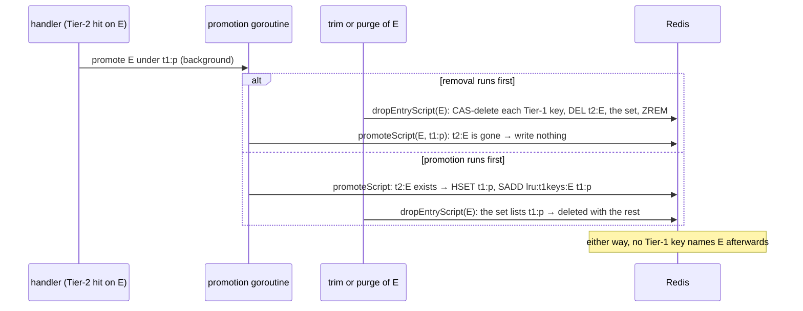

# Track every Tier-1 key of an entry

Status: opened 2026-10-28 · spec approved 2026-10-28 · design approved 2026-10-28 · plan approved 2026-10-28
§1/§2 changed at design: DC 12 added (the 4.2 race check's cleanup must delete the new set); §2 lists that script.
§1/§2/§3 changed at build (2026-10-28, the human chose to fix §4's finding here): DC 13, `store.py`, Phase 5.
Super-plan item: 4.3 — Fix the promoted-`t1_key` bug before it detonates

## 1. Spec

**The change.** Every Tier-1 key that names an entry is recorded in one cache-owned set,
`lru:t1keys:{entry_id}`, at the moment it is written. Eviction and purge then delete every key in that set
that still names the entry, and the set itself. A promotion is written only while the entry's `t2:` record
still exists.

**The decision the item asks for.** The choice was: track several `t1_key`s, or drop promoted keys on purge.
This task **tracks them.** Dropping promoted keys on purge still needs a way to find them. Without a record,
that means scanning every `t1:` key on each purge and each eviction. Not promoting at all would move every
repeated paraphrase back to Tier 2 (an embed and a search each time), which changes the hit path being
measured.

**Why the set is in the cache's region and not in `entry:{entry_id}`.** §E v0.17 planned to put promoted keys
into `entry:{entry_id}`. But eviction lives in `cache/`, and `cache/` never reads the dependency records
(item 4.1, DC 6). The `lru:` prefix is already the cache's bookkeeping region. Two existing tools delete
`lru:` keys together with `t1:` and `t2:`: `make demo-reset`, and `make footprint` (through its flush).

**What is broken today** (each one serves an answer that is outside the cache the run believes it has):
- **A promoted key outlives its entry.** Eviction and purge both find Tier 1 only through the single
  `t1_key` field. So a promoted key keeps serving after its entry is evicted, and after a restart it also
  keeps serving after a purge.
- **A Tier-1-only entry leaves an orphan when it is evicted.** Such an entry has no `t2:` record, so the
  eviction reads an empty `t1_key` and deletes no Tier-1 key.
- **Eviction deletes Tier 1 blindly.** If a newer entry reused the key, the eviction of the old one removes
  the new one's Tier-1 copy. Purge already compares first (4.1).

**Done conditions.** Each test that needs Redis must print `--- PASS`, never `--- SKIP`. The cache tests use
Redis DB 15, through `capacity_test.go`'s `testStore`.

1. **Every Tier-1 write is recorded.** A new `cache` test: after `Put` of entry `E` under key `k1`, and a
   promotion of `E` under `k2`, `lru:t1keys:E` holds exactly `{k1, k2}`.
2. **A promotion needs a live entry.** Promoting `E` when there is no `t2:E` writes no `t1:` key and no set
   member. With `t2:E` present, it writes both.
3. **Eviction removes every Tier-1 pointer.** A new `cache` test sets up three entries, all touched:
   - `E` has `t2:` and two Tier-1 keys (one written at the miss, one promoted);
   - `F` is Tier-1 only;
   - `G` is the newest entry.

   `TrimToCapacity(…, 1)` evicts `E` and `F`. Afterwards neither has a `t1:` key, a `t2:` record, a set or
   an `lru:entries` member, and every key of `G` is unchanged.
4. **Eviction leaves a reused key alone.** If `t1:k` now names a newer entry `E2`, evicting `E` (whose set
   lists `t1:k`) leaves `t1:k`.
5. **Purge removes every Tier-1 pointer.** `PurgeEntry(E, "")` on an entry with a miss key and a promoted
   key deletes both, the set, `t2:E` and the `lru:entries` member. A key reused by a newer entry is left.
   The same holds end to end through `deps.Invalidate` (Redis DB 14): no Tier-1 key names `E` afterwards.
6. **Entries written before this change still go.** An entry with no `lru:t1keys:` set is evicted and
   purged through its `t2:` record's `t1_key`, as today. Shown by every existing `capacity_test.go`,
   `purge_test.go` and `deps` test passing unchanged; they seed entries with no set.
7. **No orphan.** A new `cache` test drives the real store through misses, Tier-1-only writes, promotions,
   trims and purges, touching each entry as the handler does. At the end:
   - every `t1:*` key names an `entry_id` that is a member of `lru:entries`;
   - every `lru:t1keys:*` set belongs to such a member.
8. **The handler promotes through the conditional write.** A new `httpapi` test: a Tier-2 hit asks the
   store for a promotion write, never a plain `Put`. Every existing `httpapi` test that waits for "the
   Tier-1 promotion" passes unchanged.
9. **The docs.**
   - `interfaces.md` is at v0.19. §D names `lru:t1keys:{entry_id}` and the rule that every Tier-1 write adds
     to it in the same atomic step. It also states the promotion condition, and the eviction and purge
     steps (compare, then delete).
   - §E's "item 4.3 will add promoted Tier-1 keys to `entry:`" sentence and its purge step 3 match.
   - `architecture.md` (the "promoted key is not tracked" bullet, invariant 3) and `Redis-Data
     Structure.md` (§1 map, §5.5, §6, §8, §9 gap 5) say what is built.
10. `make verify` passes with Redis up, run alone. Any SKIPPED target is listed by name.
11. No existing test is edited: in `git status --porcelain -- '*_test.go' 'rag/tests/*'` every line starts
    with `??` or `A `.
12. **Tools that delete one entry's keys know the set.** `experiments/scripts/epoch_race_check.py`'s cleanup
    also deletes `lru:t1keys:{A}`: `grep -n "lru:t1keys:" experiments/scripts/epoch_race_check.py` is not empty.
13. **The RAG read path never searches a half-built index** (§4). New `rag/tests/test_store_index_ready.py`
    fails before the fix and passes after (both runs in `evidence/`), and a new timeout test shows that an
    index that never finishes raises an error instead of serving a partial result.

**Out of scope.**
- **Removing promotion** (the alternative above), and a hit-path liveness check that would find orphans
  lazily: it adds a step to the hit path, and it leaves orphans in Redis until they are hit.
- **Cleaning up promoted keys written before this change.** A measured run starts on a cache it wrote
  itself (run rule 11), and the reset for that rule still has no owner.
- **Changing `entry:{entry_id}`.** Its `t1_key` field stays as 4.1 wrote it.
- The edit transport (4.4), and 4.1's follow-up that a failed purge still deletes `dep:{chunk}`.

## 2. Impact

**Files.** Gateway only. No new package and no new import edge.
- `cache/store.go`: `Put` writes the Tier-1 hash and adds the key to `lru:t1keys:{entry_id}` in one atomic
  step. A promotion write checks that `t2:{entry_id}` exists in the same step.
- `cache/capacity.go`: the trim deletes, per victim, every listed key that still names it (compare, then
  delete), plus the set, `t2:`, and the `lru:entries` member. It still falls back to `t2:`'s `t1_key`.
- `cache/purge.go`: the purge script does the same, adding the set's keys to the `t1Key` it is given.
- `httpapi/handler.go`: the promotion uses the conditional write; the "⚠️ Known limitation" comment goes.
- `experiments/scripts/epoch_race_check.py`: its cleanup deletes the new set too (DC 12).
- `rag/src/rag/store.py` (DC 13): `get_vector_store` waits until the corpus index is fully built.
- New tests in `cache/`, `deps/`, `httpapi/` and `rag/tests/`.
- Docs: `interfaces.md`, `architecture.md`, `Redis-Data Structure.md`.

**Frozen values touched.** None. The capacity ratio, `noeviction`, the FLAT index and the purge's blindness
do not change. The new set lives in the cache's region and is deleted with its entry. It is not a dependency
record, so invariant 1 (dependency records are never evicted) is untouched. **Invalidates:** none — no runs
yet (`experiments/results/` holds only `.gitkeep`).

**Contract change.** Yes: `interfaces.md` v0.18 → v0.19, gateway side only.
- §D gains the `lru:t1keys:{entry_id}` set, the Tier-1 write rule, the promotion condition, and the trim
  steps.
- §E's purge step 3 reads the set too, and its plan for `entry:` is corrected.
- `t1_key` on every Tier-2 record keeps its meaning, "the Tier-1 key this entry was co-written with", so
  invariant 2 still holds. The set is in addition to it.
- `source_chunk_ids` and `dataset_epoch` are untouched, and so are the Python service, §A, §B and the `.proto`.

**Measurement change.**
- **Bounded capacity: Tier-1 hit counts become honest.** An evicted entry no longer goes on serving through
  a promoted key or an orphaned Tier-1-only key. Those hits were counted as `TIER1_HIT` for an entry that
  was outside the cache, so the hit rate could exceed what the capacity allows. It can now only go down to
  the true value.
- **Unbounded capacity (`CACHE_CAPACITY` 0) under `mutation: off`:** nothing changes.
- **Under `mutation: on`:** a purge now also removes promoted keys. Within one process the 4.1 tombstone
  already refused them; now a restarted gateway cannot serve them either.
- **Cost:** a miss's Tier-1 write gains one `SADD` in the same round trip. The promotion (in the
  background) and the trim (after the write-back) each run one script per entry. Nothing changes on the
  hit path.

**New dependency.** None. Resident memory: one small set per cached entry, a few hundred bytes. That is
about 160 sets at `0.25 × K` for `v1`.

**Cut scope reinstated.** No.

**Existing tests.** They limit the design, and none is edited.
- `cache/capacity_test.go` and 4.1's `purge_test.go` seed entries by writing `t1:` and `t2:` hashes
  directly, with no set. So the trim and the purge must keep the `t2:` `t1_key` fallback (DC 6).
  `TestEvictionLeavesDependencyRecordsAlone` still holds, because the set is not `dep:` or `entry:`.
- 4.1's `deps` tests use the real `cache.Store` as their `Purger`, with sets absent. Same fallback.
- `httpapi` tests see the promotion only through the fake store's `Put` (`tier1Written()`), and check its
  `EntryID`, key, answer and sources. The fake implements the `cacheStore` interface, so adding a method to
  that interface would stop these tests compiling. §3 must keep the promotion reachable through `Put`, for
  example with a field on `cache.Entry` that marks it as a promotion.

## 3. Design

**Approach.** The cache keeps, per entry, a set of every Tier-1 key that was written for it. One Lua script,
`dropEntryScript`, says what "this entry is gone" means, and both the trim and the purge call it. It
gathers the candidate Tier-1 keys from three places: the set, the `t2:` record's `t1_key`, and the key the
caller passes. It deletes each candidate only if that key's `entry_id` still names the entry, then deletes
`t2:`, the set and the `lru:entries` member. The promotion is a second script that writes only while `t2:`
exists. Redis runs each script as one step, so a promotion and a removal of the same entry can never
interleave.

*The alternative it beat:* keep the promoted keys in 4.1's `entry:{entry_id}`. That needs no new key, but
`cache/` would then have to read `deps/`'s records to evict, which 4.1 forbids (DC 6). The other choice is
to give eviction to `deps/`, which would rewrite who owns the trim.

**The promotion race, and why the condition closes it.**



**Files.**

- `cache/capacity.go`:
  - `const t1KeysPrefix = "lru:t1keys:"` and `func t1KeysKey(entryID string) string`, beside `lruKey`,
    with a comment: the set is in the `lru:` region on purpose. `make demo-reset` and `make footprint`
    delete `lru:` together with the tiers, and nothing reads it but this package.
  - `dropEntryScript`, with `KEYS = {t2:E, lru:entries, lru:t1keys:E}` and `ARGV = {E, extra t1 key or ""}`:

    ```lua
    local cands = redis.call('SMEMBERS', KEYS[3])
    local own = redis.call('HGET', KEYS[1], 't1_key')
    if own then table.insert(cands, own) end
    if ARGV[2] ~= '' then table.insert(cands, ARGV[2]) end
    local deleted = {}
    for _, k in ipairs(cands) do
      if redis.call('HGET', k, 'entry_id') == ARGV[1] then
        redis.call('DEL', k); table.insert(deleted, k)
      end
    end
    redis.call('DEL', KEYS[1], KEYS[3])
    redis.call('ZREM', KEYS[2], ARGV[1])
    return {own or '', deleted}
    ```

    A key listed twice is harmless: the second `HGET` finds nothing. The Tier-1 key names come from the
    set at run time, so they are not in `KEYS`. That is fine on the one standalone server, as in 4.1.
  - `func (s *Store) dropEntry(ctx, entryID, extraT1Key string) (t2T1Key string, deleted []string, err error)`
    runs the script.
  - `TrimToCapacity`: per victim, call `dropEntry(ctx, id, "")`. `EvictedEntry` keeps `T1Key` (the `t2:`
    record's `t1_key`, as now) and gains `T1Keys []string` (what was deleted).
- `cache/purge.go`: `PurgeEntry` calls `dropEntry(ctx, entryID, t1Key)`. The old `purgeScript`, and its Go
  read of `t1_key` from `t2:`, go: the script now does both.
- `cache/store.go`:
  - `Entry` gains `Promotion bool`, commented: write only while `t2:{EntryID}` exists, and record the key in
    the set (interfaces.md §D v0.19). The handler sets it on the Tier-2 promotion and nowhere else.
  - `Put`, when `!e.Promotion`: one `TxPipeline` with the existing `HSET` and `SADD lru:t1keys:{EntryID} key`.
  - `Put`, when `e.Promotion`: `EntryID` must be non-empty (an error otherwise). It runs `promoteScript`,
    with `KEYS = {t2:E, key, lru:t1keys:E}` and `ARGV` the five hash fields: if `EXISTS KEYS[1] == 0`,
    return 0; else `HSET`, then `SADD`, return 1. A 0 is not an error: the entry left the cache first,
    which is the race above. `Put` returns nil, and the handler logs nothing.
- `httpapi/handler.go`: the promotion goroutine passes `Promotion: true` in its `cache.Entry`. The
  "⚠️ Known limitation" comment is replaced by two lines saying what is tracked and where. The miss
  write-back's `Put` does not change. Neither does the `cacheStore` interface.
- `experiments/scripts/epoch_race_check.py`: `cleanup` also deletes `lru:t1keys:{eid}` and lists it.

**Failure modes, silent ones first.**

1. **A Tier-1 write lands without its set member.** If `HSET` and `SADD` were separate calls and the second
   failed, the key would be untracked: an orphan after eviction, serving an entry outside the cache. → one
   `TxPipeline`; DC 1, DC 7.
2. **A promotion lands after its entry was removed.** It would write a pointer at an evicted or purged
   entry. That pointer serves a stale answer, and its next Tier-1 hit even puts the entry back into
   `lru:entries` with no `t2:`. → the condition in one script; DC 2, DC 7.
3. **The trim or the purge forgets the set.** The promoted and Tier-1-only keys stay behind. → DC 3, DC 5,
   DC 7.
4. **The trim or the purge deletes a reused key.** A newer entry loses its Tier-1 copy, and the hit rate
   drops a little with no error. → compare, then delete; DC 4, DC 5.
5. **The handler still promotes with a plain write.** The race in 2 then stays open, and nothing shows it.
   → DC 8.
6. **The fallback is dropped.** An entry written without a set (every existing seed, and any old cache)
   would keep its Tier-1 key after eviction. → DC 6.
7. **A tool that deletes one entry's keys misses the set.** A small leftover key, and
   `epoch_race_check.py`'s "0 new key(s) remain" check would then fail. → DC 12.

**Edge cases.**
- **Promoting a key that names another entry.** The Tier-2 path runs only when Tier 1 missed or refused
  the key, so any older entry the key named is already invalidated. That entry's set still lists the key,
  and compare-then-delete leaves the new owner alone.
- **Two promotions of the same key.** `SADD` makes them one.
- **A `Promotion` write with no `EntryID`** is an error and writes nothing.
- **A purge of an entry already evicted.** Nothing is left to delete. The script is a no-op for the tiers,
  as in 4.1.
- **An entry whose `Touch` failed** is not in `lru:entries`, so no trim reaches it. This is unchanged and
  out of scope: the failure is already logged.

**Unknowns.**
- **The trim's cost per victim** (one script in place of a `HGET` and a `MULTI`) is reasoned to be no worse,
  not measured. It runs after the write-back, not on the hit path, and item 7.2 measures μ_hit.

**Verification.**

| DC | How |
| :--- | :--- |
| 1, 2 | `go test -v -run 'TestPutRecords\|TestPromotion' ./internal/cache/` (DB 15) |
| 3, 4 | `go test -v -run TestTrimDrops ./internal/cache/` |
| 5 | `go test -v -run TestPurgeDrops ./internal/cache/`; `go test -v -run TestInvalidateDropsPromotedKey ./internal/deps/` (DB 14) |
| 6 | `go test -count=1 -v ./internal/cache/ ./internal/deps/`: every existing test passes |
| 7 | `go test -v -run TestNoOrphan ./internal/cache/` |
| 8 | `go test -v -run TestTier2HitPromotesConditionally ./internal/httpapi/` and every existing promotion test |
| 9 | `grep` on the three docs |
| 10 | `make verify`, run alone |
| 11 | `git status --porcelain -- '*_test.go' 'rag/tests/*'` |
| 12 | the `grep` in §1 |

**The index-ready fix (added at build, from §4).**
- `rag/src/rag/store.py`:
  - `class IndexNotReady(RuntimeError)`.
  - `wait_until_indexed(client, index_name, timeout_s=5.0, poll_s=0.005) -> None` polls `client.ft(index_name).info()`
    until `indexing` is 0 and `percent_indexed` is at least 1, both read as numbers. When `timeout_s` passes
    first, it raises `IndexNotReady` naming the index and the last values. It never returns early.
  - `get_vector_store(overwrite)` builds the `RedisVectorStore` as now, which creates the index if it is
    missing, then calls `wait_until_indexed(get_redis_client(), config.CORPUS_INDEX_NAME)`. It uses the sync
    client, because `vector_store.client` is the async one.
  - The cost is one `FT.INFO` per Python retrieval, under a millisecond. It is not on the Go hit path.
- On a timeout, `Retrieve` / `Answer` raise. The gateway then logs a retrieval failure, which is loud,
  instead of grounding on a partial corpus.
- The failing test comes first: `test_get_vector_store_returns_only_after_background_indexing_finishes`.
  - Set `config.CORPUS_INDEX_NAME` to `idx:test-ready` with monkeypatch, and refuse to run if it equals
    `idx:corpus`.
  - Drop `idx:test-ready` if it exists, with `FT.DROPINDEX` without `DD`.
  - Count the `corpus::*` keys, which must be more than 0.
  - Call `store.get_vector_store(overwrite=False)`. Then at once, `FT.INFO idx:test-ready` must show
    `indexing` 0 and `num_docs` equal to that count.
  - Clean up with `FT.DROPINDEX` without `DD`. Never `FLUSHDB`, and never touch `idx:corpus`.
- The timeout test needs no Redis: a fake client whose `info()` always reports `indexing` 1 makes
  `wait_until_indexed` raise `IndexNotReady` within its timeout.
- Out of scope here: problem 2, the Go test helpers sharing a server with the live indexes (that edits
  existing test files); and problem 3, the same race for `idx:cache` in `cache/tier2.go`. Both go to their
  own task after 4.3 closes.

The `cache` and `deps` Redis tests call `FLUSHDB`, which drops every search index (4.1 §4). So no step runs
them in parallel with another Redis test.

## 4. Findings

**2026-10-28 — `make verify` fails now and then: the RAG service searches an index that is still being
built.** In the main session's re-check, `make verify`, run alone after `go clean -testcache`, exited 2. The
failing test was `rag/tests/test_retrieve_scoping.py::test_retrieve_unscoped_behaviour_is_unchanged_when_product_id_absent`.
Its two identical `retrieve()` calls returned different top-5 lists (`evidence/verify-recheck.out`). Every
Go test passed. `rca-analyst` ran (probe scripts in `evidence/rca/`; pressure level 2, embedding model only,
not citable).

- **Root cause (high confidence).**
  - The Go Redis tests' `FLUSHDB` drops `idx:corpus` (4.1 §4).
  - In pytest, this test is the first that touches Redis. Its first `retrieve()` goes through
    `store.get_vector_store(overwrite=False)` → redisvl `SearchIndex.create()`, which sends `FT.CREATE` and
    returns at once.
  - RediSearch then indexes the 44 `corpus::*` hashes in the background, in 5–21 ms. The only delay before
    the KNN search is one embed of about 20 ms. When indexing is slower, the search sees a partial index.
  - Evidence:
    - Both failures (this one and 4.1's) logged "Index already exists" once, not twice: the first call
      created the index.
    - Right after create, `FT.INFO` showed 2–5 of 44 docs, and a KNN search with no delay was wrong in 20 of
      20 trials.
    - The failing list equals the full ranking with `kitchen-09` not yet indexed.
    - Ties and FLAT noise are ruled out: rank 1 and rank 2 differ by 1.3e-3, and 15 warm calls gave one
      identical top-10.
- **4.1's finding named the right mechanism but the wrong trigger.** The parallel run was not needed, and
  4.1's sequential re-runs passed by luck.
- **Not caused by 4.3.** `retrieve()` has created the index on read since 2026-08-15, and the flushing Go
  test since 2026-09-21. 4.3's code never touches `idx:corpus`, and one drop is enough, so its extra tests
  add nothing.
- **The test is not stale.** It checks that retrieval is deterministic. The failure is a real wrong result.
  After any index drop, the live `Retrieve` / `Answer` RPCs would send Go a wrong `source_chunk_ids`, and
  the epoch guard cannot see it, because the epoch does not move.
- **The fix, outside 4.3's scope.** In `rag/src/rag/store.py`, `get_vector_store()` should poll `FT.INFO`
  until `indexing == 0`, with a time limit that raises instead of serving a partial index. Use the sync client
  (`store.get_redis_client()`): `vector_store.client` is the async one.
  - Failing test first: `rag/tests/test_store_index_ready.py`, on a throwaway index name. It drops that index
    with `FT.DROPINDEX` without `DD`, never touches `idx:corpus`, and never calls `FLUSHDB`. Before the fix
    it fails every time.
- **Prevention, needs the human.**
  - The Go Redis test helpers should not share a server with live indexes: a separate test port, or delete
    by prefix instead of `FLUSHDB`. Either option edits existing test files.
  - `gateway/internal/cache/tier2.go` probably has the same create-then-search race for `idx:cache` at
    gateway start. Not checked.
