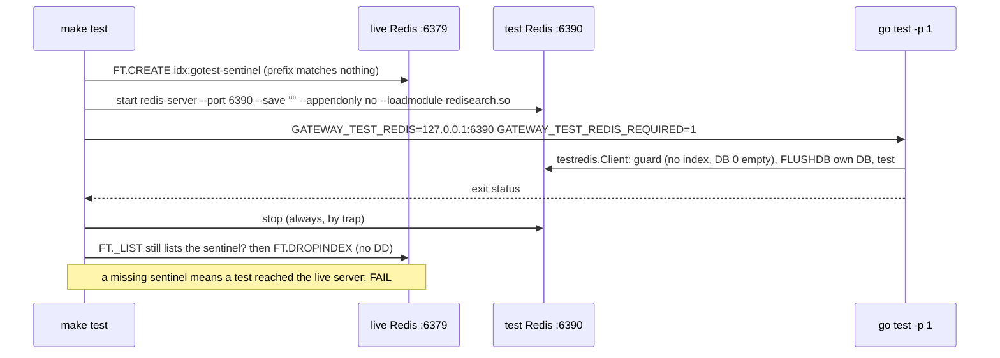

# Redis index lifecycle: the Go tests and the live services share one server

Status: opened 2026-10-29 (bugfix; RCA first, `evidence/rca/`) · spec approved 2026-10-29 · design approved 2026-10-29 · plan approved 2026-10-29
§1 changed at design: DC 2 adds `-p 1`; DC 6 says the evaluation log does the counting (`finishRun` keeps its signature). §3 adds
`GO_TEST_PKGS` / `GO_TEST_FLAGS` at plan, so a single step can run its tests on the test server.
Super-plan item: none — blocks 4.4 (its completeness runs need `make verify` and both indexes reliable)

## 1. Spec

**The change.** The Go Redis tests move to a throwaway test Redis that `make test` starts and stops, so
they can no longer drop the live search indexes. The gateway waits until `idx:cache` is fully built before
it serves. A run that hits a Tier-2 search error is marked in its records and is not admissible.

**Root cause** (RCA 2026-10-29; probes and outputs in `evidence/rca/`; pressure level 1, no model loaded).
- **Problem 2: the trigger** (high confidence).
  - On this server (search 2.10.20), **any `FLUSHDB` or `FLUSHALL` drops every search index**, in every DB,
    even on an empty DB. `SWAPDB`, `DEL`, `UNLINK`, `RENAME` and `MOVE` do not drop indexes.
  - **Index names and indexed keys are global across DBs.** An index can only be created from DB 0, but a
    `t2:*` hash written in DB 15 enters DB 0's `idx:cache`. A KNN from DB 0 then returns it as a ghost
    entry with empty fields.
  - The Go test helpers (`cache/capacity_test.go` `testStore`, DB 15; `deps/deps_test.go` `testRedis`,
    DB 14) call `FLUSHDB` on `localhost:6379`. So every `go test ./...` and every `make verify` removes the
    live `idx:corpus` and `idx:cache`. The Redis log shows the drops. The helpers' premise ("FLUSHDB on 15
    touches nothing else") is false; their assertions are not stale.
- **When `idx:cache` vanishes during a run** (code traced, checked with go-redis 9.22):
  - The Tier-2 search fails with `No such index`. `cascade.go` logs it and degrades to a MISS.
  - The record is identical to a cold-cache miss, so nothing is counted and the run still looks
    admissible.
  - `PutTier2` writes hashes that are never indexed. This lasts until the gateway restarts.
  - **The Tier-2 hit rate falls with no trace.** It is a measured path.
- **Problem 3: create-then-search** (high confidence in Redis, medium-high for the gateway).
  - `FT.CREATE` returns in about 0.35 ms and indexes the existing `t2:*` hashes in the background. This was
    measured with the real schema under a throwaway name, 30 trials per row:
    - 44 entries took about 42 ms;
    - 318 entries took 60–120 ms;
    - 1274 entries took about 210 ms.
  - A KNN sent before the scan finishes returns nothing, or another entry from the same namespace, with no
    error. A second `FT.CREATE` during the scan answers "already exists", which `EnsureCacheIndex` treats as
    success.
  - The gateway creates the index only at start (`main.go`). So a gateway start on a warm cache after an
    index drop serves its first requests from a partial index. The log shows four such scans since
    2026-09-05.
  - It cannot reach an admissible rule-11 run (the cache starts empty). It can reach item 6.3's
    static-cache arm, whose fill and measured phase may run in different gateway processes.

**Done conditions.** Each Redis test must print `--- PASS`, never `--- SKIP`, when run through `make`.

1. **The live server keeps its indexes** (failing check first). A new `make test-isolation-check`:
   - creates `idx:gotest-sentinel` on `localhost:6379` DB 0, with a prefix that matches no key;
   - runs the Go tests exactly as `make test` does;
   - fails unless the sentinel is still in `FT._LIST`;
   - drops it without `DD`.

   Before the fix it fails (output in `evidence/`). After the fix it passes, and `make verify` runs it.
2. **`make test` owns the test Redis.** It starts `redis-server` with the search module on
   `127.0.0.1:6390`, with no disk persistence, and refuses to start if the port is taken. It runs the Go
   tests against it one package at a time (`-p 1`), and stops it even when a test fails. Afterwards
   nothing listens on 6390.
3. **The helpers never touch the live server.** They read the test address from one environment variable
   and never default to `localhost:6379`. A new guard test shows that a helper pointed at a server that
   holds any search index, or any DB 0 key, fails before it deletes anything.
4. **No silent skip under `make`.** With the variable set to a dead address and `make`'s "required" flag
   on, a helper fails (not skips). With the variable unset (plain `go test`), it skips, with a message
   naming the variable.
5. **The gateway serves only a complete index** (failing test first). A new `cache` test on the test
   server:
   - seed 1000 `t2:*` vector hashes and filler keys, then call `EnsureCacheIndex`;
   - at once, `FT.INFO` must show `indexing` 0 and `num_docs` 1000, and `NearestTier2InNamespace` on a
     seeded vector must return that entry;
   - an "already exists while scanning" case also waits;
   - a scan that never finishes makes `EnsureCacheIndex` return an error, not success.

   Before the fix the first case fails.
6. **A Tier-2 search error is visible and voids the run.**
   - A new `httpapi` test: a failed Tier-2 search gives a record with a new §H key marking it, and a
     non-zero counter.
   - The evaluation log counts marked records. A new `cmd/gateway` test shows `incomplete()` names a
     non-zero count as a reason the run is not admissible.
   - `TestCauseIsNullOnEveryExitWithNoCandidate` passes unchanged.
7. **The docs.**
   - `interfaces.md` is at v0.20. §H has the new key and run rule 12 (any Tier-2 search error makes a run
     inadmissible). §D says the gateway waits for `idx:cache` to be fully built at start.
   - `architecture.md` and `Redis-Data Structure.md` state the test-server rule and the `FLUSHDB` fact.
8. `make verify` passes with Redis up, run alone. Any SKIPPED target is listed by name.
9. **Only the approved test edits.** `git diff --stat -- '*_test.go'` lists only `cache/capacity_test.go`
   and `deps/deps_test.go` as modified. Their diff touches only the two helpers and their comments; no
   assertion changes. Every other test file is new (`??`).

**Out of scope.**
- **The RAG Python tests** still use `localhost:6379`, because they need the ingested corpus. Their read
  path waits for its index since 4.3 (`rag/store.py`).
- **Another project's `FLUSHDB` on the shared server.** It cannot be prevented from here. Rule 12 makes it
  visible in a run instead of silent.
- A pre-run check in `make measure`; stale `num_docs` after `SWAPDB`/`MOVE`; `CLAUDE.md` (the author's).

## 2. Impact

**Files.**
- **Test helpers (approved edits, below):** `gateway/internal/cache/capacity_test.go` (`testStore`) and
  `gateway/internal/deps/deps_test.go` (`testRedis`).
  - The address comes from the environment variable. A guard refuses a live-looking server, and a
    "required" flag turns a skip into a failure.
  - The logic shared by both helpers either goes into a small test-only package, or is copied into both. §3
    decides, against `architecture.md`'s boundaries.
- **Gateway:**
  - `cache/tier2.go`: `EnsureCacheIndex` waits on `FT.INFO`.
  - `cmd/gateway/main.go`: the counter in `runCounts` and `incomplete()`, and the comment at the index call.
  - `httpapi/cascade.go` and `handler.go`: count the Tier-2 search error and mark the record.
  - `telemetry/evallog.go`: the new key.
- **`Makefile`:** `test` starts and stops the test Redis, and the new `test-isolation-check` target is part
  of `verify`.
- **Docs:** `interfaces.md`, `architecture.md`, `Redis-Data Structure.md`.
- **New tests** in `cache/`, `deps/` (or the shared helper package), `httpapi/` and `cmd/gateway/`.

**On a measured path, and at the seam: yes.** Rule 12 changes which runs are admissible, and §H is the
measurement contract. The start-up wait changes no number in a rule-11 run. The test-helper changes are
test-only.

**Frozen values touched.** None. FLAT, `noeviction`, the capacity ratio and every threshold are unchanged.
The index schema is unchanged; only when the gateway starts serving changes. **Invalidates:** none — no runs
yet (`experiments/results/` holds only `.gitkeep`).

**Contract change.** Yes: `interfaces.md` v0.19 → v0.20, gateway side only.
- §H gains an extension key, present only on a request whose Tier-2 search failed, and run rule 12.
- §D gains one sentence: the gateway serves only after `idx:cache` is fully built.
- No wire, §A, §B or `.proto` change. `source_chunk_ids`, `t1_key` and `dataset_epoch` are untouched.

**Measurement change.**
- **A run with any Tier-2 search error is no longer admissible.** Before this, it looked like a run with a
  colder cache and a lower `h`, and nothing said why.
- **The start-up wait** adds up to about 200 ms at a gateway start on a warm cache, and nothing on an empty
  cache, which is how every rule-11 run starts.
- **`make verify` takes a little longer:** the test server starts in about 70 ms.

**New dependency.** None. The `redis-server` binary and `redisearch.so` come with the installed
redis-stack-server. The test server uses about 5 MB while `make test` runs.

**Cut scope reinstated.** No.

**Existing tests.**
- **Approved by the human on 2026-10-29:** the two helpers above change their address, add the guard, and
  change when they skip. The helpers' premise is proved false (RCA). No assertion in those files changes
  (DC 9).
- **`httpapi/cause_test.go:TestCauseIsNullOnEveryExitWithNoCandidate`** pins the search-error record
  (`MISS`, a null cause, `entered_band` false). The new key is an addition, and the test must pass unchanged.
- **4.1's design §3** said "DB 14 for deps, DB 15 for cache". That isolated keys, not indexes. This task
  corrects the premise; that trail stays as written.

## 3. Design

**Approach.** Three separate changes, one per finding.
- **Isolation:** the Go Redis tests connect only to a test server that `make test` starts. A guard refuses
  any server that looks live. One small test-only package owns the address, the guard and the skip rule,
  so the two helpers cannot drift apart.
- **Start-up:** `EnsureCacheIndex` returns only when `FT.INFO` says the index is complete, like
  `rag/store.py` since 4.3.
- **Visibility:** a failed Tier-2 search marks its record, the evaluation log counts marked records, and
  `incomplete()` refuses the run.

*The alternative it beat:* delete keys instead of `FLUSHDB` on the live server. That is smaller, but the
test hashes would still enter the live `idx:cache` (an index covers every DB), and the start-up race could
never be tested, because an index can only be created on DB 0.

**Files.**

- `gateway/internal/testredis/testredis.go` (new; imported only by `_test.go` files):
  - `const EnvAddr = "GATEWAY_TEST_REDIS"`, `const EnvRequired = "GATEWAY_TEST_REDIS_REQUIRED"`.
  - `func Client(t testing.TB, db int) *redis.Client`. The steps, in order:
    1. Read the address. Unset or empty: `Fatalf` if required, else `Skipf` naming `EnvAddr`. It never
       defaults to `localhost:6379`.
    2. `PING`. A failure is `Fatalf` if required, else `Skipf`.
    3. `CheckNotLive`, and `Fatalf` with its error.
    4. `FLUSHDB` the given db, and register a cleanup that flushes it again and closes the client.
  - `func CheckNotLive(ctx context.Context, rdb *redis.Client) error`: an error if `FT._LIST` is non-empty
    or DB 0 holds any key. It only reads.
  - The doc comment states the RCA's facts: `FLUSHDB` drops every index, and an index covers every DB.
- `cache/capacity_test.go` `testStore`, and `deps/deps_test.go` `testRedis` (the approved edits): replace
  the address, the ping, the skip and the first `FLUSHDB` with `testredis.Client(t, 15)` and
  `testredis.Client(t, 14)`. Rewrite their comments to the true premise. Nothing else in those files
  changes.
- `cache/tier2.go`:
  - `EnsureCacheIndex` treats "already exists" as "go on to wait", not as success. It then calls
    `waitIndexed(ctx, func(ctx context.Context) (redis.FTInfoResult, error) { return
    s.rdb.FTInfo(ctx, CacheIndexName).Result() }, indexReadyTimeout, 5*time.Millisecond)`.
  - `func waitIndexed(ctx context.Context, info func(context.Context) (redis.FTInfoResult, error),
    timeout, poll time.Duration) error` returns nil only when `Indexing == 0 && PercentIndexed >= 1`.
    A read error, `ctx` done or the timeout returns an error naming the last values.
  - `const indexReadyTimeout = 10 * time.Second`. The RCA measured at most 1.5 s for 5000 docs.
- `cmd/gateway/main.go`:
  - The comment at the `EnsureCacheIndex` call: it waits until the index is complete.
  - `runCounts` gains `Tier2SearchFailures int64`, filled in `finishRun` from
    `l.Tier2SearchFailures()`.
  - `incomplete()` adds the reason "N request(s) hit a Tier-2 search error (interfaces.md §H rule 12)".
- `httpapi/cascade.go`: `tier2Outcome.SearchFailed bool`, set in the existing search-error branch, which
  still degrades to a MISS. `handler.go`: `rec.Tier2SearchFailed = t2.SearchFailed`.
- `telemetry/evallog.go`:
  - `Tier2SearchFailed bool` with the tag `json:"tier2_search_failed,omitempty"`, and a comment pointing
    to §H rule 12.
  - The `Logger` counts records with it set (`tier2SearchFailures atomic.Int64`, incremented where a
    record is accepted), and `func (l *Logger) Tier2SearchFailures() int64` reads it.
- `Makefile`:
  - `TEST_REDIS_PORT ?= 6390`, and `REDISEARCH_SO`, derived from the real path of `redis-server`
    (`…/redis-stack-server/<ver>/lib/redisearch.so`).
  - A new `test-go` target does, in one shell:
    1. Refuse if the port is taken or the module is missing.
    2. Drop a stale `idx:gotest-sentinel` if one exists, then create it on :6379.
    3. Start the test server, and `trap` its stop on exit.
    4. Wait for `PING`.
    5. Run `cd gateway && GATEWAY_TEST_REDIS=… GATEWAY_TEST_REDIS_REQUIRED=1 go test -p 1 $(GO_TEST_FLAGS)
       $(GO_TEST_PKGS)`, with `GO_TEST_PKGS ?= ./...` and `GO_TEST_FLAGS ?=` (empty), so a plan step can run
       a subset on the test server.
    6. Keep the exit status. Check that the sentinel survived, then drop it.
    7. Exit non-zero if either the tests failed or the sentinel is gone.
  - `test` calls `test-go`, then the two pytest steps as now. `test-isolation-check` is an alias of
    `test-go`, so `make verify` (which runs `test`) runs the check every time.
- **Docs:**
  - `interfaces.md` v0.20: the §H row for `tier2_search_failed`, run rule 12, the §D sentence and the
    version row.
  - `architecture.md`: a `testredis/` row in the package table (owns the tests' Redis connection; must
    never be imported by non-test code or default to :6379), and the test-server rule.
  - `Redis-Data Structure.md`: the two `FLUSHDB` facts and the test server.

**Failure modes, silent ones first.**
1. **The Go tests still reach :6379,** through a default address or a leaked variable. The indexes are
   dropped again with no error. → DC 1, the sentinel, on every `make test`; DC 3, no default.
2. **The test server is not up, or the variable is not passed.** Every Redis test then skips, and the suite
   "passes". → DC 4, the required flag; DC 2.
3. **The guard runs after the flush,** or not at all. A developer who points the variable at :6379 wipes
   the live server. → DC 3: `CheckNotLive` only reads, and `Client` calls it before `FLUSHDB`.
4. **Packages share the test server in parallel.** Then one package's `FLUSHDB` drops the index test's
   index, and `deps`' `t2:*` hashes enter the index test's `idx:cache`. The index test becomes flaky.
   → `-p 1`; DC 2.
5. **"Already exists" during a scan still counts as ready.** → DC 5's second case.
6. **The wait returns on a misread `FT.INFO`.** A zero `Indexing` with a zero `PercentIndexed` is not ready,
   so a misread times out loudly. → DC 5's first and third cases.
7. **The marker is set but nothing counts it,** or `incomplete()` ignores it. The run then looks
   admissible. → DC 6 (record, log count, `incomplete()`).
8. **A stray test server holds the port** after a crash. `test-go` refuses to start, which is loud. → DC 2.

**Edge cases.**
- **A leftover `idx:gotest-sentinel`** from an interrupted run is dropped and recreated. The name is ours.
- **Plain `go test ./...` with the variable unset** skips every Redis test, with a message naming the
  variable. That is a change: before, they ran against :6379. `make test` is the way to run them.
- **The index test** needs DB 0 on the test server, because indexes are created only there. It uses
  `testredis.Client(t, 0)`, and its cleanup drops `idx:cache` without `DD`. The guard at the next
  `Client` call catches a failed cleanup.
- **The RAG tests** keep using :6379. During `test-go` the sentinel is the only index added there.

**Unknowns.**
- **The cost of `-p 1`** is reasoned to be about 15–20 s more for `make verify` (the packages run one after
  the other), not measured. The plan records the time. If it is too slow, the other option is two test
  servers, one per Redis package.

**Verification.**

| DC | How |
| :--- | :--- |
| 1 | `make test-isolation-check`, first on the old `go test ./...` (must fail), then after the fix |
| 2 | `make test`; then `lsof -nP -iTCP:6390 -sTCP:LISTEN` prints nothing; `grep -n "go test -p 1" Makefile` |
| 3 | `go test -v -run TestCheckNotLive ./internal/testredis/` (under `make test-go`'s server) |
| 4 | `GATEWAY_TEST_REDIS=127.0.0.1:1 GATEWAY_TEST_REDIS_REQUIRED=1 go test -run TestRegisterWritesDepAndEntry ./internal/deps/` fails; with the variable unset it prints `--- SKIP` naming it |
| 5 | `go test -v -run 'TestEnsureCacheIndex\|TestWaitIndexed' ./internal/cache/` (fails first) |
| 6 | `go test -v -run TestTier2SearchError ./internal/httpapi/ ./internal/telemetry/`; `-run TestIncomplete ./cmd/gateway/`; the existing `TestCauseIsNullOnEveryExitWithNoCandidate` |
| 7 | `grep` on the three docs |
| 8 | `make verify`, run alone |
| 9 | `git diff --stat -- '*_test.go'`; `git diff -- gateway/internal/cache/capacity_test.go gateway/internal/deps/deps_test.go` |

The tests in DCs 3, 5 and 6 that need Redis run through `make test-go` or with its variable set by hand to a
test server the step starts. They never run against :6379.
