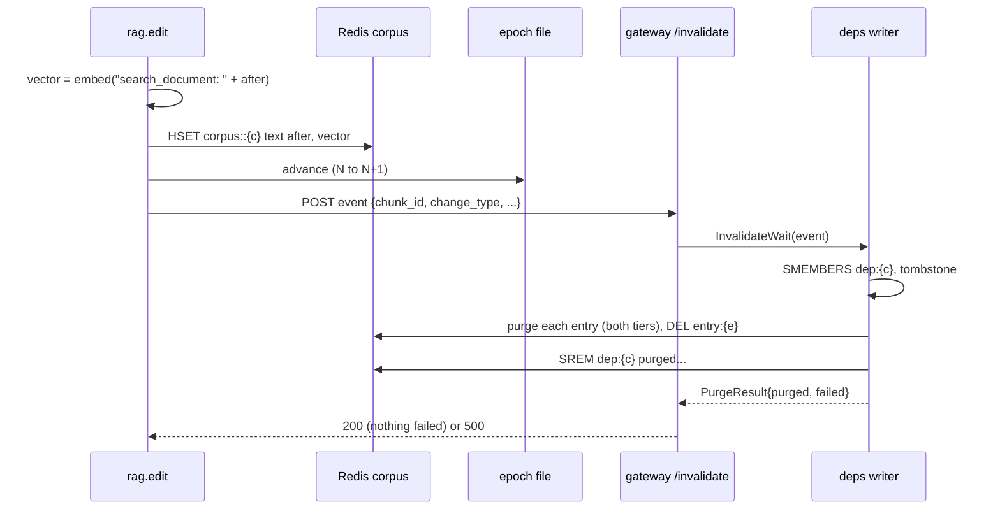

# Update set and the edit path

Status: opened 2026-10-29 · spec approved 2026-10-29 · design approved 2026-10-29 · plan approved 2026-10-29
Changed by §3 and the design check: DC 13 added; DC 9 adds scorer and snapshot tests; DC 8 needs the chunk in
`retrieved_chunk_ids`. Changed at build by the author (2026-10-29, §4): ID files stay in `private/`; `dev-v0`
is retired, so DC 10 and DC 12 run on `v1` and two existing test files change.
Super-plan item: 4.4 — Update set (~20 edits), how an edit reaches the gateway, completeness and precision
from one script

## 1. Spec

**The change.** Build the labelled update set on `v1` and the edit path that carries one edit into the
gateway: new text, then the epoch, then `POST /invalidate`. Then add one script that fills a real cache
through the gateway, applies the edits, and computes completeness and precision against the labels.

**Why now.** All three parts of the Phase 4 exit belong to this item (super-plan, Progress 2026-10-29).
- **`Invalidate` has no caller outside tests.** It returns before the Redis purge runs
  (`deps/deps.go:131`), so no caller can learn whether the purge worked.
- **A purge error on one entry still deletes `dep:{chunk}`** (4.1 follow-up), so nothing can purge that
  entry again after a restart.
- **Redis holds `dev-v0` (44 chunks), not `v1` (539).** Phase 4 has not run on the frozen corpus.
- **The run-rule-11 reset has no tool.** `loadgen_footprint.py flush-cache` refuses while `dep:` or
  `entry:` exist, and `make demo-reset` runs `FLUSHALL`.

**The human's decision, 2026-10-29.** 4.4's runs record no statistic for the thesis: `citable: no`. The
memory pressure level is recorded, never gates a run, and the LLM may be loaded.

**Words used here.**
- **Dependent** of chunk `c`: an entry whose MISS record (§H) lists `c` in `entry_sources`. The oracle is the
  evaluation log, never `dep:*`, so a registration that never happened cannot hide itself.
- **Completeness:** of the dependents present in both tiers before the edits, the share gone from both
  tiers after. Must be 1.
- **Exactness:** the number of entries present before the edits, gone after, that depend on no edited
  chunk. Must be 0.
- **Precision:** of the purged dependents, the share that a `substantive` edit needed. An entry under both a
  `substantive` and a `cosmetic` edit counts as needed. Reported, with no target.

**Done conditions.**

1. **The update set.** `data/update-set-v1.json` (gitignored: product text is Amazon-PQA), its sha256 in
   the tracked `data/update-set-manifest.json`. `make update-set-verify` passes:
   - 20 edits on 20 different chunks: 10 `substantive`, 10 `cosmetic`, each half with at least 4 policy and
     4 product edits;
   - each `before` equals that chunk's `v1` text, and each `after` differs; a `cosmetic` edit keeps every
     number of its `before`;
   - one is the 30 → 14 day return edit; the schema is `data-card.md` §5's. The author has reviewed every
     label (date in §4).
2. **The edit order is tested.** A unit test with fakes records one edit's calls: write text and vector,
   then advance the epoch, then call `/invalidate`. Each wrong order fails it.
3. **A failed purge is loud.** With the gateway down, or a non-200 reply, the edit tool exits non-zero
   and names the chunk. Running the same edit again is safe and purges again.
4. **`POST /invalidate`.** Gateway tests show:
   - the reply comes after the Redis purge has finished, and lists the purged and the failed `entry_id`s;
   - a failed purge gives 500, and the failed entries stay in `dep:{chunk}`;
   - a bad body, an unknown `change_type`, or a caller not on loopback is refused, and nothing is purged.
5. **The cache reset (run rule 11).** `make cache-reset` deletes every `t1:`, `t2:`, `lru:`, `dep:` and
   `entry:` key by `SCAN` + `UNLINK`, never `FLUSHDB`, and refuses while a gateway port is listening. A
   test shows the five prefixes end empty while `corpus:` keys and `FT._LIST` do not change. The live run
   shows the same on the real server.
6. **`v1` is in Redis.** `DATASET_VERSION=v1 make ingest`, then `make corpus-index-check` passes, then
   `make epoch-race-check` passes on `v1`, with its evidence in this trail.
7. **The live run.** `make update-set-check` (`citable: no`) resets the cache, starts `rag.server` and the
   gateway with a temp epoch file and `MUTATION=on`, fills from validation-split queries, applies the 20
   edits through the edit tool, and reads both tiers. It passes when:
   - every edit has at least one dependent, and some entries depend on no edited chunk;
   - completeness is 1 and exactness is 0, and every `/invalidate` reply is 200 with nothing failed;
   - asking every dependent's question again never gives a hit on a purged `entry_id`. Precision is printed.
8. **An edit during a generation** (exit part 2, a real policy edit). The script applies the 30 → 14 day
   edit while a generation over that chunk runs. Its record lists that chunk in `retrieved_chunk_ids` and
   has `writeback_discarded: true`, and no `t1:`, `t2:` or `entry:` key exists for it. If the timing missed,
   it says "race not forced" (exit 2), never pass.
9. **One script, reproducible.** `make update-set-score` reads only the run's evidence folder, never Redis or a
   service. Every file with an ID or text stays in its gitignored `private/`; only `score.json` (counts by
   `edit_id`) is committed. Run twice on one folder, it prints byte-identical output. A second live run also
   gives completeness 1 and exactness 0. Unit tests on fixtures show:
   - an entry absent before the edits is not counted;
   - a non-dependent that is gone breaks exactness;
   - a dependent left in Tier 1 only makes completeness < 1;
   - an entry under both labels counts as needed;
   - the snapshot finds a `t1:` key that `lru:t1keys:` does not list (a fake client).
10. **`v1` is put back.** After the run, every edited chunk holds its saved `text` and `vector` again, and
    `make corpus-index-check` passes. The cache keys the run wrote are gone. `data/v1/` is never written
    (`make corpus-verify` passes). Redis keeps `v1`: the author retired `dev-v0` on 2026-10-29.
11. **Docs.** `interfaces.md` v0.21: `POST /invalidate`, the purge result, failed entries kept in
    `dep:{chunk}`, the reset in rule 11. `data-card.md` §5 filled, no `TODO`. `architecture.md` lists the
    new files.
12. `make verify` passes, run alone with `v1` in Redis. `git status` shows no modified existing test except
    the two files the author approved (§4); the two moved live tests keep every assertion, the unscoped
    self-check included.
13. **The edit lands where retrieval reads.** For every edit in the live run:
    - `fetch_by_ids` and product-scoped `retrieve` both return the `after` text;
    - the stored vector equals the edit tool's embedding of `after`;
    - re-embedding a chunk's unedited `before` gives cosine ≥ 0.9999 with its ingested vector, so the tool
      embeds the way ingest does (the `search_document: ` prefix).

**Out of scope.**
- **No citable number.** RQ3's stale-answer rate, the swept TTL baseline and edits under load are
  measurements. Item 7.4 owns edits under load; **no super-plan item owns the TTL baseline yet**.
- The `RWMutex` against copy-on-write microbenchmark. `make demo`, `demo-reset` and `seam-check` still
  assume `dev-v0`; moving them to `v1` is a follow-up.
- A file watcher or pub/sub transport (rejected in the 4.4 row). Writing `data/v1/`: edits change Redis only.

## 2. Impact

**Files.** All respect `architecture.md`'s boundaries (§3 has the signatures).
- **Gateway:** `deps/deps.go` (`InvalidateWait`, `PurgeResult`; step 4 removes only purged members);
  `httpapi/invalidate.go` (new); `httpapi/handler.go` (one field); `cmd/gateway/main.go` (the route).
- **RAG:** `rag/src/rag/edit.py` (new): writes one chunk's `text` and `vector`, advances the epoch, calls the
  gateway. It sits beside `ingest.py`, which also writes the corpus and advances the epoch.
- **`experiments/scripts/`** (new): `update_set.py` (probe, verify), `cache_reset.py`,
  `update_set_check.py` (the live run), `score_update_set.py` (the scorer).
- **`Makefile`:** `update-set-probe`, `update-set-verify`, `cache-reset`, `update-set-check`,
  `update-set-score`. **`.gitignore`:** `data/update-set-v1.json` and `docs/work/*/evidence/**/private/`.
- **Data:** `data/update-set-v1.json` (gitignored) and `data/update-set-manifest.json` (tracked).
- **Docs:** `interfaces.md`, `data-card.md` §5, `architecture.md`.
- **Retiring `dev-v0` (§4):** `rag/src/rag/config.py` defaults to `v1`; the `Makefile` `ingest` text says so.
- **New tests:** `deps/`, `httpapi/`, `rag/tests/test_edit*.py`, `experiments/tests/test_update_set*.py`,
  `test_cache_reset.py`, `test_score_update_set.py`.

**On a measured path: yes.** This task fixes how completeness, exactness and precision are computed, and
Phase 7 will reuse the scorer. Precision is per edit, not per entry: a dependent of a `substantive` edit
counts as "needed" even when its answer does not use the changed fact.

**Frozen values touched.** None changed: chunking, both models, FLAT, `noeviction`, the capacity rule and
every threshold. The update set is a **new** frozen input, pinned by its manifest hash.
- **Invalidates:** none — no runs yet (`experiments/results/` holds only `.gitkeep`).
- The live run leaves `CACHE_CAPACITY` unset (unbounded) so that no eviction can look like a purge. It is
  not a measured run, so the capacity rule does not apply to it.
- **While the run is live, Redis differs from `v1`.** Nothing else may run then. It uses its own epoch file,
  so `data/dataset-epoch` moves only with `make ingest`.

**Contract change: yes,** `interfaces.md` v0.20 → v0.21.
- **New:** `POST /invalidate`. The request is §E's event; the reply is the purge result. Client: `rag.edit`.
- **§E:** the purge result; a failed entry stays in `dep:{chunk}` (step 4 changes); the edit order as built.
- **Rule 11** names `make cache-reset`. No `.proto`, §B or §C change.

**Measurement change.** The words above become the computed definitions of a proposal metric
("Invalidation completeness / precision"). A measured run gets a reset that also clears `dep:`/`entry:`.

**New dependency.** None (`httpx` is already in `rag`). The live run loads both Ollama models.

**Cut scope reinstated.** No. Purging stays blind, `change_type` never gates, and there is no predictor.

**Existing tests.** Two files change, approved by the author on 2026-10-29 (§4): `test_retrieve_scoping.py`
and `test_dataset_version.py`. `TestPurgeErrorIsCounted` checks the tombstone, `t2:E` and `entry:E` after a
failed purge, not `dep:A`, so keeping failed entries in `dep:{chunk}` does not conflict with it.

## 3. Design

**Approach.** One edit is one call of `rag.edit.apply`. It computes the new vector, writes `text` and
`vector` on `corpus::{chunk_id}`, advances the epoch, then posts the §E event to the gateway. The gateway's
`/invalidate` waits for the whole purge and replies with what was purged and what failed. One live script
drives a whole run, and a separate scorer turns the run's saved IDs into the three numbers.

*Beaten:* the gateway applying the edit itself. It would have to embed text and write the corpus, which
belong to Python (`ingest.py`, `store.py`), and a second writer of the corpus could drift from the first.

### Gateway

**`deps/deps.go`.**
- `type PurgeResult struct { ChunkID string; Purged, Failed []string; Errors []string }`. `Purged` and
  `Failed` are sorted. `Errors` holds a failed `SREM`.
- `func (m *Map) InvalidateWait(ctx context.Context, ev Event) (PurgeResult, error)`. It sends the same op
  as `Invalidate`, plus a `done chan PurgeResult` (buffered 1). It waits for the ack (an `SMEMBERS` error
  returns here, and nothing is purged), then for `done` or `ctx.Done()`. A cancelled wait leaves the purge
  running in the writer. After `Close` it returns the same error as `Invalidate`.
- `applyInvalidation`: an entry counts as failed when any of its three steps fails. Step 4 becomes
  `SREM dep:{c} <purged...>`, so the failed entries stay; Redis deletes the set when it empties. `done`, if
  set, gets the result after step 4. `Invalidate` is unchanged: it still returns after step 2.

**`httpapi/invalidate.go`.**
- `type invalidator interface { InvalidateWait(context.Context, deps.Event) (deps.PurgeResult, error) }`,
  and `Handler.Invalidator invalidator`. This is a new field: `dependencyMap` stays as it is, so the
  existing fakes still compile.
- `func (h *Handler) Invalidate(w http.ResponseWriter, r *http.Request)`:
  - 405 unless POST; 403 unless `RemoteAddr`'s host is loopback;
  - 400 for a body over 1 MB, an unknown field, an empty `chunk_id`, or a `change_type` other than
    `substantive`/`cosmetic`;
  - 503 when `Invalidator` is nil or the map is closed;
  - 500 when `Failed` or `Errors` is non-empty; 200 otherwise.
- The reply is JSON `{chunk_id, purged, failed, errors}`, and the handler logs one line per call. It never
  refuses under `MUTATION=off`: refusing a purge would leave stale entries, and the arm is the operator's
  choice.

**`cmd/gateway/main.go`:** `handler.Invalidator = depMap` and `mux.HandleFunc("/invalidate", handler.Invalidate)`.

### The edit tool, `rag/src/rag/edit.py`

- `@dataclass(frozen=True) class Edit`: `edit_id, doc_id, chunk_id, change_type, before, after`.
- `@dataclass(frozen=True) class Applied`: `chunk_id, old_text: str, old_vector: bytes, epoch: int,
  reply: dict`.
- `def load_edit(path: Path, edit_id: str) -> Edit`.
- `def embed_document(text: str) -> bytes`: `OllamaEmbedding()._get_text_embedding`, packed as float32.
  It is the function `ingest.py` uses, so the prefix cannot drift (DC 13).
- `def apply(edit: Edit, *, write, advance, post, embed=embed_document, vector: bytes | None = None) -> Applied`.
  The order is fixed in this one function: embed (no side effect), `write`, `advance`, `post`.
  - `write` refuses when the key is missing, or when its `text` is neither `before` nor `after`. That way a
    re-run is allowed and a foreign change is not.
  - `vector`, when given, skips the embed: the race computes it before its question is sent.
- `def restore(chunk_id, text, vector, change_type, *, write, advance, post) -> dict`: writes the saved
  bytes back through the same three steps.
- `main`: `python -m rag.edit --update-set FILE --edit-id ID --gateway URL`. It needs an absolute
  `DATASET_EPOCH_FILE` (`epoch.require_path`) and prints the chunk, the epoch path and value, and the
  reply. It exits 0 only on a 200.

### Scripts

- **`update_set.py`:**
  - `probe --out FILE` runs product-scoped `retrieve` for every validation query (`v1` in Redis, the
    embedding model only) and writes `qa_id → chunk_ids`, IDs only. It is used to pick chunks that some
    query retrieves.
  - `verify` checks DC 1 offline. It rebuilds the `v1` chunk texts with `ingest.records_to_nodes`, which
    needs no embedding, and checks the manifest hash.
- **`cache_reset.py`:** `reset(client, *, listening: list[int]) -> dict[str, int]` refuses when
  `listening` is not empty. It `UNLINK`s by `SCAN MATCH {prefix}* COUNT 1000`, then checks that the five
  prefixes are empty, and that the `corpus:` count and `FT._LIST` are unchanged. `main` checks ports 8080,
  18080 and 18081 with `lsof`.
- **`update_set_check.py`, `make update-set-check EVIDENCE=dir`.** It reuses `epoch_race_check.py`'s
  process handling: its own ports (`:50054`, `:18081`), a temp epoch file, a scrubbed environment,
  `MUTATION=on`, and `CACHE_CAPACITY` unset. The order:
  1. Preconditions: Redis is up; the manifest hash matches; every edited chunk holds its `before`; the
     probe file is present.
  2. **Race (DC 8):**
     - reset;
     - compute the 30 → 14 day edit's vector;
     - send a validation question that the probe says retrieves that chunk;
     - after 1.5 s, `apply` the edit;
     - then the checks. Exit 2 if the record does not show the chunk was retrieved, or the write-back was
       not discarded.
     - Restore the chunk.
  3. **Fill:** stop both processes, reset (it refuses under a live gateway), start them again. For each
     edit, up to 3 validation questions the probe ties to its chunk; plus 10
     questions tied to no edited chunk. They are sent one at a time (`question`, `product_id`).
  4. Snapshot *before*. Then the 20 edits through `python -m rag.edit` (the real CLI), saving every reply.
     Then DC 13's reads, and snapshot *after*.
  5. Ask every dependent's question again, and record the outcomes.
  6. Restore all 20 chunks (reverse order), stop both processes with SIGINT, reset, and check every chunk's
     `text` is `before` again.
  7. Write the evidence and run the scorer.
- **The snapshots** do not trust the cache's own bookkeeping. They `SCAN` every `t1:*` key and read its
  `entry_id`, so a promoted key is found even if `lru:t1keys:` missed it. Then `t2:*` and `entry:*` are
  read the same way, and stored as `entry_id → {t1_keys, t2, entry}`.
- **Evidence.**
  - `EVIDENCE/private/` (gitignored): `requests.jsonl` and the process logs (question text), and every file
    with a `qa_id` or a chunk ID, which can carry an ASIN: `oracle.json` (`qa_id, entry_id, entry_sources,
    outcome, writeback_discarded` per record), `labels.json` (`edit_id, chunk_id, change_type`), both
    snapshots, `replies.json`, `reask.json`, `race.json`, `dc13.json`. The probe file lives in the trail's
    `evidence/private/` too. This follows `freeze_corpus.py`'s rule: no ASIN or `qa_id` in a public record.
  - `EVIDENCE/` (committed): `score.json` (counts, per-edit counts keyed by `edit_id`), `pressure.txt`.
- **`score_update_set.py EVIDENCE` → `score.json`** (sorted keys, no time stamps).
  - *Present before* (P): entries in `oracle.json` with a `t1:` key or a `t2:` record in the *before*
    snapshot.
  - *Dependents* (D): the entries in P whose sources meet an edited chunk.
  - *Gone* (G): the entries in P with no `t1:` key and no `t2:` record *after*.
  - **Completeness** = |D∩G| / |D|; **exactness** = |G∖D|; **precision** = the share of D∩G whose sources
    meet a `substantive` chunk.
  - It also checks:
    - every `entry_id` in a reply is in `oracle.json`;
    - D ⊆ the union of the replies' `purged`;
    - every edit has ≥ 1 dependent;
    - no re-ask hits an entry in D.

  It exits non-zero on any failure, and prints the per-edit counts.

**Corpus switching.** The plan runs, in order: `DATASET_VERSION=v1 make ingest` →
`make corpus-index-check` → `make epoch-race-check` → probe → draft the set → the author's review →
`make update-set-check` twice → `make corpus-index-check` → `make verify`, with `v1` kept in Redis.
Ingest drops the old corpus with its documents (`drop=True`), so two corpora never mix. If a run dies
mid-way, `make ingest` (now `v1` by default) also restores the edited chunks.

**Retiring `dev-v0`** (the author, 2026-10-29). `rag/src/rag/config.py`'s default becomes `v1`. Two existing
tests assume `dev-v0`:
- `test_retrieve_scoping.py`: two live tests name `dev-v0` products (`product-laptops-02`,
  `product-kitchen-05`). On `v1` they fail with "0 product chunks" (§4). They move to two `v1` products of
  different categories, where one has a spec the other lacks. Every assertion stays, including the unscoped
  self-check that shows the other product's chunks leak in without scoping, so each test still proves its
  bug. The two `v1` product IDs are written in the test, as `experiments/tests/test_select_pqa.py` already
  does; the rule for evidence files does not cover test code.
- `test_dataset_version.py`: its two "unset" and "empty" assertions expect `"v1"` instead of `"dev-v0"`.

**Drafting the set.** The executor drafts it from the probe, using only chunks that at least 2 validation
questions retrieve. Then it **stops for the author's review**: the labels set the precision.
- A `substantive` edit changes a fact an answer could state: a number, a window, a condition or a spec
  value.
- A `cosmetic` edit rewords the text and keeps every fact and every number.
- `expected_effect` says which answers should change, or why none should.

### Failure modes, silent ones first

1. **The edit writes `text` but not `vector`, or the reverse.** Answers are built on new text that is
   ranked by the old meaning, with no error. → DC 13 (both read paths, the stored vector).
2. **The embedding lacks the `search_document: ` prefix.** The edited chunk drifts in vector space and is
   seldom retrieved, with no error. → DC 13's golden re-embed of `before`.
3. **The oracle is `dep:*` itself.** A missing registration would be invisible to the check. → The
   oracle is the log (DC 7, 9), and every dependent must be named in some reply.
4. **An entry that was never stored counts as purged** (a discarded write-back, a failed embed), so
   completeness looks better than it is. → Only entries present before the edits count (DC 9 fixture).
5. **A promoted Tier-1 key survives because the check reads `lru:t1keys:`.** → The snapshot scans every
   `t1:*` key by its `entry_id` field (DC 9's snapshot test).
6. **An eviction looks like a purge, and a wrong exactness reads as a real cost.** → The capacity is
   unbounded in the run, and a gone non-dependent fails exactness (DC 9 fixture).
7. **The reply comes before the purge, and a later failure goes unseen.** → `InvalidateWait` (DC 4).
8. **A failed purge deletes `dep:{chunk}`, so a retry finds nothing and says "done".** → `SREM` (DC 4, 3).
9. **The edit tool writes to another Redis or another epoch file than the services read.** The purge still
   runs, so the run "passes" on an unchanged corpus. → DC 13 reads through the same Redis; the race (DC 8)
   fails when the epoch file differs; the tool prints both.
10. **A wrong label** (a "cosmetic" edit that changes an answer) gives a plausible wrong precision. → The
    number rule for `cosmetic` edits and the author's review (DC 1).
11. **Edited text left in Redis after the run** makes later runs use a corpus that is not `v1`, with no
    error. → DC 10 (`corpus-index-check` after the run).
12. **The race passes for another reason** (another edit, or the late rule). → Only one edit runs in the
    race, and its record must show the chunk was retrieved (DC 8).
13. **A reset under a live gateway** leaves its tombstones pointing at deleted keys. → It refuses on the
    three gateway ports (DC 5). A gateway on another port is not seen (edge case).

### Edge cases

- An entry that depends on two edited chunks: the second purge is a no-op. The scorer uses sets.
- A fill question that is a Tier-2 hit writes no entry. That is fine, since D comes from MISS records only.
- `/invalidate` while the map is closing gives 503, and the tool exits non-zero.
- The same edit applied twice: `write` accepts `after`, the epoch advances again, and the purge finds
  nothing new.

### Unknowns

- **Run time.** About 70 fill and 60 re-ask generations is my guess at 10–20 minutes per run. The run
  writes its own time.
- **Embedding determinism.** Re-embedding `before` gives cosine ≥ 0.9999, not bytes. DC 13 measures it, and
  the restore writes the saved bytes either way.
- **Whether every chosen chunk gets a dependent through the gateway.** The probe uses the same retrieval,
  but the lane may differ for policy questions. DC 7 fails loudly if not; then choose another chunk.

### Verification

| DC | Shown by |
| :--- | :--- |
| 1 | `make update-set-verify`; §4 review line |
| 2, 3 | `rag/tests/test_edit_order.py`, `test_edit_failures.py` (fakes, no Redis) |
| 4 | `deps/invalidate_wait_test.go` (test Redis), `httpapi/invalidate_test.go` (fake invalidator) |
| 5 | `experiments/tests/test_cache_reset.py` (fake client); the live run's reset counts |
| 6 | the three `make` targets, with their outputs in `evidence/` |
| 7, 8, 13 | `make update-set-check EVIDENCE=…/evidence/live1` |
| 9 | `make update-set-score` twice + `cmp`; `live2`; `test_score_update_set.py`, `test_update_set_snapshot.py` |
| 10 | `make corpus-index-check`, `make corpus-verify`; `num_docs` 539 |
| 11 | greps on the three docs |
| 12 | `make verify` on `v1`; `git status --porcelain`; `git diff` of the two approved test files |

## 4. Findings

**Update set reviewed by the author on 2026-10-29.** All 20 labels were approved as drafted (10
`substantive`, 10 `cosmetic`; manifest sha256 `df3ae7d4…e247c2`). The executor asked whether the four
product rewordings (edit-004, -006, -008, -010) keep every fact. The changed words are a section label
("Specs:" → "Specifications:") plus "- soft" → "that is soft", "Engineered construction" → "Constructed from
engineered", "Wireless built in" → "Built-in wireless" and "IMPRESSIVE" → "GREAT". The author accepted them as
`cosmetic`.

**ID files stay private** (the author, 2026-10-29). `probe.json` and every run file holding a `qa_id` or a
chunk ID go under `evidence/**/private/`. Only `score.json` (keyed by `edit_id`) and `pressure.txt` are
committed. This follows `freeze_corpus.py`'s rule for public records. DC 9 is reworded to match.

**`dev-v0` is retired; work runs on `v1`** (the author, 2026-10-29: "từ giờ sẽ k dùng dev-v0 nữa, hãy dùng
thẳng trên v1").
- **Staleness shown on `v1`** (`evidence/rag-live-tests-on-v1.out`, pressure 1): `test_retrieve_scoping.py`
  gives 2 failed and 5 passed. `test_product_scoping_prevents_cross_product_contamination` (line 84) and
  `test_scoping_does_not_flood_policy_chunks_for_a_plain_spec_question` (line 103) find **0 chunks** for
  `product-laptops-02` and `product-kitchen-05`, which exist only in `dev-v0`. The tests' premise, the
  corpus, is gone; the code under test is not wrong. `test_store_index_ready.py` and
  `test_store_index_timeout.py` pass on `v1`.
- **Approved by the author on 2026-10-29:**
  - move those two live tests to `v1` products, keeping every assertion;
  - change `test_dataset_version.py`'s two default assertions from `"dev-v0"` to `"v1"`;
  - set `rag.config`'s default to `v1`.
- **The diff, accepted by the author on 2026-10-29.** Moving to `v1` products had to change the product
  string inside three `assert` lines of `test_retrieve_scoping.py` (`"product-kitchen"` → `"product-laptops"`
  twice, and the stand-in for `product-kitchen-05`); what each `assert` checks is unchanged. Test 1 asks
  about a furniture product with no power spec, and unscoped retrieval pulls in a laptop that lists a 45 W
  adapter. Test 2 asks about that laptop. `test_dataset_version.py` changes three lines.
- **Follow-up, not this task:** `make demo`, `demo-reset` (pinned `dev-v0`, `FLUSHALL`) and `make seam-check`.
