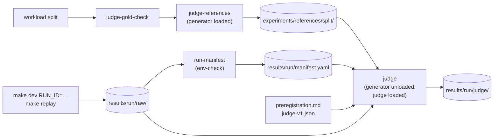

# Judge harness, and P1 first

Status: opened 2026-10-30 · spec approved 2026-10-31 · design approved 2026-10-31 · plan approved 2026-11-01
Changed before review (2026-10-31): ADR-022 and v0.28; gold references, version checks, error layers (mentor); the
B-within fact, the retrieval-miss rule, `RETRIEVAL_VERSION`'s start (rag-correctness plan). Changed by §3: a
*generation* layer, a lane-free retrieval-miss rule; `replay.py`, `judge-sanity`; DC 2, 7, 9, 10, 11's checks.
After Round 1 (2026-11-01, the author): DC 8 marks `reference right` too; DC 7, 9: a pinned 4B writer (ADR-023, §4).
Super-plan item: 5.1 — Judge harness (owns P1: metric definitions, run manifest, pre-registration record)

## 1. Spec

**The change.** Write P1 (metric definitions with counting rules, the run-manifest schema, the pre-registration
record). Freeze one judge model and prompt. Build references from each question's **gold documents**, not from the
system's retrieval. Then build an offline harness that judges every served answer in a run's `raw/` against its
reference, and splits each error by layer: retrieval, the answer cached at the miss, or the reuse. Last, measure
the judge's cost on one functional run.

**Why now.** Phase 6 needs a label for every hit. `Final_Proposal.md` §9.1 says P1 must exist before Phase 5's first
artefact (`decisions.md`, P1). Facts this spec rests on:
- `experiments/results/` is empty. No run exists, so nothing can be invalidated.
- After ADR-020, the rank-1 policy document is still not the gold one for 26 of 167 validation policy questions
  (21 in B-within). A reference built from that retrieval would share the cached answer's error, and the judge
  would call the reuse correct. Gold evidence removes that loop.
- On the ADR-021 retrieval, 42 of 124 validation B-within pairs pass the full gate at τ 0.85 (either prompt); 36 are
  policy-condition pairs in which one side ranked the other condition's document first (ADR-021, its plan's §3.1).
- In the workload, `doc_ids` is the intended source, written when each query was made, not a retrieval result
  (`data-card.md` §2): one document for 589 validation queries, two (product + policy) for 33. `reference_answer`
  is `""` in every record. 40 validation queries are `answerable: false`.
- `Answer` already grounds on chunk IDs the caller passes (`retrieved_chunk_ids`, §B v0.7), and §H keys verdicts by
  `sha256(query ‖ answer)` with the delimiter open (v0.11).
- The generator samples at `temperature 1` (U8). The judge is not Claude (ADR-013).

**Words used here.**
- **Gold evidence:** every chunk of the query's `doc_ids`, in document order, read from frozen `v1`.
- **Reference:** `Answer(query, product_id, gold evidence)`, the served generator and prompt, generated once per
  query and stored. One reference set per split serves every configuration.
- **Verdict:** `CORRECT`, `INCORRECT` or `UNPARSED` (output not in the format: a broken instrument, never a label).
- **Error layers** of an `INCORRECT` record, first match wins: a *retrieval miss* (a gold product document has no
  chunk in its retrieval, or a gold policy document is not the first policy chunk's document); a *generation
  error* (a MISS with no retrieval miss); an *inherited error* (a hit whose entry's own MISS was `INCORRECT`); a
  *reuse error* (a hit whose entry was `CORRECT` for its own question); a *reference error* (5.2's human check).

**Done conditions.**

1. **P1, metric definitions.** `docs/contracts/metrics.md`, dated: one entry per metric row of `Final_Proposal.md`
   §9.1 and §9.2 (17), plus μ_gen, μ_hit and the **miss-path error rate** (`INCORRECT` share of judged MISS answers).
   Each entry gives the claim, the formula over §H fields, the record filter (arm, `config_id`, stratum, split), the
   denominator and the interval (Wilson for rates). It defines the five error layers by a rule over stored fields,
   and reports them apart, never as one number. It says `cache` and `refusal_cause` are the served decision and
   `source_overlap` a counterfactual (ADR-019). No `TODO`.
2. **P1, run manifest (5.1-A).** `interfaces.md` §I gives `manifest.yaml`. At least: run id; gateway SHA and dirty
   flag; `(config_id, mutation, support_gate, mixed_lane)` read from the records (ADR-010); the `ENVELOPE` line
   (ADR-003); `redis_version`, `rdb_last_save_time` (ADR-007); corpus version and snapshot digest; workload file,
   sha256, `K`; `CACHE_CAPACITY`, `τ_run`, `θ_run`; **`retrieval_version`, the sha256 of the retrieval source, and
   `top_k`**; the generator's model digest and settings; the admissibility verdict (rules 6, 10, 12, I9).
   `make run-manifest` writes it, reading the gateway's start log. `make run-manifest-check` fails on a missing
   field, a record whose arm differs, or a log from another run or arm. Unit tests show each refusal.
3. **P1, pre-registration record.** `docs/preregistration.md`, append-only, every entry dated. The first names the
   judge model and digest, the prompt version and sha256, the judge options, the verdict key, the reference
   definition (gold-anchored) and the counting rules' version. Item 6.1's entries are named and left empty.
4. **The verdict key.** `interfaces.md` §H v0.28 gives its exact formula (inputs, order, delimiter). A golden test
   pins one key, and shows `(q1, A)` and `(q2, A)` get two keys, and one `(q, A)` under two `product_id`s two keys.
5. **The frozen judge.** ADR-022 records the model (not the generator, not Qwen's family) and digest, the prompt
   and version, the options (`temperature 0`, fixed seed, `num_ctx`, thinking off where it exists), and the gold-
   anchored reference. The rubric covers a wrong product, a bare same-polarity "Yes.", and an unanswerable question.
   ADR-022 and DC 3 are dated before the first verdict.
6. **Gold audit (5.1-C).** `make judge-gold-check SPLIT=validation` passes when every `doc_id` exists in frozen `v1`,
   each query's kinds agree with its stratum (D has one product and one policy), and every `reference_answer` is
   `""`; no gold set exceeds 24,000 characters. It prints counts by stratum and `answerable`. Tests show each failure.
7. **Gold-anchored references (5.1-D).** `make judge-references SPLIT=validation` writes one reference per distinct
   `(query, product_id)`, content-addressed, with an index that records per reference the gold doc IDs, the chunk
   IDs passed, and the **reference-generation version** (writer digest, settings, prompt hash, corpus digest).
   It refuses unless `make corpus-index-check` passes, and never overwrites. A test shows the chunk IDs passed are
   exactly the gold documents' chunks, in order; an empty list or a reply with other `source_chunk_ids` stops it.
8. **Gold sufficiency (5.1-F), a stop rule.** The script counts declining `answerable: true` references. The author
   marks 30 pairs (≥ 10 B-within) `sufficient` and `reference right`. Over 3 `no` in either: stop before any verdict.
9. **The harness (5.1-B, 5.1-E).** `make judge RUN_ID=…` reads only `raw/`, the reference set and the frozen prompt.
   Unit tests with a fake judge show each point:
   - it **refuses when the manifest and the reference index disagree** on corpus digest, `retrieval_version`,
     retrieval sha256, `top_k`, generator or reference writer (ADR-023), and never continues on a mismatch;
   - it checks every answer file's hash; it refuses an inadmissible run, a failed manifest check, `mutation: on`;
   - it judges every served answer, hits and MISS, once per verdict key, and every record gets exactly one verdict;
   - a record that matches no workload `(question, product_id)` stops it; a fixture gives each layer exactly once;
   - each verdict row stores, apart: gold doc IDs, retrieved chunk IDs, the entry's sources, the reference hash,
     both versions, and the error layer;
   - it refuses while the generator is loaded, when the judge or prompt differ from DC 3, or when output exists;
   - it writes beside `raw/`, not inside; only the two exact tokens parse, and `INCORRECT` never reads as `CORRECT`.
10. **Sanity pairs, a stop rule.** `make judge-sanity`: 12 hand-made pairs from the validation split, two of each:
    the return/warranty trap, a wrong product, a bare "Yes." against a "No" reference, a same-polarity bare "Yes.",
    an unanswerable question with an invented answer, true paraphrases. If the frozen judge gets one wrong, stop.
    A prompt change is a new version and a new DC 3 entry.
11. **The cost** (`citable: no`). After `make cache-reset`, one gateway run, `make replay SPLIT=validation` (every
    query once; configuration 4, gate on, MIXED off, `mutation: off`), then `make judge`. `evidence/cost.md` records:
    hit and MISS records, distinct verdict keys, seconds per verdict (median, p95), wall time, the judge's footprint,
    pressure, `UNPARSED`, the count per layer, how many of 30 re-judged keys flip, and the projected judge time for
    every Phase 6 configuration and arm.
    The run's `raw/` stays gitignored. No frontier is computed, and no rate from this run is used for any choice.
12. `make verify` passes. `architecture.md` lists the new files, and `experiments/README.md` no longer says the
    judge does not exist. No existing test changes.

**Out of scope.**
- Human labels against the judge, both agreements (5.2); δ (5.3); figures (5.4).
- Judging under `mutation: on` (6.5): there the gold text depends on the epoch.
- Test-split references, any frontier, configuration selection (6.0). The generator, its prompt and temperature (U8).
- **Fixing the 26 wrong-document retrievals** (mostly opened / unopened): a condition flag is rejected (§9.3).

## 2. Impact

**Files.** All respect `architecture.md`: the judge runs offline under `experiments/`, and nothing in the gateway
or `rag/` imports it.
- **New:** `experiments/scripts/judge.py`, `judge_references.py`, `run_manifest.py`, `replay.py`; the prompt under
  `experiments/judge/`; tests `experiments/tests/test_judge*.py`, `test_judge_references.py`, `test_run_manifest.py`.
- **`rag/src/rag/config.py`:** one constant, `RETRIEVAL_VERSION`, bumped by every ADR that changes retrieval. Its
  first value names the ADR-021 retrieval (ADR-020's category swap and ADR-021's own-product refill).
- **Makefile:** `run-manifest`, `run-manifest-check`, `judge-gold-check`, `judge-references`, `judge`,
  `judge-sanity`, `replay`.
- **Docs:** new `docs/contracts/metrics.md` and `docs/preregistration.md`; `interfaces.md` §H and new §I;
  `decisions.md` (ADR-022, the P1 row closed); `architecture.md`; `experiments/README.md`. The super-plan's 5.1
  wording ("deduped by `answer_sha256`") is corrected at `/done`. `.gitignore`: references, judge output. No Go change.

**On a measured path: yes.** This task defines what a false hit is, and how every §9 metric is counted.

**Frozen values touched.** None changed: generator, embedding, `τ_s`, δ (provisional until 5.3), the capacity
ratio, `top_k`. New frozen values are created: the judge and digest, the prompt version, the judge options, the
verdict key, the counting rules, the reference definition and writer (ADR-023), and the reference set's hash.
The served generator is unchanged (2B, `temperature 1`); the writer is 4B at `temperature 0`, one text per query.
- **The reference definition changes** from `Final_Proposal.md`'s `LLM(retrieve(q), q)` to `LLM_w(gold(q), q)`.
  ADR-022 and 023 record it; the proposal's §5 C1 and §9.3 wording becomes stale (the author's file, not edited).
- **Invalidates:** none — no runs yet (`experiments/results/` is empty).

**Contract change: yes,** `interfaces.md` v0.27 → v0.28, then v0.29 (ADR-023's `reference_writer`, §I).
- §H: the verdict key's exact formula. New §I: `manifest.yaml`, and the verdict and reference layout.
- The seam: the gateway writes §H and does not change; the harness reads it. `source_chunk_ids`, `t1_key` and
  `dataset_epoch` are untouched. References use the existing `Answer` RPC with `retrieved_chunk_ids`.

**Measurement change: yes.** The first written definitions for every §9 metric, plus the miss-path error rate
and the five error layers. Choices §3 makes and the author approves:
- whether the headline false-hit rate counts inherited errors (proposed: every wrong hit is counted, with the
  layers beside it, and the miss-path error rate as the baseline);
- how the `answerable: false` queries count;
- the `UNPARSED` share above which a run's rate is not reported.

**New dependency: one judge model in Ollama,** loaded alone after the generator is unloaded. **The author chooses
it.** Recommended: `gemma3:4b-it-q4_K_M` (3.3 GB on disk, not Qwen's family). `gemma4:e2b` (7.2 GB) does not fit the
~5–6 GB free. An API judge would send PQA-derived text off the machine. PyYAML is already a `rag` dependency.

**Cut scope reinstated.** No: the judge is offline, never on the hit path; no predictor, learned gate or condition flag.

**Existing tests.** None change.

## 3. Design

**Approach.** Five commands, each checked before the next, with one model loaded at a time:

1. `make judge-gold-check` checks the gold labels, offline.
2. `make judge-references` builds one reference per query. It calls the `Answer` handler in process, with the gold
   chunk IDs as `retrieved_chunk_ids`. The generator is loaded.
3. A run: `make dev` with `RUN_ID`, then `make replay`, then stop the gateway, then `make run-manifest`. The
   manifest runs `env-check`, so the generator is still loaded.
4. Unload the generator. `make judge RUN_ID=…` runs the frozen judge.
5. The documents: `metrics.md`, `preregistration.md`, §H and §I, ADR-022. All are dated before step 4.

*Beaten:* a reference built from the run's own retrieval, as `Final_Proposal.md` §9.3 says. A request that
retrieved the wrong policy document gets a reference with the same error, and the judge calls it correct: 36 of the
42 B-within passes measured on 2026-10-31 are this case. *Also beaten:* calling a separate `rag.server` over gRPC
for references. The in-process handler is the same code, with no port or process to manage.



### The verdict key

`interfaces.md` §H v0.28 replaces "item 5.1 fixes it" with:

```
verdict_key = sha256( "vk1:" + ns(query_raw) + ns(product_id) + ns(answer_sha256) ), lowercase hex
ns(s)       = <the byte length of s in UTF-8, in decimal> ":" <the UTF-8 bytes of s> ","   (a netstring)
```

- `query_raw` is the record's field as logged, never the normalised form.
- `product_id` is `""` when the record has none (the key is `omitempty`).
- `answer_sha256` is the record's 64-character field.

A netstring cannot be split two ways, so no question text can fake a field boundary. §H gives one pinned key, and
the golden test checks the same value.

**What is judged.** Every record with `answer_sha256 != ""`, that is, TIER1_HIT, TIER2_HIT and MISS. There is one
judge call per distinct key, and each record takes its key's verdict. Records with `""` (SHED, ABANDONED,
GENERATION_FAILED) are counted, not judged.

### The error layer

Each `INCORRECT` record gets one layer, first match wins:

| # | Layer | Rule over stored fields |
| :---: | :--- | :--- |
| 1 | `retrieval` | `retrieved_chunk_ids` is not null, and a gold `product-` document has no chunk in it, or a gold `policy-` document is not the document of its first `policy-` chunk (none counts as not) |
| 2 | `generation` | `cache == MISS` |
| 3 | `inherited` | a hit, and the MISS record with the same `entry_id` has verdict `INCORRECT` |
| 4 | `reuse` | a hit, and that MISS record's verdict is `CORRECT` |
| — | `undecided` | a hit whose entry's MISS verdict is `UNPARSED`; counted beside, never in a layer |

- **No lane rule is copied into Python.** The first `policy-` chunk is the POLICY lane's namespace document
  (`reuse.Namespace`), so rule 1 reads only chunk IDs.
- **A TIER1_HIT has no retrieval**, so rule 1 never fires on it.
- **The entry.** On a hit, `entry_id` names the served entry (§H). The MISS that wrote it is in the same run when
  I9 holds, which the manifest checks. A coalesced follower shares its leader's entry and answer.
- **A flag beside the layer.** `retrieval_miss` (rule 1's test) is stored for every record that has a retrieval,
  `CORRECT` ones too, so 5.2 can read it.

### Counting choices, for the author's approval

- **Headline false-hit rate** = `INCORRECT` hits / judged hits (TIER1_HIT + TIER2_HIT), per arm and stratum, with
  a Wilson 95 % interval. Every wrong hit counts, inherited and retrieval ones too: the user gets a wrong answer
  either way. The layers are reported beside it, and the miss-path error rate (`INCORRECT` / judged MISS) is the
  baseline.
- **`answerable: false` queries** count like any other. The rubric makes a "don't know" `CORRECT` for them and an
  invented answer `INCORRECT`. Their count is its own row in every table.
- **`UNPARSED`** leaves both the numerator and the denominator, and is counted beside. If more than **2 %** of a
  run's verdict keys are `UNPARSED`, that run's rates are not reported.

**`metrics.md`.** One entry per metric, each in the same six parts: claim · formula over §H fields · filter ·
denominator · interval · cells. That is the 17 rows of §9.1–§9.2, plus μ_gen, μ_hit and the miss-path error
rate.
- **Formulas §H already gives** (band share, the refusal rate's denominator, the 3 ⋈ 4 join) are cited, not
  restated.
- **Only four need a verdict:** the false-hit rate, the residual (RQ2a), false hits by cause, and staleness. The
  rest come from `raw/` and the manifest.
- **An entry whose data no item builds yet** (the static arm, item 6.3; the 3 ⋈ 4 join, F-K) says so in one line.
- **The rules carry a version,** `counting-v1`.

### The judge (ADR-022): proposed, the author chooses

`experiments/judge/judge-v1.json` is the one machine-readable record of the frozen judge:

```json
{"version": "judge-v1", "model": "gemma3:4b-it-q4_K_M", "digest": "<from /api/tags when frozen>",
 "prompt_file": "prompt-v1.txt", "prompt_sha256": "<sha256 of the file>",
 "options": {"temperature": 0, "seed": 20261031, "num_ctx": 4096, "num_predict": 8}}
```

- **Model.** `gemma3:4b-it-q4_K_M`: already pulled, 3.3 GB, Google's family. `qwen2.5:3b` and `qwen3:4b` are
  Qwen's family, which DC 5 excludes; `gemma3:1b` is smaller and likely weaker. gemma3 has no thinking mode, so no
  `think` field is sent. The scripts send `think: false` only to a model whose `/api/show` lists `thinking`.
- **Options.** `num_ctx` 4096: rubric, question, reference and answer come to about 1,000 tokens.
  `num_predict` 8 keeps a chatty reply short, so it ends as `UNPARSED`.
- **Prompt v1**, `experiments/judge/prompt-v1.txt`:

```
You check answers from an online shop's assistant.

Question: {question}

Reference answer, written from the correct product and policy documents:
{reference}

Answer to check:
{answer}

Is the answer to check correct for this question, judged against the reference?
- CORRECT: it gives the same facts as the reference. More or fewer details are fine if nothing it says differs.
- INCORRECT: it states a different number, time, condition or fact; it is about a different product or a
  different policy; or it says "yes" where the reference says "no", or the reverse.
- A bare "Yes." or "No." is CORRECT when the reference gives the same yes or no.
- If the reference says the answer is not known, the answer is CORRECT only if it also gives no answer.
- If the reference gives the answer and the answer to check says it does not know, it is INCORRECT.

Reply with exactly one word: CORRECT or INCORRECT.
```

  Two rubric choices are the author's: a bare same-polarity "Yes." is `CORRECT`, and so is a partial answer that
  says nothing wrong.
- **Parse.** The reply, with white space trimmed at both ends, must equal `CORRECT` or `INCORRECT`. Nothing else is
  read: no case folding, no substring search (`INCORRECT` contains `CORRECT`), no stripping of a full stop.
  Anything else is `UNPARSED`, and the raw reply is stored.

### Files

**`rag/src/rag/config.py`.** `RETRIEVAL_VERSION = "adr-021"`, with a comment: every ADR that changes retrieval
bumps it. The retrieval source hash is `sha256(rag/src/rag/retrieve.py)`, computed by the scripts, not stored.

**`experiments/scripts/judge_references.py`**
- `load_split(split: str) -> list[dict]`: `data/workload-v1-{split}.json`.
- `doc_chunk_ids(data_dir: Path) -> dict[str, list[str]]`: each document's chunk IDs in ordinal order, rebuilt with
  `ingest.load_records` and `ingest.records_to_nodes` (no embedding), as `update_set.py verify` does.
- `gold_chunk_ids(doc_ids: list[str], chunks: dict[str, list[str]]) -> list[str]`: the documents in `doc_ids`
  order, each one's chunks in ordinal order. Raises on an unknown document or an empty result.
- `gold_problems(queries, chunks, texts) -> list[str]` and `gold_counts(queries) -> dict`, for DC 6:
  - an unknown `doc_id`;
  - kinds that do not fit the stratum: A, B-within, B-cross and C have one document; D has one `product-` and one
    `policy-`;
  - a `reference_answer` that is not `""`;
  - a gold set over 24,000 characters.
- `answer_in_process(query: str, product_id: str, chunk_ids: list[str]) -> tuple[str, list[str]]`: calls
  `server.RagServicer().Answer(rag_pb2.AnswerRequest(query=…, product_id=…, retrieved_chunk_ids=…), None)` and
  returns the one `AnswerChunk`'s `text` and `source_chunk_ids`. Since ADR-023 it is no longer `build`'s default.
- `answer_with_writer(query, product_id, chunk_ids) -> tuple[str, list[str]]` (ADR-023): `retrieve.fetch_by_ids`,
  `generate._build_prompt`, then `/api/generate` with `reference-writer-v1.json`'s model and options (`think: false`
  when the model lists thinking). Returns the text and the IDs `fetch_by_ids` returned, so `make_reference`'s order
  check still applies. `writer_block()` reads the same file and refuses when the live digest differs.
- `make_reference(query: dict, chunk_ids: list[str], answer=answer_in_process) -> dict`. It refuses:
  - an empty `chunk_ids` (`Answer` would retrieve instead);
  - a reply whose `source_chunk_ids` differ from the list sent (`fetch_by_ids` drops a missing chunk with no
    error).
- `version_block() -> dict`, with these fields:
  - `generator`, from `generator_block()`: `model`, `digest` (`/api/tags`), `num_ctx`, `think`, the Modelfile's
    `temperature` (`/api/show`), and `prompt_sha256` of `generate._PROMPT_TEMPLATE`. The manifest's `generator`
    block comes from the same function, so the two always have the same keys;
  - the corpus `snapshot_digest` (`data/v1-freeze.json`);
  - `retrieval_version`, `retrieve_py_sha256` and `top_k`;
  - `reference_writer`, from `writer_block()` (ADR-023).
- `build(split: str, out: Path) -> dict`. It refuses when `out` exists or when `freeze_corpus.cmd_check_index`
  fails. It writes:
  - `answers/{sha256}.txt`;
  - `index.jsonl`: per query, `qa_id, question, product_id, stratum, answerable, gold_doc_ids, chunk_ids,
    reference_sha256`;
  - `version.json`.

  It prints how many `answerable: true` references decline, using the decline pattern of the 2026-10-31 prompt
  probe, and the sha256 of `index.jsonl`: the reference set's hash. A second dated entry in `preregistration.md`
  records that hash before the first verdict.
- `sheet(split, out, n=30, min_b_within=10, seed=7)` and `score(sheet) -> dict` for DC 8. The sheet is Markdown, one
  row per pair, with a `sufficient: yes/no` cell for the author. Since Round 1 each row also has a `reference right:
  yes/no` cell (a decline is right only when the evidence does not answer), and `score` counts both cells.
- CLI: `gold-check`, `build`, `sheet`, `score`.

**`experiments/scripts/run_manifest.py`**
- `read_records(run_dir: Path) -> list[dict]`.
- `arms(records) -> dict`: `config_id, mutation, support_gate, mixed_lane`. Raises when one differs across records.
- `parse_gateway_log(text: str, run_id: str) -> dict`. It reads:
  - `tau` and `theta` (`gateway: tau=… theta=…`), and `cache_capacity`;
  - `support_gate`, and `mixed_lane` (the `lane_band=` line);
  - the run id, from the `evaluation log -> …/{run_id}/raw/` line;
  - `ended` (`shutting down, flushing the evaluation log`) and `incomplete` (`THIS RUN IS INCOMPLETE -- …`).

  It raises when the run id differs or a value is missing.
- `admissibility(records, log: dict) -> dict`:
  - rule 6: `ended` and not `incomplete`;
  - rule 10: no `NOT_SCORED`;
  - rule 12: no `tier2_search_failed`;
  - I9: every hit's `entry_id` and every `candidate_entry_id` is the `entry_id` of some MISS;
  - `admissible`: all four hold.
- `build_manifest(run_dir, log_path, split, *, git, redis_info, envelope, ollama) -> dict`. The injected callables
  keep the unit tests offline.
- `check_manifest(run_dir: Path, log_path: Path | None = None) -> list[str]`: every §I field is present; the arms
  re-read from the records equal the manifest's; with `log_path`, the log's run id, `support_gate` and `mixed_lane`
  equal the records'. The manifest has no field for the log's arms, so `write` always compares them and `check`
  compares them when the log is passed. Steps 6.5 and 7.3 pass it.
- CLI: `write --run-id ID --gateway-log FILE --split S` and `check --run-id ID [--gateway-log FILE]`. `write`
  refuses while `:8080` listens or when `manifest.yaml` exists. It gets the `ENVELOPE` line from `env_check.observe` and
  `envelope_line`.

**`manifest.yaml`** (§I). `manifest_version: 1`; `run_id`; `written_at`; then:
- `gateway: {git_sha, dirty}`;
- `arms: {config_id, mutation, support_gate, mixed_lane}`;
- `envelope: "ENVELOPE …"`;
- `redis: {redis_version, rdb_last_save_time}`;
- `corpus: {dataset_version, snapshot_digest}`;
- `workload: {file, sha256, K, frozen_cache_capacity}`, from `data/v1-freeze.json` `run_files.<split>`;
- `cache: {capacity, tau_run, theta_run}`;
- `retrieval: {retrieval_version, retrieve_py_sha256, top_k}`;
- `generator: {model, digest, num_ctx, think, temperature, prompt_sha256}`;
- `records: {count, by_cache}`;
- `admissibility: {rule_6, rule_10, rule_12, i9, admissible}`.

It holds no question or answer text, so it stays tracked.

**`experiments/scripts/replay.py`.** `replay(split: str, url: str, seed: int = 7) -> Counter` sends every query of
the split once, in a seeded shuffle, one at a time. Each is `POST /ask {question, product_id}`, with `product_id`
left out when empty and an `X-Thesis-Stratum` header. It prints progress and the pressure level every 50 requests.
It is not a load driver: Phase 6's rate sweep stays with k6.

**`experiments/scripts/judge.py`**
- `verdict_key(query_raw: str, product_id: str, answer_sha256: str) -> str`.
- `parse_verdict(reply: str) -> str`.
- `load_answers(run_dir: Path, records) -> dict[str, str]`: reads every named file and checks its hash (§H rule 1).
- `join(records, index) -> dict[str, dict]`: `request_id` → reference row, by the exact
  `(query_raw, product_id or "")`. Raises on a record with no match.
- `retrieval_miss(retrieved: list[str] | None, gold_doc_ids: list[str]) -> bool | None`: rule 1 of the table.
- `layer(record, verdict, entry_verdict, miss) -> str | None`.
- `preflight(manifest, ref_version, judge_cfg, prereg_text, ollama, *, writer_cfg=None) -> list[str]`
  (`writer_cfg` defaults to `reference-writer-v1.json`; `run()` passes it from `writer_path`). It refuses when:
  - the manifest check fails, the manifest says `admissible: false`, or the run has `mutation: on`;
  - one of the version fields differs between the manifest and the reference set: the corpus digest, the three
    `retrieval` fields, and all six `generator` fields, `prompt_sha256` included;
  - the reference set's `reference_writer` differs from `reference-writer-v1.json` (ADR-023);
  - the live judge digest or the prompt file's hash differs from `judge-v1.json`;
  - `preregistration.md` does not contain `judge-v1.json`'s sha256;
  - `/api/ps` lists the generator;
  - the output folder exists.
- `ask_judge(question, reference, answer, cfg, post) -> tuple[str, float]`: one `/api/generate` call with
  `stream: false`; returns the reply and its seconds.
- `run(run_id: str, ...) -> dict` writes `results/{run_id}/judge/`:
  - `verdicts.jsonl`, one row per key: `verdict_key, verdict, reply, seconds, reference_sha256`;
  - `records.jsonl`, one row per record: `request_id, cache, qa_id, stratum, answerable, verdict_key, verdict,
    layer, retrieval_miss, gold_doc_ids, retrieved_chunk_ids, entry_sources, candidate_sources,
    entry_miss_request_id, reference_sha256, reference_version, manifest_sha256, judge_version`;
  - `summary.json`, counts only.

  After the last key it re-judges 30 keys (seed 7) and stores the flips in `summary.json`.
- `sanity(file: Path) -> int`, for DC 10. Each row is `qa_id`, an authored `answer` and an `expected` verdict. It
  exits non-zero on any wrong verdict. The executor drafts the 12 rows from the reference set, and the author checks
  every `expected` before the first sanity run.
- CLI: `run`, `sanity`.

**`experiments/judge/`**: `prompt-v1.txt`, `judge-v1.json` and, since ADR-023, `reference-writer-v1.json`.

**Makefile.** All targets use `$(PY)`. The two that load a model check the memory first, as `gate-corpus` does.
- `run-manifest RUN_ID= GATEWAY_LOG= SPLIT=` and `run-manifest-check RUN_ID= [GATEWAY_LOG=]`;
- `judge-gold-check SPLIT=`;
- `judge-references SPLIT=`, which loads the generator;
- `judge RUN_ID=`, which loads the judge;
- `judge-sanity FILE=`;
- `replay SPLIT=`.

**`.gitignore`.** Adds `experiments/references/` and `experiments/results/*/judge/`: both hold question text and
PQA-grounded answers. `manifest.yaml` stays tracked.

**Tests.** They use fakes and temp folders, with no Ollama and no Redis.
- `test_judge.py`: the key's golden value, the parse, the join, each layer, each preflight refusal, write-once.
- `test_judge_references.py`: gold order, gold problems, `make_reference`'s refusals, `build` refusing a folder
  that exists.
- `test_run_manifest.py`: arms, the log parse, admissibility, each check refusal.
- `test_replay.py`: the seeded order, the header, and no `product_id` sent when it is empty.

**Docs.**
- `interfaces.md`: §H's key and the new §I (manifest, reference set, judge output); v0.28.
- `metrics.md`, and `preregistration.md` with its first entry.
- `decisions.md`: ADR-022, its summary row, and the P1 row closed.
- `architecture.md` lists the new files; `experiments/README.md` says the judge exists.

### The cost run (DC 11)

1. Check pressure. Run `make cache-reset`.
2. `RUN_ID=<id> CONFIG_ID=4 SUPPORT_GATE=on MUTATION=off CACHE_CAPACITY=156 make dev 2>&1 | tee <log>`. 156 is
   `round(0.25 × 622)`, the validation file's frozen capacity.
3. `make replay SPLIT=validation`.
4. Stop the gateway with SIGINT. Then `make run-manifest RUN_ID=<id> GATEWAY_LOG=<log> SPLIT=validation`.
5. `ollama stop qwen3.5:2b-q4_K_M`. Check that `/api/ps` is empty, and check pressure again.
6. `make judge RUN_ID=<id>`. Write `evidence/cost.md` from `judge/summary.json` and the pressure readings.

### Failure modes, silent ones first

1. **The reference comes from retrieval, not gold.** `Answer` retrieves when `retrieved_chunk_ids` is empty, and
   `fetch_by_ids` drops a missing chunk with no error. The reference then shares the cached answer's error, and the
   judge calls the hit correct. → DC 7's refusals, and DC 6.
2. **Two different questions share one verdict.** A key on the answer alone, or one without `product_id`, merges
   `(q1, A)` and `(q2, A)`, and the false-hit rate takes whichever came first. → DC 4.
3. **`INCORRECT` is read as `CORRECT`** by a substring or case-folded parse, so every wrong answer counts as right.
   → DC 9's exact-token test, with `INCORRECT` as a fixture.
4. **A record is joined to the wrong query.** A loose join gives it another query's reference and a plausible wrong
   verdict. → DC 9: an exact `(query_raw, product_id)` join, and no match stops the run. The pair is unique in both
   splits (measured 2026-10-31).
5. **The judge or prompt drifts after pre-registration** (a re-pulled tag, an edited prompt file). → DC 9's
   preflight: the live digest and the prompt hash against `judge-v1.json`, and that file's hash against DC 3's
   entry.
6. **References and the run come from different study states** (corpus, retrieval, generator, or the generator's
   prompt). → DC 9's version comparison, which includes the generator's `prompt_sha256` (added 2026-11-01).
7. **The manifest takes τ, θ or an arm from another run's log.** → DC 2: the run id comes from the log, and the
   log's arms must equal the records'.
8. **An inadmissible run is judged.** A killed gateway leaves no `INCOMPLETE` line. → Rule 6 needs the
   `shutting down` line too (DC 2), and `judge` refuses a run that fails the check (DC 9).
9. **A layer is guessed.** A hit whose entry's MISS is missing or `UNPARSED` would fall into `reuse` by default.
   → `undecided` is counted beside; DC 9's fixture gives each layer once; I9 is in the manifest.
10. **Gold evidence is cut by `num_ctx`.** Ollama drops prompt text past `num_ctx` with no error. Measured on
    2026-10-31: the longest gold set (D, 10 chunks) is 7,766 characters, about 2,000 tokens, against 8,192.
    → DC 6's 24,000-character limit.
11. **The judge is not repeatable** at `temperature 0`, so verdicts move between runs and read as noise in 5.2.
    → DC 11's 30 re-judged keys.
12. **`UNPARSED` bends a rate** if it is counted as either verdict. → It leaves both terms; the 2 % rule (DC 1).
13. **A wrong gold label** in the workload gives a wrong reference. → DC 8's read of 30 pairs; the rest is 5.2's
    reference-error layer.
14. **A wrong reference from sufficient gold.** The generator declines or misreads although the evidence answers, and
    the rubric then grades a correct answer `INCORRECT`. → DC 8's `reference right` cell (added after Round 1, §4).
15. **References from another writer** (a re-pulled tag, the served 2B again by default). → DC 9's writer check
    against `reference-writer-v1.json`, and the live digest check in `writer_block()`.

### Edge cases

- **No `product_id`:** 16 validation queries have none. The key uses `""`, and `replay` leaves the field out.
- **The same `(question, product_id)` twice in a run:** one key, judged once.
- **An empty answer** is a real answer. Its key uses `e3b0…` and it is judged.
- **A TIER1_HIT on a promoted key** serves a Tier-2 entry to another question. Its layer comes from the entry's
  MISS, like a TIER2_HIT.
- **D queries:** the gold set is the product document, then the policy document, in `doc_ids` order.
- **`answerable: false`:** the reference is expected to decline. DC 8's decline count covers only
  `answerable: true`.

### Unknowns

- **How good gemma3:4b is as a judge.** 5.2 measures it against the author's labels. The sanity pairs (DC 10) only
  catch gross errors.
- **The `UNPARSED` share** under an exact-token parse. DC 10 and DC 11 measure it. If it is over 2 %, prompt v2
  uses Ollama's `format` with an enum of the two words: a new version and a new DC 3 entry.
- **Seconds per verdict, and so Phase 6's judge time.** DC 11 measures it. My guess is 1–3 s per key, with about
  600 keys per run.
- **Whether a seed makes `temperature 0` repeatable** on Ollama 0.33.2. DC 11's 30 re-judged keys show it.
- **Reference quality with whole documents as context** (up to 10 chunks, where the served path has 5). DC 8's read
  shows it.

### Verification

| DC | Shown by |
| :--- | :--- |
| 1 | `metrics.md`: 20 entries, each with its six parts; `grep -c TODO` gives 0; the counting choices as approved |
| 2 | `test_run_manifest.py`; the cost run's `make run-manifest` and `make run-manifest-check` |
| 3 | `preregistration.md`'s first entry, holding `judge-v1.json`'s sha256 and dated before the first `verdicts.jsonl` |
| 4 | `test_judge.py`: the golden key and the two "two keys" tests; §H's pinned key equals the test's |
| 5 | ADR-022 and `judge-v1.json`, with their dates |
| 6 | `make judge-gold-check SPLIT=validation`; `test_judge_references.py` |
| 7 | `make judge-references SPLIT=validation`; `test_judge_references.py` (order, empty list, other IDs, no rewrite) |
| 8 | the decline count; the author's marked sheet in `evidence/private/`, scored by `judge_references.py score` |
| 9 | `test_judge.py`, one test per bullet, with a fake judge and a fake Ollama |
| 10 | `make judge-sanity FILE=docs/work/2026-10-30-judge-harness/evidence/private/sanity-v1.jsonl` |
| 11 | the run above; `evidence/cost.md` from `judge/summary.json` |
| 12 | `make verify`; greps in `architecture.md` and `experiments/README.md`; `git diff --stat` on the existing tests |

## 4. Findings

**Review of Phases 1–2 (2026-11-01).** Two gaps in §3, both closed above with the author's agreement and built in
`plan.md` Phase 8:
- `check_manifest` had no log to compare, so DC 2's "a log from another run or arm" held only at `write` time.
  It now takes the log, and steps 6.5 and 7.3 pass it.
- The manifest's `generator` block had no prompt hash, so DC 9 could not catch references and a run made under two
  generator prompts. `prompt_sha256` moves into `generator_block()`, which both sides use.

Phase 8 edits tests that this task wrote in Phase 2. None of them is in `evidence/tests-before.txt`, so DC 12 holds.

**Round 1, after step 4.5 (2026-11-01).** 78 of 582 `answerable: true` references match the decline pattern. The main
session read 16 of them beside their gold evidence (not citable): in 5 the evidence answers and Qwen declines, mostly
because it wants the product's name in a policy written per category; 3 answer after a hedge; 4 are not declines (the
pattern caught one phrase); in 2 or 3 the evidence lacks the answer. DC 8 asked only whether the gold is sufficient, so a
wrong reference with sufficient gold passed it (failure mode 14). The author chose (2026-11-01) to also mark `reference
right`, with the same "more than 3 `no`" stop rule; the count is also a first measure of reference error for 5.3.
Built in `plan.md` Phase 9: the unmarked `sufficiency-v1.md` is left as it is, and `sufficiency-v2.md` (the same seed,
so the same 30 pairs) carries both cells; Entry 3 of `preregistration.md` records the rule before the first verdict.
Phase 9 edits only this task's own test file, so DC 12 holds.

**Step 4.7's stop rule fired (2026-11-01).** The author's marks on `sufficiency-v2.md`: `sufficient` 28 yes, 2 no;
`reference right` 25 yes, **5 no** (17 %, Wilson 95 % [7.3, 33.6]; citable: no). Three of the five (rows 12, 21, 24)
are one template, "Is there a restocking fee to return an opened <phone>?": the policy says $45 for each opened phone,
and Qwen answers that the model is not mentioned (40 such queries in the split). Two (rows 17, 19) misread the
evidence. Even the interval's lower bound is above δ = 5 %. No verdict has run. The next step is the author's.

**Pilot: Qwen 3.5 4B as the reference writer (2026-11-01, the author's request; citable: no).** The same 30 rows, gold
chunks and prompt; `temperature 0`, seed 20261101; `evidence/pilot-4b.md`, script `evidence/pilot_4b.py`. 4B fixes
rows 12, 19, 21 and 24; row 17 stays wrong; row 25 is debatable. That is 1 to 2 wrong of 30 (up to 4 if two borderline
rows count), by the main session's provisional, non-blind reading. A 2B control at temperature 0 keeps 4 of the 5
errors, so the gain is the model, not the temperature. 4B at temperature 0 repeats byte for byte. Entry 2's set is
unchanged and stays the baseline; no ADR or pre-registration entry is written until the author chooses a protocol change.

**ADR-023, the reference writer (2026-11-01, the author).** After the generator comparison
(`docs/work/2026-11-01-generator-selection/`), the author kept `qwen3.5:2b-q4_K_M` as the served generator: the machine
bounds it, and the model is not the research object. References are written instead by `qwen3.5:4b-q4_K_M` at
`temperature 0`, pinned in `experiments/judge/reference-writer-v1.json`, from the same gold evidence and prompt. Built
in `plan.md` Phase 10. The 2B set moves to `experiments/references/validation-qwen2b-t1/` as the baseline; Entry 4
records the new hash; `sufficiency-v3.md` (same seed) carries the author's v2 `sufficient` marks, and the author
re-marks `reference right` blind. Step 4.7's stop rule is then scored on v3 (step 10.11). DC 7 and DC 9 changed in
wording only. Phase 10 edits only this task's own test files, so DC 12 holds.
