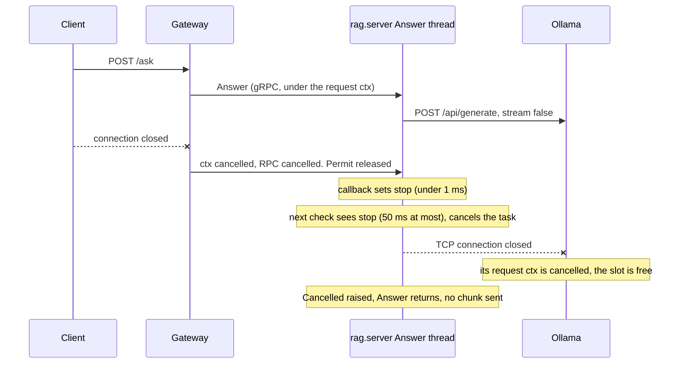

# Stop abandoned generations (F-L), and a graceful shutdown for rag.server

Status: opened 2026-11-10 · spec approved 2026-11-10 · design approved 2026-11-10 · plan approved 2026-11-10
Changed by §3 (2026-11-10): DC 1, 3, 4 gain checks for the silent failure modes; DC 5 times B straight against
Ollama; §2 drops streaming, because U1 showed Ollama stops on a closed `stream: false` request.
Changed by §4 (2026-11-10, approved by the author): DC 5 is split into (a) a drop after A's prefill and (b) the
1 s drop, bounded by one prefill; DC 6, §2 and U3 name the prefill residual.
Super-plan item: none — closes finding F-L (`docs/super-plan.md`, Phase 1 findings), which blocks 7.1 and 7.5.
The rag.server graceful shutdown was added by the author on 2026-11-10.

## 1. Spec

**The change.** When a client leaves during generation, the stop reaches Ollama: rag.server ends its Ollama
request and Ollama's one slot is free for the next request. Also, rag.server stops cleanly on SIGTERM or
SIGINT: it finishes the RPCs in flight, refuses new ones, then exits.

**Why.** The gateway already cancels the gRPC `Answer` call when the client leaves (`handler.go:473` passes the
request context) and frees its one permit. But `server.py` never checks for the cancel, and `generate.py`
blocks on one `httpx.post` with `stream: False` for up to 120 s. So Ollama keeps generating an answer nobody
will read, and the next admitted request queues inside Ollama, out of the gateway's sight. The bound
(1 + q) · S breaks (ADR-003). F-L's probe (a stubbed `generate`, no Ollama) saw the stub run to +1.50 s after
a cancel at +0.20 s.

rag.server also has no signal handler. `make dev` stops it with `kill` (SIGTERM), which ends it at once, so an
`Answer` in flight fails while the gateway is still draining. (The gateway's own drain was fixed on
2026-11-10 in chat, outside a task.)

**Facts this spec rests on.**
- The gateway half works today. No Go change is expected; §3 confirms the cancel reaches the wire.
- `generate._PROMPT_TEMPLATE` and `generate._build_prompt` are read by `experiments/scripts/judge_references.py`
  (the manifest's `prompt_sha256`, and the reference prompt). They must not change.
- One recorded run exists, `2026-11-01T21-17-56_cfg4_judgecost` (citable: no): 528 MISS, 94 TIER2_HIT,
  no ABANDONED.

**Done conditions.**

1. **The cancel test fails first, then passes.** New `rag/tests/test_server_cancel.py`, with no Ollama and no
   Redis: a fake Ollama HTTP server that answers slowly, and the real `build_server`. Pass, all of:
   (a) the client cancels `Answer` at +0.2 s, and the fake sees its connection closed within 0.5 s of the
   cancel; (b) a stopped `Answer` sends no chunk, also when the stop came before generation started (called
   directly, with a fake context whose callback the test fires); (c) a second `Answer` in flight at the same
   time, whose client stays, returns the full text, and so does the next `Answer` after a cancel. Run before
   the fix, (a) fails because the fake's request runs to its end; that output is saved in `evidence/`.
2. **Same request, same answer.** A pytest with the fake shows that the body sent to Ollama keeps `model`,
   `prompt`, `think: false` and `options.num_ctx = 8192` exactly as today, and that `Answer` returns the
   full text the fake sent. The sha256 of `generate._PROMPT_TEMPLATE` matches a golden value taken before
   the change.
3. **Graceful shutdown.** A pytest starts `rag.server` as a subprocess against the fake. During an `Answer`
   in flight it sends SIGTERM. Pass: (a) that `Answer` returns its full text; (b) a new RPC sent after the
   signal is refused with `UNAVAILABLE`; (c) the process exits with code 0 before the grace ends. The same
   test passes with SIGINT. (d) Started with SIGINT ignored, as `make dev` starts it, SIGINT changes nothing
   and SIGTERM still shuts it down as in (a)–(c).
4. **Shutdown with a stuck generation.** As in 3, but the fake never finishes. Pass: when the grace ends, the
   RPC is cancelled, the fake sees its connection closed (the cancel path of DC 1), and the process has
   exited within grace + 2 s. With a long grace, a second SIGTERM ends the process at once.
5. **Live probe, the whole chain** (`citable: no`; memory pressure checked before it, as `execution.md`
   says, and reported next to the result). `evidence/fl_probe.sh`, with `make dev` running. A is a question
   whose answer, asked once straight to rag.server, takes at least 4 s to generate (picked in a pilot and
   recorded). B is a one-word request sent straight to Ollama, as in `evidence/probe_ollama_stops.sh`. In
   each of 5 rounds, A goes through `/ask`, its client drops at `DROP_S` seconds, the gateway logs
   `abandoned while generating` for it, and then B is timed at once. The gap is B's median after a drop minus
   B's median alone. Pass, both: (a) with `DROP_S=4`, after A's prefill has ended, the gap is at most 0.5 s;
   (b) with the drop at 1 s, inside A's prefill, the gap is at most A's warm prefill, 1.94 s (§4: Ollama
   frees its slot only when the whole prompt is read). The probe also runs once **before** the fix with the
   drop at 1 s, and there the gap is over 0.5 s, which shows the probe can see F-L. All results go in
   `evidence/`.
6. **Docs.** `interfaces.md` §H's `t_generate_ms` note no longer says a MISS can absorb a whole orphaned
   generation, and names the prefill residual, with a version line (v0.31). `docs/super-plan.md` marks F-L
   closed with that residual and names this trail.
7. `make verify` passes, and no existing test is edited.

**Out of scope.**
- F-D: what a live follower gets when its leader's client leaves. The follower fails today and still will;
  the only change is that Ollama now stops too.
- Cancel for `Retrieve`, and for the gateway's embedding call: both take milliseconds.
- Any gateway Go change, unless §3 finds that the cancel does not reach rag.server.
- Streaming to the client: `/ask` stays one JSON body, and `Answer` still sends one terminal chunk.
- The stop order between services in `make dev`, and marking F-F closed in the docs.

## 2. Impact

**Files and boundaries.**
- `rag/src/rag/generate.py`: the Ollama call becomes stoppable. `_PROMPT_TEMPLATE` and `_build_prompt` do not
  change. It gets no gRPC import: the stop signal is a `threading.Event` handed over through a context
  variable (§3), so `generate(query, chunks)` keeps its signature and scripts can call it as they do now.
- `rag/src/rag/server.py`: `Answer` passes the stop signal to `generate`; `serve()` gets the signal handler
  and `server.stop(grace)`.
- `rag/src/rag/config.py`: possibly the grace value.
- New tests: `rag/tests/test_server_cancel.py`, `rag/tests/test_server_shutdown.py`. The live probe lives in
  `evidence/`, not in `experiments/scripts/`.
- Docs: `docs/contracts/interfaces.md` §H (and possibly one sentence in §B), the F-L entry in
  `docs/super-plan.md`.
- Gateway: none expected.

All changes stay inside the `rag/src/rag/` modules that `architecture.md` lists, and `generate.py` stays the
only caller of the LLM. The boundaries hold.

**Frozen values touched.** None. The model, `think: false`, `num_ctx` 8192, the prompt template and the
temperature do not change, and DC 2 checks it. The request to Ollama keeps `stream: false` and the same
body. Only the client object changes: one `httpx.AsyncClient` per call instead of one shared
`httpx.Client`, so each generation opens a new local TCP connection. Neither is a frozen value.
**Prior runs invalidated: none.** The one run (judgecost) has no ABANDONED record and is citable: no.

**Contract change.** No wire change: the `.proto` and both sides of §B stay as they are. The behaviour at the
seam changes: rag.server now honours a cancelled `Answer`, which the Go side already sends. §H's
`t_generate_ms` note changes (doc only). `source_chunk_ids`, `t1_key` and `dataset_epoch` are not touched.

**Measurement change.** Yes, and that is the point of the fix.
- A MISS that follows an ABANDONED generation no longer absorbs the rest of that generation in its
  `t_generate_ms` and its latency. §H already names this as a caveat while F-L is open. The field's meaning
  does not change. It can still absorb the rest of that generation's prompt prefill, at most one prefill (§4).
- `t_generate_ms` on ABANDONED keeps its meaning (the time until `Answer` returned). It is now close to the
  work Ollama really did, because the generation stops soon after.
- The per-call client adds a small cost to each generation (a new event loop and a local TCP connection).
  It may move `t_generate_ms` and the gateway-measured μ_gen by milliseconds. A plan step measures it (U2).
  μ_gen is a planning figure until Phase 7 re-measures it.
- The gateway frees its permit when it cancels, a moment before Ollama stops, or up to one prefill before
  when the cancel lands during the prefill (§4). DC 5 bounds both cases.
- At shutdown, `Answer` calls in flight now finish instead of failing. A queued gateway request that reaches
  rag.server after its signal gets `UNAVAILABLE`, which the gateway logs as GENERATION_FAILED. This only
  happens at shutdown, so a run that stops its load first is not affected.

**New dependency.** None. `httpx` and `grpcio` are already used.

**Cut scope reinstated.** No. Nothing streams: the request to Ollama keeps `stream: false`, `Answer` still
sends one terminal chunk, and `/ask` stays one JSON body. SSE stays cut.

## 3. Design

**The approach.** rag.server makes one `threading.Event` per `Answer`, and gRPC sets it when the RPC ends
(`context.add_callback`). `generate()` runs the Ollama request as an asyncio task inside `asyncio.run`, and
checks the event every 50 ms. When the event is set, it cancels the task. That closes the TCP connection,
and Ollama then stops the generation. The request to Ollama does not change.

Alternatives that lost:
- Ollama `stream: true`, checking between tokens. It changes the transport, and it cannot stop during
  prompt processing, when no token arrives.
- A `stop=` argument on `generate()`. It would break the two-argument fake in `test_server_epoch.py:65`, which
  is an existing test.

**What the design rests on (measured 2026-11-10, no model unless said).**

| Probe | Fact | Result |
| :--- | :--- | :--- |
| P1, `evidence/probe_cancel_mechanics.out` | `add_callback` fires when the client cancels, while the handler is still blocked | < 1 ms, 3 of 3 |
| P2, same file | cancelling an `httpx.AsyncClient` POST closes the TCP connection, before any header | 0.6–1.3 ms |
| P3, same file | the event checked every 50 ms from inside `asyncio.run` in a thread | 40–47 ms |
| P4, `evidence/probe_stop_grace.out` | `server.stop(grace)`: a new RPC gets `UNAVAILABLE`; the callback of a call still running fires when the grace ends | +501, +506 ms at grace 0.5 s |
| U1, `evidence/probe_ollama_stops.out` (real Ollama, `citable: no`, yellow with the model loaded) | Ollama stops when its `stream: false` client closes | B alone 0.11–0.14 s; B after A cut at 1 s 0.13–0.15 s; A uncut 26.1 s |

**The cancel path.**

**The shutdown path.** On the first SIGTERM (or SIGINT, unless it was ignored at start), rag.server prints
one line and calls `server.stop(grace)`. New RPCs get `UNAVAILABLE` (P4). The calls in flight run on. A call
still running when the grace ends is cancelled by gRPC, which fires its callback, so the cancel path above
stops its Ollama request. `wait_for_termination()` then returns, `serve()` prints `stopped`, and the process
exits with code 0. The first signal also resets both handlers to the default, so a second signal ends the
process at once.

**Files.**
- `rag/src/rag/generate.py`
  - `class Cancelled(Exception)`: the RPC ended before the answer. There is no answer, not even a partial one.
  - `stop_when(stop: threading.Event) -> ContextManager[None]`: sets the context variable `_stop` for the
    block and resets it after, so a reused worker thread never keeps an old event.
  - `generate(query: str, chunks: list[RetrievedChunk]) -> str`: same signature. It reads `_stop`, raises
    `Cancelled` at once if it is already set, and otherwise returns
    `asyncio.run(_post_until_stop(_request_body(query, chunks), stop))`.
  - `_request_body(query, chunks) -> dict`: today's body, unchanged: `model`, `prompt`, `stream: False`,
    `think`, `options.num_ctx`.
  - `async _post_until_stop(body: dict, stop: threading.Event | None) -> str`: one `httpx.AsyncClient
    (timeout=120.0)` per call. Starts the POST as a task, waits with `asyncio.wait({task}, timeout=0.05)` in a
    loop (so a finished answer is not delayed), and on `stop` cancels the task and raises `Cancelled`.
    Otherwise `raise_for_status()` and returns `json()["response"]`.
  - The module-level `_client` goes. `_PROMPT_TEMPLATE` and `_build_prompt` stay byte for byte.
- `rag/src/rag/server.py`
  - `_stop_on_rpc_end(context) -> threading.Event`: a new event. With a context, `context.add_callback(stop.set)`;
    if that returns `False` (the RPC already ended), it sets the event at once. With `context=None` (direct
    calls in tests) the event is never set.
  - `RagServicer.Answer`: the event first, then the epoch read as today (the order rule is unchanged), then
    `with generate.stop_when(stop): text = generate.generate(...)`. On `generate.Cancelled` it prints one
    line (seconds since the start) and returns without a chunk.
  - `_install_shutdown(server: grpc.Server, grace: float) -> None`: SIGTERM always; SIGINT only if
    `signal.getsignal(SIGINT)` is not `SIG_IGN`. Called right **after** `server.start()`.
  - `serve()`: as today, plus `_install_shutdown(server, config.SHUTDOWN_GRACE_S)`, and a `stopped` line.
    All its prints use `flush=True`, because `make dev` runs it in the background.
- `rag/src/rag/config.py`: `SHUTDOWN_GRACE_S = float(os.environ.get("RAG_SHUTDOWN_GRACE_S", "60"))`, 60 s like
  the gateway's `shutdownGrace`. A bad value fails at import, so the server does not start.
- Tests: `rag/tests/conftest.py` (a `FakeOllama` fixture: a raw-socket HTTP server that records each body
  and the time the client closed, and answers after a set delay or never); `test_server_cancel.py` (DC 1,
  DC 2); `test_server_shutdown.py` (DC 3, DC 4); `serve_with_fakes.py` (the subprocess entry point: patches
  `retrieve.fetch_by_ids` and `retrieve.retrieve` to return one fixed chunk, then calls the real
  `server.serve()`).
- Evidence: `evidence/fl_probe.sh` (DC 5), `evidence/bench_generate_overhead.py` (U2).
- Docs: `interfaces.md` §H `t_generate_ms` note and version line v0.31; F-L marked closed in `super-plan.md`.

**Failure modes, silent ones first.**
1. **The stop is not wired in the served path**, for example the `with` is missing or the callback is not
   registered. F-L comes back with no error: the next request absorbs the orphan, a plausible slow number.
   Caught by DC 1(a), with the real `build_server` and a real cancel, and by DC 5 on the whole chain.
2. **Ollama does not stop on a closed connection** (another version, or another endpoint). Same symptom.
   Only DC 5 can see it; U1 settled it for the pinned Ollama.
3. **A stop reaches the wrong request**: a shared event, or `_stop` left set in a reused worker thread. A live
   request is cut. The gateway logs GENERATION_FAILED, never a cached answer (`ragclient/answer.go:62` refuses
   a stream with no terminal chunk), but the outcome counts are wrong. Caught by DC 1(c).
4. **The body sent to Ollama drifts** with the new client (a field added, dropped or re-encoded). The served
   prompt changes with no error. Caught by DC 2: exact dict equality, plus the template sha256
   `3e224f4500a18dc065ab6e24c46e25302ac275f8e145085bfb211bcf65ba67dd`.
5. **A stopped call yields an empty or partial answer.** With `stream: false` there is no partial text, and
   `Answer` yields nothing on `Cancelled`. Caught by DC 1(b); `answer.go:62` is the second guard.
6. **The shutdown handler is not installed in the served path** (`python -m rag.server`). SIGTERM kills an
   `Answer` in flight; the gateway shows 502. Caught by DC 3, which runs the real `serve()`.
7. **SIGINT overrides an inherited `SIG_IGN`.** In `make dev`, Ctrl-C would then give SIGINT plus the trap's
   SIGTERM, a "second signal", and kill an `Answer` in flight. Caught by DC 3(d).
8. **The process hangs at exit** on a worker thread that cannot stop (the executor's threads are joined at
   exit). Caught by DC 4's time limit.

**Edge cases.**
- A cancel during retrieval: the event is already set, so `generate()` raises before any HTTP call.
- A cancel after Ollama answered, before the yield: the chunk goes to a dead RPC, as today. Harmless.
- A normal end: the callback fires after the handler returned and sets an event nobody reads.
- A coalesced follower of a departed leader (F-D): it fails as before; Ollama now stops too.
- At shutdown, a queued gateway request that reaches rag.server gets `UNAVAILABLE` (the gateway logs 502).
- A signal before `_install_shutdown` runs takes the default action; nothing is in flight yet.
- Ollama's 120 s timeout: unchanged, it raises as today.

**Unknowns.**
- U2, the per-call cost of `asyncio.run` plus a new local connection. Reasoned at a few milliseconds.
  `evidence/bench_generate_overhead.py` times 100 calls against an instant fake, the old client against the
  new, and reports the median difference (`citable: no`, not gated).
- U3, the gap between the gateway freeing its permit and Ollama stopping. From P1, P3 and U1, it should be
  under 0.1 s. DC 5 bounds it at 0.5 s. Settled in §4: true only for a cancel after the prefill; during
  the prefill, the gap is the rest of it.

**Verification.**
- DC 1, 2: `pytest rag/tests/test_server_cancel.py`. DC 1(a) runs first on the unfixed code; its failure is
  saved as `evidence/dc1_before.out`.
- DC 3, 4: `pytest rag/tests/test_server_shutdown.py`, with small graces (DC 3 at 10 s, DC 4 at 2 s).
- DC 5: `evidence/fl_probe.sh`, before the fix with the drop at 1 s, after it at 1 s and at 4 s, `citable: no`,
  pressure printed at start and end.
- DC 6: the two doc diffs. DC 7: `make verify`, and `git diff --stat rag/tests` shows only new files.

## 4. Findings

**Plan step 4.2 failed, 2026-11-10.** The live probe after the fix says GAP: 1.258 s, limit 0.5 s (before
the fix: 34.715 s). Pressure 1 at start and end, `citable: no`. `dev_after.log` shows rag.server stopping
in all 5 rounds (`Answer stopped after 0.94–0.99 s`), so the fix itself works.

**Root cause: Ollama's runner acts on a cancel only after it has read the whole prompt.** rag.server closes
the connection on time, and the runner logs `stop: cancel task` about 12 ms after the cut. But it frees its
one slot only when the prompt's prefill ends (prefill: reading the prompt, before the first output token).
Measured straight against Ollama, no gateway, pressure 1, `citable: no`:
- `evidence/rca_prefill2.out`: A's served prompt is 987 tokens, warm prefill 1.94 s. Cut at 1.5 s: gap
  0.45 s, the rest of the prefill; the slot is released at n_tokens 988.
- Same file: a 1,899-token prompt (two batches of `-b 1024`) cut at 1.0 s: gap 2.75 s, released at
  n_tokens 1899. The cancel waits for the whole prompt, not for a batch boundary.
- `evidence/rca_prefill.out`: cuts after the prefill (at 2.92 s and 5.83 s) give a gap of 0.03 s.
- `evidence/rca_cancel_timing.out`: the runner's log lines, time-stamped. Cancel line at +1.03 s, slot
  released at +3.77 s, for the 1,899-token prompt cut at 1.0 s.

Every cut fits one rule: gap ≈ max(0, prefill end − cut). Prefill runs at about 500 tokens/s. In the live
probe the cut lands about 0.9 s into a ~1.9 s prefill, so the rule predicts about 1.0 s; the probe measured
1.26 s. The extra ~0.25 s is not explained.

**Why the design missed it.** U1's request A was a one-line prompt, so its prefill ended long before the
1 s cut. The served prompt carries about 1,000 tokens of context. U3 ("under 0.1 s") holds only for a cut
after the prefill.

**What it means.** F-L's main cost is gone: an abandoned generation no longer holds the slot for the whole
answer (about 35 s here). A residual stays: up to one prompt's prefill (about 2 s for 987 tokens), during
which Ollama is busy and the gateway cannot see it. Nothing in this task's scope removes it. The runner's
flags and the Ollama version are pinned (`make env-check`), and the client cannot tell when the slot is free,
because Ollama has already answered 500 at the cut.

**Decision, 2026-11-10 (the author).** DC 5 is split in two (§1): (a) a new run with the drop at 4 s,
after the prefill, gap at most 0.5 s; (b) the 1 s run of step 4.2, gap at most 1.94 s. No code changes.
The fix is plan.md Phase 6. It replaces 4.2–4.4, whose doc text said the orphan was fully gone, and Phase 7
re-runs every done condition.

**After the executor (main session, 2026-11-10).** Two errors in Phase 6's text, both fixed by hand, with no
change in meaning. (1) The versioning table is not newest first: v0.28–v0.30 were added in rising order above
v0.27. 6.3 put v0.31 between v0.29 and v0.30; it now follows v0.30, so 6.3's "one less" check reads one more.
(2) 6.4's new text ended in `**` followed by a line break, which renders as literal asterisks; the `**` now opens
the next line. Then `make verify` and DC 1–7 were re-run here, and all passed.
