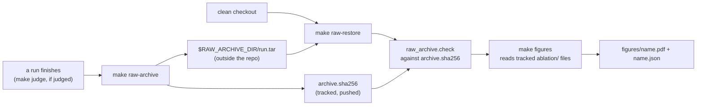

# Figure generators and the raw archive (item 5.4)

Status: opened 2026-11-12 · spec approved 2026-11-12 · design approved 2026-11-12 · plan approved 2026-11-12
Changed by §3: DCs 1–4 and 6 gain the checks for §3's silent failures; §2 names `experiments/requirements.txt` and
`make figures-clean-check`. The archive folder stays at its default, `~/thesis-raw-archive/` (spec approved unchanged).
Changed while writing the plan: §3 names the scripts' `--results-dir` and `--archive-dir` options, `raw_archive`'s use
of `yaml`, and `Figure()` in place of `pyplot`. No done condition changed.
Changed during the build (2026-11-12, plan Phase 9): `fontTools` was also built for x86_64 and is reinstalled at
4.61.0, not pinned; `raw_archive check` with no `--run-id` checks every run that has a manifest and fails when it
checks none. No done condition changed.
Super-plan item: 5.4 — Figure generators

## 1. Spec

**The change.** Build `make figures`, which draws every registered figure from each run's tracked files, but only
after checking that the run's `raw/` and `judge/` are present and unchanged. Also build the raw archive, which puts
those two gitignored folders back on a clean checkout (ADR-005 left this design to 5.4).

Two figures exist today, both on the cost run `2026-11-01T21-17-56_cfg4_judgecost` (corpus `v1` validation,
configuration 4, gate on, MIXED off, τ 0.85, citable: no):
- **F10** (`docs/0-Thesis-Report/plan/figures.md`): agreement of `judge-v1` with the author's labels, by containment
  bucket, with Wilson intervals. Source: `ablation/scores.json`, `judge_vs_author_by_bucket`.
- **F16** (new): the noise-floor correction. The corrected rate against the judged rate, with its interval and the
  δ line at 5 %. Source: `ablation/floor.json` and `noise_floor.corrected_rate`.

The Phase 6 and Phase 7 items add their figures to the same script.

Words used below:
- **Hash list:** a tracked file per run, `experiments/results/<run>/archive.sha256`. It has one line
  `<sha256>  <path>` per file under `raw/` and `judge/`. It holds paths and hashes only, no text.
- **Archive:** one file per run, `$RAW_ARCHIVE_DIR/<run_id>.tar`, holding the run's `raw/` and `judge/`.
  `RAW_ARCHIVE_DIR` is outside the repository (default `~/thesis-raw-archive/`) and is never pushed.
- **Clean copy:** the repository's tracked files plus its untracked, not-ignored files
  (`git ls-files --cached --others --exclude-standard`), copied into an empty temp folder. It has no `raw/`,
  `judge/` or `figures/`. A copy is used instead of `git clone` because this task's files are not committed until
  the author commits them.

**Done conditions**

1. **Archive.** `make raw-archive RUN_ID=<cost run>` writes the archive and the hash list. The hash list has one
   line per file under `raw/` and `judge/` (the same count as `find raw judge -type f`). Each `raw/answers/<sha>.txt`
   line's hash equals its file name, every non-null `answer_sha256` in `raw/requests.jsonl` has its file (519 of
   519), and `raw/requests.jsonl` has 622 lines, the manifest's `records.count`. Every file in the tar hashes to its
   line. A second `make raw-archive` for the same run refuses to overwrite either file and exits non-zero.
2. **Check.** `make raw-check RUN_ID=<cost run>` exits 0. In tests, on a temp copy of a run (never the real `raw/`),
   one changed byte, one deleted file and one added file each exit non-zero, and the message names the file.
   `raw-restore` refuses, and extracts nothing, when `raw/` or `judge/` already exists, or when a tar member is a
   link or lies outside `raw/` and `judge/` (tests).
3. **Figures.** `make figures` exits 0 in the working tree and writes F10 and F16 as PDFs under the cost run's
   `figures/`. It prints one line per figure and run: `built`, or `not applicable` with the missing input named. In
   tests: a registered figure that is built for no run makes it exit non-zero; a stale file left in `figures/` is
   gone after a run; a matplotlib version other than the pin in `experiments/requirements.txt` exits non-zero
   before anything is drawn.
4. **The values match the source.** Each figure writes the values it plots beside it, as `<name>.json`, with
   `citable` true only when the source says so. Tests check:
   - F10's `k`, `n`, rate and Wilson bounds per bucket equal `scores.json`'s; the four hit buckets' `n` sum to 79,
     the hit stratum's `n`; the summary bucket `below 1.0` is not plotted;
   - F16's points at judged 165/1000 and 134/1000 give 0.0501 [0, 0.3038] and 0 [0, 0.2307], M08's worked
     values, and its point at 0/1000 has `corrected: null`, never 0.
5. **Same bytes.** Running `make figures` twice gives the same sha256 for every file under `figures/`.
6. **Clean checkout plus archive (the Phase 5 exit).** `make figures-clean-check` exits 0. In a clean copy, it checks:
   - `make figures` first exits non-zero and names the missing `raw/`;
   - then `make raw-restore RUN_ID=<cost run>` and `make raw-check` exit 0;
   - then `make figures` exits 0, and every file under `figures/` has the same sha256 as in DC 5.
7. `make verify` exits 0 with no SKIPPED target. The new tests are under `experiments/tests/`. Under the test folders,
   `git status` shows only new files.
8. **Write-once intact.** The sha256 of every file under the cost run's `raw/`, `judge/`, `ablation/` and
   `manifest.yaml` is the same before and after the task.
9. **Docs.**
   - ADR-027 records the archive: where it lives, what it holds, the hash list and the restore. It has an
     `Invalidates:` line.
   - `interfaces.md` §I documents `archive.sha256` and `figures/`, at v0.35.
   - `architecture.md`, the evaluation pipeline doc (`docs/1-System Docs/Pipelines/Evaluation.md`) and `CLAUDE.md`
     no longer say the figure generators are not built.

**Out of scope**
- The figures of Phases 6 and 7 (F3–F9, F11, F13–F15). Their items add them.
- F1 is analytic, and F2 comes from the workload build, not a run. Neither is drawn here; both can join the list later.
- Rebuilding `scores.json` and `floor.json` on a clean copy. That also needs the reference set and the trail's private
  sheets, which are gitignored and not in this archive. The figures read the tracked files, and those files record
  `sheet_sha256` and `labels_sha256`.
- A private backup of `RAW_ARCHIVE_DIR` (the author keeps it; ADR-027 says where), and copying figures into the
  report's `latex/images/`.

## 2. Impact

**Files**
- New: `experiments/scripts/make_figures.py`, `experiments/scripts/raw_archive.py`,
  `experiments/scripts/figures_clean_check.sh`, `experiments/requirements.txt` (the matplotlib pin) and two test
  files in `experiments/tests/`, plus the cost run's tracked `archive.sha256`.
- Changed: the `Makefile` (`figures` gets a guard; new `raw-archive`, `raw-check`, `raw-restore` and
  `figures-clean-check`), `docs/decisions.md`, `docs/contracts/interfaces.md`, `docs/architecture.md`, the
  evaluation pipeline doc, `CLAUDE.md`, and `docs/super-plan.md` at close.
- Boundaries: all the code is in `experiments/scripts/`, as `architecture.md` places it. The scripts already import
  each other (`noise_floor` imports `label_ablation`). Nothing in `gateway/` or `rag/` changes.

**Frozen values touched: none.** δ, the correction and `z` 2.394 are read, never changed. **Prior runs invalidated:
none.** The cost run gets one new tracked file beside `raw/`. Its `raw/`, `judge/`, `ablation/` and `manifest.yaml`
stay as they are (DC 8).

One limit. The cost run's hash list is taken on 2026-11-12, eleven days after the run, so it proves `raw/` unchanged
from today, not since 2026-11-01. DC 1 checks what can be checked: the answer files are content-addressed, and the
request count equals the manifest's. Every later run is archived right after it finishes.

**Contract change: yes, additive.** §I adds `archive.sha256` and the `figures/` layout (`<name>.pdf` and
`<name>.json`), at v0.35. No wire, gRPC, Redis or record field changes. `source_chunk_ids`, `t1_key` and
`dataset_epoch` are untouched.

**Measurement change: none.** The figures draw numbers that are already recorded, and DC 4 checks they are the same
numbers. Both figures stay `citable: no`, as their source is.

**New dependency: matplotlib**, pinned to one version, because the same bytes (DC 5) depend on it. It uses about
100 MB of memory, and only while `make figures` runs, never during a measured run (the plan measures it). The
installed 3.10.8 is built for x86_64 and does not import on this arm64 machine. The plan reinstalls it for arm64 with
a `pip3` command that the author approves.

**Cut scope reinstated: no.**

**Phase exit.** If DC 6 passes, the last Phase 5 exit criterion is met, and `/done` closes Phase 5.

## 3. Design

**Approach.** Two small scripts. `raw_archive.py` owns the hash list, the tar and the restore. `make_figures.py` owns
a list of figures, and draws each one from a run's tracked files only after `raw_archive.check` passes for that run.
The alternative was a private second git repository (or git-lfs) for `raw/`. It lost because it is one more repository
to keep in step, and a tracked hash list gives the same proof that `raw/` is unchanged without one.

### Files

**`experiments/scripts/raw_archive.py`** (stdlib, and `yaml` to read `records.count`, as `run_manifest` does)
- `HASH_LIST = "archive.sha256"`, `FOLDERS = ("raw", "judge")`, `IGNORED = (".DS_Store",)`.
- `hash_tree(run_dir: Path) -> list[tuple[str, str]]`: `(path, sha256)` for every file under the `FOLDERS` that
  exist, sorted by path, paths relative to `run_dir` in POSIX form. It skips `IGNORED` names. A symlink, or a path
  with a newline, raises `ArchiveRefused`.
- `format_list(rows) -> str`: one `<sha256>  <path>` line per row, the `shasum -a 256` format, so
  `shasum -a 256 -c archive.sha256` run in the run folder is an independent second check.
- `read_list(run_dir: Path) -> dict[str, str]`: path → sha256. A malformed line raises.
- `check(run_dir: Path) -> list[str]`: problems, each naming a path: `no hash list`, `no raw/`,
  `missing: <path>`, `changed: <path>`, `added: <path>`. An empty list means the run is intact.
- `cross_check(run_dir: Path) -> list[str]`: DC 1's checks before anything is written. Every `raw/answers/<x>.txt`
  hashes to `x`; every non-null `answer_sha256` in `raw/requests.jsonl` has its file; the line count of
  `raw/requests.jsonl` equals `records.count` in `manifest.yaml`.
- `archive(run_dir: Path, archive_dir: Path) -> None`, in this order:
  1. refuse if `manifest.yaml` or `raw/` is missing, or if `archive.sha256` or the tar already exists;
  2. refuse if `cross_check` returns anything;
  3. write the tar to `<run_id>.tar.partial` (files only, paths relative to the run folder), then rename it;
  4. read the tar back and compare every member's sha256 with `hash_tree`; a mismatch raises and leaves the tar
     for inspection;
  5. write `archive.sha256` last, through a temp file and a rename.
- `restore(run_dir: Path, archive_dir: Path) -> None`: refuse if `archive.sha256` or the tar is missing, or if `raw/`
  or `judge/` exists. Before extracting anything, refuse if any member is not a regular file under `raw/` or `judge/`
  (a link, a device, an absolute path, `..`). Then `extractall(filter="data")`, then `check`.
- `main(argv) -> int`: subcommands `archive`, `check`, `restore`, each with `--run-id`. `check` without it checks every
  run that has `manifest.yaml`, so a run with no hash list is reported as `no hash list`; checking no run at all exits
  1 (a check that checks nothing must not pass). Options `--results-dir` (default: `$RESULTS_DIR`, else `experiments/results`, as
  `run_manifest`) and `--archive-dir` (default: `$RAW_ARCHIVE_DIR`, else `~/thesis-raw-archive`). Exit 0 on
  success, 1 when `check` finds a problem, 2 on a refusal or bad usage.

**`experiments/scripts/make_figures.py`**
- `PIN_FILE = experiments/requirements.txt`; `pinned_version() -> str` reads its `matplotlib==X` line.
- `FigureSpec` (frozen dataclass): `name: str`, `inputs: tuple[str, ...]` (paths relative to the run folder),
  `values: Callable[[Path], dict]`, `draw: Callable[[dict], matplotlib.figure.Figure]`.
- `FIGURES = (F10, F16)`, the registry. A later item adds its figures here.
- `f10_values(scores: dict) -> dict` (pure): the four buckets of `label_ablation.HIT_BUCKETS`, in that order, then
  the MISS stratum's `generated` bucket as a separate group. Each point carries `k`, `n`, `rate`, `wilson95` and
  `kappa`, copied from `scores.json`, never recomputed. It raises when the four hit buckets' `n` do not sum to the
  hit stratum's `judge_vs_author.n`. `below 1.0` is a sum of three plotted buckets, so it is left out.
- `f16_values(floor: dict, n: int = 1000) -> dict` (pure): for `k` from 0 to 400, the result of
  `noise_floor.corrected_rate(k, n, floor["hits"])`, plus `delta: 0.05` and the floor's `false_alarm` rate. `n` 1000
  is M08's worked size; the figure says it is illustrative.
- `draw_f10(values)`: bars of the judge-to-author agreement per bucket with Wilson error bars and `n` above each bar;
  hit buckets in Tier 2 blue `#0072B2`, the MISS group in orange `#E69F00`.
- `draw_f16(values)`: the corrected rate against the judged rate as a line, its interval as a shaded band, the
  identity line dashed (a judge with no error), δ = 5 % as a horizontal line, and the noise floor (13.5 %) as a dotted
  vertical line. A point with `corrected: null` is a gap in the line, never a 0.
- `style()`: backend `pdf`; `font.family` "DejaVu Sans", the font bundled with matplotlib (figures.md §0.2 asks for
  Helvetica, a system font, which could change the bytes when the system changes); `pdf.fonttype` 3; Okabe-Ito colours.
- `save(fig, values, out_dir, name)`: writes `<name>.pdf` with `metadata={"CreationDate": None}`, and `<name>.json`
  with `sort_keys`, indent 2 and a final newline. Both go through a temp file and a rename. Neither holds a
  timestamp.
- `<name>.json`: `figure`, `run_id`, `citable` (true only when the source's `citable` is `true`; `scores.json` has no
  such field, so F10 is false), `source` (`path` and `sha256` of each input), and `values`.
- Each PDF carries a footer: `run <run_id> · citable: no` (or `yes`).
- `list_runs(results_dir: Path) -> list[Path]`: folders holding `manifest.yaml`, sorted. Any other folder is printed
  as `skipped: no manifest.yaml` (`interfaces.md` §I: such a run is invalid).
- Figures are built with `matplotlib.figure.Figure()`, never `pyplot`, so no global state carries from one figure to
  the next.
- `main(argv) -> int`, with `--results-dir` (default as `raw_archive`), in this order:
  1. the matplotlib version must equal `pinned_version()`, else exit 2 before drawing;
  2. `raw_archive.check` on every run; any problem prints each one, with the hint `make raw-restore RUN_ID=<id>`
     when `raw/` is missing, and exits 1 with nothing drawn;
  3. empty each run's `figures/` (it only ever holds regenerated files);
  4. for each figure and run: if every input exists, draw and print `built`; else print `not applicable: <input>`;
  5. exit 1 if a registered figure was built for no run.

**`experiments/scripts/figures_clean_check.sh`** (DC 6)
1. Run `make figures` in the working tree, and record the sha256 of every file under each run's `figures/`.
2. Copy each file listed by `git ls-files -z --cached --others --exclude-standard` that exists into a new
   `mktemp -d` folder, removed on exit. Fail if the copy holds any `experiments/results/*/raw/`.
3. In the copy, with `RESULTS_DIR` unset: `make figures` must exit non-zero, and its output must contain `raw/`.
4. For each run with an `archive.sha256`: `make raw-restore RUN_ID=<id>`, then `make raw-check`; both must exit 0.
5. `make figures` must exit 0, and the sha256 of every figure file must equal step 1's. Print `IDENTICAL <n> files`,
   or each differing file, then exit 1.

**`experiments/requirements.txt`**: `matplotlib==3.10.8`, with a comment that the pin keeps the figure bytes fixed.
3.10.8 is the version already installed, so nothing else changes version. Only matplotlib is pinned: its own
dependencies do not draw. `fontTools` must import (the PDF backend imports it), but with `pdf.fonttype` 3 the glyph
outlines come from matplotlib's own FreeType code (`backend_pdf._get_pdf_charprocs`); fontTools only subsets Type 42
fonts. So its version cannot change the bytes, and it is not pinned (read in matplotlib 3.10.8's source, 2026-11-12).

**`Makefile`**
- `RAW_ARCHIVE_DIR ?= $(HOME)/thesis-raw-archive`.
- `figures`: `PYTHONHASHSEED=0 $(PY) experiments/scripts/make_figures.py`. The fixed seed removes one possible
  source of byte changes between processes.
- `raw-archive` and `raw-restore` need `RUN_ID`; `raw-check` takes it as an option; `figures-clean-check` runs the
  script. All four go into `.PHONY`.

**Docs** (the last implementation phase):
- ADR-027 records the archive: one tar per run outside the repository, its default folder, the hash list as the
  tracked proof, archiving right after a run's last write-once step (`make judge` when the run is judged), and that
  the author keeps a private backup of `RAW_ARCHIVE_DIR`, never on the public remote. `Invalidates: none.` It also
  records the one limit from §2: the cost run was archived eleven days after it ran.
- `interfaces.md` §I gets "The raw archive and figures (item 5.4, v0.35)": the hash list's format, the tar's layout,
  and `figures/<name>.pdf` and `<name>.json` with their fields. Status line, "Current version" and the versioning
  table go to v0.35.
- `architecture.md`: the `NOT BUILT` line, the "not yet runnable" row and the "not built" row; the results tree gains
  `archive.sha256`. `Evaluation.md` §3's row for `make figures`. `CLAUDE.md`'s "Not built yet" line. Each edit only
  changes the stale words.

### Failure modes, silent ones first

1. **A plotted number is not the recorded one.** Symptom: a plausible bar, for example the summary `below 1.0`
   drawn beside its own parts, or a MISS rate drawn as a hit bucket. Guard: values are copied, never recomputed,
   the `n` sum is checked, and DC 4 compares them with `scores.json` and M08.
2. **A figure is drawn for a run whose `raw/` changed or is lost.** Symptom: none, the figure looks normal. Guard:
   `check` before any drawing (DC 2, DC 6).
3. **A stale figure.** A figure dropped from the registry, or a run whose input was deleted, leaves an old PDF that
   looks current. Guard: `figures/` is emptied first (DC 3).
4. **The bytes change between runs** (a timestamp, the hash seed, a system font, another matplotlib). Symptom: none
   until someone compares. Guards: no timestamp, a fixed seed, the bundled font, the version pin (DC 3, DC 5, DC 6).
5. **The hash list blesses a run that already lost files.** Symptom: `check` passes on a broken run. Guard:
   `cross_check` before the list is written (DC 1).
6. **A truncated tar.** Symptom: a restore that looks complete. Guard: the tar is read back after writing (DC 1), and
   `check` runs after every restore (DC 6).
7. **An inconsistent F16 point drawn as 0.** Symptom: the curve shows a false-hit rate of 0 below the floor. Guard:
   `null` stays a gap (DC 4).
8. **DC 6 passes without testing anything,** because the copy already held `raw/`. Guard: the script fails if the copy
   holds a `raw/` before the restore, and the first `make figures` must fail (DC 6).

Loud failures: a restore over an existing `raw/` or a tar with a bad member (refused, DC 2); a second archive
(refused, DC 1); a run judged after it was archived (`check` names the new `judge/` files as `added`, and the author
re-archives by hand, as ADR-027 says).

### Edge cases

- A run that is never judged has no `judge/`. Its hash list covers `raw/` only.
- Empty folders are not archived. The restore creates folders from file paths.
- `.DS_Store` is the only ignored name. Any other extra file is `added`.
- `experiments/results/.gitkeep` and any folder without `manifest.yaml` are not runs.
- With one run today, both figures are built once. Later runs that have no `ablation/` print `not applicable`.

### Unknowns

- matplotlib's PDF bytes are stable across processes once `CreationDate` is removed and the seed is fixed. This is
  reasoned, not measured. DC 5 and DC 6 settle it.
- Reinstalling matplotlib 3.10.8, kiwisolver 1.4.9, contourpy 1.3.3 and fonttools 4.61.0 for arm64 breaks nothing.
  No other script imports them (checked with grep). `make verify` settles it.
- matplotlib's memory, about 100 MB. The plan measures it with `/usr/bin/time -l make figures` (maximum resident size).
- The import chain `noise_floor` → `label_ablation` → `judge` reads no gitignored file at import time. DC 6 settles it.

### Verification

- **DC 1:** run `make raw-archive` on the cost run; check the line count against `find`; the tests cover
  `cross_check` and the refusals.
- **DC 2:** run `make raw-check`; tests on temp copies cover every change, deletion, addition and bad tar member.
- **DC 3:** run `make figures` and read its lines; tests cover the zero-built exit, a stale file and the version guard.
- **DC 4:** tests read the tracked `scores.json` and `floor.json` and compare them with `f10_values` and `f16_values`.
- **DC 5:** run `make figures` twice and compare the `shasum` lists.
- **DC 6:** `make figures-clean-check`.
- **DC 7:** `make verify`, and `git status` on the test folders.
- **DC 8:** hashes before the first step and after the last step, then `diff`.
- **DC 9:** `grep` for each heading and version.
